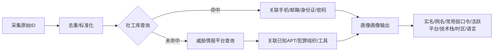
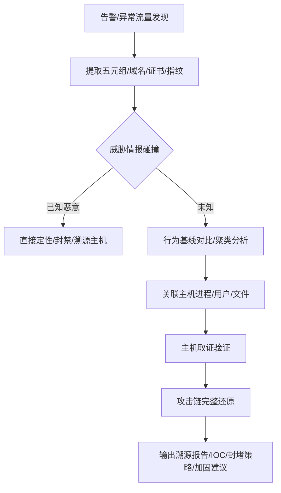

## 概述

攻击溯源是渗透测试复盘与应急响应处置的核心环节，旨在通过技术手段还原攻击路径、定位攻击源头、刻画攻击者画像。本页面系统整合微信归档文章《初探 | 渗透测试中的溯源手法》核心框架，结合知识库现有实战页面，构建覆盖 **IP归属分析、钓鱼邮件反查、VPS渗透溯源、攻击者ID画像、恶意样本分析、主机入侵取证、网络流量回溯** 七大技术模块的完整知识体系，并新增 **反溯源对抗与伪旗行动** 专题，剖析攻击者如何通过伪造痕迹误导归因分析。本次更新新增 **伪基站短信钓鱼结合APK逆向溯源** 实战案例，展示从恶意短信投递、钓鱼页面分析、APK逆向提取邮箱凭证、邮箱登录取证、受害人电话溯源预警到犯罪窝点地理定位的完整闭环溯源流程。

> **交叉引用**：本页面与 [[xd-security-incident-response-notes]]（应急响应标准流程与工具箱）、[[internal-network-pivoting-techniques]]（内网穿透与横向移动技术）、[[xd-security-internal-network-penetration-notes-day71-72]]（隧道技术与Web攻击溯源实战）、[[social-engineering-attack-techniques]]（社会工程学攻击技术全谱系，含伪基站钓鱼）、[[android-shelling-unshelling-techniques]]（Android加固脱壳技术，含APK逆向基础）形成上下游衔接，建议配合阅读。

---

## 一、IP定位与归属分析

### IP资产分类识别

溯源首步需判断IP性质，不同类型IP的溯源策略差异显著：

| IP类型 | 特征 | 溯源策略 |
|--------|------|----------|
| **IDC机房IP** | 云厂商/托管商网段，Whois信息为企业 | 通过云厂商工单、备案信息、历史解析记录追踪租用账号 |
| **CDN/代理出口IP** | 归属CDN厂商，前端隐藏真实源站 | 结合历史DNS记录、SSL证书透明度日志、实战渗透绕过CDN定位源站 |
| **住宅/运营商动态IP** | 家庭宽带、移动网络，用户量大 | 配合运营商协查、时间窗口关联、指纹特征聚类 |
| **Tor/VPN/代理出口节点** | 公开节点列表可查，匿名性强 | 节点日志获取难度大，侧重关联分析而非直接定位 |

### 核心查询工具与数据源

- **在线IP情报平台**：
  - [OpenGPS IP查询](https://www.opengps.cn/Data/IP/IPSearch.aspx) —— 地理位置、ASN、历史关联域名
  - [站长之家Whois](http://whois.chinaz.com/) —— 域名注册信息、历史备案、反查同IP站点
  - **微步在线**、**奇安信威胁情报**、**VT**、**IPinfo**、**Shodan**、**FOFA**、**Censys** —— 威胁标签、端口服务、历史漏洞扫描记录

- **命令行/脚本化批量查询**：
  ```bash
  # 批量IP归属地与ASN查询示例
  for ip in $(cat iplist.txt); do
    curl -s "http://ip-api.com/json/$ip?fields=status,message,country,regionName,city,isp,org,as,query"
  done
  ```

### IP反查域名与关联资产扩展

- **反向DNS/PTR记录**：`dig -x <IP>`、`nslookup <IP>`
- **同IP绑定站点**：FOFA/ZoomEye/Censys `ip:"<IP>"`、站长之家「同IP网站」
- **SSL证书关联**：`crt.sh` 搜索 IP 或域名，提取 Subject Alternative Names (SAN) 扩展资产
- **历史解析记录**：SecurityTrails、ViewDNS、DNSDB —— 还原域名历史指向，发现废弃/测试子域名

> **实战提示**：若反查域名数量异常庞大（>50），极大概率为 CDN 或共享主机，需结合 `Host` 头探测、HTTP 响应特征指纹、TLS SNI 回显等手段剥离 CDN 定位真实源站。相关技术见 [[ssrf-bypass-techniques]]「绕过CDN定位源站」章节。

---

## 二、钓鱼邮件反查与溯源

### 邮件原始头分析

获取 `.eml` 原始邮件，重点解析字段：

| 字段 | 溯源价值 |
|------|----------|
| `Received` 链 | 追踪邮件传递路径，最后一条为发件人真实出口 MTA IP |
| `X-Originating-IP` / `X-Client-IP` | 部分厂商记录发件人客户端真实 IP |
| `Message-ID` | 全局唯一标识，关联同批次钓鱼活动 |
| `Return-Path` / `Reply-To` | 退信/回复地址，常与发件域名不一致 |
| `DKIM-Signature` / `SPF` / `DMARC` 结果 | 判断伪造程度，`fail` 强指示伪造 |

### 附件与链接威胁情报碰撞

1. **附件静态提取**：
   - 计算 MD5/SHA256 → 上传 [[xd-security-incident-response-notes]] 推荐的沙箱（奇安信、微步、VT、Hybrid Analysis、ANY.RUN）
   - 提取嵌入 IOC：C2 域名/IP、释放文件路径、注册表键值、互斥体、PDB 路径、编译时间戳

2. **恶意链接动态访问**：
   - 沙箱/无头浏览器访问 → 记录重定向链、最终落地页、下载载荷哈希
   - URL 扫描：URLhaus、PhishTank、Google Safe Browsing、微步在线 URL 查询

### 发件基础设施反查

- **发件域名/子域名枚举**：Whois 历史、被动 DNS、证书透明度日志
- **发件服务器指纹**：`Received` 头中 MTA 主机名、软件版本（Postfix/Exim/Exchange 等）→ Shodan/Censys 搜索同版本暴露面
- **发件 IP 关联**：结合 1.3 手段扩展同套基础设施

> **关联页面**：[[phishing-website-creation-tutorial]] 记录钓鱼站点搭建实战，反向理解攻击者视角；[[xd-security-pentest-basic-stage-notes]] 含社工钓鱼邮件构造与发送技巧。

---

## 三、VPS渗透溯源与基础设施画像

### Web资产指纹与身份关联

| 发现线索 | 溯源方向 |
|----------|----------|
| 个人博客/技术文章/备案信息 | 直接关联真实身份（姓名、联系方式、备案主体） |
| GitHub/GitLab/代码托管平台 | 提交记录邮箱、SSH 公钥、CI/CD 配置中的敏感信息 |
| 技术论坛/社交媒体账号 | 同名账号、历史发言、关注列表、元数据（EXIF、发帖设备） |
| SSH Banner / TLS 证书 / favicon hash | Shodan/Censys/FOFA 指纹搜索同款资产聚类 |

### 漏洞挖掘与权限获取（仅限授权测试/取证）

- **Web应用漏洞**：SQL注入、文件上传、RCE、SSRF、反序列化 → 获取 WebShell/系统 Shell
- **服务配置弱点**：未授权访问、弱口令、敏感文件泄露、端口服务已知漏洞
- **供应链/依赖组件**：CMS插件、第三方库、容器镜像漏洞

> ⚠️ **法律风险警示**：未经授权渗透攻击者 VPS 属违法行为。实战中仅限 **授权渗透测试**、**取证保全**、**蜜罐主动防御** 场景。蜜罐部署参考 [[xd-security-blue-team-defense]]「HFish蜜罐平台部署与攻击者溯源实战」。

### 蜜罐与诱捕视角

- 部署高交互蜜罐（Cowrie、Dionaea、Conpot、HFish）捕获攻击者工具、凭证、C2地址
- 记录攻击者操作全过程（TTY日志、PCAP、文件下载），提取 TTPs 映射 ATT&CK
- 关联页面：[[xd-security-blue-team-defense]]、[[xd-security-awd-competition-strategies]]「蜜罐技术」

---

## 四、攻击者ID画像与社工库碰撞

### ID采集来源

1. **安全设备日志**：WAF/防火墙/蜜罐记录的 `User-Agent`、Cookie、Header、POST 数据中的账号/邮箱/手机号
2. **业务系统日志**：登录/注册/下单/评论接口捕获的攻击者账号体系
3. **WebShell/后门交互**：蚁剑/哥斯拉/冰蝎流量中的会话标识、自定义 Header
4. **恶意样本元数据**：PDB路径用户名、编译主机名、作者字符串、嵌入的联系方式
5. **公开情报（OSINT）**：GitHub提交邮箱、技术博客留联、社交平台ID、域名Whois邮箱

### 社工库/威胁情报库碰撞流程



- **社工库来源**：历史泄露库（SReg、SGK、DeHashed、Have I Been Pwned）、内部积累、商业威胁情报平台
- **威胁情报平台**：微步在线、奇安信 TI、安恒、VT Enterprise、AlienVault OTX、MISP 实例

### 画像维度与输出

| 维度 | 示例字段 |
|------|----------|
| **实体身份** | 真实姓名、身份证号、手机号、邮箱、常住地 |
| **网络身份** | 常用 ID、昵称、头像哈希、公钥指纹、钱包地址 |
| **行为特征** | 活跃时区、语言习惯、技术栈偏好、常用工具集、TTPs 模式 |
| **基础设施** | 常用 VPS 厂商、域名注册商、CDN、C2 域名命名规律 |
| **关联组织** | 团队/组织名称、成员关系图、分工协作模式 |

> **支付宝/微信转账验证真实姓名**：仅限司法程序或平台合规接口，非授权场景严禁使用。

---

## 五、恶意样本沙箱分析与流量溯源

### 静态/动态沙箱平台矩阵

| 平台 | 特色 | 适用场景 |
|------|------|----------|
| **奇安信威胁情报 / 微步在线** | 国内样本覆盖全、关联情报丰富 | 首选国内 APT/犯罪样本研判 |
| **VirusTotal / Hybrid Analysis / ANY.RUN / Joe Sandbox** | 多引擎检测、交互式动态分析、MITRE ATT&CK 映射 | 国际样本、深度行为分析 |
| **卡巴斯基 / 安恒 / 火眼 / 腾讯哈勃** | 专业厂商沙箱、定制化规则 | 企业级应急响应 |
| **自建 Cuckoo / CAPE / DRAKVUF** | 完全可控、支持反反虚拟机、内核级监控 | 敏感样本、定制化分析 |

### 样本分析关键提取清单

- **网络 IOC**：C2 域名/IP/端口、通信协议（HTTP/DNS/TCP/UDP/ICMP/WebSocket）、加密算法、心跳间隔、Domain Generation Algorithm (DGA) 种子
- **主机 IOC**：文件释放路径/哈希、注册表键值、计划任务/服务/启动项、互斥体、管道名、驱动加载、ETW 绕过痕迹
- **对抗技术**：反虚拟机/沙箱/调试、进程注入/空洞化/DLL侧载、syscall 直接调用、天使进程、AMSI/ETW 绕过
- **归属线索**：PDB 路径、编译时间戳、资源段字符串、代码签名证书、语言区域设置、加壳器特征

> **关联页面**：
> - [[phantom-dll-hollowing-technique]] 幽灵DLL空洞化技术分析
> - [[dotnet-clr-usage-log-tampering-edr-evasion]] .NET CLR日志篡改对抗
> - [[cobalt-strike-external-c2-smb-beacon]] Cobalt Strike SMB Beacon 流量特征
> - [[c2-redirectors-malleable-c2-profiles]] C2重定向器与Malleable Profile流量混淆
> - [[android-shelling-unshelling-techniques]] Android加固脱壳技术四代演进与主流脱壳工具链（dexdump、frida-dexdump、DumpDex、FDex2），适用于APK深度逆向分析

### 恶意流量回溯与C2基础设施聚类

1. **PCAP/流量日志分析**：
   - 提取 TLS SNI、JA3/JA3S 指纹、HTTP Host/User-Agent/URI 模式
   - 关联 Zeek/Suricata 告警、威胁情报 IP/域名库

2. **C2基础设施聚类指标**：
   - 同一 SSL 证书（指纹/Subject/Issuer/序列号）
   - 同一 Whois 注册信息（邮箱/电话/名称/NS服务器）
   - 同一 IP 段/ASN/托管商
   - 同一 Malleable Profile 特征（HTTP 头顺序、Cookie 名称、URI 结构）
   - 同一 DGA 算法/种子/Top-Level Domain

3. **外部情报关联**：
   - VT/URLhaus/微步/奇安信「关联样本/关联IP/关联域名」图谱
   - PassiveTotal/DNSDB 被动 DNS 历史解析
   - SSL 证书透明度日志（crt.sh、Censys）

---

## 六、Windows/Linux主机入侵痕迹取证

### Windows 主机核心取证点

| 取证对象 | 工具/命令 | 关键指标 |
|----------|-----------|----------|
| **用户登录日志** | `eventvwr.msc` (Security 4624/4625/4672)、`LastActivityView`、`LogonTracer` | 登录类型(3/10/2)、来源IP、SID、登录时间 |
| **进程/服务/计划任务** | `tasklist /v`、`wmic process`、`Get-ScheduledTask`、`autoruns.exe`、`Process Hacker` | 无签名/异常路径/高权限/父子关系异常 |
| **注册表持久化** | `reg query` 遍历 `Run`/`RunOnce`/`Winlogon`/`Image File Execution Options`/`Services` | 可疑值、指向临时目录/下载目录 |
| **文件系统时间线** | `MFTECmd.exe`、`Timeline Explorer`、`dir /t:c /t:a /t:w` | 时间戳篡改、AD$ 数据流、近期创建/修改可执行文件 |
| **内存取证** | `Volatility3`、`WinPMEM`、`DumpIt` | 注入进程、隐藏模块、内存马、加密凭证 |
| **网络连接** | `netstat -ano`、`Get-NetTCPConnection`、`TCPView` | 非标准端口、ESTABLISHED 远程 IP、进程 PID 关联 |
| **PowerShell/脚本日志** | Event ID 4103/4104/400 (Operational)、`Get-WinEvent` | 编码命令、下载执行、AMSI 绕过 |

> **自动化应急工具箱**：[[xd-security-incident-response-notes]] 推荐 `ir-rescue`、`GScan`、`LogonTracer`、`CrossC2` 等。

### Linux 主机核心取证点

| 取证对象 | 命令/工具 | 关键指标 |
|----------|-----------|----------|
| **登录审计** | `last`、`lastb`、`lastlog`、`utmpdump /var/log/wtmp`、`ausearch -m USER_LOGIN` | 异地/异时登录、失败爆破、隐藏账号 |
| **历史命令** | `history`、`.bash_history`、`.zsh_history`、`.mysql_history`、`.viminfo`、`/root/.local/share/recently-used.xbel` | 删库/下载/反弹/提权/清理痕迹命令 |
| **进程/网络** | `ps auxf`、`lsof -i`、`ss -antp`、`netstat -antp`、`pstree` | 伪装进程名、无二进制路径、反弹 Shell 连接 |
| **定时任务/服务** | `crontab -l`、`systemctl list-unit-files`、`ls /etc/cron*`、`/etc/init.d/`、`/etc/systemd/system/` | 反弹 Shell、下载执行、权限提升 |
| **SSH 相关** | `~/.ssh/authorized_keys`、`/etc/ssh/sshd_config`、`/var/log/auth.log` | 新增公钥、PermitRootLogin、暴力破解 IP |
| **文件完整性** | `rpm -Va` / `dpkg -V`、`aide`、`tripwire`、`find / -mtime -7 -type f -perm /4000` | 系统二进制篡改、新增 SUID、WebShell |
| **内核/模块** | `lsmod`、`dmesg`、`/proc/modules`、`/dev/kmem` 检查 | Rootkit、隐藏模块、系统调用劫持 |

> **实战靶机复现**：[[vulnhub-platform-resource-index]] 汇总 750+ 靶机，[[vulnhub-doubletrouble-writeup]]、[[vulnhub-darkhole2-writeup]]、[[vulnhub-hard-socnet2-writeup]] 等含完整入侵排查流程。

### 通用取证方法论

1. **时间线构建**：`log2timeline`/`Plaso` 跨源融合（文件系统/注册表/事件日志/浏览器历史/邮件/聊天记录）
2. **最小权限原则**：只读挂载、镜像取证、哈希固证（SHA256）
3. **ATT&CK 映射**：每个发现映射至 Tactic/Technique，生成攻击路径图
4. **关联分析**：主机 IOC 与网络流量/威胁情报/邮件/样本双向印证

---

## 七、网络流量回溯与全流量分析

### 流量数据源获取

| 数据源 | 部署位置 | 保留周期 | 适用场景 |
|--------|----------|----------|----------|
| **边界防火墙/网闸日志** | 互联网出口 | 3-6个月 | 外联 C2、数据外泄、扫描溯源 |
| **核心交换机镜像/NetFlow** | 核心汇聚层 | 实时/短期 | 内网横向移动、异常流量基线 |
| **全流量包捕获** | 关键段/服务器区 | 7-30天 | 深度协议分析、载荷还原、0day溯源 |
| **主机网络审计** | EDR/Agent/SystemTap/eBPF | 持续 | 进程-网络绑定、加密流量解密、容器网络 |

### 协议层面溯源技术

- **DNS 隧道/C2**：高熵值子域名、TXT/NULL/A记录异常、长查询/响应、NXDOMAIN 泛滥 → [[xd-security-internal-network-penetration-notes-day71-72]]「DNS隧道配合Cobalt Strike上线」
- **HTTP/S 异常**：非标准端口、异常 Host/User-Agent/URI、长连接心跳、Chunked 传输隐蔽通道、证书自签名/过期/不匹配
- **SMB/命名管道横向**：`Event ID 5145/5140`、管道名模式（`\\.\pipe\msagent_*`、`\\.\pipe\postex_*`）、IPC$ 会话 → [[named-pipe-smb-detection-sysmon]]、[[smb-named-pipe-c2-communication]]、[[cobalt-strike-external-c2-smb-beacon]]
- **RDP/SSH/VPN 暴力破解/凭证复用**：失败登录聚类、成功后异常进程启动、端口转发隧道建立
- **ICMP/DNS/HTTP 隧道工具特征**：`ptunnel`、`iodine`、`dnscat2`、`reGeorg`、`Tunna`、`ABPTTS`、`Chisel`、`ligolo-ng` → [[internal-network-pivoting-techniques]]「ICMP隧道、DNS隧道、HTTP隧道」

### 流量分析工具链

| 场景 | 推荐工具 |
|------|----------|
| **快速协议统计/会话还原** | `Zeek` (Bro)、`Argus`、`nfstream`、`Tshark` `-z conv,ip/tcp/udp` |
| **深度包检测/载荷提取** | `Wireshark` (Lua脚本)、`NetworkMiner`、`CapAnalysis`、`PCAPFix` |
| **威胁狩猎/规则匹配** | `Suricata` + ET Pro/ET Open/自定义规则、Sigma 网络规则、YARA-Network |
| **加密流量分析 (ETA/JA3)** | `JA3/JA3S` 指纹库、`TLSH`、`Mercury`、`Zeek SSL.log` 分析 |
| **大规模历史回溯** | `Elastic Stack` (Filebeat/Logstash + Elasticsearch + Kibana)、`ClickHouse` + `Grafana`、Apache Doris、Loki |

### 溯源实战模型：从告警到攻击链还原



---

## 八、反溯源对抗与伪旗行动

### 核心概念

**反溯源对抗** 是攻击者为阻碍防御方归因分析，主动实施的痕迹伪造、误导归因、基础设施匿名化等对抗手段。其高级形态为 **伪旗行动** —— 故意留下指向第三方（通常为他国APT组织）的虚假证据，将攻击责任嫁祸于他人。

> **典型案例**：**CIA Vault 7 泄露文件** 披露的 **"Umbrage" 组件库** 与 **"Marble" 框架**，证实美国中情局具备系统性模仿他国黑客攻击痕迹的能力。

### CIA Vault 7 披露的反溯源技术细节

| 组件/框架 | 功能描述 | 对抗溯源维度 |
|-----------|----------|--------------|
| **Umbrage** | 收集、分类、维护来自其他恶意软件（如俄罗斯、中国、伊朗、朝鲜等 APT 组织）的攻击技术、代码片段、加密算法、混淆手法 | **TTPs 模仿**：复用真实攻击者的代码风格、加密方式、C2 通信协议、持久化机制 |
| **Marble** | 字符串混淆/反混淆框架，支持在恶意代码中嵌入多语言（中文、俄文、阿拉伯文、波斯文、韩文）诱饵字符串，编译时混淆、运行时解密 | **归属诱饵**：伪造 PDB 路径、编译时间戳、语言区域设置、作者字符串、错误信息，误导静态分析与威胁情报归因 |
| **Hive** | 可扩展的恶意软件加载器/插件框架，支持模块化部署 | **基础设施解耦**：将核心功能与归属特征分离，便于快速替换伪装模块 |

#### Marble 框架技术原理示意

```c
// 伪装成中文开发者的混淆字符串示例
char *obfuscated = MARBLE_OBFUSCATE("C:\\Users\\ZhangWei\\Projects\\Malware\\Release\\payload.pdb", "zh-CN");
// 编译后二进制中不存在明文字符串，运行时解密还原
// 反编译器/字符串提取工具将看到乱码或诱饵中文字符
```

> **归档来源**：微信公众号文章《请问，黑客技术哪国强？》引用维基解密披露的 CIA Vault 7 文件，确认 CIA 拥有「模仿其他黑客的能力，可以留下假装是其他国家黑客的电子痕迹」。

### 常见反溯源对抗战术矩阵 (基于 MITRE ATT&CK Defense Evasion 扩展)

| 战术目标 | 具体技术 | 溯源失效点 | 检测/对抗建议 |
|----------|----------|------------|---------------|
| **伪造归属指纹** | 篡改 PDB 路径、编译时间戳、语言区域、代码签名证书、嵌入诱饵字符串 | 静态样本分析、威胁情报自动归因 | 多维度交叉验证：行为特征 > 静态字符串；关联基础设施而非单点样本 |
| **模仿 TTPs** | 复用公开/泄露的 APT 组织工具链（如 Carbanak、APT28、Lazarus 代码）、采用相同 C2 协议/加密/域名命名规范 | ATT&CK 技术画像匹配、YARA 规则命中 | 关注 **实施细节差异**（如时间戳规律、OpSec 失误、基础设施关联图谱），而非单一技术指标 |
| **基础设施匿名化/跳板链** | 多层代理/Tor/VPN/僵尸网络、域名前置、CDN 隐匿、快速更换 C2 IP/域名、使用合法云服务 | IP 归属分析、C2 基础设施聚类 | 流量关联分析（JA3/JA3S、TLS 指纹、心跳间隔）、被动 DNS 历史关联、SSL 证书透明度日志追踪 |
| **日志篡改/清除** | 清除 Windows Event Log / Linux auditd / wtmp、篡改时间戳、禁用审计策略 | 主机入侵取证、时间线构建 | 远程日志转发、WORM 存储、Sysmon/ETW/ auditd 不可篡改配置、内存取证恢复 |
| **反取证工具集成** | 使用 TimerStopper、TimeStomp、SlackSpace 隐藏、ADS 备用数据流、安全删除工具 | 文件系统时间线、磁盘取证 | 易失性数据优先采集（内存、网络连接、进程列表）、FIM 实时监控关键目录 |

### 伪旗行动研判指标

当溯源指向「过于完美」「高度吻合某知名 APT 组织公开画像」时，需警惕伪旗可能，重点核查：

1. **OpSec 失误不一致**：真实 APT 组织的历史 OpSec 失误模式（如特定时区活跃、特定节假日停工、特定语言拼写错误）是否被完美复现
2. **基础设施关联断层**：C2 服务器、域名注册信息、SSL 证书、托管商是否与该 APT 历史基础设施存在实质关联（而非仅技术相似）
3. **目标选择动机悖论**：攻击目标是否符合该 APT 组织已知战略意图（地缘政治、经济间谍、破坏行动等）
4. **代码复用深度**：是否仅复用了表层特征（字符串、加密常量），而核心逻辑、架构设计、开发习惯（如错误处理、日志风格、配置管理）与该 APT 历史样本家族不符
5. **情报机构「能力披露」背景**：参考 Vault 7、Shadow Brokers 等泄露文件，确认是否存在现成的「伪装工具包」可被第三方利用

> **分析师提示**：归因结论应采用 **置信度分级**（高/中/低）而非二元判定，并在报告中明确标注「可能存在伪旗干扰」的证据链。

---

## 九、实战案例复盘：伪基站短信钓鱼全链路溯源

> **来源**：微信公众号「301在路上」文章《白帽黑客：别TMD再给我发短信了！！！》（作者：SSS安全论坛创始人 许柯/95zz）
> **关联分类**：[[social-engineering-attack-techniques]] 社会工程学攻击技术全谱系（第9类：伪基站钓鱼站结合短信拦截木马实战）、[[android-shelling-unshelling-techniques]] Android逆向工程技术体系

### 案例背景与攻击链还原

攻击者利用 **伪基站（假基站）** 设备，在特定半径范围内强制下发伪装成银行/运营商的钓鱼短信，引导受害者访问 WAP 伪装的钓鱼网站（`http://wap.XXXX` 格式），利用疑似 XSS 漏洞验证银行卡密码真实性，进而诱导下载安装 **短信拦截木马 APK**（恶意应用），窃取验证码、通讯录实施资金盗刷。

**ATT&CK 映射**：
| 阶段 | 战术 | 技术编号 | 技术名称 | 本案观测行为 |
|------|------|----------|----------|--------------|
| Initial Access | T1499.001 | Endpoint Denial of Service: Network Flood | 伪基站信号覆盖劫持基站连接 |
| Initial Access | T1566.001 | Phishing: Spearphishing Link | 群发钓鱼短信含恶意链接 |
| Execution | T1204.001 | User Execution: Malicious Link | 受害者点击链接访问 WAP 钓鱼页 |
| Credential Access | T1056.001 | Input Capture: Keylogging | 钓鱼页录入银行卡/密码/身份证/手机号 |
| Execution | T1204.002 | User Execution: Malicious File | 诱导下载安装 APK（短信拦截马） |
| Collection | T1114.002 | Email Collection: Remote Email Collection | APK 将短信/通讯录上传至攻击者邮箱 |
| Credential Access | T1552.001 | Unsecured Credentials: Credentials In Files | APK 内硬编码攻击者邮箱账号密码 |
| Discovery | T1590.005 | Active Scanning: Vulnerability Scanning | 钓鱼页利用 XSS 验证凭证有效性 |

### 溯源关键技术节点复盘

#### 钓鱼页面环境模拟与访问
- **WAP 协议特性**：钓鱼站采用 `wap.` 子域名，需模拟移动端 User-Agent（如 iPhone Safari）才能正常渲染，规避 PC 浏览器直接访问的拦截/重定向。
- **实操工具**：Firefox 插件 **User-Agent Switcher** 或 **Responsive Design Mode** 模拟 iPhone 环境成功进入。
- **交互验证**：填写测试银行卡/密码/身份证/电话，触发「密码过于简单，请重置密码」提示，确认后端对接真实银行接口验证凭证有效性（疑似利用 XSS 或后端 API 回显）。

#### APK 样本获取与静态逆向分析
- **样本获取**：钓鱼页引导下载 APK，直接下载获取样本（`app-release.apk` 等）。
- **逆向工具链**：`apktool` 解包 → `dex2jar` + `JD-GUI`/`jadx` 反编译查看 Java/Kotlin 源码 → 搜索关键字 `SMTP`、`mail`、`password`、`send`、`163.com`/`qq.com` 等邮箱后缀。
- **核心发现**：
  - **硬编码凭证**：恶意代码中明文存储攻击者接收短信的 **邮箱账号（如 `xxx@163.com`）与授权码/密码**。
  - **非标准端口**：攻击者修改了邮箱协议默认端口（如 SMTP 非 25/465/587，IMAP 非 143/993），意图规避简单端口封锁或流量审计，但客户端登录时需手动指定端口。
  - **功能确认**：代码逻辑显示 `SmsReceiver` 监听 `android.provider.Telephony.SMS_RECEIVED` 广播，提取验证码短信内容、发件人号码，配合 `ContentResolver` 读取通讯录，通过 `JavaMail API` 发送至硬编码邮箱。

> **技术细节**：APK 未加固或仅基础加固，直接 `jadx` 即可还原核心逻辑。若遇加固，参考 [[android-shelling-unshelling-techniques]] 选择 `frida-dexdump`/`FDex2` 脱壳后再分析。

#### 邮箱登录取证与证据固化
- **登录验证**：使用逆向得到的邮箱账号、密码、非标准端口（IMAP/SMTP），通过 Foxmail/Thunderbird 或 Webmail 登录。
- **证据景象**：
  - **收件箱**堆积大量来自木马上传的邮件，主题/内容含受害者手机号、银行验证码、通讯录联系人姓名电话。
  - **发件箱**可能存在攻击者测试木马功能的记录。
  - **邮件数量**可直观评估受害规模（文章中提示「大量犯罪证据」）。
- **取证固化**：
  - 全邮箱导出 `.eml`/`.pst` 格式，计算哈希值（SHA256）固证。
  - 解析邮件正文提取 IOC：受害者手机号、银行卡尾号、验证码、通讯录数据 → 建立受害人身份库。

#### 受害人溯源预警与电话取证
- **身份关联**：从邮件数据中提取受害者手机号，去重后逐一拨打。
- **沟通话术**：自称白帽/安全人员，告知其信息已泄露、资金风险，指导卸载不明 APK、修改银行密码、挂失补办 SIM 卡、报警。
- **案例反馈**：文章中首位受害者置之不理，后续受害者配合，验证了「受害人安全意识薄弱」及「及时预警可止损」的实战意义。

#### 攻击者实体画像与地理定位
- **手机号溯源**：APK 代码/邮件签名/邮箱注册信息中关联到攻击者手机号：`13229673905`。
- **归属地查询**：
  - **归属地**：广东省汕头市
  - **运营商**：中国联通（130/131/132 号段）
  - **区号**：0754
  - **活动区域**：龙湖区、金平区、濠江区、潮阳区、潮南区、澄海区、南澳县（汕头市辖区全覆盖）。
- **社交账号关联**：尝试微信搜索手机号添加好友，提示「账号异常」，疑似已被封禁或设备指纹标记。
- **物理定位推断**：犯罪窝点极大概率位于 **广东汕头市区**，结合伪基站覆盖半径（通常 0.5-2km），可进一步缩小至发送钓鱼短信时的基站扇区范围（需运营商协查）。

### 攻击者 OpSec 失误复盘（溯源突破口）

| 失误类型 | 具体表现 | 溯源价值 |
|----------|----------|----------|
| **凭证硬编码** | 邮箱账号密码明文写在 APK 代码中 | 直接登录核心数据中转站，无需破解 |
| **中心化收集** | 所有受害者数据汇聚单一邮箱 | 一次登录全量获取受害人身份、规模、时间线 |
| **非标端口无实效** | 仅修改邮箱客户端连接端口，未加密传输内容 | 仅增加微小分析成本，不影响取证 |
| **真实手机号绑定** | 木马发送邮件/注册邮箱/微信绑定真实手机号 | 直接定位物理归属地，关联实体身份 |
| **木马未加固/弱加固** | `jadx` 直接还原核心逻辑 | 分钟级完成逆向，提取核心 IOC |

### 该案例的溯源方法论沉淀

1. **移动端钓鱼溯源入口**：伪基站/WAP钓鱼页/恶意APK三位一体，重点突破 **APK逆向** 获取数据中转凭证。
2. **数据中转站接管**：攻击者常用 Email/FTP/HTTP API/Telegram Bot/C2 面板接收数据，**Email 因协议标准、支持非标端口、便于批量查阅成为高频选择**，逆向提取凭证即可「反客为主」。
3. **受害人数据即情报**：邮箱中的受害者手机号、验证码、通讯录是 **高价值情报**，既可预警止损，又可反推攻击时间窗口、地理分布、目标画像。
4. **实体身份穿透**：移动端攻击强依赖真实 SIM 卡（注册微信/邮箱/接收短信），**手机号是穿透网络匿名性的核心锚点**，归属地查询+社交账号关联+基站侧写可定位物理窝点。
5. **法律合规边界**：
   - APK逆向分析属于 **恶意代码分析**，合法合规。
   - 登录攻击者邮箱属于 **未授权访问计算机信息系统**（刑法 285 条），实战中应 **配合公安机关由执法人员操作** 或申请网络安全技术协查函，避免法律风险。
   - 拨打受害者电话预警属于 **善意通知**，建议录音留证、告知已报警。

---

## 十、溯源实战案例交叉索引

| 案例页面 | 覆盖溯源阶段 | 核心技术点 |
|----------|--------------|------------|
| [[xd-security-internal-network-penetration-notes-day71-72]] | Web挂马应急响应、后门溯源、日志分析、进程网络排查 | WebShell查杀、时间线构建、Cobalt Strike/Metasploit会话移交 |
| [[vulnhub-doubletrouble-writeup]] | Shellshock初始入侵、Dirty COW提权、全链路复现 | CGI环境变量注入、本地提权、日志残留分析 |
| [[vulnhub-darkhole2-writeup]] | Git泄露审计、SQL注入、SSH登录、WebShell反弹、sudo提权 | 源码泄露溯源、数据库枚举、权限提升链 |
| [[ctf-smb-wordpress-meterpreter-writeup]] | SMB空会话枚举、WordPress凭证获取、Meterpreter上线、横向提权 | SMB枚举、CMS后台Getshell、会话移交 |
| [[gkctf-2021-web-writeup]] | Java/XMLDecoder、Node.js原型链污染、SSRF/XSS、WebLogic、frp内网穿透 | 多链路入侵、内网穿透溯源、C2基础设施关联 |
| [[xd-security-incident-response-notes]] | 标准应急流程、Windows/Linux/数据库日志、暴力破解溯源、后门木马排查、勒索病毒处置、自动化工具箱 | 全生命周期应急响应体系 |
| **本页面·第九节** | **伪基站短信钓鱼、APK逆向、邮箱凭证提取、邮箱登录取证、受害人电话预警、手机号归属地定位** | **移动端钓鱼全链路溯源、恶意代码静态分析、数据中转站接管、实体身份锚点穿透** |

---

## 十一、溯源报告标准化输出模板

```markdown
# 攻击溯源分析报告 - <事件编号>

## 事件概况
- 发现时间 / 报告时间 / 响应等级
- 受影响资产 (IP/主机名/业务系统/数据分级)
- 初始告警来源 (IDS/WAF/EDR/威胁情报/用户投诉/短信举报)

## 攻击链还原 (ATT&CK Mapping)
| 阶段 | 战术 | 技术编号 | 技术名称 | 观测到的行为 | 证据来源 |
|------|------|----------|----------|--------------|----------|
| Initial Access | T1499.001 | Endpoint Denial of Service | 伪基站信号劫持 | 受害人举报/运营商日志 |
| Initial Access | T1566.001 | Phishing: Spearphishing Link | 群发钓鱼短信 | 短信网关日志/受害人截图 |
| Execution | T1204.002 | User Execution: Malicious File | 诱导安装APK | APK样本/下载URL |
| Collection | T1114.002 | Email Collection | 短信/通讯录上传邮箱 | APK逆向代码/邮箱取证 |
| Credential Access | T1552.001 | Credentials In Files | 邮箱账号密码硬编码 | APK静态分析 |
| ... | ... | ... | ... | ... | ... |

## 攻击者基础设施画像
- C2/数据中转: Email (xxx@163.com, 非标端口 IMAP/SMTP)
- 恶意载荷: APK (未加固, 包含 SmsReceiver, JavaMail, 硬编码凭证)
- 投递通道: 伪基站 (汕头市区) + WAP钓鱼站 (wap.xxxx)
- 关联实体: 手机号 13229673905 (汕头联通), 微信账号异常
- 疑似窝点: 广东省汕头市 (龙湖/金平/濠江/潮阳/潮南/澄海/南澳)

## 反溯源对抗评估
- 伪造归属指纹: 无 (代码中无诱饵字符串/伪造PDB)
- 模仿 TTPs: 标准短信拦截马套路, 无高级 APT 技术特征
- 基础设施匿名化: 仅修改邮箱端口, 无代理/Tor/域名前置
- 日志篡改/清除: 移动端无持久化日志, 依赖邮箱服务商审计日志
- 伪旗可能性: 低 (典型黑灰产犯罪团伙作案手法, 无地缘政治动机)

## 核心 IOC 清单
| 类型 | 值 | 置信度 | 首次发现时间 | 备注 |
|------|-----|--------|--------------|------|
| File Hash (APK) | sha256:... | High | 2024-01-01 | 短信拦截木马 |
| Domain | wap.xxxx.xxx | High | 2024-01-01 | 钓鱼页面 |
| Email | xxx@163.com | High | 2024-01-01 | 数据接收箱 |
| IPv4 | (邮箱服务器IP) | Medium | 2024-01-01 | 163邮箱出口IP |
| Phone | 13229673905 | High | 2024-01-01 | 攻击者实体手机号 |
| Geo Location | 汕头市, 广东 | High | 2024-01-01 | 犯罪窝点疑似物理位置 |

## 影响范围评估
- 受害人数: 邮箱邮件数约 X 封, 推算受害人数 X 人
- 数据泄露: 银行卡号、密码、身份证号、手机号、验证码、通讯录
- 资金损失: 待受害人报警/银行核实统计
- 持久化机制: APK 请求设备管理员权限/自启动/隐藏图标 (需动态分析确认)

## 处置建议与加固措施
- **阻断**: 域名/IP/URL 推送威胁情报平台/浏览器拦截/运营商拦截; 邮箱账号冻结申诉(联系服务商); 手机号标记/停机(联系运营商/公安)。
- **清理**: 受害人卸载恶意 APK、修改银行/支付密码、挂失补办 SIM 卡、开启短信/电话防骚扰。
- **监控**: 部署移动端威胁检测 (EDR/杀毒)、监控伪基站信号特征 (运营商侧)、关联邮箱/手机号 IOC 持续狩猎。
- **复盘**: 伪基站物理溯源配合公安; 钓鱼站域名备案/解析历史溯源; APK 代码相似度比对溯源作者/团伙。

## 时间线附件
- 完整时间线 CSV/JSON (Plaso导出)
- 关键日志原文、APK逆向关键代码截图、邮箱取证导出文件哈希、受害人通话记录录音(脱敏)
```

---

## 十二、工具箱速查表

| 类别 | 工具/平台 | 核心能力 | 部署形态 |
|------|-----------|----------|----------|
| **威胁情报** | 微步在线、奇安信TI、VT、AlienVault OTX、MISP | IP/域名/样本/关联图谱 | SaaS/私有化 |
| **沙箱分析** | ANY.RUN、Hybrid Analysis、Joe Sandbox、CAPE、Cuckoo | 动态行为、网络IOC、ATT&CK映射 | 在线/私有化 |
| **移动端分析** | `jadx`、`apktool`、`dex2jar`、`frida-dexdump`、`FDex2`、`MobSF`、`DroidLysis` | APK逆向、脱壳、静态扫描、动态Hook | 本地/容器 |
| **流量分析** | Zeek、Suricata、Wireshark、NetworkMiner、Elastic Stack | 协议解析、规则匹配、全文检索 | 传感器/集中式 |
| **主机取证** | Velociraptor、KAPE、Volatility3、Autoruns、MFTECmd、LogonTracer | 远程采集、内存分析、持久化枚举 | Agent/无代理/镜像 |
| **日志审计** | Sysmon、Winlogbeat、Auditd、Auditbeat、Osquery | 端点遥测、查询引擎 | Agent |
| **自动化应急** | ir-rescue、GScan、CrossC2、SOAR平台 | 一键采集、关联分析、剧本执行 | 脚本/平台 |
| **蜜罐诱捕** | HFish、Cowrie、Dionaea、Conpot、T-Pot | 高交互/低交互、日志采集、ATT&CK映射 | 容器/物理机 |
| **OSINT/归属** | `whois`、`dig`、`nslookup`、`Shodan`、`Censys`、`FOFA`、`PhoneInfoga`、`Social-Analyzer` | 资产测绘、邮箱/手机号/用户名关联 | CLI/Web/API |

---

## 十三、法律合规与操作规范

1. **授权前提**：所有溯源渗透、主机取证、流量镜像、恶意代码分析均需书面授权或纳入应急响应预案授权范围。
2. **证据固证**：遵循《电子数据取证规范》(GA/T 1058-2013)、ISO/IEC 27037，全程哈希、只读、时间戳、链式保管。
3. **数据边界**：严禁越权访问第三方系统（如未经授权登录攻击者邮箱/服务器）、非授权提取用户隐私数据、利用社工库非法查询公民个人信息。
   - **特别提示**：本案例中「登录攻击者邮箱」属于高风险操作，实战中 **必须由公安机关依法实施或取得合法授权后由技术人员协助**，否则可能触犯刑法第 285 条（非法侵入计算机信息系统罪）或第 253 条（侵犯公民个人信息罪）。
4. **结果呈报**：溯源报告仅限授权方/司法机关/监管部门，禁止对外公开敏感 IOC 与攻击者实名信息。
5. **工具合规**：使用合法合规工具，禁用未备案漏洞利用代码、非法获取的社工库、境外非法情报平台。

---

## 十四、持续演进建议

- **建立组织级威胁情报平台 (TIP)**：内部 IOC 资产化、自动化分发至边界/端点/流量检测。
- **构建 ATT&CK 覆盖度仪表盘**：按数据源/检测规则/响应剧本映射技术覆盖盲区。
- **开展定期红蓝对抗/紫队演练**：以溯源能力验证为核心 KPI，驱动检测规则与取证流程迭代。
- **关注新兴对抗技术**：Bootkit/UEFI持久化、eBPF/内核级Rootkit、云原生/容器逃逸、AI生成恶意代码、供应链投毒、**反溯源工具链产业化 (如 Marble 框架变体扩散)**、**移动端恶意应用商业化分发 (加固对抗、隐私合规绕过)**。
- **人才梯队建设**：分级认证 (初级排查/中级分析/高级溯源/专家狩猎)、建立知识库沉淀机制 (本页面即为典范)。

---

> **页面维护提示**：本页面作为威胁溯源技术体系总索引，后续新增实战页面、工具页面、案例页面时，请在对应章节补充 `[[wikilink]]` 交叉引用，保持知识图谱连通性。

## 来源

- [301在路上-201508-202208_018](../sources/301在路上-201508-202208_018.md)
- [301在路上-201508-202208_116](../sources/301在路上-201508-202208_116.md)
