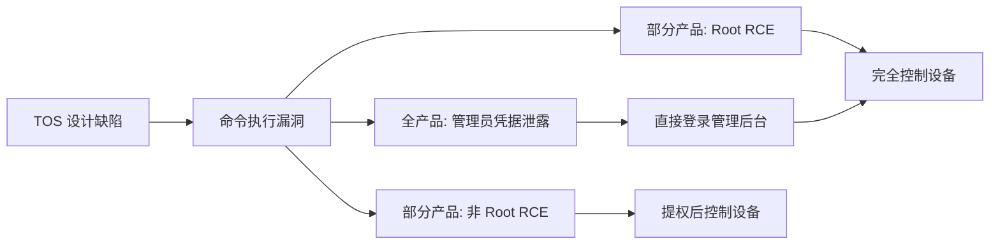

## 漏洞概述

2016 年 1 月 30 日，乌云白帽子 Ano_Tom 提交严重漏洞报告，披露天融信完全自主知识产权的 **TOS（Topsec Operating System）安全操作系统** 存在设计缺陷，导致命令执行漏洞。该漏洞影响基于 TOS 开发的多个系列安全产品，涉及面广、危害等级高。

## 影响产品线

| 产品系列 | 产品定位 | 权限影响 |
|----------|----------|----------|
| **NGFW4000** | 下一代防火墙 | 部分系列直接 root 权限命令执行 |
| **TopVPN6000** | SSL VPN 网关 | 部分系列非 root 权限命令执行 |
| **TopGate300** | 网关类安全产品 | 全系列可读取管理员账号密码并直接登录 |

## 漏洞技术细节

### 核心成因
- **TOS 安全操作系统设计缺陷**：作为天融信多款安全产品的统一基础平台，TOS 在核心架构层面存在命令执行风险
- **权限控制不当**：不同产品系列因权限隔离实现差异，呈现「root 权限执行」与「非 root 权限执行」两种利用效果
- **凭据存储与读取缺陷**：全产品线均存在管理员账号密码可被读取的问题，导致攻击者可直接登录管理后台

### 攻击影响链


## 时间线与厂商响应

| 时间节点 | 事件描述 |
|----------|----------|
| **2016-01-30 09:55** | 白帽子 Ano_Tom 在乌云平台提交漏洞报告 |
| **提交后 < 1 小时** | 天融信官方确认漏洞存在，启动应急响应 |
| **确认后** | 天融信对相关产品线开展紧急修复工作 |

> **行业评价**：天融信在漏洞确认响应速度上表现优异，成为安全厂商负责任漏洞响应的正面案例。详见 [[security-vendor-incident-response-behavior#天融信-tos-漏洞厂商-1-小时确认修复的正面响应案例]]。

## 风险评估与影响范围

### 部署场景风险
- 受影响产品广泛部署于**企业边界防护、远程接入 VPN、网络边界网关**等核心安全节点
- 漏洞可导致**安全设备本身沦陷**，进而绕过防护策略、窃取网络拓扑与流量数据、作为跳板渗透内网

### 资产测绘参考
可使用 FOFA/ZoomEye 等空间搜索引擎通过产品特征指纹（HTTP 头、页面标题、证书信息等）排查资产暴露面：
```
title="Topsec" || header="TOS" || cert="Topsec"
```

## 缓解与修复建议

1. **官方补丁**：联系天融信官方技术支持获取对应版本的安全补丁或固件升级包
2. **临时加固**（补丁发布前）：
   - 限制管理接口仅允许可信 IP 访问
   - 启用管理端口 ACL、双因子认证
   - 监控设备日志中的异常登录与命令执行记录
3. **事后排查**：
   - 检查设备配置文件是否被篡改
   - 审计管理员账号列表，清理异常账号
   - 变更所有管理凭据（含 SNMP 社区字符串、API Key 等）
   - 导出并分析近期系统日志、审计日志

## 关联知识与交叉引用

- [[security-vendor-incident-response-behavior]] —— 安全厂商漏洞应急响应行为分析，收录本漏洞作为厂商 1 小时确认修复的正面案例
- [[cve-2016-3081-struts2-s2-032-rce]] —— 同期 Struts2 S2-032 漏洞，对比不同厂商对同期高危漏洞的响应差异
- [[supply-chain-attack-fundamentals]] —— 供应链攻击基础，安全设备自身沦陷属于供应链风险的一种特殊形式
- [[vulnerability-mining-recon-aiqicha-fofa]] —— 漏洞挖掘侦察方法论，可用于资产测绘与暴露面排查
- [[redteam-hw-opsec-guidelines]] —— 红队演练 OPSEC 规范，涉及安全设备绕过与利用的实战考量

## 参考资料

- 乌云漏洞原始报告（已下线，归档见安全社区镜像）
- 天融信官方安全公告与固件更新通知
- 360 安全卫士/天眼实验室等厂商发布的同期威胁情报通告

## 来源

- [301在路上-201508-202208_204](../sources/301在路上-201508-202208_204.md)
