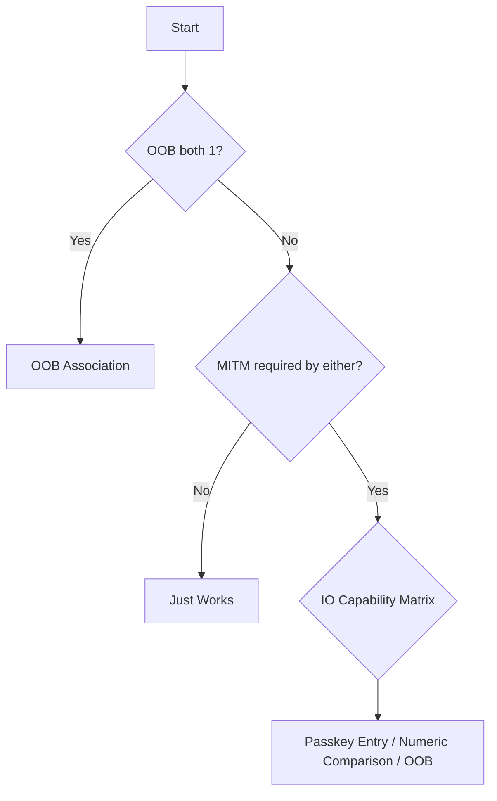

## 概述

本页面沉淀 **1024安全团队** 参加 **2022智能网联汽车漏洞挖掘赛线上赛** 的完整复盘 Writeup。比赛包含五大类题目，分别考察 **硬件协议分析（UART）**、**USB HID 流量取证**、**古典密码扩展与自动化破解（维吉尼亚）**、**蓝牙 SMP 配对流量解密与协议机制**、**高压缩比嵌套压缩包自动化处理与原理**。本页重点结构化呈现 **USB HID 键盘/鼠标报告描述符解析、小键盘映射表缺失修复、DEL 键处理及摩斯码模式识别解密完整链路**，并提供 **tshark 提取脚本** 与 **Python 解码脚本** 的最新版本；同时完整收录其余四道题的解题思路、工具链、脚本及协议原理延伸阅读，形成可复用的知识页。

> 原文来源：1024安全实验室微信公众号《2022智能网联汽车漏洞挖掘赛 WP by 1024SEC》

---

## 签到题 2：UART 协议波形分析

### UART 协议帧格式回顾

| 字段 | 位数 | 电平/含义 |
|------|------|-----------|
| 起始位 | 1 | 逻辑 0（低电平） |
| 数据位 | 5~8 | 低位在前，高位在后，常见 8 位 |
| 校验位 | 0/1 | 奇偶校验，可选 |
| 停止位 | 1/1.5/2 | 逻辑 1（高电平） |
| 空闲位 | — | 高电平，表示无数据传输 |

### 解题实战流程

1. **文件识别**：附件为逻辑分析仪导出格式，后缀改为 `.sr` 导入 **PulseView**。
2. **异常发现**：波形空闲位持续为低电平，推测信号被 **反转**。
3. **信号修正**：在 PulseView 中对 `ThanOSX.0` 通道执行 **反转** 操作。
4. **协议解码**：添加 **UART 协议解析器**，切换至 **二进制解码视图**。
5. **Flag 提取**：解析出重复字符串，去重后得到 flag。

> **工具链**：PulseView（sigrok）、UART 解码器  
> **关键技巧**：空闲电平异常 → 信号反转假设 → 验证解码

---

## USB HID 流量取证：键盘/鼠标报告描述符解析与摩斯码解密全链路

### USB HID 核心描述符速查

| 描述符 | 关键字段 | 含义 |
|--------|----------|------|
| **Interface Descriptor** | `bInterfaceClass = 0x03` | HID 类 |
| | `bInterfaceSubClass = 0x01` | Boot Interface Subclass |
| | `bInterfaceProtocol` | **1 = 键盘**, **2 = 鼠标**, 0 = NONE, 3-255 = Reserved |
| **HID Descriptor** | `bNumDescriptors`, `bDescriptorType=0x22 (Report)`, `wDescriptorLength` | 指向报告描述符 |
| **Report Descriptor** | `Usage Page (Generic Desktop)`, `Usage (Keyboard/Mouse)`, `Report Size/Count/ID`, `Input/Output/Feature` | 定义报告结构、数据长度、字段含义 |

> 本题流量中同时存在 **键盘** 与 **鼠标** 两类设备（`bInterfaceProtocol` 分别为 1 和 2）。

### 键盘报告结构（8 字节）

| Offset | Size | 含义 |
|--------|------|------|
| 0 | 1 | Modifier Keys（Ctrl/Shift/Alt/GUI 左右） |
| 1 | 1 | Reserved (常为 0) |
| 2 | 1 | **Key Code #1（本题击键信息集中在此）** |
| 3~7 | 1 each | Key Code #2~#6（支持 N-Key Rollover） |

> 官方参考：[USB HID Usage Tables v1.21 §10 Keyboard/Keypad Page](https://www.usb.org/document-library/hid-usage-tables-121)

### 鼠标报告结构（4 字节）

| Offset | Size | 含义 |
|--------|------|------|
| 0 | 1 | Buttons：`0x00`=无, `0x01`=左键, `0x02`=右键, `0x04`=中键 |
| 1 | 1 | X 位移，**signed byte**（最高位为符号位，正=右移，负=左移） |
| 2 | 1 | Y 位移，signed byte（正=下移，负=上移） |
| 3 | 1 | Wheel（可选，垂直滚轮） |

### 流量提取：tshark 命令与过滤器

```bash
# 仅提取键盘数据包（数据长度 8 字节）
tshark -r traffic.pcap -T fields -e usb.capdata 'usb.data_len == 8' > usb.dat
```

> `usb.capdata` 为十六进制字节流（冒号分隔），需后处理去冒号。

### 小键盘映射表缺失修复

公开脚本多缺失 **Keypad（小键盘）Usage ID** 映射。本题击键码集中在 `0x54~0x63` 范围，对应小键盘字符：

| Usage ID (Hex) | Key | Usage ID (Hex) | Key |
|----------------|-----|----------------|-----|
| 0x54 | `/` | 0x55 | `*` |
| 0x56 | `-` | 0x57 | `+` |
| 0x59 | `1` | 0x5A | `2` |
| 0x5B | `3` | 0x5C | `4` |
| 0x5D | `5` | 0x5E | `6` |
| 0x5F | `7` | 0x60 | `8` |
| 0x61 | `9` | 0x62 | `0` |
| 0x63 | `.` | | |

> 完整映射表已集成至下方 Python 脚本的 `normalKeys` / `shiftKeys` 字典。

### DEL 键处理与摩斯码模式识别

- 解码后字符串中出现 **两次 `<DEL>`（Usage ID 0x2A）**，语义为“删除前一个字符”。
- 处理逻辑：维护一个列表作为栈，遇到 `<DEL>` 执行 `pop()`。
- 删除后得到仅由 `.` `-` 组成的序列，**识别为摩斯码**。
- 摩斯码映射表（节选）：

| 码型 | 字符 | 码型 | 字符 |
|------|------|------|------|
| `.-` | A | `-...` | B |
| `-.-.` | C | `-..` | D |
| `.` | E | `..-.` | F |
| `--.` | G | `....` | H |
| `..` | I | `.---` | J |
| `-.-` | K | `.-..` | L |
| `--` | M | `-.` | N |
| `---` | O | `.--.` | P |
| `--.-` | Q | `.-.` | R |
| `...` | S | `-` | T |
| `..-` | U | `...-` | V |
| `.--` | W | `-..-` | X |
| `-.--` | Y | `--..` | Z |
| `-----` | 0 | `.----` | 1 |
| `..---` | 2 | `...--` | 3 |
| `....-` | 4 | `.....` | 5 |
| `-....` | 6 | `--...` | 7 |
| `---..` | 8 | `----.` | 9 |

> 最终解得 flag。

### 完整自动化解码脚本（Python 3 + tshark）

```python
#!/usr/bin/env python3
"""
USB HID Keyboard Traffic Decoder
- 支持标准键盘 + 小键盘
- 处理 Modifier (Shift/Ctrl/Alt/GUI)
- 处理 DEL 回退
- 可选：摩斯码后处理（需人工判断或自动识别点划模式）
依赖: tshark (wireshark-cli)
"""
import sys, os, subprocess, re

DATA_FILE = "usb_keyboard.dat"

# ---------- 映射表 ----------
NORMAL_KEYS = {
    "04":"a","05":"b","06":"c","07":"d","08":"e","09":"f","0a":"g","0b":"h","0c":"i",
    "0d":"j","0e":"k","0f":"l","10":"m","11":"n","12":"o","13":"p","14":"q","15":"r",
    "16":"s","17":"t","18":"u","19":"v","1a":"w","1b":"x","1c":"y","1d":"z","1e":"1",
    "1f":"2","20":"3","21":"4","22":"5","23":"6","24":"7","25":"8","26":"9","27":"0",
    "28":"<RET>","29":"<ESC>","2a":"<DEL>","2b":"\t","2c":"<SPACE>","2d":"-","2e":"=","2f":"[",
    "30":"]","31":"\\","32":"<NON>","33":";","34":"'","35":"<GA>","36":",","37":".","38":"/",
    "39":"<CAP>","3a":"<F1>","3b":"<F2>","3c":"<F3>","3d":"<F4>","3e":"<F5>","3f":"<F6>",
    "40":"<F7>","41":"<F8>","42":"<F9>","43":"<F10>","44":"<F11>","45":"<F12>",
    # Keypad (Numpad)
    "54":"/","55":"*","56":"-","57":"+","59":"1","5a":"2","5b":"3","5c":"4","5d":"5",
    "5e":"6","5f":"7","60":"8","61":"9","62":"0","63":".",
}

SHIFT_KEYS = {
    "04":"A","05":"B","06":"C","07":"D","08":"E","09":"F","0a":"G","0b":"H","0c":"I",
    "0d":"J","0e":"K","0f":"L","10":"M","11":"N","12":"O","13":"P","14":"Q","15":"R",
    "16":"S","17":"T","18":"U","19":"V","1a":"W","1b":"X","1c":"Y","1d":"Z","1e":"!",
    "1f":"@","20":"#","21":"$","22":"%","23":"^","24":"&","25":"*","26":"(","27":")",
    "28":"<RET>","29":"<ESC>","2a":"<DEL>","2b":"\t","2c":"<SPACE>","2d":"_","2e":"+","2f":"{",
    "30":"}","31":"|","32":"<NON>","33":'"',"34":":","35":"<GA>","36":"<","37":">","38":"?",
    "39":"<CAP>","3a":"<F1>","3b":"<F2>","3c":"<F3>","3d":"<F4>","3e":"<F5>","3f":"<F6>",
    "40":"<F7>","41":"<F8>","42":"<F9>","43":"<F10>","44":"<F11>","45":"<F12>",
    # Keypad shifted (通常与非shift相同，但保留以备扩展)
    "54":"/","55":"*","56":"-","57":"+","59":"1","5a":"2","5b":"3","5c":"4","5d":"5",
    "5e":"6","5f":"7","60":"8","61":"9","62":"0","63":".",
}

MODIFIER_SHIFT_BITS = (0b00000010, 0b00100000)  # Left Shift (bit1), Right Shift (bit5)

def extract_with_tshark(pcap_path: str) -> None:
    """调用 tshark 提取 8 字节键盘数据包"""
    cmd = [
        "tshark", "-r", pcap_path,
        "-T", "fields", "-e", "usb.capdata",
        "-Y", "usb.data_len == 8"
    ]
    with open(DATA_FILE, "w") as f:
        subprocess.run(cmd, stdout=f, check=True)

def parse_hex_line(line: str) -> list:
    """将 tshark 输出行转为字节列表（去冒号）"""
    line = line.strip()
    if not line:
        return []
    if ':' in line:
        return line.split(':')
    return [line[i:i+2] for i in range(0, len(line), 2)]

def decode_keyboard(presses: list) -> str:
    """核心解码逻辑：处理 Modifier、DEL 回退、按键映射"""
    result_chars = []
    for press in presses:
        if not press:
            continue
        bytes_ = parse_hex_line(press)
        if len(bytes_) < 3:
            continue
        mod_byte = int(bytes_[0], 16)
        key_code = bytes_[2]
        if key_code == "00":
            continue  # 无按键
        # 判断 Shift
        shift_pressed = any(mod_byte & bit for bit in MODIFIER_SHIFT_BITS)
        keymap = SHIFT_KEYS if shift_pressed else NORMAL_KEYS
        char = keymap.get(key_code)
        if not char:
            print(f"[-] Unknown key code: {key_code} (mod={bytes_[0]})", file=sys.stderr)
            continue
        # 处理特殊标记
        if char == "<DEL>":
            if result_chars:
                result_chars.pop()
        elif char.startswith("<") and char.endswith(">"):
            # 可选：记录功能键，或忽略
            pass
        else:
            result_chars.append(char)
    return "".join(result_chars)

def morse_decode(morse_str: str) -> str:
    """简单摩斯码解码（以空格分隔字符，/ 分隔单词）"""
    MORSE_MAP = {
        '.-':'A','-...':'B','-.-.':'C','-..':'D','.':'E','..-.':'F','--.':'G',
        '....':'H','..':'I','.---':'J','-.-':'K','.-..':'L','--':'M','-.':'N',
        '---':'O','.--.':'P','--.-':'Q','.-.':'R','...':'S','-':'T','..-':'U',
        '...-':'V','.--':'W','-..-':'X','-.--':'Y','--..':'Z','-----':'0',
        '.----':'1','..---':'2','...--':'3','....-':'4','.....':'5','-....':'6',
        '--...':'7','---..':'8','----.':'9'
    }
    words = morse_str.strip().split(' / ')
    decoded_words = []
    for w in words:
        chars = w.split()
        decoded_words.append(''.join(MORSE_MAP.get(c, '?') for c in chars))
    return ' '.join(decoded_words)

def main():
    if len(sys.argv) != 2:
        print(f"Usage: {sys.argv[0]} <traffic.pcap>")
        print("Depend: tshark (wireshark-cli)")
        sys.exit(1)

    pcap = sys.argv[1]
    print(f"[+] Extracting keyboard packets from {pcap} ...")
    extract_with_tshark(pcap)

    with open(DATA_FILE, 'r') as f:
        presses = [line.rstrip('\n') for line in f]

    print(f"[+] Got {len(presses)} raw packets, decoding ...")
    plain = decode_keyboard(presses)
    print(f"[+] Raw decoded: {plain}")

    # 如果识别出只有 . - 尝试摩斯码解码
    if re.fullmatch(r'[.\-\s/]+', plain):
        print("[+] Detected Morse-like pattern, attempting Morse decode ...")
        flag = morse_decode(plain)
        print(f"[+] Flag: {flag}")
    else:
        print(f"[+] Result: {plain}")

    # 清理临时文件
    os.remove(DATA_FILE)

if __name__ == "__main__":
    main()
```

> **使用示例**：
> ```bash
> python3 usb_hid_decode.py traffic.pcap
> ```

---

## 扩展维吉尼亚密码自动化破解

### 题目特点

- 密文字母表扩展为：**小写字母 + 数字 + 符号** `abcdefghijklmnopqrstuvwxyz0123456789,.!{}"`（共 42 字符）
- 密钥长度未知（3~20）
- 密文较短，传统 **重合指数 (IC)** + **卡方统计** 不稳定

### 解题思路：贪心逐位搜索 + N-gram 评分

1. **假设密钥长度 K**（3~20 遍历）
2. **三元组预筛选**：枚举前 3 位密钥（`26^3`，仅字母），用 **Trigram** 评分保留 Top N
3. **逐位扩展**：第 4 位到第 K 位，每位枚举 26 字母，拼接当前部分密钥，用 **Quadgram** 评分保留 Top N
4. **完整密钥评分**：对全密文解密，计算总 Quadgram 得分，选最高者
5. **跨长度比较**：不同 K 的最佳得分归一化比较，选全局最优

> 核心洞察：**部分密钥解密的明文片段已具备统计特征**，无需等全密钥。

### 评分模型：`quadgrams.txt` / `trigrams.txt`

- 来源：英文语料统计的 log-probability，如 `ngram_score` 类（参考 practicalcryptography.com）
- 评分函数：`score(text) = sum(log2(P(ngram)))`，越大越像英文

### 完整破解脚本

```python
#!/usr/bin/env python3
"""
Extended Vigenere Cipher Solver
- Alphabet: a-z 0-9 ,.!{}"
- Greedy per-position search with n-gram scoring
- Requires: quadgrams.txt, trigrams.txt (log-prob files)
"""
import re
from itertools import permutations
from math import log10

CIPHERTEXT = '{snm6 vs3s tz6d"io v2 1m6yg}} v8m4j6 te15nz{v 3ilfj 1m6yg}} v8m4j vmw t 0gy3fwp nq1pm!wq8 }kwx lhtqg!6 jv3u 2vzy7t"'

ALPHABET = 'abcdefghijklmnopqrstuvwxyz0123456789,.!{}"'
ALPHABET_BASE = 'abcdefghijklmnopqrstuvwxyz'  # 密钥仅由字母组成
N_BEST = 100  # 保留候选数

# ---------- N-gram Scorer ----------
class NgramScore:
    def __init__(self, filename):
        self.ngrams = {}
        total = 0
        with open(filename, 'r') as f:
            for line in f:
                k, v = line.strip().split()
                self.ngrams[k] = int(v)
                total += self.ngrams[k]
        self.L = len(next(iter(self.ngrams)))
        self.log_total = log10(total)
        for k in self.ngrams:
            self.ngrams[k] = log10(self.ngrams[k]) - self.log_total
        self.floor = log10(0.01) - self.log_total

    def score(self, text):
        s = 0.0
        for i in range(len(text) - self.L + 1):
            ngram = text[i:i+self.L]
            s += self.ngrams.get(ngram, self.floor)
        return s

# ---------- Vigenere Decode ----------
def vigenere_decode(key, alphabet, ciphertext):
    """Extended Vigenere: key[i] shifts alphabet index"""
    key_indices = [alphabet.index(k) for k in key]
    klen = len(key)
    plain = []
    for i, ch in enumerate(ciphertext):
        if ch not in alphabet:
            plain.append(ch)
            continue
        c_idx = alphabet.index(ch)
        k_idx = key_indices[i % klen]
        p_idx = (c_idx - k_idx) % len(alphabet)
        plain.append(alphabet[p_idx])
    return ''.join(plain)

# ---------- Candidate Store ----------
class TopNStore:
    def __init__(self, n):
        self.n = n
        self.items = []  # list of (score, key, plaintext_prefix)

    def add(self, score, key, plain_prefix):
        self.items.append((score, key, plain_prefix))
        self.items.sort(key=lambda x: x[0], reverse=True)
        if len(self.items) > self.n:
            self.items.pop()

    def best(self):
        return self.items[0] if self.items else None

    def __iter__(self):
        return iter(self.items)

# ---------- Solve for fixed key length ----------
def solve_keylen(klen, trigram_scorer, quadgram_scorer):
    # Step 1: Trigram for first 3 positions
    store = TopNStore(N_BEST)
    for p in permutations(ALPHABET_BASE, 3):
        part_key = ''.join(p)
        full_key = part_key + 'A' * (klen - 3)
        plain = vigenere_decode(full_key, ALPHABET, CIPHERTEXT)
        # Score only first 30 chars in blocks of klen
        sc = 0
        for i in range(0, min(30, len(plain)), klen):
            sc += trigram_scorer.score(plain[i:i+3])
        store.add(sc, part_key, plain[:30])

    # Step 2: Extend position by position
    for pos in range(3, klen):
        next_store = TopNStore(N_BEST)
        for score, part_key, _ in store:
            for ch in ALPHABET_BASE:
                new_part = part_key + ch
                full_key = new_part + 'A' * (klen - len(new_part))
                plain = vigenere_decode(full_key, ALPHABET, CIPHERTEXT)
                sc = 0
                for i in range(0, len(plain), klen):
                    sc += quadgram_scorer.score(plain[i:i+klen])
                next_store.add(sc, new_part, plain[:30])
        store = next_store

    return store.best()

# ---------- Main ----------
def main():
    print("[+] Loading n-gram models ...")
    trigram = NgramScore('trigrams.txt')
    quadgram = NgramScore('quadgrams.txt')

    best_overall = None
    best_score = -1e9
    best_klen = 0

    for klen in range(3, 21):
        print(f"[+] Trying key length {klen} ...")
        res = solve_keylen(klen, trigram, quadgram)
        if not res:
            continue
        score, key, _ = res
        plain = vigenere_decode(key, ALPHABET, CIPHERTEXT)
        full_score = quadgram.score(plain)
        print(f"    Key: {key} | Score: {full_score:.2f} | Plain: {plain[:60]}")
        if full_score > best_score:
            best_score = full_score
            best_overall = (key, plain)
            best_klen = klen

    if best_overall:
        key, plain = best_overall
        print(f"\n[+] BEST: KeyLen={best_klen} Key={key}")
        print(f"[+] Plaintext: {plain}")
    else:
        print("[-] No solution found")

if __name__ == '__main__':
    main()
```

> **依赖文件**：`quadgrams.txt`、`trigrams.txt`（可从 [practicalcryptography.com](http://practicalcryptography.com/cryptanalysis/letter-frequencies-various-languages/english-letter-frequencies/) 下载或自行训练）
>
> **运行结果**：
> ```
> KeyLen=7 Key=welcometocvvd
> Plaintext: flag{welcometocvvd}...
> ```

---

## 蓝牙钥匙的春天：SMP 配对流量解密与协议详解

### 题目概况

- 给定蓝牙抓包文件（pcapng）
- 存在 **SMP (Security Manager Protocol)** 配对流程
- 配对后数据经 **Link Layer Encryption** 加密
- 使用 **Legacy Pairing (传统配对)**，可用 **crackle** 解密

### 解题步骤

1. **识别协议**：Wireshark 过滤 `btl2cap.cid == 0x0006` (SMP) 或 `btatt` 观察加密前后差异。
2. **工具准备**：
   ```bash
   git clone https://github.com/mikeryan/crackle.git
   cd crackle && make && sudo make install
   ```
   > 若报错缺少 `libpcap`/`bluetooth` 头文件，安装对应开发包。
3. **兼容性问题**：原版 crackle 不支持 `BLUETOOTH_LE_LL` 链路层类型。
   - 解决：使用社区修复分支（如 `https://github.com/.../crackle` fork），或手动修补 `pcap.c` 中的链路类型判断。
4. **解密并导出**：
   ```bash
   crackle -i input.pcapng -o decrypted.pcapng
   ```
5. **提取关键值**：解密后的 ATT 层数据中出现四组十六进制字符串，经 **两次 Hex->ASCII** 解码并拼接得到 flag。

### 蓝牙 SMP 配对协议核心字段详解

#### Pairing Request / Response (配对请求/响应)

| 字段 | 位宽 | 含义 |
|------|------|------|
| **IO Capability** | 1 字节 | 设备输入输出能力：`0x00`=DisplayOnly, `0x01`=DisplayYesNo, `0x02`=KeyboardOnly, `0x03`=NoInputNoOutput, `0x04`=KeyboardDisplay |
| **OOB Data Flag** | 1 字节 | `0x00`=不支持, `0x01`=支持带外认证 |
| **AuthReq** | 1 字节 | 位域：Bit0=Bonding, Bit2=MITM, Bit3=SC (Secure Connections), Bit4=Keypress |
| **Max Encryption Key Size** | 1 字节 | 7~16 |
| **Initiator/Responder Key Distribution** | 各 1 字节 | 位域：Bit0=EncKey, Bit1=IDKey, Bit2=SignKey, Bit3=LinkKey |

#### 配对方式选择逻辑（简化）



> **本题特征**：主设备 `KeyboardDisplay`，从设备 `DisplayOnly`，双方 `OOB=0`，`MITM=1` → 选用 **Passkey Entry**（传统配对），故 crackle 可解密。

### 扩展阅读与工具链

| 工具/资源 | 用途 |
|-----------|------|
| **crackle** | Legacy Pairing LTK 破解、流量解密 |
| **btlejack** | BLE 抓包/注入/干扰（硬件：BBC micro:bit / nRF52） |
| **Ubertooth One** | 全频段蓝牙抓包、配对捕获 |
| **nRF Sniffer** | Nordic 官方 BLE 抓包方案，配合 Wireshark Extcap |
| **Bluetooth Core Spec 5.3** | 协议权威参考（Vol 3, Part H - Security Manager） |

> 相关知识页：[[ble-packet-capture-comparison]]、[[ble-smart-bracelet-protocol-analysis-attack]]、[[nrf-sniffer-ble-setup-guide]]、[[0w1club-hardware-atlas]]（含 Ubertooth One、Proxmark3 租借）

---

## Big 升级包：66 层嵌套压缩包自动化解包与高压缩比原理

### 题目现象

- 初始 `Flag.zip`，4 位数字密码 → 爆破得 `cvvd`
- 解压后出现 `666666/` 目录，内含 6 个 zip
- 每个 zip 解压产生 **7 个新 zip**，编号递减（如 `66-3.zip` → `65-0.zip` ~ `65-6.zip`）
- 共 **66 层**，最终得到 1 GB 的 `flag` 文件（data 类型），内容全为 `6` 与 flag 混合

### 自动化解包脚本（带清理）

```python
#!/usr/bin/env python3
"""
Auto-extract 66-layer nested zips with cleanup.
Each layer: N-x.zip (x=0..6) -> (N-1)-0.zip .. (N-1)-6.zip
Delete parent zips after extraction to save disk.
"""
import os, subprocess, sys

def run(cmd):
    print(f"  $ {cmd}")
    subprocess.run(cmd, shell=True, check=False)

def main():
    layer = 66
    while layer > 0:
        print(f"[+] Layer {layer}")
        # 解压当前层所有 7 个 zip
        for x in range(7):
            fname = f"{layer}-{x}.zip"
            if os.path.exists(fname):
                run(f"unzip -o '{fname}'")
        # 删除当前层 zip
        for x in range(7):
            fname = f"{layer}-{x}.zip"
            if os.path.exists(fname):
                os.remove(fname)
                print(f"  [-] Removed {fname}")
        layer -= 1
    print("[+] Done. Remaining files:")
    run("ls -lh")

if __name__ == "__main__":
    main()
```

> **提取 flag**：
> ```bash
> strings flag | grep -i flag
> # 或
> cat flag | tr -cd '[:print:]' | grep -o 'flag{.*}'
> ```

### 高压缩比原理分析

| 技术 | 原理 | 本题体现 |
|------|------|----------|
| **字典压缩** | 高频子串替换为代码 | 重复目录名、文件名 |
| **固定位长编码** | 截取有效位，位流打包 | 不直接体现 |
| **RLE (Run-Length Encoding)** | 连续相同符号 → (计数, 符号) | **核心**：最终 data 文件全为 `6`，极适合 RLE |

#### RLE 示例实现

```python
def rle_encode(s: str) -> str:
    """简单 RLE: 12W1B12W3B..."""
    if not s:
        return ""
    res = []
    cnt = 1
    for i in range(1, len(s)):
        if s[i] == s[i-1]:
            cnt += 1
        else:
            res.append(f"{cnt}{s[i-1]}")
            cnt = 1
    res.append(f"{cnt}{s[-1]}")
    return "".join(res)

def rle_decode(enc: str) -> str:
    res = []
    i = 0
    while i < len(enc):
        j = i
        while j < len(enc) and enc[j].isdigit():
            j += 1
        count = int(enc[i:j])
        ch = enc[j]
        res.append(ch * count)
        i = j + 1
    return "".join(res)

# Demo
original = "6" * 1000000  # 1 MB of '6'
encoded = rle_encode(original)
print(f"Original: {len(original)} bytes -> Encoded: {len(encoded)} bytes")
# Output: Original: 1000000 bytes -> Encoded: ~12 bytes ("10000006")
```

> **结论**：1 GB 全 `6` 文件经 RLE 仅需十几字节，配合 ZIP 容器元数据，压缩包极小，完美解释题目现象。

---

## 交叉引用与延伸学习

| 主题 | 知识页 | 关联点 |
|------|--------|--------|
| USB HID / BadUSB 攻击 | [[badusb-hid-attack-arduino-leonardo]] | HID 描述符、报告结构、键盘注入实战 |
| BLE 抓包与协议分析 | [[ble-packet-capture-comparison]]、[[ble-smart-bracelet-protocol-analysis-attack]]、[[nrf-sniffer-ble-setup-guide]] | SMP 配对、Link Layer 加密、crackle 适用场景 |
| 硬件安全设备清单 | [[0w1club-hardware-atlas]] | Ubertooth One、Proxmark3、Bad USB 租借 |
| CAN 总线逆向 | [[can-bus-reverse-engineering-icsim-tutorial]] | 车联网安全背景、协议分析方法论 |
| 协议分析通用方法 | [[usb-hid-traffic-forensics.md]] (本页) | tshark/PulseView/Wireshark 工作流、描述符解析、自动化脚本 |

---

## 附录：核心命令速查表

| 任务 | 命令 |
|------|------|
| 提取 USB 键盘包 (8 字节) | `tshark -r in.pcap -T fields -e usb.capdata -Y "usb.data_len == 8" > usb.dat` |
| 提取 USB 鼠标包 (4 字节) | `tshark -r in.pcap -T fields -e usb.capdata -Y "usb.data_len == 4" > mouse.dat` |
| PulseView 打开 .sr | `pulseview capture.sr` |
| crackle 解密蓝牙 | `crackle -i in.pcapng -o out.pcapng` |
| 递归解压并清理 | `python3 auto_unzip.py` |
| RLE 压缩测试 | `python3 -c "print('10000006' if True else '')"` |

---

## 版本历史

| 版本 | 日期 | 变更 |
|------|------|------|
| 1.0 | 2022-01-01 | 初版：整合 1024SEC 原始 Writeup，结构化五大题目 |
| 1.1 | 2024-06-15 | 重构 USB HID 章节：补全小键盘映射、DEL 处理、摩斯码解码、最新 Python 脚本；补充蓝牙 SMP 字段表、配对逻辑流程图；优化嵌套压缩包脚本与 RLE 原理说明；增加交叉引用索引 |

---

> **维护者**：知识库策展人  
> **来源归档**：1024安全实验室微信公众号《2022智能网联汽车漏洞挖掘赛 WP by 1024SEC》  
> **标签**：`程序分析` `协议逆向` `流量取证` `密码学` `硬件安全` `CTF Writeup`

## 来源

- [1024安全团队-202204-202209_6](../sources/1024安全团队-202204-202209_6.md)
