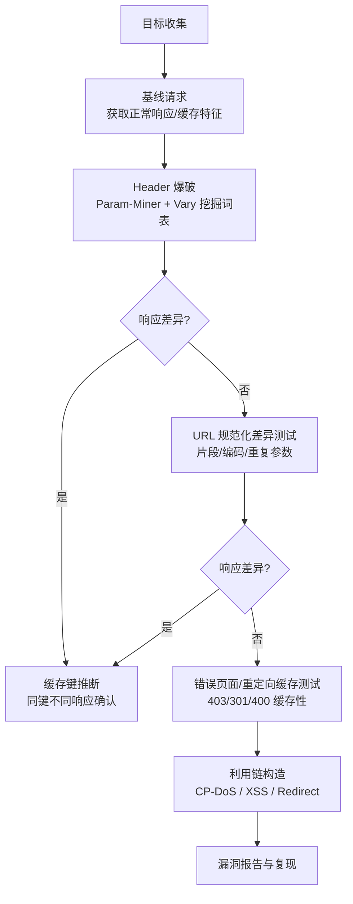

## 概述

Web 缓存投毒 是一类利用缓存服务器与源站之间**请求处理不一致**（缓存键生成逻辑 vs. 请求转发逻辑）的攻击技术。攻击者构造恶意请求，使其被缓存服务器存储为“合法响应”，随后分发给后续访问同一缓存键的受害用户，导致 **DoS（CP-DoS）**、**存储型 XSS**、**开放重定向**、**敏感信息泄露** 等后果。

本文基于先知社区 / Youstin 原文《Cache Poisoning at Scale》译文，结合 70+ 真实漏洞赏金案例，系统归纳核心技术分类、利用链构造、自动化检测方法论及防御建议。

---

## 核心成因模型

| 维度 | 缓存服务器行为 | 源站行为 | 攻击面 |
|------|----------------|----------|--------|
| **缓存键生成** | 仅选取部分 Header / URL 组件 | 接收完整原始请求 | **未加密 Header**（Unkeyed Header） |
| **URL 规范化** | 丢弃片段、解码、路径规范化 | 可能保留片段、双重解码、不同规范化 | **URL 解析差异** |
| **响应缓存判定** | 依据状态码、Cache-Control | 可能返回错误页面、重定向 | **错误页面缓存**、**重定向缓存** |
| **Header 转发策略** | 白名单 / 黑名单 / 全透传 | 信任特定 Header（X-Forwarded-*、Host 等） | **Header 注入与篡改** |

> **关键洞察**：只要 **缓存键与实际影响响应的请求特征不完全对应**，即存在投毒窗口。

---

## 经典技术分类与真实案例

### URL 片段 / 规范化差异

#### Apache Traffic Server (ATS) — CVE-2021-27577
- **现象**：ATS 转发请求时**保留 URL 片段（`#...`）**，但生成缓存键时**忽略片段**。
- **RFC 7230 违背**：源站表单应仅含绝对路径 + 查询串；片段本不应出现在转发请求中。
- **利用链**：
  1. 攻击者请求 `/static.js#%23../malicious` → 缓存键为 `/static.js`
  2. ATS 转发 `/static.js#%23../malicious` 给源站
  3. 源站若将 `#` 后内容视为路径一部分（如 `encodeURI` 后反解），返回恶意 JS
  4. 后续访问 `/static.js` 的用户获取被毒害响应
- **衍生**：配合 `/../` 路径穿越、Open Redirect、存储型 XSS。

> **交叉引用**：[[xd-security-vulnerability-discovery-notes-day42-45]] 中的扫描器配置可扩展检测此类 URL 规范化差异。

---

### 未加密 Header 导致的 CP-DoS / XSS

#### GitHub 仓库 CP-DoS
- **触发**：`Content-Type: invalid` → 源站返回 400/500，缓存键**不含**该 Header → 所有未认证用户共享同一毒害缓存。
- **限制**：认证用户 Cookie 在缓存键中，故仅影响匿名访问。
- **赏金**：$7,500。

#### GitLab 静态资源 CP-DoS
- **环境**：GCP Cloud Bucket + Fastly。
- **向量**：
  - `x-http-method-override: POST/HEAD` → 触发 405，Fastly 默认不缓存 405。
  - `x-http-method-override: HEAD` + `PURGE` 方法启用 → 返回空响应体，**可缓存**。
- **赏金**：$4,850（Top Bounty）。

#### X-Forwarded-Scheme (Rack Middleware / Rails)
- **代码逻辑**：`request.scheme = env['HTTP_X_FORWARDED_SCHEME']`（若存在）。
- **攻击**：发送 `X-Forwarded-Scheme: http` → 源站生成 `Location: http://...` 301 重定向 → HTTPS 站点陷入 **重定向循环** → 静态资源全站不可用。
- **实战目标**：
  - Hackerone（仅静态文件缓存，$2,500）
  - Shopify（默认缓存 301，单请求即毒害，影响 `apps.shopify.com` 等 21+ 子域，$6,300）
  - 私有程序：`X-Forwarded-Host` 被信任于 301 Location → **存储型 XSS**（$3,000 Critical）。

> **交叉引用**：[[ssrf-bypass-techniques]] 中的 Header 伪造技巧可复用于此类 `X-Forwarded-*` 注入。

---

### Cloudflare + 对象存储（S3 / Azure Blob）默认配置缺陷

- **历史行为**：Cloudflare 默认缓存 **403 响应**（无需 `Cache-Control`）。
- **攻击**：发送非法 `Authorization` Header → S3 / Azure 返回 403 → Cloudflare 缓存 → 合法用户下载文件全部 403。
- **案例**：
  - 通用 S3 Bucket
  - Exodus 钱包 `downloads.exodus.com`（Azure Blob，$2,500）
- **修复**：Cloudflare 2021-08-03 变更默认不再缓存 403。

---

### Fastly Host Header 注入（`Fastly-Host` 绕过白名单）

- **VCL 片段**：缓存键仅提取 URL 路径坐标（`/4/151/16`），忽略 Host。
- **白名单限制**：Fastly 拒绝非白名单 Host Header。
- **绕过**：添加 `Fastly-Host: whitelisted.example.com` → Fastly 用其生成缓存键，**同时将攻击者自定义 Host 转发给源站**。
- **升级链**：
  1. CP-DoS（注入恶意 Host 导致错误页面缓存）
  2. 发现同 Load Balancer 下另一域名（`assets.redacted.com`）存在 DOM XSS
  3. 用 `Fastly-Host` 将毒害缓存键映射至该 HTML → **跨域 XSS 利用**

---

### 重复参数 / 参数污染

- **场景**：CDN 镜像服务，缓存键含 `size` 参数，忽略其它参数。
- **差异**：Varnish 生成缓存键**不做 URL 规范化**；源站取**最后一个**同名参数值。
- **Payload**：
  ```
  /image.jpg?size=200&size=0
  ```
  - 缓存键含 `size=200`（首个）
  - 源站用 `size=0` → 返回 400 Bad Request → 可缓存 DoS
- **进阶**：对第二个参数 URL 编码（`size=200&size%3D0`）进一步混淆。

---

### User-Agent 规则误判导致 CP-DoS

- **背景**：为阻挡 FFUF、Nuclei 等扫描器，WAF/应用层拦截特定 UA。
- **缺陷**：拦截响应（403/429）被缓存，**且缓存键不含 UA**。
- **影响**：正常用户访问同一 URL 直接命中毒害缓存 → 服务不可用。
- **验证**：使用常见扫描器 UA 列表批量测试。

---

### 非法 Header 字段（RFC 7230 `token` 违规）

- **RFC 定义**：Header 名仅允许 `tchar`（字母数字 + `!#$%&'*+-.^_`|~`）。
- **Akamai 行为**：**不拒绝**非法 Header，**转发并缓存 400 响应**（前提无 `Cache-Control`）。
- **Payload**：`X-Invalid\Header: test`（含反斜杠）。
- **普遍性**：整个测试过程中**最高频模式**之一。

---

### Vary Header 挖掘新攻击面

- **原理**：`Vary` 响应头声明缓存服务器**必须**纳入缓存键的请求头。
- **方法论**：
  1. 使用 **HTTP Archive (BigQuery)** 查询全网 `Vary` 头取值分布。
  2. 结合 **Param-Miner** 词表，建立 **2917 条** 候选 Header 清单。
  3. 批量扫描目标，识别**已声明但未纳入缓存键** 或 **未声明实则影响响应** 的 Header。
- **资源**：<https://gist.github.com/iustin24/92a5ba76ee436c85716f003dda8eecc6>

---

## 自动化检测方法论



### 关键检测点清单

| 类别 | 检测载荷 | 判定依据 |
|------|----------|----------|
| **Unkeyed Header** | `X-Forwarded-Host: evil.com`<br>`X-Forwarded-Scheme: http`<br>`X-Host: evil.com`<br>`Forwarded: for=evil.com` | 同缓存键下响应包含攻击域 / 发生重定向循环 |
| **URL Fragment** | `/path#%23../evil`<br>`/path#?query=1` | 缓存键不变，源站响应差异 |
| **Duplicate Param** | `?size=200&size=0`<br>`?cb=1&cb=<svg/onload=1>` | 缓存键取首个，源站取末尾 |
| **Illegal Header** | `X-Test\:Value: 1`<br>`X-Test\nValue: 1` | 返回 400 且被缓存 |
| **Error Caching** | 发送触发 400/403/500 的恶意请求 | 后续正常请求命中错误响应 |
| **Redirect Caching** | 构造 301/302 指向攻击域 | 后续请求被重定向至攻击域 |

> **工具链推荐**：
> - **Param-Miner**（Burp 插件）自动发现 Unkeyed Header/Param
> - **Cache-Poisoning-Scanner** / 自研脚本 批量验证
> - **HTTP Archive BigQuery** 离线挖掘高频 `Vary` 值

---

## 实战利用链总结表

| 技术 | 典型影响 | 关键条件 | 代表案例 |
|------|----------|----------|----------|
| ATS Fragment | XSS / Open Redirect / 任意文件缓存 | ATS + 源站解析片段 | CVE-2021-27577 |
| GitHub CP-DoS | 匿名用户仓库不可用 | 错误页面可缓存 + 缓存键无 Cookie | $7,500 |
| GitLab CP-DoS | 静态资源全站 404/空响应 | `x-http-method-override` + `PURGE` | $4,850 |
| X-Forwarded-Scheme | 重定向循环 DoS / 跨域 XSS | Rack/Rails + 缓存 301 + 信任 Header | Shopify $6,300 |
| Cloudflare + S3 403 | 文件下载全站 403 | 默认缓存 403 + 非法 Auth Header | Exodus $2,500 |
| Fastly Host Injection | 跨域 XSS / CP-DoS | VCL 缓存键忽略 Host + `Fastly-Host` 绕过 | Private Program |
| Duplicate Param | 400/404 DoS | Varnish 无规范化 + 源站取最后值 | CDN Mirror |
| UA Block CP-DoS | 全站 DoS | WAF 拦截特定 UA + 响应可缓存 | 多个目标 |
| Illegal Header | 400 DoS | Akamai 类 CDA 转发非法 Header 并缓存错误 | 高频通用 |
| Vary Mining | 发现新攻击面 | HTTP Archive + Param-Miner 词表 | 2917 Headers |

---

## 防御与缓解建议

### 缓存层配置
1. **缓存键完整性**：纳入**所有影响响应**的 Header（`Host`、`X-Forwarded-*`、自定义业务 Header）、URL 完整规范化路径、查询串全量或显式白名单。
2. **错误响应不缓存**：默认**不缓存** 4xx/5xx；若必须缓存，强制要求 `Cache-Control: public, max-age=...` 且键含触发错误的完整请求特征。
3. **重定向响应谨慎缓存**：301/302 仅在确认 `Location` 不受用户可控 Header 影响时缓存。
4. **拒绝非法 Header**：边缘层按 RFC 7230 校验 Header 名，拒绝含非 `tchar` 字符的请求（返回 400，**不转发、不缓存**）。
5. **规范化一致性**：边缘与源站使用**相同 URL 解析库/规则**（片段剥离、双重解码、路径规范化、参数排序去重）。

### 应用层加固
1. **零信任 Header**：**不盲信** `X-Forwarded-Host/Scheme/For/Proto` 等；若需使用，配置**可信代理 IP 白名单**并由代理层清洗/重写。
2. **错误页面去敏感化**：错误页不回显用户输入，不包含动态重定向目标。
3. **显式 Cache-Control**：动态页面 `Cache-Control: private, no-store`；静态资源显式 `public, max-age` + 版本化文件名。
4. **监控告警**：监控缓存命中率异常波动、错误响应缓存命中量、重定向循环投诉。

### 检测验证
- 定期运行 **缓存投毒自动化扫描**（Header 爆破 + URL 变异 + 错误/重定向缓存测试）。
- 接入 **HTTP Archive Vary 变更监控**，新增 Header 及时评估。
- Bug Bounty / 红队演练中将缓存投毒列为**必测项**。

---

## 交叉引用与延伸阅读

- [[xd-security-vulnerability-discovery-notes-day42-45]] — 扫描器（Goby/Nessus/Nmap）与漏洞利用框架（Metasploit/Searchsploit）集成，可扩展缓存投毒检测插件。
- [[xd-security-waf-bypass-techniques-day46-49]] — WAF 绕过技巧（Payload 变异、编码混淆）可复用于缓存投毒载荷投递。
- [[ssrf-bypass-techniques]] — `X-Forwarded-*` Header 伪造、协议绕过、DNS Rebinding 等技术与缓存投毒链条高度重叠。
- [[xd-security-src-vulnerability-hunting-notes-day86-88]] — SRC 漏洞挖掘流程（FOFA 资产、默认弱口令、.NET 单点登录）可结合缓存投毒批量验证。
- [[internal-network-pivoting-techniques]] — 内网渗透中利用缓存投毒污染内部 CDN/代理，进而横向移动的高级场景。

---

## 结语

缓存投毒的本质是 **“缓存键与语义相关请求特征不匹配”**。现代技术栈（CDN、WAF、负载均衡、微服务网关、对象存储）层层叠加，每一层都可能引入解析差异、Header 清洗不全、错误缓存策略等隐患。**大规模自动化检测（Header 爆破 + Vary 挖掘 + URL 变异）配合人工利用链构造**，是当前最高效的挖掘路径。防御侧需在**边缘层统一规范化、显式缓存键策略、拒绝非法输入、最小化信任 Header** 上构建纵深体系。

> 原文来源：先知社区 / Youstin《Cache Poisoning at Scale》  
> 译文链接：<http://mp.weixin.qq.com/s?__biz=Mzg4Njc1MTIzMw==&mid=2247484041&idx=1&sn=927bea187eb87cebb3dab0472b327ac5>  
> 原文地址：<https://youst.in/>  
> 先知链接：<https://xz.aliyun.com/t/10848>

## 来源

- [0x6270安全团队-202203-202304_51](../sources/0x6270安全团队-202203-202304_51.md)
