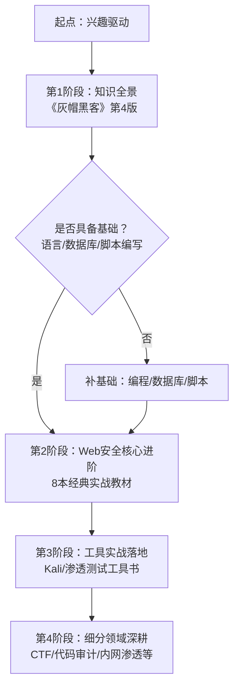

## 概述

本页面整理自「301在路上」公众号文章《Web安全入门－书籍推荐》，系统梳理了Web安全领域从入门到进阶的经典书单，并结合工具实战书籍，构建一条新手可落地的阅读学习路线。文章作者建议以**兴趣驱动**为核心，先建立知识全景，再逐层深入技术细节，强调**光看不练不可取**，需配合靶场、工具实操。

> **原文来源**：[301在路上 - Web安全入门－书籍推荐](http://mp.weixin.qq.com/s?__biz=MzIwMTQ2NzY4NA==&mid=2652521380&idx=1&sn=014fbbd39d4a6d0def9d0de36ea02675&chksm=8d0391efba7418f9fc504cdce13a391dfb59f9b719fa9f438d003c469f3601a7f60354e7a6f3&scene=126&sessionid=1681656706#rd)

---

## 阅读路线图总览

---

## 第1阶段：建立知识全景 —— 入门必读

### 《灰帽黑客》（第4版）

- **定位**：黑客技术知识体系的「地图」，覆盖Web安全、二进制、无线、移动、硬件、工控等全领域
- **作用**：帮助初学者理解「黑客需要掌握哪些知识」，建立完整知识全景，避免盲目刷题、碎片化学习
- **阅读建议**：通读目录与核心章节，标记感兴趣方向，作为后续选书的导航仪
- **交叉引用**：[[reverse-engineering-beginner-learning-path]] 中同样推荐此书作为逆向工程入门的全景参考

---

## 第2阶段：Web安全核心进阶 —— 8本经典实战教材

> **前置条件**：具备一定语言基础（Python/JS/PHP/Java等）、数据库操作了解、能自己编写简单脚本

| 序号 | 书名 | 核心侧重 | 适合阶段 | 备注 |
|------|------|----------|----------|------|
| 1 | **《白帽子讲Web安全》** | Web安全基础原理、常见漏洞成因与修复、安全开发规范 | 入门进阶 | 业界公认「Web安全红宝书」，体系化强 |
| 2 | **《Web安全深度剖析》** | 漏洞原理深度分析、挖掘技巧、代码审计视角 | 进阶 | 适合想从代码层面理解漏洞本质的读者 |
| 3 | **《黑客攻防技术宝典——Web实战篇》** | 实战攻防技巧、工具使用、渗透测试流程 | 进阶实战 | 侧重实操，配合靶场练习效果佳 |
| 4 | **《Web前端黑客技术揭秘》** | XSS、CSRF、点击劫持、前端逻辑漏洞、浏览器安全机制 | 专题深入 | 前端安全专项必读 |
| 5 | **《Web应用安全威胁与防治》** | 威胁建模、安全SDLC、企业级防御体系 | 工程化/防御 | 偏向蓝队、安全架构视角 |
| 6 | **《Web之困：现代Web应用安全指南》** | 现代Web架构（SPA、微服务、API）下的安全挑战 | 现代Web | 覆盖新技术栈安全问题 |
| 7 | **《XSS跨站脚本攻击剖析与防御》** | XSS全谱系：原理、变种、绕过、检测、防御 | 专题深入 | XSS领域权威专著 |
| 8 | **《Web应用安全权威指南》** | 综合参考手册，覆盖认证、授权、会话、加密、API安全等 | 案头参考 | 适合查阅、构建知识索引 |

### 阅读策略建议

1. **先薄后厚**：《白帽子讲Web安全》建立体系 → 《黑客攻防技术宝典》实战演练 → 专题书深入
2. **配合靶场**：每读一类漏洞章节，即去对应靶场复现（推荐 [[pikachu-target-writeup-part1-setup-brute-force]]、[[attack-defense-world-beginner-web-writeup]]、[[ctf-training-platforms-collection]]）
3. **产出笔记**：建立个人漏洞知识卡片，记录 Payload、绕过技巧、修复代码，形成可检索的知识库

---

## 第3阶段：工具实战落地 —— 必备工具书

| 书名 | 定位 | 核心内容 | 适用场景 |
|------|------|----------|----------|
| **《Kali大学霸内部资料》** | Kali Linux 系统级实战手册 | Kali 工具集分类、常用渗透测试流程、命令速查、实战案例 | 日常渗透测试工具查阅、Kali 环境快速上手 |
| **《安全之路》** | 渗透测试方法论与实战全流程 | 信息收集、漏洞扫描、利用、提权、横向移动、报告撰写 | 系统性学习渗透测试标准流程、考证（如 CISP-PTE）参考 |

> **工具实战补完**：
> - Burp Suite 核心用法：[[burpsuite-basics-tutorial]]
> - SQLMap 自动化注入：[[sqlmap-comprehensive-guide]]、[[sqlmap-api-automation]]
> - 内网穿透与代理：[[frp内网渗透应用]]、[[http-proxy-tunneling-goproxy-netsh]]
> - Cobalt Strike 实战：[[cobalt-strike-external-c2-smb-beacon]]、[[c2-redirectors-malleable-c2-profiles]]

---

## 第4阶段：细分领域深耕 —— 按兴趣延伸

完成前三阶段后，可根据兴趣选择细分方向深入：

| 方向 | 推荐切入点 | 知识库现有支撑页面 |
|------|------------|-------------------|
| **CTF/Web靶场实战** | 从入门靶场进阶到高难度Writeup | [[attack-defense-world-beginner-web-writeup]]、[[attack-defense-world-master-advanced-writeup]]、[[buuctf-web-writeup-collection]] |
| **代码审计** | PHP/Java/CMS/框架审计方法论 | [[xd-security-code-audit-notes-day50-57]]、[[oasys-system-code-audit]]、[[metinfo-612-sql-injection-analysis]] |
| **内网渗透/红队** | 域环境、横向移动、C2隐匿 | [[xd-security-internal-network-penetration-notes-day65-66]]、[[jumbo-internal-penetration-cheatsheet]]、[[internal-network-pivoting-techniques]] |
| **二进制/逆向/PWN** | 栈溢出、堆利用、逆向工程 | [[reverse-engineering-beginner-learning-path]]、[[buuctf-pwn-writeup-collection]]、[[rop-linux-x86-beginner-tutorial]] |
| **漏洞挖掘/应急响应** | 信息收集、漏洞复现、溯源取证 | [[vulnerability-mining-recon-aiqicha-fofa]]、[[xd-security-incident-response-notes]]、[[threat-attribution-tracing-techniques]] |
| **移动/IoT/硬件安全** | Android逆向、BLE、固件分析 | [[android-shelling-unshelling-techniques]]、[[ble-smart-bracelet-protocol-analysis-attack]]、[[ft232h-spi-flash-firmware-extraction]] |

---

## 学习方法论补充

### 社群化学习参考

- **0w1Club 零基础安全学习小组组建全流程**：[[security-study-group-methodology]]（预备群筛选、笔记准入制、月度三件套、八阶段课程规划）
- **XD安全渗透测试课程体系**：[[xd-security-pentest-course-curriculum]]（88天系统课程、配套文档、电子书、学员就业见证）

### 避坑指南

1. **切忌「只读不动手」**：每个漏洞知识点至少在靶场完整复现一次，记录完整复现链
2. **切忌「贪多嚼不烂」**：按路线图分阶段，每阶段聚焦 1-2 本核心书 + 对应靶场
3. **建立个人知识库**：用 Obsidian/Notion 沉淀笔记，形成 `漏洞类型 → 原理 → Payload → 绕过 → 修复 → 实战案例` 结构化卡片
4. **关注前沿漏洞复现**：定期复现 CVE（如 [[log4j2-rce-reproduction]]、[[cve-2021-43798-grafana-path-traversal]]），保持技术时效性

---

## 交叉引用索引

### 基础入门类
- [[reverse-engineering-beginner-learning-path]] - 逆向工程入门学习路线（同推荐《灰帽黑客》）
- [[ctf-training-platforms-collection]] - 主流CTF Web靶场离线打包合集
- [[pikachu-target-writeup-part1-setup-brute-force]] - Pikachu靶场环境搭建与基础实战

### 核心技术深度页
- [[xd-security-pentest-basic-stage-notes]] - XD安全渗透测试基础阶段24天知识清单
- [[sqlmap-comprehensive-guide]] - SQLMap全功能实战指南
- [[burpsuite-basics-tutorial]] - Burp Suite Intruder四大爆破模式详解
- [[php-file-inclusion-vulnerability]] - PHP文件包含漏洞完整攻防知识页
- [[ssrf-bypass-techniques]] - SSRF五大核心绕过技巧与实战利用链

### 进阶实战类
- [[xd-security-internal-network-penetration-notes-day65-66]] - 内网渗透域环境信息收集与横向移动
- [[cobalt-strike-external-c2-smb-beacon]] - Cobalt Strike SMB Beacon与External C2实战
- [[jumbo-internal-penetration-cheatsheet]] - 实战内网渗透备忘录（命令速查与利用链索引）
- [[vulnhub-platform-resource-index]] - VulnHub靶场750+镜像资源合集与Writeup索引

### 专题深耕类
- [[xd-security-code-audit-notes-day50-57]] - PHP/Java代码审计方法论与CMS实战案例
- [[android-shelling-unshelling-techniques]] - Android加固脱壳四代演进与工具链
- [[ble-packet-capture-comparison]] - BLE抓包方案对比与选型指南
- [[memory-scanning-tools-evasion-techniques]] - 内存扫描检测原理与UDRL规避技术

---

## 结语

> 「书籍的推荐肯定有不全面的地方，有别的好书推荐可以在留言区评论」—— 原文作者

本页面将持续更新，欢迎通过知识库协作机制补充：
- 新版经典书籍（如《白帽子讲Web安全》第2版、《Web应用安全权威指南》第2版）
- 细分领域新书（API安全、云原生安全、供应链安全、AI安全等）
- 配套视频课程、靶场平台、工具链的最新实战资源

**兴趣是最好的老师，愿你在Web安全的道路上越走越远。**

---

*页面维护：数字知识库策展人 | 最后同步：2022-08-15 | 来源归档：301在路上微信公众号*

## 来源

- [301在路上-201508-202208_038](../sources/301在路上-201508-202208_038.md)
