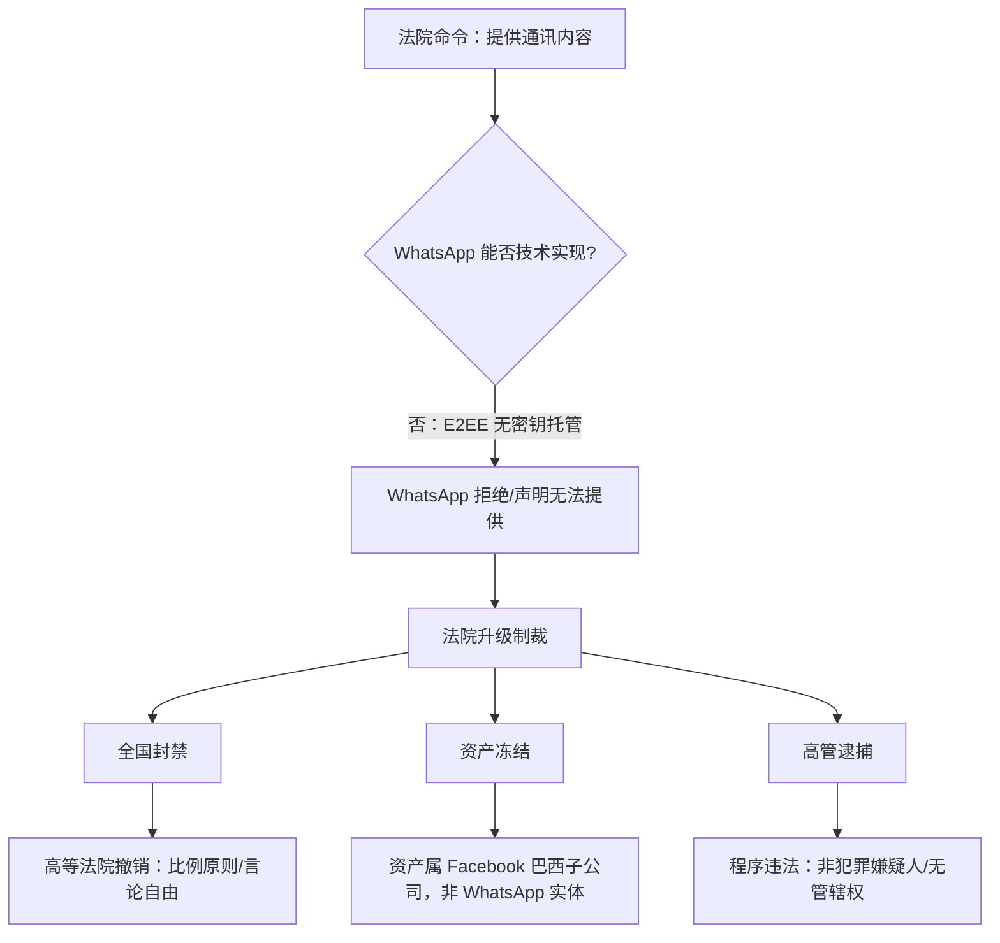

## 事件概览

2015年12月至2016年3月，WhatsApp 与巴西政府陷入持续升级的司法对抗。核心矛盾：**巴西法院以刑事调查为由要求 WhatsApp 提供特定用户的通讯内容**，而 WhatsApp 基于**端到端加密（E2EE）架构**，**技术上无法获取明文消息**，仅存储有限元数据。巴西政府先后采取三次全国性封禁、冻结 Facebook 约 1170 万美元资产、逮捕 Facebook 拉美区副总裁 Diego Jorge Dzodan 等强制措施，均因高等法院介入或法律程序问题被推翻或终结。

> **关键技术事实**：WhatsApp 采用 Signal Protocol（原 TextSecure 协议）实现端到端加密，消息在发送端加密、接收端解密，**服务器仅作密文转发**，不持有解密密钥。WhatsApp 官方声明："我们没有办法提供我们自身都无法获取到的数据。"

## 时间线复盘

| 时间 | 事件 | 司法主体 | 措施 | 结果 |
|------|------|----------|------|------|
| 2015-12 | 首次封禁令 | 巴西联邦法院 | 要求电信运营商全国封锁 WhatsApp 48 小时 | 数小时后巴西最高法院驳回，恢复服务 |
| 2016-02 | 资产冻结 | 亚马逊州联邦调查局/法院 | 冻结 Facebook 约 1170 万美元资产 | 后续无公开解冻进展记录 |
| 2016-03 | 高管逮捕 | 塞尔希培州法官 Marcel Maia Montalvão | 逮捕 Facebook 拉美区副总裁 Diego Jorge Dzodan | 次日获释，法院被指程序不当 |

## 技术架构溯源：为何“无法提供”

### Signal Protocol 核心机制
- **双棘轮算法**：每条消息使用一次性密钥，前向安全与后向安全兼备
- **X3DH 密钥协商**：离线场景下通过预密钥束完成首次握手
- **服务端零知识**：WhatsApp 服务器仅路由加密载荷，不参与密钥派生

### 数据持有范围对比
| 数据类型 | WhatsApp 持有 | 可否应法院令提供 |
|----------|---------------|------------------|
| 消息明文 | ❌ 无 | 不可能 |
| 消息密文 | ✅ 临时路由中转 | 可提供，但无解密价值 |
| 元数据（通讯双方、时间戳、IP、设备信息） | ✅ 存储 | 可提供，且历史上已配合执法 |
| 用户注册信息（手机号、Profile） | ✅ 存储 | 可提供 |

> **交叉引用**：端到端加密原理与双棘轮机制详见 [[crypto-basics-xor-stream-cipher-tutorial]] 中流密码与密钥派生基础；Signal Protocol 白皮书可作深度参考。

## 法律与政策层面的结构性冲突

### 巴西法律依据
- **《互联网民事权利框架法》 (Marco Civil da Internet, Law 12.965/2014)** 第 10 条：应司法命令提供连接记录
- **刑事诉讼法典**：法官可命令提供证据
- **争议焦点**：“连接记录”是否包含**通讯内容**？WhatsApp 主张仅指元数据；巴西部分法官认定包含内容。

### 国际对比视角
| 国家/地区 | 典型案例 | 结果/现状 |
|-----------|----------|-----------|
| 美国 | Apple v. FBI (2016, San Bernardino) | FBI 最终以第三方工具解锁，未形成判例 |
| 英国 | 《调查权力法案》 (2016) | 要求技术可行时协助解密，遭业界强烈反对 |
| 欧盟 | ePrivacy Directive / GDPR | 强制加密保护，禁止后门 |
| 巴西 | 本案 | 司法强制手段升级，均因技术不可行或程序违法落空 |

## 对抗升级逻辑与失效原因

**失效根因**：
1. **技术不可逆性**：数学层面无后门，强制令无法改变密码学事实
2. **实体错位**：制裁对象多为 Facebook 巴西实体，而 WhatsApp 运营主体为美国实体
3. **程序正当性**：最高法院以“影响数亿用户通讯自由、商业活动”为由驳回封禁令

## 行业与学界回响

- **WhatsApp 官方博客 (2016-03-01)**：《Protecting private communication in Brazil》强调“加密不是帮助犯罪，而是保护所有人安全”
- **巴西联邦最高法院 (STF) 大法官**：多位表态“封禁即时通讯工具违宪”
- **国际人权组织 (Access Now, EFF)**：发布联合声明谴责巴西司法滥用强制权力
- **密码学界**：重申“后门唯一性谬误” —— 为执法留后门必然被恶意利用

## 后续演进（截至 2023）

| 年份 | 关键节点 |
|------|----------|
| 2017 | 巴西《通用数据保护法》(LGPD) 通过，确立数据最小化、目的限制原则 |
| 2019 | WhatsApp 全球启用“转发标签”“两步验证”等反虚假信息功能，**不弱化 E2EE** |
| 2021 | 巴西联邦警察采用“设备端取证”工具（Cellebrite、Magnet AXIOM）直接从嫌疑人手机提取解密数据库，**绕过服务端** |
| 2022 | 巴西最高法院就“即时通讯封禁合宪性”启动 ADI 直接违宪审查程序，尚无终局判决 |

> **实务启示**：执法重心已从“强制服务商解密”转向“合法设备端取证 + 云端元数据关联”，技术对抗下沉至终端侧。

## 关键启示与防御视角

1. **加密架构设计即合规策略**：**零知识架构**将“无法提供”转化为技术铁律，而非政策拒绝
2. **元数据最小化收集**：WhatsApp 仅存必要路由元数据，降低被强制披露面
3. **实体隔离与法律准备**：跨国服务需提前完成公司治理、数据本地化、应诉预案
4. **司法对话机制**：建立“透明度报告 + 合规专员 + 紧急联系渠道”三位一体响应体系
5. **终端安全加固**：预判执法转向客户端取证，需强化白盒加密、安全飞地、反取证技术

## 交叉引用索引

- 密码学基础与流密码原理：[[crypto-basics-xor-stream-cipher-tutorial]]
- 国家级网络武器与加密绕过案例：[[cia-vault7-leak-analysis]]
- 社会工程学视角的法律施压：[[social-engineering-attack-techniques]]
- 漏洞挖掘中的法律合规边界：[[cve-id-application-guide]]
- 红队演练中的 OPSEC 与法律风控：[[redteam-hw-opsec-guidelines]]

## 参考资料链接（原文归档）

- 微信公众号原文：`http://mp.weixin.qq.com/s?__biz=MzIwMTQ2NzY4NA==&mid=2652520877&idx=1&sn=efc56872e02aba31b11c09a14ca8220f`
- WhatsApp 官方博客《Protecting private communication in Brazil》(2016-03-01)
- 巴西《互联网民事权利框架法》第 10、11 条
- 巴西联邦最高法院 ADI 5527 / ADPF 403 案卷公开摘要

## 来源

- [301在路上-201508-202208_084](../sources/301在路上-201508-202208_084.md)
