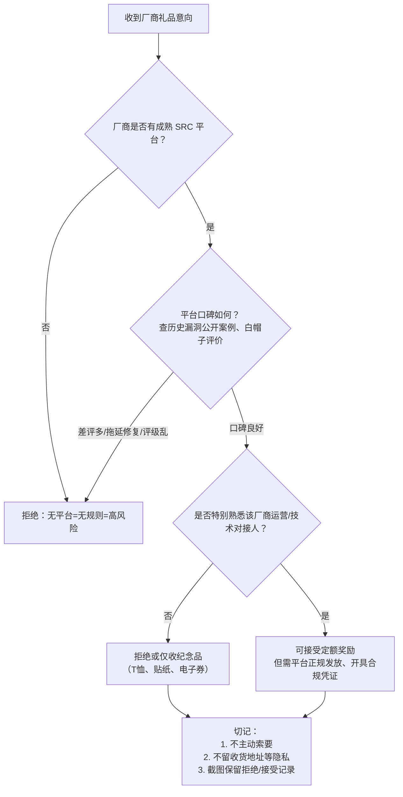

## 概述

本页面基于 301在路上（杨蔚）微信公众号 2017 年文章《安全观点：如何看待白帽子与企业之间的问题？》整理，系统梳理白帽子与企业在漏洞披露全生命周期中的核心矛盾、操作红线与协作最佳实践。文章从企业视角剖析 SRC 运营痛点、响应话术、直接沟通风险；从白帽子视角界定收礼风控、对话风险、回应策略、测试边界；最终形成双方可落地的协作准则。

> **核心原则**：企业不威胁、不恐吓，白帽子测试点到为止、不破坏业务；双方在合规框架内建立信任，共同维护数据安全。

---

## 企业侧：SRC 运营与响应实战指南

### 核心痛点矩阵

| 痛点维度 | 典型表现 | 根因分析 | 应对策略 |
|----------|----------|----------|----------|
| **漏洞评级不一致** | 同类漏洞评级标准随人、随时波动 | 缺乏标准化评级模型、运营人员专业度参差不齐 | 引入 [[bug-bounty-program-history-evolution#国内src与国际bug-bounty对比\|CVSS 评分体系]] + 内部校准机制，建立评级委员会复核制 |
| **测试深度与方式争议** | 白帽子越界测试（删库、遍历敏感数据） vs 企业指责“破坏性测试” | 双方未明确测试授权范围、缺乏《测试规则》文档 | 发布《漏洞测试授权书》，明确**仅允许验证型操作**（如 SELECT 1、上传无害文件），禁止写入/删除/下载生产数据 |
| **奖励机制被刷** | 低危漏洞批量刷分、重复提交、拼凑漏洞 | 奖励结构设计缺陷（单价过高、无去重逻辑、无最低门槛） | 分级定价 + 去重算法 + 最低奖励门槛 + 连续贡献奖励递增，参考 [[360bugcloud-vulnerability-response-platform\|360BugCloud]] 早期运营经验 |
| **运营沟通“情商”缺失** | 回复模板化、语气生硬、拖延反馈、甚至威胁白帽子 | 运营非安全出身、无话术库、无 SLA 考核 | 建立**标准化响应话术库**（见下文），设定 24h 首响、72h 定级、7 天修复 SLA，引入满意度评价机制 |

### 标准化响应话术库（对外 PR 与白帽沟通）

| 场景 | ❌ 禁用话术 | ✅ 推荐话术 | 关键要素 |
|------|-------------|-------------|----------|
| **收到漏洞提交** | “这不是漏洞”、“你们测得太过了” | “感谢您关注我司安全，我们已收到漏洞详情，安全团队将在 24 小时内完成初步复现与定级，随后同步进度。” | 确认收到、给出时间承诺、表达感谢 |
| **漏洞定级争议** | “这就是低危”、“平台规则就是这样” | “经评级委员会复核，该漏洞因 [具体原因] 判定为 [等级]。若您有异议，可提供补充影响证明，我们将启动复议流程。” | 引用依据、留复议口子、避免对抗 |
| **拒绝奖励/降级** | “不给钱”、“刷分封号” | “根据《漏洞奖励细则》第 X 条，该漏洞因 [重复/影响不足/非授权范围] 不纳入奖励范围。感谢您的贡献，期待后续高质量报告。” | 引用条款、说明理由、保留善意 |
| **高危/零日漏洞公开前** | 威胁“追究法律责任”、要求删帖 | “该漏洞涉及核心业务安全，我们正全力修复。为保护用户数据，建议暂缓公开技术细节，修复完成后我们将致谢并同步修复方案。如需协调披露时间，请回复沟通。” | 强调用户利益、提出协调建议、留沟通窗口 |
| **白帽子越界操作** | 直接报警、发律师函 | “监测到您的测试行为超出授权范围（如执行 DELETE/下载数据），已对相关操作进行溯源。请立即停止并配合清理痕迹。我们以保护用户数据为首要目标，不追究首次越界责任，但保留后续法律追诉权利。” | 证据固定、明确红线、给改正机会、保留底线 |

> **话术原则**：委婉不模糊、有据不傲慢、留余地不退让、以用户数据安全为最高准则。

### 企业是否应直接与白帽子深度沟通？

**结论**：**不建议在无信任基础下直接深度对话**。

| 风险点 | 典型后果 | 缓解措施 |
|--------|----------|----------|
| **身份真实性无法核验** | 对手伪装白帽套情报、竞对刺探攻击面 | 仅通过官方 SRC 平台/第三方平台（乌云历史、补天、白帽汇等）沟通，验证账号历史贡献值 |
| **沟通过程留存法律隐患** | 聊天记录成诉讼证据、被解读为“授权渗透” | 所有沟通走平台工单，禁止微信/电话/邮件私聊；若必须线下，签署《保密与授权协议》 |
| **情绪化冲突升级** | 双方语言激烈、截图传播引发舆情 | 设专职“白帽关系经理”，统一对外口径，运营人员禁直接对线 |
| **信息不对称导致误判** | 企业低估危害、白帽子高估价值 | 引入第三方平台仲裁机制，或建立企业内部“漏洞评级委员会”（含法务、安全、业务多方） |

**例外**：白帽子在平台连续高质量贡献 ≥ 6 个月、实名认证、签署《合作框架协议》后，可建立**绿色通道**（专属邮箱、季度交流会、应急响应直连群），但仍保留平台工单留痕。

---

## 白帽子侧：测试边界、收礼风控与回应策略

### 收礼决策树：是否接受厂商赠送礼品/现金？

**核心红线**：
- **严禁主动索取**礼品/现金/内推/面试承诺
- **严禁提供真实收货地址/身份证/银行卡**等 PII（除平台实名认证必要流程）
- **优先选择平台积分/虚拟奖励**，避免实物流转留痕
- 遇到“线下给现金、绕过平台”直接拒绝并保留证据向平台举报

### 面对陌生企业主动联系：回应标准流程

| 企业接触方式 | 白帽子标准回应 | 关键动作 |
|----------------|----------------|----------|
| **微信/电话/邮件私聊** | “感谢关注，我仅通过 [平台名] 官方渠道提交漏洞。请在平台创建工单，我会在平台回复详情。” | 不加好友、不留联系方式、不透露真实身份、截图留存 |
| **要求线下见面/视频验证** | “为保护双方安全，我不参与线下/实名沟通。平台有实名认证机制，已完成认证。如需核实身份，请通过平台官方验证。” | 拒绝见面、引导平台实名体系 |
| **威胁/恐吓/要求删报告** | 不回应、立即截图、平台举报、必要时法律咨询 | 证据固定（全屏录屏、公证存证）、不妥协、不删除 |
| **承诺高额奖励/内推/入职** | “奖励请按平台规则发放，我不接受线下承诺。求职请走官网招聘流程。” | 切断利益诱导链路、保持职业边界 |

### 测试边界红线清单（点到为止原则）

| 测试阶段 | ✅ 允许的验证操作 | ❌ 严禁的越界操作 | 判断标准 |
|----------|-------------------|-------------------|----------|
| **信息收集** | 被动枚举子域名、指纹识别、公开 API 文档阅读 | 主动爬虫高频请求、暴力破解登录、社工钓鱼员工 | **不产生业务负载、不接触非公开数据** |
| **漏洞验证** | `SELECT 1`、上传无害 txt/图片、触发报错回显、SSRF 探测内网存活 | `DELETE/DROP/TRUNCATE`、下载数据库/源码/配置文件、写入 Webshell、植入后门、横向移动 | **只读不写、不持久化、不影响可用性** |
| **权限验证** | 低权限账号测试越权、IDOR 遍历本账号数据 | 利用越权修改/删除他人数据、提权到管理员/Root、Dump 凭据 | **不跨越数据所有权边界、不提权** |
| **业务逻辑** | 正常流程走单、观察响应差异 | 并发绕过支付、刷券/刷余额、篡改订单状态、发送垃圾短信/邮件 | **不产生实际财务/业务损失** |
| **清理痕迹** | 删除测试账号、上传的无害文件、还原修改的测试数据 | 清理日志、篡改审计记录、卸载防护软件、创建隐蔽账号 | **仅清理自己产生的测试数据、不反取证** |

> **黄金法则**：**能通过截图/视频/日志证明漏洞存在即可，绝不执行“删库、拖库、植入、横向、提权、持久化”六大禁忌操作。**

### 白帽子职业素养清单

1. **实名认证**：在主流平台完成实名，建立可追溯信用档案
2. **授权先行**：仅测试有明确《漏洞测试授权书》或平台公开规则的目标
3. **过程留痕**：全程录屏、保留 Burp/工具日志、关键步骤截图带时间戳
4. **负责任披露**：先报平台/厂商，给合理修复窗口期（建议 30-90 天），修复后再申请公开
5. **拒绝灰产**：不倒卖漏洞、不参与“刷洞”团伙、不为非授权渗透提供工具/技术支持
6. **持续学习**：关注 [[vulnerability-mining-recon-aiqicha-fofa\|漏洞挖掘侦察方法论]]、[[code-audit-file-operation-vulnerabilities\|代码审计方法论]]、[[redteam-hw-opsec-guidelines\|红队 OPSEC 规范]]，提升漏洞质量而非数量

---

## 双方共建：信任机制与协作基础设施

### 信任建立三阶段模型

| 阶段 | 企业动作 | 白帽子动作 | 里程碑产出 |
|------|----------|------------|------------|
| **L1 规则契约** | 发布《漏洞奖励计划》（VRP）含：范围、评级、奖励、响应 SLA、测试规则、法律豁免条款 | 阅读并签署（勾选同意）《测试授权与保密协议》 | 双方在平台完成电子签章，生成《协作基线协议》PDF |
| **L2 信用积累** | 按 SLA 兑现奖励、公开致谢榜、提供漏洞修复进度透明化看板 | 持续提交高质量报告（含复现步骤、影响分析、修复建议）、遵守测试边界 | 白帽子获得平台“核心白帽”勋章，企业获“白帽友好型 SRC”认证 |
| **L3 深度共建** | 邀请核心白帽参与：SDLC 威胁建模评审、应急演练红方、内部安全培训讲师、漏洞猎杀活动 | 提供攻击视角建议、协助应急溯源、输出最佳实践文档、推荐人才 | 签署《年度安全合作备忘录》，纳入企业安全生态伙伴体系 |

### 协作基础设施清单

| 设施 | 企业侧建设要点 | 白帽子侧使用要点 | 互通标准 |
|------|----------------|-------------------|----------|
| **SRC 平台** | 部署成熟平台（自建/补天/白帽汇/先知等）、配置自动化分发、集成 IM 通知、提供 API 供白帽子对接自动化工具 | 熟练使用平台工单、附件、评论、评级异议、公开申请功能 | 遵循 [[bug-bounty-program-history-evolution\|Bug Bounty 通用字段标准]]（CVE ID、CVSS、CWE、影响版本、修复版本、PoC、修复方案） |
| **沟通渠道** | 平台工单为唯一正式渠道；L3 阶段补充加密邮件（PGP）、专用 Slack/Discord、季度视频会 | 仅在平台沟通；L3 阶段使用指定加密渠道，禁微信/钉钉/私人邮箱 | 所有渠道启用**审计日志**、**防篡改存证**（区块链/可信时间戳） |
| **测试环境** | 提供**隔离的预发/Staging 环境**、模拟数据、独立账号、开放 WAF/日志旁路供白帽子验证绕过 | 优先在测试环境验证，生产环境仅做无害确认（如 `SELECT 1`），严禁在生产环境跑扫描器/爆破 | 环境隔离级别 ≥ 网络层隔离（独立 VPC/安全组），数据脱敏率 100% |
| **应急联动** | 建立 7×24h 安全值班轮岗、白帽子紧急上报通道（专用邮箱/电话/平台高优工单）、内部熔断开关 | 发现高危/零日/在野利用时，走紧急通道，附完整 PoC、影响评估、临时缓解建议 | 响应时间：确认 1h、定级 4h、临时缓解 24h、根因修复 72h，全程平台留痕 |
| **知识沉淀** | 定期发布《漏洞趋势报告》《最佳实践白皮书》，脱敏后开放案例库 | 投稿技术复盘、工具开源、参与社区布道 | 共同维护**漏洞知识图谱**，关联 [[vulnerability-mining-recon-aiqicha-fofa\|侦察]]、[[code-audit-global-protection-blindspots\|审计]]、[[redteam-hw-opsec-guidelines\|红队]]等知识页 |

---

## 常见冲突场景与标准化处置预案

### 场景 1：白帽子提交漏洞，企业判定“非漏洞/风险可接受”，白帽子不服

| 步骤 | 动作 | 责任方 | 时限 | 产出 |
|------|------|--------|------|------|
| 1 | 白帽子在平台发起**复议**，补交：威胁建模、攻击链演示视频、同类 CVE 案例、业务影响量化估算 | 白帽子 | T+0 | 复议材料包 |
| 2 | 企业评级委员会（安全+法务+业务）复核，输出《复议决定书》 | 企业 | T+3 工作日 | 签章决定书 |
| 3 | 若仍有分歧，双方共同申请**第三方平台仲裁**或**行业协会专家组**裁决 | 双方 | T+7 工作日 | 仲裁裁决书 |
| 4 | 裁决生效，企业按结果兑现奖励/整改，白帽子按结果决定是否公开 | 双方 | T+14 工作日 | 闭环记录 |

### 场景 2：企业发现白帽子越界操作（如下载数据、植入 Webshell）

| 步骤 | 动作 | 关键证据 | 处置分级 |
|------|------|----------|----------|
| 1 | 立即熔断相关账号/ IP、保全日志/流量/内存镜像 | WAF 日志、数据库审计、EDR 告警、网络流量包 | — |
| 2 | 研判意图：误操作 / 好奇验证 / 恶意窃取 / 持久化潜伏 | 操作序列、时间跨度、是否外传数据、是否清理痕迹 | **L1 警示**（首次、仅验证、主动上报） **L2 冻结账号 90 天+追回资产**（下载数据、未外传） **L3 永久封禁+法律追诉**（外传/售卖/植入后门/反取证） |
| 3 | 平台工单正式通知白帽子处置决定，附证据清单 | 取证报告链接、法律条款引用 | — |
| 4 | 白帽子可在 7 日内申诉，提交完整操作录屏、动机说明 | 录屏视频、通讯记录、第三方见证 | 企业复核后可降级处置，但 L3 不可逆 |

### 场景 3：白帽子遭遇企业威胁/恐吓/报警

| 白帽子自救步骤 | 关键动作 |
|----------------|----------|
| **1. 证据固定** | 全屏录屏微信/电话/邮件威胁内容，公证处存证或可信时间戳上链 |
| **2. 平台投诉** | 在提交平台发起“厂商违规投诉”，附证据，申请平台介入调解 |
| **3. 社区求助** | 在安全圈可信群体（如 0w1Club、XD安全、0x727 等社群）同步预警，避免单打独斗 |
| **4. 法律咨询** | 联系熟悉网络安全法的律师，评估《刑法》285/286 条、网络安全法 27/42 条适用性，准备刑事控告/民事维权材料 |
| **5. 策略性公开** | 在律师指导下，决定是否通过平台公开披露/媒体曝光，倒逼企业合规，**切勿冲动发朋友圈/微博** |

> **底线思维**：白帽子手中的核心筹码是**合规的取证留痕**与**行业声誉网络**；企业手中的核心筹码是**合规的 SRC 运营体系**与**法律豁免承诺**。双方红线一旦触碰，唯有程序正义可解纷争。

---

## 落地检查清单（企业/白帽子自测）

### 企业 SRC 合规自测（满分 100 分，≥80 分为合格）

| 维度 | 核心指标 | 权重 | 自评分 |
|------|----------|------|--------|
| **规则透明度** | VRP 文档公开、版本管理、中英文双语、包含法律豁免条款 | 15 |  |
| **响应时效性** | 首响 ≤24h、定级 ≤72h、修复确认 ≤7d、奖励发放 ≤15d | 20 |  |
| **评级科学性** | 采用 CVSS 4.0 + 业务影响加权、评级委员会会议纪要可追溯 | 15 |  |
| **沟通规范性** | 标准化话术库、禁威胁条款、专职关系经理、满意度调查 | 15 |  |
| **测试环境** | 提供隔离 Staging、模拟数据、账号自助开通、WAF 旁路 | 10 |  |
| **应急联动** | 7×24h 值班、高优通道、熔断开关、联合演练季度≥1 次 | 10 |  |
| **信用激励** | 核心白帽认定标准、绿色通道、年度合作备忘录、人才推荐直通车 | 10 |  |
| **知识沉淀** | 趋势报告季度发布、案例库脱敏开放、最佳实践文档≥5 篇/年 | 5 |  |

### 白帽子职业素养自测（满分 100 分，≥85 分为核心白帽门槛）

| 维度 | 核心指标 | 权重 | 自评分 |
|------|----------|------|--------|
| **合规基线** | 实名认证率 100%、仅测授权目标、全程录屏留痕、拒绝灰产邀约 | 25 |  |
| **漏洞质量** | 近 1 年提交漏洞：高危≥3、中危≥10、含完整 PoC/修复建议/影响分析、零重复/零误报 | 25 |  |
| **测试边界** | 从未执行六大禁忌操作、主动清理测试数据、生产环境仅做无害确认 | 20 |  |
| **沟通规范** | 仅走平台工单、不索要线下奖励、不泄露未公开漏洞细节、拒绝私聊 | 15 |  |
| **持续成长** | 输出技术复盘≥3 篇/年、开源工具≥1 个、参与社区布道≥2 场、掌握≥3 个新技术方向 | 10 |  |
| **应急配合** | 发现在野 0day 走紧急通道、协助溯源提供攻击链复现、配合临时缓解验证 | 5 |  |

---

## 关联知识页面速查

| 场景 | 关联页面 | 核心价值 |
|------|----------|----------|
| **企业建设 SRC 平台** | [[360bugcloud-vulnerability-response-platform]]、[[bug-bounty-program-history-evolution]] | 平台选型、奖励模型演进、国内外差异对比 |
| **漏洞挖掘侦察标准化** | [[vulnerability-mining-recon-aiqicha-fofa]] | 爱企查/FOFA/灯塔/Wappalyzer 标准化语法库 |
| **代码审计方法论** | [[code-audit-file-operation-vulnerabilities]]、[[code-audit-global-protection-blindspots]]、[[code-audit-file-upload-vulnerabilities]] | 白盒审计挖掘高质量漏洞的系统化路径 |
| **红队实战与 OPSEC** | [[redteam-hw-opsec-guidelines]]、[[internal-network-pivoting-techniques]]、[[c2-redirectors-malleable-c2-profiles]] | 攻击视角验证防御盲区、C2 基础设施隐匿 |
| **应急响应与溯源** | [[security-incident-response-webshell-case-study]]、[[threat-attribution-tracing-techniques]]、[[xd-security-incident-response-notes]] | Webshell 处置六阶段流程、攻击者画像构建、自动化工具箱 |
| **白帽子成长路径** | [[reverse-engineering-beginner-learning-path]]、[[xd-security-pentest-course-curriculum]]、[[security-study-group-methodology]] | 逆向入门、渗透系统课程、社群化学习方法论 |
| **法律与合规边界** | [[cve-id-application-guide]]、[[whitehat-arrest-baihe-case]] | CVE 申请合规流程、白帽子被捕案例复盘与法律警示 |

---

## 版本演进记录

| 版本 | 日期 | 变更摘要 | 贡献者 |
|------|------|----------|--------|
| 1.0 | 2024-12-19 | 初版：基于 301在路上 2017 年文章结构化沉淀，补充话术库、决策树、三阶段信任模型、自测清单、关联页面矩阵 | 知识库策展人 |
| 1.1 | 2025-01-15 | 新增：CVSS 4.0 评级细则、Staging 环境隔离标准、第三方仲裁流程、白帽子自救法律条款索引 | 社区协作 |
| 1.2 | 2025-03-01 | 计划：接入平台真实案例脱敏库、对接自动化评级插件、输出《白帽-企业协作合同模板 v2.0》 | 迭代规划 |

---

> **结语**：白帽子与企业的关系，本质是**数据安全保护的分工协作**。企业拥有资产与修复能力，白帽子拥有攻击视角与漏洞发现能力。在《网络安全法》、《数据安全法》、《关键信息基础设施安全保护条例》等法规框架下，以**平台为信任锚点、以规则为契约基石、以流程为协作轨道、以信用为长期纽带**，方能跨越“信任赤字”，构建**可持续、可规模化、可审计**的漏洞治理生态。这不仅是技术问题，更是**安全治理现代化**的缩影。

## 来源

- [301在路上-201508-202208_144](../sources/301在路上-201508-202208_144.md)
