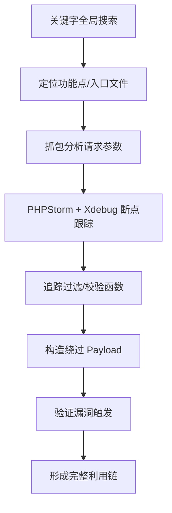

## 概述

本页面整理自 XD安全渗透测试课程第 50-57 天代码审计阶段学习内容，涵盖 **PHP 与 Java 双语言代码审计方法论**、**关键字搜索策略**、**自动化审计工具（Fortify/FindBugs）实战**、多个 **CMS 实战案例**（Beescms、Ofcms、Jeesns）以及 **主流框架审计要点**（ThinkPHP5、Struts2、SpringBoot）。旨在构建从关键字定位、数据流追踪、断点调试到漏洞验证的完整审计闭环知识体系。

---

## 一、 通用代码审计方法论

### 双轨审计思路

| 审计模式 | 核心流程 | 优势 | 劣势 | 适用场景 |
|----------|----------|------|------|----------|
| **架构/业务流向审计** | 获取参数 → 表现层 → 业务层 → 持久层，通读源码 | 覆盖逻辑漏洞、业务漏洞，理解上下文 | 耗时长，需深度理解业务 | 核心业务模块、权限控制、支付流程 |
| **敏感函数/关键字回溯审计** | 搜索敏感函数 → 追踪参数源头 → 分析上下文过滤 | 快速定位高危漏洞（注入、执行、包含），工具化程度高 | 覆盖不了纯逻辑漏洞，需懂基础框架 | 快速扫描、已知漏洞类型挖掘、CTF/实战速成 |

> **实战建议**：两者结合。先用关键字快速定位高危点，再结合业务流向验证逻辑漏洞。

### 通用漏洞关键字速查表

> 以下关键字适用于 **PHP 与 Java** 双语言环境，建议结合 IDE 全局搜索或 `grep -rn` 使用。

| 漏洞类型 | PHP 关键字 | Java 关键字 | 备注 |
|----------|------------|-------------|------|
| **SQL 注入** | `select` `insert` `update` `mysql_query` `mysqli_query` `PDO::query` | `Statement` `executeQuery` `executeUpdate` `createStatement` `jdbcTemplate` `MyBatis ${}` | 重点关注拼接变量、未使用预编译场景 |
| **文件上传** | `$_FILES` `move_uploaded_file` `copy` `file_put_contents` `type="file"` | `MultipartFile` `CommonsMultipartFile` `transferTo` `FileUpload` | 结合 [[xd-security-pentest-basic-stage-notes#文件上传绕过]] 绕过技巧 |
| **XSS/跨站** | `echo` `print` `print_r` `printf` `sprintf` `die` `var_dump` `var_export` | `out.print` `response.getWriter().write` `ModelAndView` 返回前端未转义 | 关注输出点上下文（HTML/JS/Attribute/CSS） |
| **文件包含** | `include` `include_once` `require` `require_once` `_GET/_POST/_REQUEST` 控制路径 | `RequestDispatcher#include` `RequestDispatcher#forward` `jsp:include` | 结合 [[xd-security-file-inclusion-notes]] 与 [[php-file-inclusion-vulnerability]] |
| **代码执行** | `eval` `assert` `preg_replace(/e)` `call_user_func` `call_user_func_array` `create_function` | `ScriptEngineManager` `eval` `GroovyShell` `Rhino` | PHP `preg_replace` e 修饰符已废弃，仍存遗留 |
| **命令执行** | `system` `exec` `shell_exec` `` `` `passthru` `pcntl_exec` `popen` `proc_open` | `Runtime.getRuntime().exec()` `ProcessBuilder` `GroovyShell` | 结合 [[xd-security-pentest-basic-stage-notes#命令执行]] |
| **变量覆盖** | `extract()` `parse_str()` `import_request_variables()` `$$` `foreach($_REQUEST as $k=>$v) $$k=$v` | `ActionContext` `ParameterInterceptor` `ModelDriven` 自动绑定 | PHP `extract` 与 Java 自动绑定均为高危模式 |
| **反序列化** | `unserialize()` `__wakeup` `__destruct` `__toString` `__call` `__callStatic` `__get` `__isset` | `ObjectInputStream.readObject()` `readObject` `readResolve` `readExternal` | 结合 [[xd-security-deserialization-xxe-notes-day37-39]] 与 [[gkctf-2021-web-writeup#java反序列化]] |
| **通用入口** | `$_GET` `$_POST` `$_REQUEST` `$_FILES` `$_SERVER` `$_COOKIE` | `request.getParameter` `request.getInputStream` `@RequestParam` `@RequestBody` | 所有用户可控输入起点 |

---

## 二、 PHP 代码审计实战：关键字搜索 + 断点调试

### 审计工作流标准化



### 案例一：Beescms 后台 SQL 注入 + 任意文件上传

#### SQL 注入（登录处报错注入）

1. **关键字定位**：搜索 `login` 定位 `login.php`，发现全局变量 `$_POST['user']` `$_POST['pass']` 经 `fl_html()` → `fl_value()` 处理
2. **函数回溯**：
   - `fl_value()`：单次 `str_replace` 过滤关键字 → **双写绕过**（如 `selselectect`）
   - `fl_html()`：调用 `htmlspecialchars()` → 单引号 `'` 编码为 `&#039;`，但反斜杠 `\` 未编码
3. **漏洞成因**：`htmlspecialchars` 将 `'` → `&#039;`，数据库存入时实体解码还原为 `'`，配合 `\` 逃逸闭合 → **报错注入**
4. **验证**：`admin'/**/or/**/1=1#` 双写绕过 `fl_value` + `\` 逃逸 `fl_html`

#### 任意文件上传（双上传点）

| 上传点 | 文件 | 校验逻辑 | 绕过方式 |
|--------|------|----------|----------|
| 后台图片上传 | `admin_file_upload.php` → `uppic` | `getimagesize()` 校验图片头 + 白名单后缀 | 构造 **图片马**（GIF89a + PHP代码）绕过 `getimagesize`，修改后缀为 `.php` |
| 编辑器上传 | `admin_ueditor_upload.php` | 仅校验 `MIME` 类型 (`image/jpeg` 等)，**未校验后缀** | 抓包修改 `Content-Type: image/jpeg`，文件名改为 `shell.php` 直接上传 |

> **核心技巧**：`$_FILES` 搜索 → 定位接收文件 → 追踪 `move_uploaded_file` 前的校验函数 → 抓包动态测试校验点 → 差异化绕过。

### 案例二：FineCMS / Xhcms 变量覆盖 + 文件包含

1. **关键字**：`extract` `parse_str` `$$` `foreach($_REQUEST`
2. **变量覆盖点**：`extract($_GET)` 或 `foreach($_POST as $k=>$v) $$k=$v` 导致 `$module` 等关键变量可控
3. **组合利用**：覆盖 `$module=1.txt` 配合 `include $module` → 任意文件包含 → 结合 [[php-webshell-fundamentals-chopper-analysis]] 一句话木马 → Getshell
4. **Payload 示例**：`/about/index.php?fmodele=7&module=php://filter/read=convert.base64-encode/resource=../config/database`

---

## 三、 ThinkPHP5 框架审计要点

### 核心架构识别

| 文件/目录 | 作用 | 审计关注点 |
|-----------|------|------------|
| `public/index.php` | 单一入口 | 调试模式 `app_debug`、路由加载顺序 |
| `application/` | 模块目录 | 控制器命名空间、中间件注册 |
| `config/` | 配置文件 | 数据库配置、缓存驱动、日志级别 |
| `route/route.php` | 路由定义 | 变量绑定、正则约束、资源路由 |
| `thinkphp/base.php` | 核心基类 | `Request`、`Response`、`Controller` 基类方法 |

### 常见漏洞模式

| 漏洞类型 | 典型代码模式 | 安全写法 | 审计定位技巧 |
|----------|--------------|----------|--------------|
| **SQL 注入** | `Db::query("select * from user where id=$id")`<br>`User::where("id=$id")->find()` | `Db::table('user')->where('id', $id)->find()`<br>`User::where('id', ['=', $id])->find()` | 搜索 `Db::query` `Db::execute` `where("` 拼接字符串 |
| **任意文件操作** | `file_put_contents($path, $content)`<br>`copy($src, $dest)` | 校验路径 `realpath`、限制目录 `open_basedir` | 搜索 `file_put_contents` `unlink` `copy` `rename` |
| **反序列化** | `unserialize($_GET['data'])`<br>`Session::get('obj')` 存储对象 | 禁用 `unserialize`、使用 `json_decode` | 搜索 `unserialize` `__wakeup` `__destruct` 魔术方法 |
| **RCE 利用链** | `think\process\pipes\Windows` 类利用链（v5.0.x）<br>`Request` 类 `filter` 属性控制（v5.1.x） | 升级至 5.1.37+ / 6.0+ | 结合 [[attack-defense-world-master-advanced-writeup#thinkphp5-rce]] 实战复现 |

### 断点调试技巧

- **PHPStorm + Xdebug**：入口 `public/index.php` 下断点 → `App::run()` → 路由分发 → 控制器方法
- **关注点**：`Request::instance()->param()` 获取参数过程、`Validate` 校验规则、中间件 `beforeAction` 执行顺序

---

## 四、 Java 代码审计实战：工具 + 框架 + 过滤器

### 自动化审计工具链

| 工具 | 定位 | 优势 | 劣势 | 适用阶段 |
|------|------|------|------|----------|
| **FindBugs (IDEA 插件)** | 静态模式匹配 | 轻量、IDE 集成、支持 Java 字节码 | 规则固定、误报高、**不支持 JSP** | 快速扫描、辅助人工 |
| **Fortify SCA** | 数据流分析、污点追踪 | **主力工具**、支持 JSP、规则丰富、调用链可视化 | 吃资源、需配置 JDK、商业软件 | 深度审计、合规交付、大型项目 |

#### Fortify 实战配置要点

1. **选择扫描模式**：`Translate` → `Scan` → `Audit`
2. **项目类型**：选择 **JavaEE**（含 JSP、Servlet、Struts、Spring 识别）
3. **JDK 版本**：匹配项目编译版本（如 1.8）
4. **结果分析**：按 **Category** 筛选（SQL Injection、Command Injection、XSS、Path Manipulation），点击 `Source` → `Sink` 查看完整调用链

> **实战演示**：Ofcms SQL 注入、命令执行、Jeesns XSS 绕过均可通过 Fortify 快速定位 `Source`（入参）到 `Sink`（危险函数）的污点传播链。

### Java 代码审计关键字速查

| 类别 | 关键字 / API | 说明 |
|------|--------------|------|
| **SQL 注入** | `Statement` `createStatement` `executeQuery` `executeUpdate` `jdbcTemplate.queryForList(String)` `MyBatis ${}` | 搜索拼接 SQL 字符串、未用 `PreparedStatement`、`#{} ` |
| **命令执行** | `Runtime.getRuntime().exec()` `ProcessBuilder` `GroovyShell` `ScriptEngineManager` | 关注用户输入拼接命令 |
| **文件操作** | `FileInputStream` `FileOutputStream` `Files.copy` `multipartFile.transferTo()` | 结合路径遍历 `../` |
| **反序列化** | `ObjectInputStream.readObject()` `readObject` `readResolve` `XStream` `Fastjson` `Jackson` | 结合 [[gkctf-2021-web-writeup#java反序列化]] |
| **XXE** | `DocumentBuilderFactory` `SAXParserFactory` `XMLReader` `setFeature` | 结合 [[xxe-xml-dtd-fundamentals]] |
| **SSRF** | `HttpClient` `URLConnection` `HttpURLConnection` `OkHttpClient` `RestTemplate` | 结合 [[ssrf-bypass-techniques]] |
| **表达式注入** | `SpelExpressionParser` `StandardEvaluationContext` `Ognl` `MVEL` `GroovyShell` | Spring EL、Struts2 OGNL、MVEL |

### 框架识别与版本确认

| 框架 | 核心特征文件 | 版本定位方式 |
|------|--------------|--------------|
| **Struts2** | `struts.xml` `struts-default.xml` `FilterDispatcher` / `StrutsPrepareAndExecuteFilter` | `pom.xml` 依赖 `org.apache.struts:struts2-core` 版本 |
| **Spring / SpringBoot** | `application.yml` `application.properties` `pom.xml` `spring-boot-starter-web` | `pom.xml` `parent.version` 或 `spring-boot-dependencies` 版本 |
| **JFinal** | `web.xml` 配置 `JFinalFilter` | `pom.xml` `com.jfinal:jfinal` 版本 |
| **MyBatis** | `mybatis-config.xml` `Mapper.xml` `#{}` vs `${}` | `pom.xml` `org.mybatis:mybatis` 版本 |

---

## 五、 CMS/系统实战案例深度复现

### Ofcms（Java）后台 SQL 注入 + 任意文件上传

#### SQL 注入（基于 `update` 关键字回溯）

1. **全局搜索** `update` → 定位 `ContentService.update()` 中拼接 SQL：`sql = "update " + table + " set " + cols + " where id=" + id`
2. **参数源头追踪**：`getPara("id")` → 重写的参数获取方法，**无过滤**
3. **路由映射**：`@Before(AdminInterceptor.class)` 权限拦截 → 需登录后台
4. **实战流程**：
   - 登录后台 → Burp 抓包 → 替换请求路径为漏洞映射 `/admin/content/update`
   - 在“新增”按钮触发点注入报错 Payload：`id=1 and updatexml(1,concat(0x7e,database()),0)`
   - 成功回显数据库名

#### 任意文件上传（模板保存功能）

1. **关键字** `save` → 定位 `TemplateController.save()` → 直接 `file.transferTo(new File(path))` **无任何校验**
2. **利用**：Burp 修改 `filename="shell.jsp"` `Content-Type: application/octet-stream` → 写入 Webshell

### Jeesns 1.3 XSS 过滤器绕过

1. **配置文件** `web.xml` → 发现 `XssFilter` 映射 `/*` 全局过滤
2. **源码分析**：`XssFilter.doFilter()` 中使用 `replaceAll("(?i)script", "")` 等**黑名单替换**，存在绕过：
   - 大小写混淆：`<ScRiPt>alert(1)</ScRiPt>`
   - 标签嵌套：`<scr<script>ipt>alert(1)</scr<script>ipt>`
   - 事件处理器：``
   - 编码绕过：`&#x3C;script&#x3E;alert(1)&#x3C;/script&#x3E;`
3. **输出点寻找**：搜索 `print` `write` → 留言板、个人签名等回显点
4. **版本差异**：1.4 版本类在外部 Jar 包需导入依赖后反编译分析

### Struts2 框架漏洞挖掘：已知 + 未知

#### 已知漏洞利用

- 识别版本 → 搜索 `"Struts2 2.3.15 漏洞"` → 直接利用公开 PoC（如 S2-016、S2-032、S2-045、S2-048、S2-057、S2-059、S2-061）

#### 未知漏洞挖掘：`redirect:` 前缀绕过拦截器执行 OGNL

1. **配置分析**：`struts.xml` → `include struts-default.xml` → 发现大量拦截器栈，但 **无自定义安全拦截器**
2. **框架特性**：`DefaultActionMapper` 支持 `action:` `redirect:` `redirectAction:` 前缀，**请求带前缀将跳过拦截器栈直接执行**
3. **断点验证**：
   - `.action` 入口下断点 → 正常请求拦截器执行
   - `redirect:xxx.action` 请求 → **断点不命中**，直接进入 Action 执行
4. **利用链**：`redirect:${#req=@org.apache.struts2.ServletActionContext@getRequest(),...}` 执行 OGNL 表达式 → RCE
5. **修复**：重写 `ActionMapper` 禁用前缀、或自定义拦截器校验 `redirect:` 前缀请求

> **参考**：[[gkctf-2021-web-writeup#weblogic-cve-2020-14882]] 中类似框架特性绕过思路。

### SpringBoot 1.3.0 SpEL 表达式注入

1. **配置搜索**：无 `web.xml` → `pom.xml` 确认 SpringBoot 1.3.0
2. **代码定位**：`@Repository` 类中 `@Query("select * from user where name = '#{#name}'")` 使用 **SpEL 表达式** 拼接参数
3. **漏洞触发**：`name = #{T(java.lang.Runtime).getRuntime().exec('calc')}` → SpEL 解析执行命令
4. **修复**：使用参数绑定 `:name` 或 `#{#name}` 但需确保参数化，避免直接拼接

---

## 六、 审计技能进阶与工具箱

### 断点调试核心技巧对比

| 维度 | PHP (PHPStorm + Xdebug) | Java (IDEA Debug) |
|------|--------------------------|-------------------|
| **入口断点** | `public/index.php` / `router.php` | `main` 方法 / `Filter.init()` / `DispatcherServlet` |
| **参数追踪** | `$_GET` `$_POST` `Request::input()` | `request.getParameter()` `@RequestParam` `HttpServletRequest` |
| **框架分发** | `Route::dispatch()` `Controller->action()` | `HandlerMapping` `HandlerAdapter` `Interceptor.preHandle()` |
| **视图渲染** | `View::fetch()` `Response::send()` | `ViewResolver` `Thymeleaf` `JSP` `Freemarker` |
| **异常捕获** | `try-catch` `set_exception_handler()` | `@ExceptionHandler` `@ControllerAdvice` `Filter.doFilter()` |

### 代码审计检查清单

#### PHP 篇

- [ ] 入口文件调试模式、错误回显、目录遍历
- [ ] 全局过滤器（`addslashes` `htmlspecialchars`）是否依赖 `magic_quotes_gpc`
- [ ] 敏感函数回溯：`eval` `assert` `preg_replace` `call_user_func` `unserialize` `include` `system` `move_uploaded_file`
- [ ] 变量覆盖：`extract` `parse_str` `$$` `import_request_variables`
- [ ] 数据库操作：预编译使用率、二次注入、宽字节注入
- [ ] 文件上传：MIME/后缀/内容/二次渲染校验、存储路径可控性
- [ ] 会话管理：Session 固定、反序列化存储、JWT 密钥硬编码
- [ ] 逻辑漏洞：越权（水平/垂直）、支付篡改、验证码/Token 复用、重置密码枚举

#### Java 篇

- [ ] `web.xml` / `Spring Security` 过滤器链完整性、顺序
- [ ] 拦截器/切面：权限校验、XSS/CSRF 防护、SQL 注入拦截
- [ ] 框架版本已知漏洞：Struts2、Spring、Fastjson、Jackson、Log4j2、Shiro
- [ ] 危险 API 调用链：`Runtime.exec` `ObjectInputStream.readObject` `ScriptEngine.eval` `DocumentBuilderFactory` `SpEL` `OGNL`
- [ ] 配置安全：`application.yml` 敏感信息、Actuator 暴露、CORS 配置、反序列化白名单
- [ ] 文件上传：`MultipartFile` 校验、路径规范化 `Path.normalize()`、存储目录隔离
- [ ] 业务逻辑：权限注解 `@PreAuthorize` 覆盖率、幂等性、并发安全

### 推荐学习资源与工具链

| 类型 | 推荐资源 |
|------|----------|
| **PHP 审计入门** | 《PHP 代码审计》@ 昊天塔、Seay 源代码审计系统、RIPS、PHPStan |
| **Java 审计入门** | 《Java 代码审计入门》@ 乐枫、FindSecBugs、SpotBugs、Fortify 规则编写指南 |
| **框架专项** | ThinkPHP5/6/8 官方文档安全章节、Struts2 官方安全公告、Spring 安全指南 |
| **实战靶场** | [[xd-security-pentest-course-curriculum]] 课程配套靶场、[[vulnhub-platform-resource-index]]、BUUCTF、攻防世界 |
| **自动化工具** | Fortify SCA、Checkmarx、SonarQube、Semgrep（规则自定义）、CodeQL（GitHub 高级） |

---

## 七、 交叉引用导航

| 知识域 | 相关页面 | 核心关联点 |
|--------|----------|------------|
| **PHP 基础漏洞** | [[xd-security-pentest-basic-stage-notes]] | SQLi、文件上传、命令执行基础篇 |
| **文件包含** | [[xd-security-file-inclusion-notes]]、[[php-file-inclusion-vulnerability]] | LFI/RFI、伪协议、截断绕过 |
| **反序列化/XXE** | [[xd-security-deserialization-xxe-notes-day37-39]]、[[gkctf-2021-web-writeup#java反序列化]]、[[xxe-xml-dtd-fundamentals]] | PHP/Java 反序列化链、XXE 利用链 |
| **逻辑漏洞** | [[xd-security-logic-vulnerability-notes-day33-36]] | 越权、支付、验证码/Token 绕过 |
| **ThinkPHP5 RCE** | [[attack-defense-world-master-advanced-writeup#thinkphp5-rce]] | 实战利用链复现 |
| **Java SQLi 防御** | [[java-preparedstatement-sql-injection-defense]] | 预编译原理、ORDER BY 注入案例 |
| **SSRF/内网探测** | [[ssrf-bypass-techniques]]、[[ssrf-ctf-exploitation-guide]] | 协议绕过、Gopher/FastCGI/Redis 利用 |
| **NoSQL 注入** | [[mongodb-nosql-injection-guide]] | MongoDB 注入手法、GKCTF 实战 |
| **内网横向/代理** | [[internal-network-pivoting-techniques]]、[[frp内网渗透应用]] | Getshell 后内网穿透、Socks5 代理 |
| **应急响应** | [[xd-security-incident-response-notes]] | Webshell 溯源、日志分析、自动化工具箱 |

---

## 八、 总结与学习路径建议

```mermaid
mindmap
  root((代码审计进阶路径))
    PHP审计
      关键字搜索 -> 断点调试 -> 绕过构造 -> 链式利用
      CMS实战: Beescms/FineCms/Xhcms
      框架: ThinkPHP5/6/8 Laravel CodeIgniter
      工具: Seay/RIPS/PHPStan/Fortify
    Java审计
      架构识别 -> 工具扫描 -> 手工回溯 -> 框架特性挖掘
      CMS实战: Ofcms/Jeesns
      框架: Struts2/SpringBoot/JFinal/MyBatis
      工具: FindBugs/Fortify/CodeQL/Semgrep
    通用能力
      漏洞挖掘方法论: 黑盒->灰盒->白盒
      自动化规则编写: Semgrep/CodeQL/Fortify Rulepack
      实战复现: VulnHub/BUUCTF/攻防世界/真实SRC
    联动技能
      内网渗透: [[internal-network-pivoting-techniques]]
      应急响应: [[xd-security-incident-response-notes]]
      红队免杀: [[xd-security-python-security-development-notes#php异或免杀webshell生成]]
```

> **核心心法**：**“关键字定位入口，数据流追踪污点，断点调试验证逻辑，框架特性挖掘未知，工具辅助提升效率，实战复现巩固技能。”** 持续关注 CVE/CNVD、框架安全公告、顶会（BlackHat/DEFCON/BlueHat）最新利用技术，保持规则库与靶场的同步更新。

---

*页面维护者：无名安全团队 | 最后更新：2024-01-15 | 版本：v1.0*

## 来源

- [0x00实验室-202108-202304_093](../sources/0x00实验室-202108-202304_093.md)
