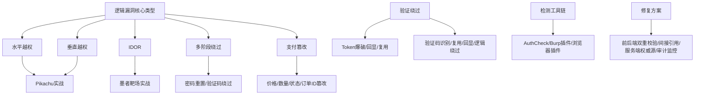

## 概述

本页面整理自 XD安全渗透测试课程第 33-36 天学习笔记，系统覆盖**逻辑漏洞**的核心分类、成因分析、实战复现（Pikachu / 墨者靶场）、验证机制绕过技巧、自动化检测工具链及修复建议。逻辑漏洞因不依赖特定代码缺陷、而源于业务流程设计缺陷，往往绕过常规扫描器检测，是渗透测试与 SRC 挖掘中的高价值漏洞类型。

> **交叉引用**：本课程完整大纲见 [[xd-security-pentest-course-curriculum]]；基础阶段 SQL注入/文件上传笔记见 [[xd-security-pentest-basic-stage-notes]]；Pikachu 靶场实战系列见 [[pikachu-target-writeup-part1-setup-brute-force]]、[[pikachu-target-writeup-part4]]。

---

## 一、 逻辑漏洞核心分类

| 类型 | 定义 | 典型场景 | 危害等级 |
|------|------|----------|----------|
| **水平越权** | 同权限用户间通过篡改标识符（ID、username 等）访问/修改彼此数据 | 订单查看、个人信息修改、私信读取 | 高 |
| **垂直越权** | 低权限用户通过发送高权限功能请求（或删除认证信息）执行越级操作 | 普通用户访问管理员接口、删除审计日志、修改系统配置 | 严重 |
| **未授权访问** | 完全绕过认证/授权直接访问受保护资源 | 隐藏 URL、静态文件泄露、平台配置错误 | 严重 |
| **IDOR (Insecure Direct Object References)** | 直接引用内部对象标识（数据库主键、文件名、订单号）且缺乏权效校验 | `/api/order/1001` 直接返回订单详情 | 高 |
| **多阶段绕过** | 利用业务流程分步验证的逻辑断层，跳过关键校验步骤 | 密码重置流程、多因子认证绕过、支付回调篡改 | 高 |
| **支付篡改** | 篡改价格、数量、状态、订单 ID 等关键参数实现“0 元购”或“负金额退款” | 修改 `price`、`num`、`status`、订单号覆盖 | 严重 |

> **图示**：原文配图展示越权分类关系（水平/垂直/未授权），此处用表格结构化呈现。

---

## 二、 实战案例复现

### Pikachu 靶场：水平越权

**场景**：登录 `kobe` 账号 → 查看个人信息 → 抓包发现 `username=kobe` 参数。

**复现步骤**：
1. 登录 `kobe`，访问个人信息页面，Burp 抓包
2. 修改请求参数 `username=kobe` → `username=lucy`
3. 响应返回 `lucy` 的敏感信息（手机、邮箱等）

**根因**：后端仅校验“用户已登录”，未校验“请求资源归属当前用户”。

> **关联**：Pikachu 环境搭建与基础爆破见 [[pikachu-target-writeup-part1-setup-brute-force]]；同靶场 RCE/文件上传/越权综合见 [[pikachu-target-writeup-part4]]。

---

### Pikachu 靶场：垂直越权

**前提**：已获取管理员 `admin` 的合法会话（Cookie `PHPSESSID`）。

**复现路径**：
1. 低权限账号 `pikachu` 登录，抓取普通功能包
2. 替换 Cookie 为 `admin` 的 `PHPSESSID`
3. 修改请求中的 `user` 参数为目标用户
4. 成功执行添加用户等管理员专属操作

**获取高权限会话的三条途径**：
- 普通用户前端可见管理员操作入口（抓包）
- 盲猜接口路径（如 `/admin/addUser`）
- 本地搭建同源码环境，自行登录管理员获取会话

---

### 墨者靶场：IDOR + 爆破卡片 ID

**场景**：抓包发现 `card_id` 参数，疑似可枚举。

**实战流程**：
1. 收集两个合法 `card_id` 样本
2. Burp Suite **Intruder** 模块加载字典爆破 `card_id`
3. 利用 **Grep-Match** 筛选响应长度异常/包含关键字（如“马春生”）的结果
4. 定位目标 `card_id` → 响应中泄露账号密码（可能需解密）
5. 登录目标账号获取 Flag

**根因**：前端仅根据 `usertype` 控制界面显示，后端未校验 `card_id` 归属权。

---

### 支付逻辑篡改三大变体

| 变体 | 篡改参数 | 典型 Payload | 业务后果 |
|------|----------|--------------|----------|
| **价格/数量篡改** | `price`、`num` | `price=0.01`、`num=-1` | 0 元购、负金额刷单 |
| **订单 ID 覆盖** | `order_id` | 先下单低价商品获取 `order_id=1001`，再提交高价商品时替换为 `1001` | 低价支付高价商品 |
| **状态回调篡改** | `status`、`trade_status` | 拦截支付网关回调包，将 `WAIT_BUYER_PAY` → `TRADE_SUCCESS` | 未付款标记为已支付 |

---

### 密码重置/验证码逻辑绕过（墨者靶场）

**场景**：重置密码流程合并“验证码校验”与“设置新密码”于同一页面。

**绕过链**：
1. 目标手机号 `A` 请求验证码（不可见）
2. 攻击者自有手机号 `B` 请求验证码并获取有效码 `123456`
3. 提交重置请求：`phone=B&code=123456&newpass=xxx` → 抓包
4. 将 `phone` 修改为 `A`，重放 → 重置成功

**核心缺陷**：验证码与手机号绑定关系在服务端未强制校验，仅前端流程控制。

---

### 客户端回显型验证码绕过

**现象**：响应包体中直接包含验证码明文（如 `{"code":"1234","status":3}`）。

**利用**：
1. 抓包获取验证码明文
2. 或修改响应状态码 `status: 3 → 1`（前端据此判定校验通过）
3. 绕过验证码校验直接进入下一步

> **实战提示**：迪哥手机号曾出现在某靶场回显中（原文截图为证）。

---

## 三、 验证机制绕过技巧总结

### Token 绕过

| 绕过类型 | 成因 | 利用方式 |
|----------|------|----------|
| **爆破** | Token 空间小/可预测 | Intruder 爆破 |
| **回显** | 前端页面/JS/响应包泄露 Token | 直接提取替换 |
| **固定/重用** | Token 无时效/无绑定/可重复使用 | 复制已知 Token 重放 |

**实战技巧**：页面回显的 Token 可直接填入 Intruder Payload 位置替换爆破中的失效 Token。

---

### 验证码绕过矩阵

| 技术手段 | 适用场景 | 工具/方法 |
|----------|----------|-----------|
| **爆破** | 4 位纯数字、无频率限制 | Burp Intruder + 数字字典 |
| **识别** | 图形验证码、字符验证码 | **Burp 插件 captcha-killer**、OCR API、自训练模型 |
| **复用** | 验证码会话不销毁、可重复使用 | 保持 Session 复用已识别验证码 |
| **回显** | 响应包/前端 JS 含明文验证码 | 直接提取 |
| **绕过** | 逻辑缺陷（如状态码篡改、验证码与手机号解绑） | 修改响应包、跨号复用 |

**防范基线**：
1. 3 次失败强制刷新
2. 一次一码，验证即销毁
3. 字符集复杂化（字母+数字+特殊符号+干扰线）
4. 引入行为验证（滑块、点选、语序点选）

---

## 四、 自动化检测工具链

| 工具 | 类型 | 核心能力 | 适用阶段 |
|------|------|----------|----------|
| **secscan-authcheck** | Burp 插件 | 双账号 Cookie 对比，自动识别水平/垂直越权 | 扫描期 |
| **AuthZ / AuthMatrix** | Burp 插件 | 多角色权限矩阵建模，批量验证访问控制 | 扫描期 |
| **浏览器插件 AuthCheck** | 浏览器扩展 | 录制登录流程，自动替换 Cookie/Token 回放检测 | 手工辅助 |
| **小米范越权检测工具** | 独立工具 | 批量导入 URL + 多账号 Cookie，自动化差异对比 | 批量扫描 |

**配置要点**：
- 需准备**至少两组不同权限账号**的有效会话
- 设置**排除规则**（登出、静态资源、心跳接口）避免噪音
- 关注**响应长度/状态码/关键字**差异作为越权判据

> **关联**：Burp Suite Intruder 四大模式详解见 [[burpsuite-basics-tutorial]]。

---

## 五、 Burp Suite Intruder 四大攻击模式深度解析

| 模式 | Payload Sets | 遍历逻辑 | 典型场景 |
|------|--------------|----------|----------|
| **Sniper** | 1 | 单支点：依次对每个位置应用同一字典，其他位置保持原值 | 单参数爆破、Fuzzing 单点 |
| **Battering Ram** | 1 | 同步替换：所有标记位置**同时**替换为字典中**同一值** | 多处同值参数（如 `username=xxx&cookie_user=xxx`） |
| **Pitchfork** | N（=位置数） | 并行推进：第 i 个位置取第 i 个字典的第 k 项，**一一对应** | 用户名+密码配对爆破、Token+Session 绑定爆破 |
| **Cluster Bomb** | N | 笛卡尔积：所有位置所有字典**全排列组合** | 多参数独立爆破（最常用、最全面） |

**实战配置技巧**：
- **Options → Grep-Match**：设置成功/失败特征字符串（如 “登录成功”、“flag”、“错误”）
- **Options → Grep-Extract**：提取响应中动态 Token/Session 用于后续请求
- **Resource Pool**：限制并发避免触发 WAF/限流

---

## 六、 修复与防御体系

### 核心原则

> **永远不要相信来自用户的输入**，对所有可控参数实施严格校验与过滤。

### 分层防御清单

| 层级 | 措施 | 说明 |
|------|------|------|
| **前端** | 双重校验 | 前端拦截明显异常，降低无效请求；**不可替代后端校验** |
| **业务逻辑** | 权限绑定校验 | 每个敏感操作前：**验证身份 → 验证资源归属 → 验证操作权限** |
| **数据层** | 间接对象引用 | 避免直接暴露 DB PK；使用 UUID、哈希、临时票据映射真实 ID |
| **会话管理** | Token 安全属性 | HttpOnly、Secure、SameSite、短过期、单次使用、绑定 IP/UA/设备指纹 |
| **支付/核心流程** | 服务端单一真相源 | 价格、库存、状态**仅从服务端权威源读取**；回调验签、幂等性、防重放 |
| **审计与监控** | 异常行为告警 | 同一 IP/账号高频遍历 ID、响应 403/404 激增、跨账号资源访问 |

### 代码级修复示例（伪代码）

```python
# 错误：直接使用用户传入的 order_id
def get_order_detail(user_id, order_id):
    return db.query("SELECT * FROM orders WHERE id = ?", order_id)

# 正确：校验归属权
def get_order_detail(user_id, order_id):
    order = db.query("SELECT * FROM orders WHERE id = ? AND user_id = ?", order_id, user_id)
    if not order:
        raise PermissionDenied("无权访问该订单")
    return order
```

---

## 七、 学习路线与知识图谱关联



**进阶阅读**：
- JWT 垂直越权、算法混淆、kid 注入实战 → [[jwt漏洞原理与实战利用]]
- SSRF 绕过与内网探测（常与逻辑漏洞链式利用） → [[ssrf-bypass-techniques]]、[[ssrf-ctf-exploitation-guide]]
- 代码审计视角的授权缺陷挖掘 → [[xd-security-vulnerability-discovery-notes-day42-45]]
- WAF 绕过下的逻辑漏洞利用隐匿 → [[xd-security-waf-bypass-techniques-day46-49]]

---

## 八、 附录：原文关键截图索引

| 图片标识 | 对应章节 | 说明 |
|----------|----------|------|
| `cef2ca61899429690adf38c97ed8e995.png` | §1 | 越权分类关系图 |
| `41c8dd03e68702b5b88cf49404f25c62.png` | §2.1 | Pikachu 个人信息页面 |
| `03c1bbbb2e2f1cd680eb192f39df8522.png` | §2.1 | 抓包见 `username=kobe` |
| `558f9e0cc731e1f4b6f2ab1805369606.png` | §2.1 | 修改为 `lucy` 后的响应 |
| `f6dfca03ae0df1bf312a360be749da47.png` | §2.2 | 垂直越权修改 Cookie/user |
| `4ef109ea81d6605d8011143072b021d4.png` | §2.3 | 墨者 `card_id` 爆破 |
| `1c629a39f46d2c99deb848ff1f510513.png` | §2.3 | 前端 `usertype` 判断代码 |
| `88c6c96f23228396201499c069972cce.png` | §4 | secscan-authcheck 插件界面 |
| `c054785adef09b8fc5717871c6041b7a.png` | §4 | 浏览器 AuthCheck 插件 |
| `ffdda7f73bee30ce2c961c1a4cdfc4c7.png` | §4 | Cookie 赋值绕过 |
| `5789e98504f5847abea857eed8901347.png` | §2.4 | 价格/数量篡改 |
| `592f3875cf902b412bd696427669ec01.png` | §2.4 | 订单 ID 覆盖 |
| `f146a7c9db8e3554ef39231933e7456d.png` | §2.4 | 支付状态篡改 |
| `d91611e259a10edf23a64a359e87b10b.png` | §2.5 | 密码重置流程图 |
| `755e4633f80c81d615878e8ca76603e3.png` | §2.5 | 目标手机号请求验证码 |
| `30b0671e7a02363c228c796e4e7438d4.png` | §2.5 | 自有手机号获取验证码 |
| `294241188c9b5d03219ecbfb5be79d96.png` | §2.5 | 修改 phone 重放 |
| `8c2cea75e70e3f3cca214506c1e63801.png` | §2.5 | 获取 Flag |
| `02175a1450a1dd6557a82b012845cf01.png` | §2.6 | 响应包回显验证码/状态码 |
| `b83cf950758ba6b25bddb521efb43118.png` | §2.6 | 迪哥手机号泄露 |
| `c43b021179f8774ff453e8e5c420cd23.png` | §3.1 | 页面回显 Token |
| `63be1d9d9a59eeca839850e66515d679.png` | §3.1 | Intruder 替换 Token |
| `b3acf05c068eab6a5c6887faa693a3c5.png` | §3.2 | 验证码图片右键复制地址 |
| `066fcb544d114fa0b62f29c73f7fba0f.png` | §3.2 | 验证码图片直链 |
| `4de8838b273f3daf60c45d872c1f4881.png` | §3.2 | 验证码识别插件 |
| `38f7abb96d63afa15c5525f466aed80c.png` | §3.2 | captcha-killer 识别结果 |
| `e992f8032c43e0e99dc50ea73909cc41.png` | §5 | Intruder 四模式对比图 |
| `0278dbeb792a7e2b25e2b6c7a6d13380.png` | §5 | Sniper 示例 |
| `26607162bf0b2780db29dde096f0f57e.png` | §5 | Battering Ram 示例 |
| `893d078a25c1779b150cdf6582632c97.png` | §5 | Pitchfork 示例 |
| `2db4ed57382f0b7f15d56b962879f194.png` | §5 | Cluster Bomb 示例 |
| `d284790a6a38d819c0f799bac4ed81b9.png` | §5 | Grep-Match 标记错误响应 |

---

> **页面维护提示**：本页面基于微信公众号归档文章整理，原文链接失效时可通过标题《XD安全 学习笔记 | 逻辑漏洞》在站内搜索。后续若补充 Day37+ 反序列化/XXE 内容，请新建页面并在此处添加交叉引用。

## 来源

- [0x00实验室-202108-202304_092](../sources/0x00实验室-202108-202304_092.md)
