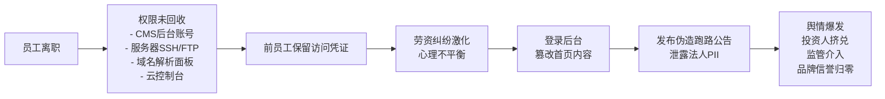

## 事件概览

**鑫利源P2P平台离职员工权限未回收导致官网被植入伪造跑路公告**，是典型的**内部威胁**案例。攻击者利用离职后仍保留的网站后台管理权限，在平台官网发布极具煽动性的「跑路声明」，并泄露法人身份证、家庭住址等敏感信息，引发投资人恐慌、媒体围堵与监管关注，造成严重声誉损失与业务中断。

- **平台名称**：鑫利源（山东日照鑫利源投资咨询有限公司）
- **法人代表**：刘永欣
- **事件性质**：内部人员恶意破坏 / 离职权限未回收 / 虚假信息发布
- **核心成因**：员工离职流程中**网站后台、CMS、服务器等核心资产权限未及时收回**
- **诱发因素**：劳资纠纷、离职交接缺失、账号共用、无权限定期审计机制

---

## 时间线复盘

| 日期 | 事件节点 | 备注 |
|------|----------|------|
| 2015-05-18 | 平台试运行 | 打出「只跑步，不跑路」口号 |
| 2015-08-03 | 正式上线 |  |
| 2015-10-01 | 发布清盘公告 | 业务已陷入停摆 |
| 2015-11-23 | **首次「跑路公告」** | 官网仅贴两张空办公室照片，疑似离职员工所为 |
| 2015-11-27 | 官方澄清 | 称系「原员工出于劳资纠纷报复，利用未收回权限发布」 |
| 2016-02-18 | **第二次奇葩公告** | 官网再现「老子就是来骗钱的」「有本事来抓我」等挑衅性内容，并曝光法人身份证与家庭住址 |

> 文章发布日期为 2016-02-18，标题为《奇葩事件！疑似离职员工自黑"某P2P平台"奇葩跑路公告：有本事你们来抓我啊》

---

## 攻击链路剖析

### 关键攻击面

| 攻击面 | 失控原因 | 影响范围 |
|--------|----------|----------|
| **CMS/网站后台** | 账号共用、无离职注销流程 | 首页内容完全可控、可植入任意HTML/JS |
| **服务器/云控制台** | SSH Key、API Key未轮换 | 可上传恶意文件、修改配置、甚至删除数据 |
| **域名/DNS解析** | 注册商账号未移交 | 可劫持流量、指向钓鱼页 |
| **法人PII（身份证、住址）** | 内部文档管理混乱、权限过大 | 配合公告实施人肉曝光、升级为人身威胁 |

---

## 根因分析：权限管理「四大缺失」

### 离职全流程权限回收机制缺位
- **无标准化清单**：未建立「入职授权-变更审批-离职回收」全生命周期台账
- **无自动化联动**：HR离职单触发IT自动禁用/删除账号、回收VPN/SSH/云API密钥
- **共享账号泛滥**：后台管理员账号多人共用、无法追溯操作人

### 最小权限原则未落地
- 运营/客服/开发人员均持有**超管级**后台权限
- 敏感数据（身份证扫描件、合同、财务报表）存放于通用网盘/服务器目录，**无分级访问控制**

### 监控与审计盲区
- 后台登录、内容发布、文件上传**无操作审计日志**，或日志不完整、不回传SIEM
- 无异地登录、非常规时间登录、批量下载等异常行为告警

### 人员安全意识与心理契约断裂
- 劳资纠纷处理不当，**离职谈话、竞业限制、保密协议签署流于形式**
- 未建立「离职前风险评估」机制：核心岗位离职前需提前交接、权限冻结、设备回收

---

## 业务与法律后果

| 维度 | 具体后果 |
|------|----------|
| **声誉** | 「跑路」标签坐实，投资人信任崩塌，媒体持续负面曝光 |
| **运营** | 官网被植入恶意内容，业务系统可用性受损，需紧急下线整修 |
| **法律** | 泄露公民个人信息（身份证、住址）涉嫌违反《刑法》第253条；伪造公告误导投资人可能构成诈骗/非法经营加重情节 |
| **监管** | 触发属地金融办、公安网安部门双重调查，平台备案/整改进程受阻 |
| **内部** | 核心技术/运营人员信心受挫，后续招聘背景调查成本上升 |

---

## 纵深防御：离职权限管控最佳实践清单

> 以下清单可直接纳入 **IT运维安全规范** 与 **HR-IT联动SOP**，参考 [[ops-security-case-studies-301]] 中「VPN漫游、.git泄露、Zabbix默认口令」等案例的整改思路。

### 账号全生命周期自动化
| 阶段 | 动作 | 责任方 | 工具/手段 |
|------|------|--------|-----------|
| 入职 | 按角色模板最小授权，记录资产-账号映射表 | IT/安全部 | IAM/JumpServer/AD + CMDB |
| 在职 | 季度权限复核、异动即时变更 | 直属领导+IT | 权限复核工单自动化 |
| 离职前1周 | 启动「离职预处理」：冻结高危权限、备份交接文档 | HR发起/IT执行 | 离职工单流程引擎 |
| 离职当日 | **全量禁用/删除**所有账号（VPN、SSH、云控制台、CMS、代码库、邮箱、IM、CRM、BI、监控平台……），回收物理设备与Token | IT/安全部 | Ansible/Terraform/自研脚本批量执行 |
| 离职后30天 | 审计日志回溯确认无异常访问，归档权限变更记录 | 审计/安全部 | SIEM/日志审计平台 |

### 共享账号治理
- **禁用共享超管账号**，强制个人命名账号 + 特权账号管理（PAM）审批制
- 关键系统实施**双人授权**、**操作录屏**、**水印溯源**

### 敏感数据分级分类与访问控制
- 法人身份证、合同、财务数据标记为 **S3/机密级**，存放于加密存储桶，**仅限法务/财务/高管最小范围访问**
- 禁止在CMS后台、前端页面、公共网盘明文存放PII

### 监控告警与应急预案
| 监控点 | 告警阈值 | 响应动作 |
|--------|----------|----------|
| 核心后台非常规时间/异地登录 | 实时 | 短信/钉钉/企微告警值班，必要时强制下线 |
| 页面内容大范围变更（首页、法律声明、联系方式） | 实时 | 自动快照+人工复核，15分钟内回滚 |
| 敏感文件批量下载/外发 | 实时 | DLP拦截+安全团队溯源 |
| 离职人员账号仍有登录尝试 | 实时 | 立即封禁IP、排查权限残留 |

### 法务与人力协同
- 入职签署《保密协议》《数据安全责任书》《离职承诺书》，明确违规追责条款
- 离职面谈纳入「安全风险评估」：核心岗位提前2周交接、权限渐进式收回
- 劳资纠纷进入法律程序前，**预先冻结相关人员所有系统权限**，防止报复性破坏

---

## 关联案例与交叉引用

| 相关页面 | 关联点 |
|----------|--------|
| [[ops-security-case-studies-301]] | 同类「VPN漫游、.git泄露、Zabbix默认口令、vCenter陷落」均源于**离职/变更时权限未回收**，可对比整改模式 |
| [[internal-vulnerability-disclosure-culture]] | 内部威胁常源于「心理契约破裂」，建立健康披露渠道可降低报复性破坏概率 |
| [[honeytoken-data-leak-detection-technique]] | 可在离职前在核心数据中植入「蜜签」，监测数据是否被外带/泄露 |
| [[physical-social-engineering-case-study]] | 物理渗透测试中同样利用「离职员工遗留工位/权限」实现横向移动，防御逻辑互通 |
| [[security-team-communication-art]] | 安全团队需向HR/法务/业务高管「用数据说话」推动离职权限管控流程落地 |
| [[security-practitioner-legal-compliance]] | 泄露身份证等PII涉嫌刑事犯罪，安全从业者需了解《网络安全法》《个保法》《刑法》相关条款与取证规范 |

---

## 给甲方安全负责人的「一句话建议」

> **把「离职当日权限归零」写入KPI，接入HR系统自动化触发，配合PAM+审计+应急预案，才能真正堵住内部威胁最大的「后门」。**

---

## 结语

鑫利源案例虽小，却暴露了**绝大多数中小金融科技公司**通病：**重业务上线、轻资产梳理、重权限分发、轻权限回收、重技术防护、轻人员管理**。将「离职权限全量回收」从「靠自觉」转为「靠流程、靠工具、靠考核」，是性价比最高的内部威胁降维打击手段。

## 来源

- [301在路上-201508-202208_198](../sources/301在路上-201508-202208_198.md)
