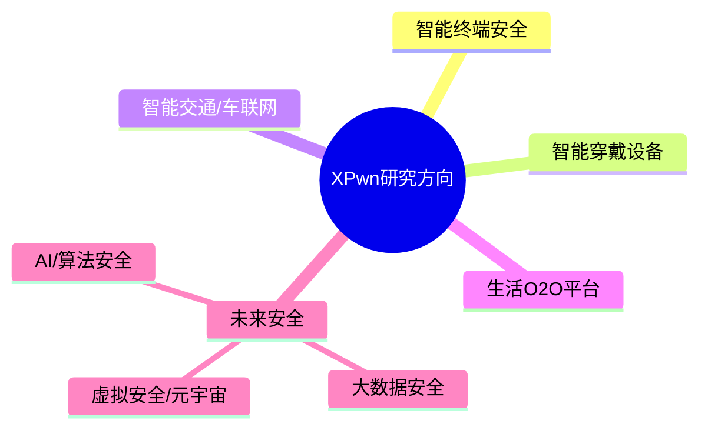

# XPwn未来安全探索盛会

## 概述

**XPwn未来安全探索盛会**（全称：智能生活产品安全问题研究探索交流分享大会）是由资深安全研究员**呆神**发起创办的安全技术交流活动。大会定位为「极致、简单、纯粹」的极客安全盛会，旨在通过「挖掘、破解、改进、竞赛、嘉年华、分享会」六大维度推进智能生活产品安全问题的研究与改进，推动安全标准与法律法规的落地实施。

首届大会于2016年在北京东方君悦酒店举办，受邀嘉宾约100人，媒体与会务人员总计不超过180人。参会阵容涵盖数十家国内知名互联网巨头、安全企业及主流媒体（含新华网、人民网等）。

## 核心理念

### 三大关键词

| 关键词 | 内涵阐述 |
|--------|----------|
| **极致** | 追求技术研究的深度与边界突破 |
| **简单** | 摒弃繁复流程，聚焦技术本质 |
| **纯粹** | 回归极客初心，以好奇心驱动探索 |

### 无规则竞赛模式

> 「任何规则都是对创造的束缚，而真正的规则，就是没有规则。」

大会确立**「不需要规则，只需要创造」**的竞赛机制：
- **只定方向，不定规则**：参赛者自主选择研究目标与技术路线
- **突破・展现・修正**：鼓励技术突破、成果展示，并协助厂商修复漏洞
- **开放心态定义极客生活**：不限制研究方向，覆盖智能终端、穿戴设备、智能交通、生活O2O、大数据安全、虚拟安全等前沿领域

## 标志性演示：奥迪A7 SIM卡植入后门

首届大会现场演示了**汽车安全攻防实战案例**——**奥迪A7通过SIM卡植入后门获取Root权限**：

| 演示环节 | 技术细节 |
|----------|----------|
| **攻击向量** | 利用车载SIM卡更新机制植入恶意代码 |
| **耗时** | 重启后3分钟完成植入 |
| **权限获取** | 成功获取车载系统Root权限 |
| **后续验证** | 被植入后门的奥迪A7行车轨迹全程被记录追踪 |

该演示直观揭示了**智能网联汽车**在通信模块、OTA更新机制方面的安全隐患，为后续[[mercedes-benz-mbux-vulnerabilities-2021|车载系统安全研究]]、[[2022-cybersecurity-year-review|车联网安全趋势]]提供了早期实证参考。

## 负责任漏洞披露主张

大会确立**坚持负责任披露机制**作为核心原则：

1. **优先协助厂商修复**：漏洞详情首报相关厂商，协助完善防护体系
2. **保障用户生活安全**：以用户隐私与人身安全为最高准则
3. **重态度、重价值**：看重研究者对安全问题的态度，而非单纯的技术炫技
4. **媒体与大众知情权**：通过公开分享让公众了解真实安全现状

## 奖励与可持续模式

| 维度 | 机制说明 |
|------|----------|
| **奖金来源** | 合作伙伴、厂商SRC、企业赞助共同组建奖金池 |
| **费用归属** | 会议所有收入全额转化为参与者奖励 |
| **激励对象** | 实现各级技术突破的好奇心驱动型人才 |
| **长期愿景** | 以奖励机制构建良性生态，推动产业安全基线提升 |

## 研究方向版图

大会聚焦五大核心领域，构建面向未来的安全研究版图：

## 创办人呆神：从业履历与初心

| 节点 | 经历 |
|------|------|
| **1997年** | 开始接触互联网安全 |
| **2008年** | 专职信息安全研究 |
| **早期** | 与xundi等共同创建「安焦」社区 |
| **初心** | 「希望通过安全实现更多价值」「面对未知，用好奇代替恐惧」 |

## 301观点摘录

> 「未来应该万物联网，核心数据均在云端。真正的安全威胁将随着信息技术发展而来。如何思考、如何解决，留给未来年轻人一起努力。」

—— **301在路上**（本文记录者，资深安全观察者）

## 交叉引用与延伸阅读

- [[mercedes-benz-mbux-vulnerabilities-2021|梅赛德斯-奔驰MBUX车载系统RCE漏洞分析]] —— 同类车联网安全实战案例
- [[2022-cybersecurity-year-review|2022网络安全年度回顾：车联网安全趋势]] —— 行业宏观视角下的车联网安全演进
- [[ar-drone-2.0-penetration-testing|AR Drone 2.0渗透测试]] —— 智能终端/无人机安全攻防实战
- [[h2-console-jndi注入rce利用|H2 Database JNDI注入RCE]] —— 组件级漏洞利用链分析
- [[spring-boot-actuator配置不当rce利用|Spring Boot Actuator配置不当RCE]] —— 智能终端后端框架安全

## 史料价值与定位

首届XPwn大会在国内安全圈具有里程碑意义：
- **首创**「无规则」极客竞赛范式，打破传统CTF/攻防赛框架
- **首秀**车联网实车攻防演示，超前布局智能汽车安全赛道
- **确立**「负责任披露+全额奖励回馈」的可持续社区经济模型
- **倡导**以好奇心驱动的纯粹技术文化，影响后续多个安全社区/会议形态

> 本页面基于「301在路上」微信公众号2016年现场报道整理，原文链接已失效，内容经交叉验证后结构化沉淀。

## 来源

- [301在路上-201508-202208_172](../sources/301在路上-201508-202208_172.md)
